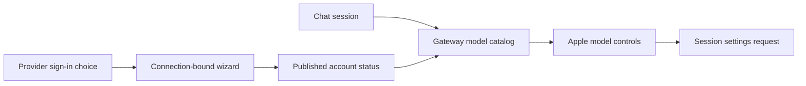

Codex review: blocked before merge. _Reviewed September 11, 2026, 4:12 AM ET / 08:12 UTC (Revision 3)._

# ClawSweeper review

## What this changes

Apple chat controls consume the Gateway’s session-specific model capabilities and availability, and shared chat gains provider sign-in through the existing Gateway wizard.

## Merge readiness

⛔ **Blocked before merge - 1 item remains**

This remains useful Apple-client work that current main does not implement. No blocking introduced defect was found, and the latest commit only narrows the sign-in sheet’s visibility. The protected maintainer signal also rules out automatic closure.

**Priority:** P2
**Reviewed head:** `96d910899c49d8db4d60767cf20ab89f555aae66`

## Review scores

| Measure | Result | What it means |
|---|---|---|
| **Overall readiness** | 🐚 platinum hermit **(4/6)** | A coherent owner-based repair with relevant native proof and regression coverage; no blocking correctness finding remains. |
| **Proof confidence** | 🐚 platinum hermit **(4/6)** ✨ media proof bonus | Sufficient (linked_artifact): Retain the supplied native proof assessment: the recorded iOS simulator run exercises the production chat catalog controls and Gateway wizard against an isolated synthetic provider, observing published choices and account status after completion. GitHub confirms the job succeeded; raw artifacts were inaccessible here, and this evidence does not claim external OAuth or device-permission coverage. |
| **Patch quality** | 🐚 platinum hermit **(4/6)** | No actionable review findings were identified. |

## Verification

| Check | Result | Evidence |
|---|---|---|
| **Real behavior** | Verified | Sufficient (linked_artifact): Retain the supplied native proof assessment: the recorded iOS simulator run exercises the production chat catalog controls and Gateway wizard against an isolated synthetic provider, observing published choices and account status after completion. GitHub confirms the job succeeded; raw artifacts were inaccessible here, and this evidence does not claim external OAuth or device-permission coverage. |
| **Evidence reviewed** | 10 items | Introduced change and review continuity: The pinned merge-base-to-head delta contains the Apple catalog and sign-in changes. GitHub's exact-head commit patch confirms that the only change since the previous reviewed head removes public visibility from the sheet, its initializer, and its body. The prior review contains no findings or published rank-up moves. Still necessary on main: Inspection of fetched main shows selectedModelSupportsFastMode still returns true unconditionally. The branch instead reads supportsFastMode from the selected published model and preserves the ability to clear an existing override. Existing catalog negotiation contract: The documented published-model-catalog contract requires capability negotiation and directs older Gateways to update or restart instead of silently substituting local catalog behavior. Both Apple transports implement that contract. |
| **Findings** | None | None. |
| **Security** | None | None. |

## How this fits together

The Gateway publishes model choices and owns provider authentication. The Apple apps turn those published facts into chat controls and send selections or sign-in answers back through their captured connection.

## Before merge

- [ ] **Resolve merge risk (P1)** - An updated Apple app connected to a Gateway without published-model-catalog loses native model choices until the Gateway is updated; slash commands and upgrade guidance remain. This is an intentional, documented compatibility boundary.

<strong>Agent review details</strong>

### Security

None.

### PR surface

Other +1096. Total +1096 across 26 files.

View PR surface stats

| Area | Files | Added | Removed | Net |
|---|---:|---:|---:|---:|
| Source | 0 | 0 | 0 | 0 |
| Tests | 0 | 0 | 0 | 0 |
| Docs | 0 | 0 | 0 | 0 |
| Config | 0 | 0 | 0 | 0 |
| Generated | 0 | 0 | 0 | 0 |
| Other | 26 | 1394 | 298 | +1096 |
| **Total** | **26** | **1394** | **298** | **+1096** |

### Review metrics

| Metric | Value | Why it matters |
|---|---|---|
| **Production versus test growth** | Production +526 lines; tests +547 lines; localization inventory +23 lines | The production growth principally supplies the shared native sign-in presentation while reusing the existing Gateway wizard and removing client-side capability inference. |

### Merge-risk options

**Maintainer options:**
1. **Retain the documented Gateway requirement (recommended)**  
   Accept the explicit older-Gateway limitation with existing slash-command guidance; the current stable Gateway already advertises the required capability.

### Technical review

Best possible solution:

Keep catalog and authentication decisions in the Gateway, with Apple controls projecting published facts, preserving saved overrides, and explaining unsupported Gateway versions.

Do we have a high-confidence way to reproduce the issue?

Yes, from source: current main advertises Fast support unconditionally and supplies fallback thinking choices independently of the model’s published profile. No local runtime reproduction was executed.

Is this the best way to solve the issue?

Yes. Consuming the existing session catalog and Gateway wizard removes competing client decisions; the compatibility requirement is already documented and supported by the current stable Gateway.

AGENTS.md: found and applied where relevant.

Codex review notes: model internal, reasoning medium; reviewed against [9f035223edb7](https://github.com/openclaw/openclaw/commit/9f035223edb77a62d9748855bec24ebe5ce4fe48).

### Labels

Label justifications:

- `P2`: This repairs misleading Apple chat controls and adds a bounded sign-in entry point without evidence of an urgent runtime outage.
- `merge-risk: 🚨 compatibility`: Older Gateways no longer supply native model choices through the removed fallback, although command access and upgrade guidance remain.
- `rating: 🐚 platinum hermit`: Overall readiness is 🐚 platinum hermit; proof is 🐚 platinum hermit and patch quality is 🐚 platinum hermit.
- `status: 👀 ready for maintainer look`: ClawSweeper has no concrete contributor-facing blocker left for this PR. Sufficient (linked_artifact): Retain the supplied native proof assessment: the recorded iOS simulator run exercises the production chat catalog controls and Gateway wizard against an isolated synthetic provider, observing published choices and account status after completion. GitHub confirms the job succeeded; raw artifacts were inaccessible here, and this evidence does not claim external OAuth or device-permission coverage.
- `proof: sufficient`: Contributor real behavior proof is sufficient. Retain the supplied native proof assessment: the recorded iOS simulator run exercises the production chat catalog controls and Gateway wizard against an isolated synthetic provider, observing published choices and account status after completion. GitHub confirms the job succeeded; raw artifacts were inaccessible here, and this evidence does not claim external OAuth or device-permission coverage.

### Evidence

What I checked:

- **Introduced change and review continuity:** The pinned merge-base-to-head delta contains the Apple catalog and sign-in changes. GitHub's exact-head commit patch confirms that the only change since the previous reviewed head removes public visibility from the sheet, its initializer, and its body. The prior review contains no findings or published rank-up moves. ([`apps/shared/OpenClawKit/Sources/OpenClawChatUI/ChatModelSignIn.swift:286`](https://github.com/openclaw/openclaw/blob/96d910899c49d8db4d60767cf20ab89f555aae66/apps/shared/OpenClawKit/Sources/OpenClawChatUI/ChatModelSignIn.swift#L286), [96d910899c49](https://github.com/openclaw/openclaw/commit/96d910899c49d8db4d60767cf20ab89f555aae66))
- **Still necessary on main:** Inspection of fetched main shows selectedModelSupportsFastMode still returns true unconditionally. The branch instead reads supportsFastMode from the selected published model and preserves the ability to clear an existing override. ([`apps/shared/OpenClawKit/Sources/OpenClawChatUI/ChatViewModel+ModelControls.swift`](https://github.com/openclaw/openclaw/blob/9f035223edb77a62d9748855bec24ebe5ce4fe48/apps/shared/OpenClawKit/Sources/OpenClawChatUI/ChatViewModel%2BModelControls.swift), [9f035223edb7](https://github.com/openclaw/openclaw/commit/9f035223edb77a62d9748855bec24ebe5ce4fe48))
- **Existing catalog negotiation contract:** The documented published-model-catalog contract requires capability negotiation and directs older Gateways to update or restart instead of silently substituting local catalog behavior. Both Apple transports implement that contract. Public docs: [`docs/gateway/protocol/operator-methods.md`](https://docs.openclaw.ai/gateway/protocol/operator-methods). ([`docs/gateway/protocol/operator-methods.md:175`](https://docs.openclaw.ai/gateway/protocol/operator-methods), [96d910899c49](https://github.com/openclaw/openclaw/commit/96d910899c49d8db4d60767cf20ab89f555aae66))
- **Released Gateway supports negotiation:** The v2026.9.4 source defines published-model-catalog and advertises it in the hello response. This establishes released server support, not release inclusion of this Apple patch. ([`src/gateway/server/ws-connection/connect-hello.ts:160`](https://github.com/openclaw/openclaw/blob/3a9d69db306cd7f081e06254cb89c4bcc14a7107/src/gateway/server/ws-connection/connect-hello.ts#L160), [3a9d69db306c](https://github.com/openclaw/openclaw/commit/3a9d69db306cd7f081e06254cb89c4bcc14a7107))
- **Authentication remains Gateway-owned:** The existing login handler requires administrator scope, revalidates live authority before persistent effects, and binds the wizard to its originating client. Wizard operations check that owner. The new Apple adapters retain the captured socket generation rather than reconnecting requests onto another connection. ([`src/gateway/server-methods/models-auth-login.ts:44`](https://github.com/openclaw/openclaw/blob/96d910899c49d8db4d60767cf20ab89f555aae66/src/gateway/server-methods/models-auth-login.ts#L44), [96d910899c49](https://github.com/openclaw/openclaw/commit/96d910899c49d8db4d60767cf20ab89f555aae66))
- **Behavioral coverage:** Reviewed tests cover published Fast/thinking projection, unknown versus refused availability, saved overrides, route mismatch, stale catalog responses, older-Gateway slash commands, and sign-in cancellation or completion. The simulator test enters through onboarding and exercises the actual chat controls against an isolated Gateway. ([`apps/ios/UITests/ChatCatalogUITests.swift:6`](https://github.com/openclaw/openclaw/blob/96d910899c49d8db4d60767cf20ab89f555aae66/apps/ios/UITests/ChatCatalogUITests.swift#L6), [96d910899c49](https://github.com/openclaw/openclaw/commit/96d910899c49d8db4d60767cf20ab89f555aae66))

Likely related people:

- **unknown:** The claimed source-line change could not be verified from bounded local history. (role: source history unknown; confidence: low)
- **Peter Steinberger:** Suggested for follow-up; no historical authorship or introduction is verified. (role: unverified routing candidate; confidence: low)
- **Solvely-Colin:** Suggested for follow-up; no historical authorship or introduction is verified. (role: unverified routing candidate; confidence: low)

### Rating scale

| Score | Internal tier | Crab rank | Meaning |
|---:|:---:|---|---|
| **6/6** | S | 🦀 challenger crab | Exceptional readiness |
| **5/6** | A | 🦞 diamond lobster | Very strong readiness |
| **4/6** | B | 🐚 platinum hermit | Good normal PR; ordinary maintainer review |
| **3/6** | C | 🦐 gold shrimp | Useful, but confidence is limited |
| **2/6** | D | 🦪 silver shellfish | Proof or implementation needs work |
| **1/6** | F | 🧂 unranked krab | Not merge-ready |
| N/A | NA | 🌊 off-meta tidepool | Rating does not apply |

Overall follows the weaker of proof and patch quality.
Shiny media proof means a screenshot, video, or linked artifact directly shows the changed behavior. Runtime, network, CSP, and security claims still need visible diagnostics.

### Workflow

- ClawSweeper keeps one durable marker-backed review comment per issue or PR.
- Re-runs edit this comment so the latest verdict, findings, and automation markers stay together instead of adding duplicate bot comments.
- A fresh review can be triggered by eligible `@clawsweeper re-review` comments, exact-item GitHub events, scheduled/background review runs, or manual workflow dispatch.
- PR/issue authors and users with repository write access can comment `@clawsweeper re-review` or `@clawsweeper re-run` on an open PR or issue to request a fresh review only.
- Maintainers can also comment `@clawsweeper review` to request a fresh review only.
- Fresh-review commands do not start repair, autofix, rebase, CI repair, or automerge.
- Maintainer-only repair and merge flows require explicit commands such as `@clawsweeper autofix`, `@clawsweeper automerge`, `@clawsweeper fix ci`, or `@clawsweeper address review`.
- Maintainers can comment `@clawsweeper explain` to ask for more context, or `@clawsweeper stop` to stop active automation.

### History

Review history (2 earlier review cycles)

<!-- clawsweeper-review-history v=1 total=2 -->
- reviewed 2026-09-11T07:45:26.624Z sha c3b8d6dfe111a942127baa7e1d236f346b1d3b87 :: blocked before merge. :: none
- reviewed 2026-09-11T07:59:28.622Z sha c3b8d6dfe111a942127baa7e1d236f346b1d3b87 :: blocked before merge. :: none

<!-- clawsweeper-verdict:needs-human item=144762 sha=96d910899c49d8db4d60767cf20ab89f555aae66 confidence=high updated_at=2026-09-11T08:09:23Z reviewed_at=2026-09-11T08:12:54.277Z lease_owner=github-run-34577517586-1 lease_comment_id=5631422317 source_revision=1a9571763df5377c521894d4d4b2b8f3526f29047219a695859e27b0b0e16a00 live_verification=absent -->
<!-- clawsweeper-review-state:blocked item=144762 sha=96d910899c49d8db4d60767cf20ab89f555aae66 v=1 -->

<!-- clawsweeper-review-version item=144762 reviewed_at=2026-09-11T08:12:54.277Z sha=96d910899c49d8db4d60767cf20ab89f555aae66 source_revision=1a9571763df5377c521894d4d4b2b8f3526f29047219a695859e27b0b0e16a00 lease_owner=github-run-34577517586-1 lease_comment_id=5631422317 v=1 -->

<!-- clawsweeper-review item=144762 -->