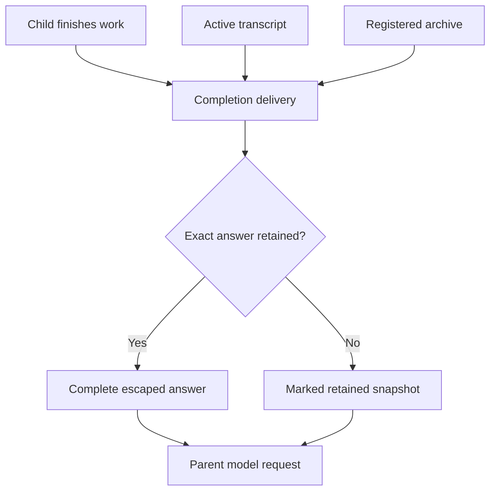

Codex review: blocked before merge. _Reviewed September 15, 2026, 3:06 PM ET / 19:06 UTC (Revision 5)._

# ClawSweeper review

## What this changes

Delivers complete child answers from active or archived transcripts to waiting parents, preserves each child’s own conclusion, and marks incomplete results when retention has removed the original answer.

## Merge readiness

⛔ **Blocked before merge - 3 items remain**

This remains a useful, proof-backed fix for incomplete parent answers. The earlier archive-decoding and retention blockers are addressed, and this review found no new blocking correctness defect.

**Priority:** P1
**Reviewed head:** `18d1265de54fb7986f73b197d92ec898f001cb78`
**Owner decision:** Required. See [Decision needed](#decision-needed).

## Review scores

| Measure | Result | What it means |
|---|---|---|
| **Overall readiness** | 🐚 platinum hermit **(4/6)** | A solid repair with convincing behavior proof and addressed prior findings; the remaining landing question concerns acceptance of the intentional context-budget tradeoff. |
| **Proof confidence** | 🦞 diamond lobster **(5/6)** ✨ media proof bonus | Sufficient (screenshot): Inspected before/after Chat captures and the linked isolated-Gateway scenario exercise child spawn, parent yield, complete-answer delivery, and retained history after deletion through the changed completion path. The required field is absent before and present after; registered retention and continuation regressions provide supplemental coverage. |
| **Patch quality** | 🐚 platinum hermit **(4/6)** | No actionable review findings were identified. |

## Verification

| Check | Result | Evidence |
|---|---|---|
| **Real behavior** | Verified | Sufficient (screenshot): Inspected before/after Chat captures and the linked isolated-Gateway scenario exercise child spawn, parent yield, complete-answer delivery, and retained history after deletion through the changed completion path. The required field is absent before and present after; registered retention and continuation regressions provide supplemental coverage. |
| **Evidence reviewed** | 11 items | Introduced changes and review continuity: The checkout matches the pinned PR head. Compared with the previous reviewed head, the only changes are four explicit session-accessor mock additions; production behavior is unchanged. Still necessary on current main: Fetched main retains the 512-character child-result projection and the 6,000-character event and steering projections. The central truncation problem therefore remains outside this branch. Latest release retains truncation: The v2026.9.4 source still declares the 512-character per-child and 4,096-character aggregate limits and applies them in completion formatting. |
| **Findings** | None | None. |
| **Security** | None | None. |

## How this fits together

Subagent completion delivery carries finished child work back into the parent agent’s next model request. It reads retained session transcripts, checks the selected run, and prepares either an immediate completion event or a queued result.

## Decision needed

| Question | Recommendation |
|---|---|
| Does the recorded September 15 owner acceptance cover delivering whole answers when they can exceed the parent model’s available context? | **Confirm the existing acceptance:** Confirm that complete inline delivery and its larger-context tradeoff are covered by the recorded owner decision. |

Why: The branch intentionally replaces shipped context protections; the proof establishes complete delivery at the demonstrated sizes but cannot establish the owner’s tolerance for larger inputs.

## Before merge

- [ ] **Resolve merge risk (P1)** - Removing the shipped projection caps permits a complete answer or settled batch to exceed the parent model’s available context; the inspected proof does not establish recovery for that extreme. The body records owner acceptance, but that decision’s scope was not independently verified.
- [ ] **Complete next step (P2)** - Confirm that the recorded owner acceptance covers complete inline answers exceeding the parent’s available context.
- [ ] **Resolve maintainer decision** - Resolve the maintainer decision shown above before merge.

<strong>Agent review details</strong>

### Security

None.

### PR surface

Source +422, Tests +1715, Docs +15. Total +2152 across 41 files.

View PR surface stats

| Area | Files | Added | Removed | Net |
|---|---:|---:|---:|---:|
| Source | 18 | 851 | 429 | +422 |
| Tests | 22 | 1924 | 209 | +1715 |
| Docs | 1 | 15 | 0 | +15 |
| Config | 0 | 0 | 0 | 0 |
| Generated | 0 | 0 | 0 | 0 |
| Other | 0 | 0 | 0 | 0 |
| **Total** | **41** | **2790** | **638** | **+2152** |

### Review metrics

| Metric | Value | Why it matters |
|---|---|---|
| **Production versus regression coverage** | Production +422 lines; tests and test support +1,715 lines | The body justifies production growth through exact-run reading and streamed archive access; most net growth supplies regression coverage. |
| **Completion budget change** | 512- and 6,000-character item caps removed; 4,096-character aggregate cap removed | This intentionally favors complete parent input over the previous fixed projection budgets. |

### Root-cause cluster

Relationship: `fixed_by_candidate`
Canonical: https://github.com/openclaw/openclaw/issues/138555
Summary: This PR is the explicit implementation candidate for the reported requester-settle truncation; the issue remains open until a fix lands.

Members:
- `canonical`: https://github.com/openclaw/openclaw/issues/138555 - Reports the same deterministic missing-tail behavior and is explicitly linked by this PR.
- `adjacent_distinct`: https://github.com/openclaw/openclaw/pull/119731 - Merged context-budget protection that this branch intentionally revises; it does not solve complete-answer delivery.
- `adjacent_distinct`: https://github.com/openclaw/openclaw/pull/124171 - Merged escaped-output bounding for nested findings, representing the earlier context-budget contract.

Proposal only: this assessment does not dispatch repair, suppress jobs, mutate sibling items, close, or merge anything.

### Merge-risk options

**Maintainer options:**
1. **Confirm full-answer delivery acceptance (recommended)**  
   Accept the documented larger-context tradeoff through the existing owner decision while retaining complete answers and visible retention-loss markers.
2. **Hold for context-overflow recovery**  
   Pause landing if complete inline delivery must also guarantee progress when the answer exceeds the parent model’s context.

### Technical review

Best possible solution:

Keep complete answers within the existing transcript and delivery owners, retain explicit retention-loss markers, and make the accepted parent-context tradeoff clear.

Do we have a high-confidence way to reproduce the issue?

Yes: spawn a child whose answer contains a required tail beyond 512 escaped characters, then yield the parent. Current main and release source enforce that truncation; the supplied before/after capture demonstrates the failure and correction, though this review did not execute it.

Is this the best way to solve the issue?

Yes, subject to the documented context tradeoff: reading the existing exact-run transcript avoids a second durable result store, and the marked fallback preserves parent progress after pruning.

AGENTS.md: found and applied where relevant.

Codex review notes: model internal, reasoning medium; reviewed against [fcb4d12acda7](https://github.com/openclaw/openclaw/commit/fcb4d12acda7db1fd408ca130ca8122af9570a96).

### Labels

Label changes:

- add `rating: 🐚 platinum hermit`: Overall readiness is 🐚 platinum hermit; proof is 🦞 diamond lobster and patch quality is 🐚 platinum hermit.
- add `status: 👀 ready for maintainer look`: ClawSweeper has no concrete contributor-facing blocker left for this PR. Sufficient (screenshot): Inspected before/after Chat captures and the linked isolated-Gateway scenario exercise child spawn, parent yield, complete-answer delivery, and retained history after deletion through the changed completion path. The required field is absent before and present after; registered retention and continuation regressions provide supplemental coverage.
- remove `rating: 🦐 gold shrimp`: Current PR rating is `rating: 🐚 platinum hermit`, so this older rating label is no longer current.
- remove `status: ⏳ waiting on author`: Current PR status label is `status: 👀 ready for maintainer look`.

Label justifications:

- `P1`: The linked report establishes required answer fields being lost before a waiting parent processes successful child work.
- `merge-risk: 🚨 availability`: Whole-answer delivery removes shipped context limits and can exceed a parent model’s available input budget.
- `rating: 🐚 platinum hermit`: Overall readiness is 🐚 platinum hermit; proof is 🦞 diamond lobster and patch quality is 🐚 platinum hermit.
- `status: 👀 ready for maintainer look`: ClawSweeper has no concrete contributor-facing blocker left for this PR. Sufficient (screenshot): Inspected before/after Chat captures and the linked isolated-Gateway scenario exercise child spawn, parent yield, complete-answer delivery, and retained history after deletion through the changed completion path. The required field is absent before and present after; registered retention and continuation regressions provide supplemental coverage.
- `proof: sufficient`: Contributor real behavior proof is sufficient. Inspected before/after Chat captures and the linked isolated-Gateway scenario exercise child spawn, parent yield, complete-answer delivery, and retained history after deletion through the changed completion path. The required field is absent before and present after; registered retention and continuation regressions provide supplemental coverage.
- `proof: 📸 screenshot`: Contributor real behavior proof includes screenshot evidence. Inspected before/after Chat captures and the linked isolated-Gateway scenario exercise child spawn, parent yield, complete-answer delivery, and retained history after deletion through the changed completion path. The required field is absent before and present after; registered retention and continuation regressions provide supplemental coverage.

### Evidence

What I checked:

- **Introduced changes and review continuity:** The checkout matches the pinned PR head. Compared with the previous reviewed head, the only changes are four explicit session-accessor mock additions; production behavior is unchanged. ([18d1265de54f](https://github.com/openclaw/openclaw/commit/18d1265de54fb7986f73b197d92ec898f001cb78))
- **Still necessary on current main:** Fetched main retains the 512-character child-result projection and the 6,000-character event and steering projections. The central truncation problem therefore remains outside this branch. ([`src/agents/subagents/announce/subagent-announce-output.ts:40`](https://github.com/openclaw/openclaw/blob/fcb4d12acda7db1fd408ca130ca8122af9570a96/src/agents/subagents/announce/subagent-announce-output.ts#L40), [fcb4d12acda7](https://github.com/openclaw/openclaw/commit/fcb4d12acda7db1fd408ca130ca8122af9570a96))
- **Latest release retains truncation:** The v2026.9.4 source still declares the 512-character per-child and 4,096-character aggregate limits and applies them in completion formatting. ([`src/agents/subagents/announce/subagent-announce-output.ts:36`](https://github.com/openclaw/openclaw/blob/3a9d69db306cd7f081e06254cb89c4bcc14a7107/src/agents/subagents/announce/subagent-announce-output.ts#L36), [3a9d69db306c](https://github.com/openclaw/openclaw/commit/3a9d69db306cd7f081e06254cb89c4bcc14a7107))
- **Exact-run result ownership:** The reader selects terminal visible assistant text for the recorded run, excludes non-final message-tool mirrors and silent replies, checks source identity after asynchronous reads, and returns a marked snapshot when the answer is unavailable. It does not rewrite lifecycle evidence. ([`src/agents/subagents/announce/subagent-announce-result.ts:77`](https://github.com/openclaw/openclaw/blob/18d1265de54fb7986f73b197d92ec898f001cb78/src/agents/subagents/announce/subagent-announce-result.ts#L77), [18d1265de54f](https://github.com/openclaw/openclaw/commit/18d1265de54fb7986f73b197d92ec898f001cb78))
- **Earlier archive blocker addressed:** Archive decoding now streams lines inside the existing serialized worker. Registered hash, session header, logical owner, and exact-run checks remain; no schema or archive-retention change appears in the introduced diff. ([`src/config/sessions/session-accessor.sqlite-archive-read.ts:56`](https://github.com/openclaw/openclaw/blob/18d1265de54fb7986f73b197d92ec898f001cb78/src/config/sessions/session-accessor.sqlite-archive-read.ts#L56), [18d1265de54f](https://github.com/openclaw/openclaw/commit/18d1265de54fb7986f73b197d92ec898f001cb78))
- **Earlier parent-progress blocker addressed:** The registered retention regression publishes and prunes a real archive, supplies a healthy sibling and an unrelated replacement session, then checks the marked fallback, complete sibling answer, cleared leases, and successful next parent turn. These tests were inspected, not executed during this read-only review. ([`src/agents/embedded-agent-runner/run/attempt-prompt-submit.retention.test.ts:99`](https://github.com/openclaw/openclaw/blob/18d1265de54fb7986f73b197d92ec898f001cb78/src/agents/embedded-agent-runner/run/attempt-prompt-submit.retention.test.ts#L99), [18d1265de54f](https://github.com/openclaw/openclaw/commit/18d1265de54fb7986f73b197d92ec898f001cb78))

Likely related people:

- **steipete:** Suggested for follow-up; no historical authorship or introduction is verified. (role: unverified routing candidate; confidence: low)
- **vincentkoc:** Suggested for follow-up; no historical authorship or introduction is verified. (role: unverified routing candidate; confidence: low)

### Rating scale

| Score | Internal tier | Crab rank | Meaning |
|---:|:---:|---|---|
| **6/6** | S | 🦀 challenger crab | Exceptional readiness |
| **5/6** | A | 🦞 diamond lobster | Very strong readiness |
| **4/6** | B | 🐚 platinum hermit | Good normal PR; ordinary maintainer review |
| **3/6** | C | 🦐 gold shrimp | Useful, but confidence is limited |
| **2/6** | D | 🦪 silver shellfish | Proof or implementation needs work |
| **1/6** | F | 🧂 unranked krab | Not merge-ready |
| N/A | NA | 🌊 off-meta tidepool | Rating does not apply |

Overall follows the weaker of proof and patch quality.
Shiny media proof means a screenshot, video, or linked artifact directly shows the changed behavior. Runtime, network, CSP, and security claims still need visible diagnostics.

### Workflow

- ClawSweeper keeps one durable marker-backed review comment per issue or PR.
- Re-runs edit this comment so the latest verdict, findings, and automation markers stay together instead of adding duplicate bot comments.
- A fresh review can be triggered by eligible `@clawsweeper re-review` comments, exact-item GitHub events, scheduled/background review runs, or manual workflow dispatch.
- PR/issue authors and users with repository write access can comment `@clawsweeper re-review` or `@clawsweeper re-run` on an open PR or issue to request a fresh review only.
- Maintainers can also comment `@clawsweeper review` to request a fresh review only.
- Fresh-review commands do not start repair, autofix, rebase, CI repair, or automerge.
- Maintainer-only repair and merge flows require explicit commands such as `@clawsweeper autofix`, `@clawsweeper automerge`, `@clawsweeper fix ci`, or `@clawsweeper address review`.
- Maintainers can comment `@clawsweeper explain` to ask for more context, or `@clawsweeper stop` to stop active automation.

### History

Review history (4 earlier review cycles)

<!-- clawsweeper-review-history v=1 total=4 -->
- reviewed 2026-09-15T15:47:16.035Z sha d9ae97706287ab8ff779586082f73fb8beaad708 :: blocked before merge. :: [P2] Stream archived result lookup instead of decoding the whole transcript
- reviewed 2026-09-15T16:49:45.645Z sha a97d75a928ed8f5a9f70ee7977da8e767d03acea :: blocked before merge. :: [P1] Keep an unavailable child result from aborting every parent turn
- reviewed 2026-09-15T17:37:46.037Z sha c5b5e2efda8edcb77c67110c09b7e75c7504c756 :: blocked before merge. :: [P1] Keep an unavailable child result from aborting every parent turn
- reviewed 2026-09-15T18:16:23.111Z sha 1fedcd72f368900e8c7a7e66cd8014fbf92850e8 :: needs maintainer review before merge. :: none

<!-- clawsweeper-verdict:needs-human item=149223 sha=18d1265de54fb7986f73b197d92ec898f001cb78 confidence=high updated_at=2026-09-15T19:02:24Z reviewed_at=2026-09-15T19:06:03.027Z lease_owner=github-run-35011011568-1 lease_comment_id=5686439588 source_revision=e8a635e63a130a32c2af86a51b7466a996d26ed399eb40493c156573c8ee266d live_verification=absent -->
<!-- clawsweeper-review-state:blocked item=149223 sha=18d1265de54fb7986f73b197d92ec898f001cb78 v=1 -->

<!-- clawsweeper-review-version item=149223 reviewed_at=2026-09-15T19:06:03.027Z sha=18d1265de54fb7986f73b197d92ec898f001cb78 source_revision=e8a635e63a130a32c2af86a51b7466a996d26ed399eb40493c156573c8ee266d lease_owner=github-run-35011011568-1 lease_comment_id=5686439588 v=1 -->

<!-- clawsweeper-review item=149223 -->