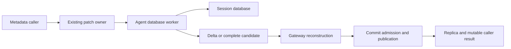

Codex review: blocked before merge.

## What this changes

This PR transfers changed session-entry fields instead of complete warm snapshots while preserving publication and mutable return values.

**Example:** Rename a warm session from “warm” to “changed” while retaining a 60 KiB skills snapshot.
- **Before:** The patch reply transfers unchanged snapshot contents.
- **After:** The reply transfers changed fields and removals, then reconstructs the complete entry from revision-validated resident facts.

## Review scores

| Measure | Result | What it means |
|---|---|---|
| **Overall readiness** | 🦐 gold shrimp **(3/6)** | The change has relevant production-path measurements and focused state-contract coverage, but adverse runtime signals leave performance acceptance unresolved. |
| **Proof confidence** | 🐚 platinum hermit **(4/6)** | Sufficient (live_output): The PR records separate real dev Gateways using WebSocket metadata churn and concurrent mock-provider turns, with completed operations and reduced patch-transfer bytes; focused native-worker measurements include reconstruction and mutable-result copying, without establishing a Gateway-wide speedup. |
| **Patch quality** | 🦐 gold shrimp **(3/6)** | No actionable review findings were identified. |

## Product

**Kind:** Performance · **Worth it:** Yes · **Fix scope:** Complete
**User problem:** Repeated metadata updates allocate and decode unchanged session snapshots on the Gateway thread.
**Reason:** The maintainer-authored direction targets measured redundant work without new configuration or storage contracts; runtime acceptance is explicitly deferred in the PR.

## Merge readiness

⛔ **Blocked before merge - 1 item remains**

Keep open: this PR provides a distinct allocation reduction absent from current main, with no definite introduced defect found; performance acceptance remains explicitly pending.

**Priority:** P2
**Reviewed head:** `f9641d4912992ff8070affaec5f4c8d30ff83958`

## Before merge

- [ ] **Resolve merge risk** - Before merge, the author should resolve the reported adverse Gateway GC and latency signals with the pending controlled comparisons, or explicitly accept the measured tradeoff.

## Findings

None.

<strong>Agent review details</strong>

### How this fits together

Session metadata callers submit patches to the agent database worker, which commits stored entries and returns publication facts for Gateway replicas, observers, and callers.

### Technical review

Best possible solution:

Retain the existing revision-validated replica and publication owners, and land the delta optimization only after its performance tradeoff is resolved.

Do we have a high-confidence way to reproduce the issue?

Current-main source transfers complete publication entries on changed patches, and the PR reports a baseline-failing wire-size regression; no target code was executed during this read-only review.

Is this the best way to solve the issue?

The approach removes redundant transport through existing owners while preserving cold and superseded-preimage behavior; its net runtime benefit remains subject to performance acceptance.

AGENTS.md: found and applied where relevant.

Codex review notes: model internal, reasoning medium; reviewed against [274a86d02feb](https://github.com/openclaw/openclaw/commit/274a86d02febe855ca2aeea71f44000531689e0a).

### Merge-risk options

**Maintainer options:**
1. **Complete the controlled comparison (recommended)**  
   The author should use the pending comparison to determine whether the allocation savings preserve Gateway GC and latency.
2. **Explicitly accept the tradeoff**  
   The feature owner may accept the measured runtime cost if the allocation benefit warrants it.
3. **Pause the optimization**  
   Retain complete replies if controlled measurements do not justify the added reconstruction work.

### Provenance checked

- `Worker patch execution and publication` keeps the original intent (d6929f854d2e9d58b1482aad072cc5da7f4bafcf: Move prepared metadata patches into the existing worker while retaining FIFO, transaction predicates, live authority, native receipts, and publication.)
- `Full publication facts and omitted caller results` keeps the original intent (1aac796623fae26eb079bb6a0f33b920fef061a3: Omit unused caller results while keeping entry-returning APIs, observers, publication facts, and final authority intact, as documented in https://github.com/openclaw/openclaw/pull/176601.)
- `Sealed publication source` keeps the original intent (8656a687160dbfdd95fd16ae1682e033747d2a07: Reuse committed facts through the existing replica while preserving invalidation and caller-owned authorization; sealing must also cover an emptied full-entry map whose entry is reconstructed by the host.)
- `Gateway measurement workload` keeps the original intent (9fe8d3e95e0da14efee8e1f1146073fb0d34f9e7: Separate untraced timing from allocation instrumentation and retain representative mixed workload diagnostics; the added polling counts and whole-soak CPU support this comparison.)

### Testing

Proof path: shipped entry point.

### Security

None.

### Evidence

What I checked:

- **Pinned change:** The introduced diff adds revision-validated delta transfer, reconstruction before admission, mutable-container copying, one focused regression, and measurement support. ([`src/config/sessions/session-entry-patch.ts:110`](https://github.com/openclaw/openclaw/blob/f9641d4912992ff8070affaec5f4c8d30ff83958/src/config/sessions/session-entry-patch.ts#L110), [f9641d491299](https://github.com/openclaw/openclaw/commit/f9641d4912992ff8070affaec5f4c8d30ff83958))
- **Current main still transfers full publication entries:** Current main constructs the complete patch candidate without entryDelta; the central optimization remains distinct work. ([`src/config/sessions/session-entry-patch.worker.ts:288`](https://github.com/openclaw/openclaw/blob/274a86d02febe855ca2aeea71f44000531689e0a/src/config/sessions/session-entry-patch.worker.ts#L288), [274a86d02feb](https://github.com/openclaw/openclaw/commit/274a86d02febe855ca2aeea71f44000531689e0a))
- **Existing ownership and freshness contract:** Replica receipts already use session lookup keys and dependent session-ID scopes; this PR uses those same scopes and retains full replies when the worker revision differs. ([`src/config/sessions/session-actor-replica-receipts.ts:45`](https://github.com/openclaw/openclaw/blob/f9641d4912992ff8070affaec5f4c8d30ff83958/src/config/sessions/session-actor-replica-receipts.ts#L45), [f9641d491299](https://github.com/openclaw/openclaw/commit/f9641d4912992ff8070affaec5f4c8d30ff83958))
- **Behavioral regression coverage:** The added production-owner test checks bounded transfer, removed fields, independently mutable nested results, and preservation of a newer persisted snapshot. ([`src/config/sessions/session-entry-patch.operations.test.ts:225`](https://github.com/openclaw/openclaw/blob/f9641d4912992ff8070affaec5f4c8d30ff83958/src/config/sessions/session-entry-patch.operations.test.ts#L225), [f9641d491299](https://github.com/openclaw/openclaw/commit/f9641d4912992ff8070affaec5f4c8d30ff83958))
- **Measured benefit and explicit acceptance pause:** The full PR body reports 12.2% and 24.3% lower owner allocation and 86.0% fewer transferred bytes per patch, but adverse Gateway GC and latency signals; it explicitly leaves acceptance pending controlled comparisons. ([f9641d491299](https://github.com/openclaw/openclaw/commit/f9641d4912992ff8070affaec5f4c8d30ff83958))
- **Inherited CI failure:** The failed tooling check expects a missing dynamic Doctor-import edge. https://github.com/openclaw/openclaw/pull/183272 records the identical failure on the pinned merge base and supplies its merged repair; this PR does not change that importer or modeler. ([`config/knip-dynamic-consumers.mjs:35`](https://github.com/openclaw/openclaw/blob/418c2ba3b39200ba38e14da0c28b2e1e2cb1abe0/config/knip-dynamic-consumers.mjs#L35), [418c2ba3b392](https://github.com/openclaw/openclaw/commit/418c2ba3b39200ba38e14da0c28b2e1e2cb1abe0))

### PR surface

Source +131, Tests +58, Other +38. Total +227 across 6 files. Added test files: 0.

View PR surface stats

| Area | Files | Added | Removed | Net |
|---|---:|---:|---:|---:|
| Source | 3 | 210 | 79 | +131 |
| Tests | 1 | 58 | 0 | +58 |
| Docs | 0 | 0 | 0 | 0 |
| Config | 0 | 0 | 0 | 0 |
| Generated | 0 | 0 | 0 | 0 |
| Other | 2 | 55 | 17 | +38 |
| **Total** | **6** | **323** | **96** | **+227** |

### Review metrics

| Metric | Value | Why it matters |
|---|---|---|
| **Production versus test growth** | Runtime production +210/−79, net +131; tests +58/−0. | Growth implements revision validation, publication reconstruction, and mutable-result isolation using existing owners; the regression protects distinct transfer and state contracts. |

### Labels

Label changes:

- add `P2`: A useful internal allocation improvement with no established urgent user-facing failure.
- add `merge-risk: 🚨 other`: Runtime performance remains unresolved: the supplied Gateway measurements show adverse GC and latency signals despite lower patch allocation.
- add `proof: sufficient`: Contributor real behavior proof is sufficient.
- add `rating: 🦐 gold shrimp`: Overall readiness is 🦐 gold shrimp; proof is 🐚 platinum hermit and patch quality is 🦐 gold shrimp.

Label justifications:

- `P2`: A useful internal allocation improvement with no established urgent user-facing failure.
- `merge-risk: 🚨 other`: Runtime performance remains unresolved: the supplied Gateway measurements show adverse GC and latency signals despite lower patch allocation.
- `rating: 🦐 gold shrimp`: Overall readiness is 🦐 gold shrimp; proof is 🐚 platinum hermit and patch quality is 🦐 gold shrimp.
- `proof: sufficient`: Contributor real behavior proof is sufficient.

### Rank-up moves

Optional improvements that raise the rating; they are not merge blockers.

- Resolve the pending controlled Gateway comparison and record whether the allocation savings justify the GC and latency tradeoff.

### Rating scale

6/6 🦀 challenger crab · 5/6 🦞 diamond lobster · 4/6 🐚 platinum hermit · 3/6 🦐 gold shrimp · 2/6 🦪 silver shellfish · 1/6 🧂 unranked krab. Overall follows the weaker of proof and patch quality; ✨ marks media proof (a screenshot, video, or linked artifact) that directly shows the changed behavior.

### Workflow

ClawSweeper edits this one comment on every review. Comment `@clawsweeper re-review` for a fresh review only. Repair and merge execution lanes are retired.

_Reviewed October 25, 2026, 1:30 AM ET / 05:30 UTC._

<!-- clawsweeper-verdict:needs-human item=183276 sha=f9641d4912992ff8070affaec5f4c8d30ff83958 confidence=high updated_at=2026-10-25T05:27:03Z reviewed_at=2026-10-25T05:30:52.604Z lease_owner=github-run-40165508993-1 lease_comment_id=6393904868 source_revision=f5f1fe7d180ad451051e21d583126cf36cfe694bbe24e43d90ff7e12004b8f94 hold=blocked findings=0 -->
<!-- clawsweeper-review-state:blocked item=183276 sha=f9641d4912992ff8070affaec5f4c8d30ff83958 v=1 -->

<!-- clawsweeper-review-version item=183276 reviewed_at=2026-10-25T05:30:52.604Z sha=f9641d4912992ff8070affaec5f4c8d30ff83958 source_revision=f5f1fe7d180ad451051e21d583126cf36cfe694bbe24e43d90ff7e12004b8f94 lease_owner=github-run-40165508993-1 lease_comment_id=6393904868 v=1 -->

<!-- clawsweeper-review item=183276 -->