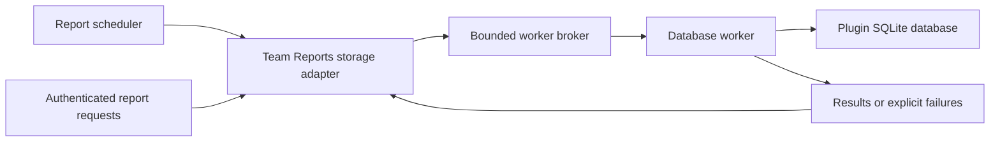

Codex review: blocked before merge. _Reviewed September 11, 2026, 9:01 AM ET / 13:01 UTC (Revision 3)._

# ClawSweeper review

## What this changes

Moves Team Reports database operations into bounded, shared SQLite workers, exposes a typed plugin SDK interface, and updates lifecycle tests and test routing.

> [!WARNING]
> **SQLite table change**
>
> This PR modifies persisted SQLite tables in `src/infra/sqlite-store.worker.ts`, `src/infra/sqlite-worker-store.ts`. Prefer a design that avoids changing persisted SQLite tables. If the change is necessary, verify migration and upgrade compatibility against an existing database before merge.

## Merge readiness

⛔ **Blocked before merge - 1 item remains**

This PR remains necessary: current main still runs Team Reports SQLite operations on the application thread. No blocking correctness or security defect was found. The previous publication concern is addressed by the documented coordinated release plan and existing compatibility-floor synchronization.

**Priority:** P2
**Reviewed head:** `57ec881ea053b5448045613038198aa90ce45f64`

## Review scores

| Measure | Result | What it means |
|---|---|---|
| **Overall readiness** | 🐚 platinum hermit **(4/6)** | A coherent worker conversion with useful production-boundary observations and substantive lifecycle coverage; no actionable blocker remains from this review. |
| **Proof confidence** | 🦞 diamond lobster **(5/6)** | Sufficient (live_output): The captured PR body reports the actual Team Reports service, HTTP handlers, worker broker, and native SQLite backend exercised in source and compiled Node layouts, with external lock contention, responsive timers, drained writes, and durable reopening. The latest commit only repairs test synchronization and wrapper packaging. |
| **Patch quality** | 🐚 platinum hermit **(4/6)** | No actionable review findings were identified. |

## Verification

| Check | Result | Evidence |
|---|---|---|
| **Real behavior** | Verified | Sufficient (live_output): The captured PR body reports the actual Team Reports service, HTTP handlers, worker broker, and native SQLite backend exercised in source and compiled Node layouts, with external lock contention, responsive timers, drained writes, and durable reopening. The latest commit only repairs test synchronization and wrapper packaging. |
| **Evidence reviewed** | 10 items | Current main still needs the worker conversion: The pinned main store exposes asynchronous methods but directly calls synchronous SQLite queries and transactions; its factory also opens and initializes SQLite on the caller's thread. Release boundary: The latest supplied release's SQLite SDK has no worker-store export. This work is not already shipped in v2026.9.4. Owned drainage and failure handling: Each client tracks accepted operations and drains them before releasing its actor. Worker failure joins native exit before rejecting uncertain dispatched operations; queued writes are not replayed. |
| **Findings** | None | None. |
| **Security** | None | None. |

## How this fits together

Team Reports collects activity and serves stored reports through authenticated Gateway routes. Its storage adapter now sends domain commands to workers that own SQLite connections, transactions, and cleanup.

## Before merge

- [ ] **Add data-model compatibility proof** - Confirm migration or upgrade compatibility proof before merge.

<strong>Agent review details</strong>

### Security

None.

### PR surface

Source +988, Tests +986, Docs +60, Config +3, Other +3. Total +2040 across 30 files.

View PR surface stats

| Area | Files | Added | Removed | Net |
|---|---:|---:|---:|---:|
| Source | 10 | 1469 | 481 | +988 |
| Tests | 15 | 1026 | 40 | +986 |
| Docs | 2 | 60 | 0 | +60 |
| Config | 1 | 3 | 0 | +3 |
| Generated | 0 | 0 | 0 | 0 |
| Other | 2 | 3 | 0 | +3 |
| **Total** | **30** | **2561** | **521** | **+2040** |

### Review metrics

| Metric | Value | Why it matters |
|---|---|---|
| **Production versus validation growth** | Production/tooling net +992 lines; tests and test routing net +988 lines | The production growth has a stated purpose: a reusable bounded worker owner with Team Reports as its first consumer. |

### Stored data model

Persistent data-model change detected: `unknown-data-model-change: src/infra/sqlite-store.worker.ts`, `unknown-data-model-change: src/infra/sqlite-worker-store.ts`. Confirm migration or upgrade compatibility proof before merge.

### Root-cause cluster

Relationship: `partial_overlap`
Canonical: https://github.com/openclaw/openclaw/issues/144592
Summary: This PR implements the Team Reports worker boundary within a broader asynchronous storage campaign.

Members:
- `canonical`: https://github.com/openclaw/openclaw/issues/144592 - The open campaign explicitly covers remaining runtime storage owners; this PR addresses one consumer.
- `adjacent_distinct`: https://github.com/openclaw/openclaw/pull/144646 - Merged prerequisite establishing awaited persistence and shutdown drainage without off-thread SQLite execution.
- `adjacent_distinct`: https://github.com/openclaw/openclaw/pull/144818 - Merged prerequisite exposing the selected runtime entry used to locate the private worker module.

Proposal only: this assessment does not dispatch repair, suppress jobs, mutate sibling items, close, or merge anything.

### Technical review

Best possible solution:

Retain one worker-owned SQLite backend per database and publish the plugin with its supporting host through the existing release compatibility synchronization.

Do we have a high-confidence way to reproduce the issue?

Yes, source establishes the mechanism: current main directly executes synchronous SQLite operations inside asynchronous store methods. The supplied lock-contention observations exercise the repaired boundary; this review did not rerun them.

Is this the best way to solve the issue?

Yes. Complete domain operations move behind one generic worker owner while existing schema and caller contracts remain intact; asynchronous transaction admission alone would not move queries or schema work off-thread. The host/plugin publication dependency is already covered by explicit release context.

AGENTS.md: found and applied where relevant.

Codex review notes: model internal, reasoning medium; reviewed against [66c7fad06385](https://github.com/openclaw/openclaw/commit/66c7fad06385986bc426a64d87a020f9b24b5fbb).

### Labels

Label changes:

- remove `merge-risk: 🚨 compatibility`: Current PR review selected no merge-risk labels.

Label justifications:

- `P2`: This is a bounded runtime responsiveness improvement for Team Reports, without evidence of an urgent widespread outage.
- `rating: 🐚 platinum hermit`: Overall readiness is 🐚 platinum hermit; proof is 🦞 diamond lobster and patch quality is 🐚 platinum hermit.
- `status: 👀 ready for maintainer look`: ClawSweeper has no concrete contributor-facing blocker left for this PR. Sufficient (live_output): The captured PR body reports the actual Team Reports service, HTTP handlers, worker broker, and native SQLite backend exercised in source and compiled Node layouts, with external lock contention, responsive timers, drained writes, and durable reopening. The latest commit only repairs test synchronization and wrapper packaging.
- `proof: sufficient`: Contributor real behavior proof is sufficient. The captured PR body reports the actual Team Reports service, HTTP handlers, worker broker, and native SQLite backend exercised in source and compiled Node layouts, with external lock contention, responsive timers, drained writes, and durable reopening. The latest commit only repairs test synchronization and wrapper packaging.

### Evidence

What I checked:

- **Current main still needs the worker conversion:** The pinned main store exposes asynchronous methods but directly calls synchronous SQLite queries and transactions; its factory also opens and initializes SQLite on the caller's thread. ([`extensions/team-reports/src/store.ts:173`](https://github.com/openclaw/openclaw/blob/66c7fad06385986bc426a64d87a020f9b24b5fbb/extensions/team-reports/src/store.ts#L173), [66c7fad06385](https://github.com/openclaw/openclaw/commit/66c7fad06385986bc426a64d87a020f9b24b5fbb))
- **Release boundary:** The latest supplied release's SQLite SDK has no worker-store export. This work is not already shipped in v2026.9.4. ([`src/plugin-sdk/sqlite-runtime.ts:1`](https://github.com/openclaw/openclaw/blob/3a9d69db306cd7f081e06254cb89c4bcc14a7107/src/plugin-sdk/sqlite-runtime.ts#L1), [3a9d69db306c](https://github.com/openclaw/openclaw/commit/3a9d69db306cd7f081e06254cb89c4bcc14a7107))
- **Owned drainage and failure handling:** Each client tracks accepted operations and drains them before releasing its actor. Worker failure joins native exit before rejecting uncertain dispatched operations; queued writes are not replayed. ([`src/infra/sqlite-worker-store.ts:388`](https://github.com/openclaw/openclaw/blob/57ec881ea053b5448045613038198aa90ce45f64/src/infra/sqlite-worker-store.ts#L388), [57ec881ea053](https://github.com/openclaw/openclaw/commit/57ec881ea053b5448045613038198aa90ce45f64))
- **Storage behavior preserved:** The backend retains the existing schema, report encoding, conditional run completion, retention queries, and synchronous transaction boundaries. Native database opening and maintenance move into the worker. ([`extensions/team-reports/src/store.worker.ts:397`](https://github.com/openclaw/openclaw/blob/57ec881ea053b5448045613038198aa90ce45f64/extensions/team-reports/src/store.worker.ts#L397), [57ec881ea053](https://github.com/openclaw/openclaw/commit/57ec881ea053b5448045613038198aa90ce45f64))
- **Real production-boundary observations:** The supplied PR body records source and plain-Node compiled registered-service/HTTP runs: zero main-thread SQLite calls, 128 timer ticks during a 751.386 ms external writer lock, all 25 queued writes drained, four HTTP routes returned 200, and report/Unicode data survived restart and fresh-process reopening. These are bounded synthetic-input observations, not a deployed Gateway claim; no runtime execution was performed during this read-only review. ([57ec881ea053](https://github.com/openclaw/openclaw/commit/57ec881ea053b5448045613038198aa90ce45f64))
- **Previous review continuity:** The previous review recorded no findings. The latest commit changes only the scheduler fixture's collector-entry synchronization and the extracted wrapper dependency list, preserving immediate concurrent-run rejection. ([`extensions/team-reports/src/scheduler.test.ts:511`](https://github.com/openclaw/openclaw/blob/57ec881ea053b5448045613038198aa90ce45f64/extensions/team-reports/src/scheduler.test.ts#L511), [57ec881ea053](https://github.com/openclaw/openclaw/commit/57ec881ea053b5448045613038198aa90ce45f64))

Likely related people:

- **steipete:** Suggested for follow-up; no historical authorship or introduction is verified. (role: unverified routing candidate; confidence: low)

### Rating scale

| Score | Internal tier | Crab rank | Meaning |
|---:|:---:|---|---|
| **6/6** | S | 🦀 challenger crab | Exceptional readiness |
| **5/6** | A | 🦞 diamond lobster | Very strong readiness |
| **4/6** | B | 🐚 platinum hermit | Good normal PR; ordinary maintainer review |
| **3/6** | C | 🦐 gold shrimp | Useful, but confidence is limited |
| **2/6** | D | 🦪 silver shellfish | Proof or implementation needs work |
| **1/6** | F | 🧂 unranked krab | Not merge-ready |
| N/A | NA | 🌊 off-meta tidepool | Rating does not apply |

Overall follows the weaker of proof and patch quality.
Shiny media proof means a screenshot, video, or linked artifact directly shows the changed behavior. Runtime, network, CSP, and security claims still need visible diagnostics.

### Workflow

- ClawSweeper keeps one durable marker-backed review comment per issue or PR.
- Re-runs edit this comment so the latest verdict, findings, and automation markers stay together instead of adding duplicate bot comments.
- A fresh review can be triggered by eligible `@clawsweeper re-review` comments, exact-item GitHub events, scheduled/background review runs, or manual workflow dispatch.
- PR/issue authors and users with repository write access can comment `@clawsweeper re-review` or `@clawsweeper re-run` on an open PR or issue to request a fresh review only.
- Maintainers can also comment `@clawsweeper review` to request a fresh review only.
- Fresh-review commands do not start repair, autofix, rebase, CI repair, or automerge.
- Maintainer-only repair and merge flows require explicit commands such as `@clawsweeper autofix`, `@clawsweeper automerge`, `@clawsweeper fix ci`, or `@clawsweeper address review`.
- Maintainers can comment `@clawsweeper explain` to ask for more context, or `@clawsweeper stop` to stop active automation.

### History

Review history (2 earlier review cycles)

<!-- clawsweeper-review-history v=1 total=2 -->
- reviewed 2026-09-11T11:07:45.584Z sha c31bbc78eabef45d9ae1cdaea6af2cc2da65f9e3 :: blocked before merge. :: none
- reviewed 2026-09-11T11:33:31.428Z sha c31bbc78eabef45d9ae1cdaea6af2cc2da65f9e3 :: blocked before merge. :: none

<!-- clawsweeper-verdict:needs-human item=144871 sha=57ec881ea053b5448045613038198aa90ce45f64 confidence=high updated_at=2026-09-11T12:57:59Z reviewed_at=2026-09-11T13:01:00.554Z lease_owner=github-run-34601382281-1 lease_comment_id=5634765096 source_revision=aef0aca345c8896e588d816b550fd88edd814ed92f52ff7a4d30789cb145490e live_verification=absent -->
<!-- clawsweeper-review-state:blocked item=144871 sha=57ec881ea053b5448045613038198aa90ce45f64 v=1 -->

<!-- clawsweeper-review-version item=144871 reviewed_at=2026-09-11T13:01:00.554Z sha=57ec881ea053b5448045613038198aa90ce45f64 source_revision=aef0aca345c8896e588d816b550fd88edd814ed92f52ff7a4d30789cb145490e lease_owner=github-run-34601382281-1 lease_comment_id=5634765096 v=1 -->

<!-- clawsweeper-review item=144871 -->