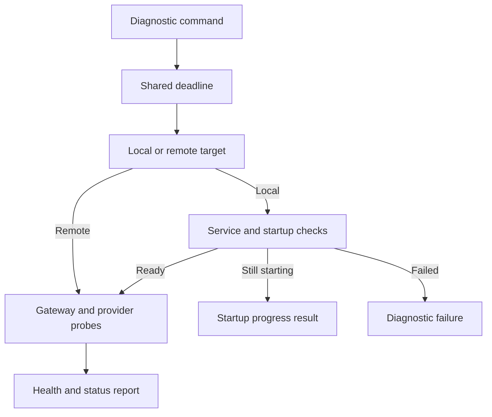

Codex review: blocked before merge. _Reviewed September 20, 2026, 2:40 AM ET / 06:40 UTC (Revision 10)._

# ClawSweeper review

## What this changes

Gateway diagnostics share a readiness deadline, distinguish ongoing startup from failure, and cancel provider usage requests when their allowance expires.

## Merge readiness

⛔ **Blocked before merge - 3 items remain**

This PR remains useful: current main still has the initial cold-start diagnostic failure. The prior cancellation finding is resolved, the maintainer has accepted the startup-result compatibility tradeoff, and this review found no remaining actionable defect.

**Priority:** P2
**Reviewed head:** `9f7d3b88b140165f74cdd978ebbff493b59319d4`

## Review scores

| Measure | Result | What it means |
|---|---|---|
| **Overall readiness** | 🐚 platinum hermit **(4/6)** | A useful, well-supported repair with resolved prior findings and an explicitly accepted compatibility tradeoff. |
| **Proof confidence** | 🦞 diamond lobster **(5/6)** | Sufficient (live_output): The hash-matched PR body records installed Linux Doctor/status/channel recovery through the real readiness path and a published-updater-to-candidate Doctor cell. That runtime matrix predates the cancellation follow-up, whose separately recorded regression coverage is supplemental; it does not invalidate the retained startup proof. |
| **Patch quality** | 🐚 platinum hermit **(4/6)** | No actionable review findings were identified. |

## Verification

| Check | Result | Evidence |
|---|---|---|
| **Real behavior** | Verified | Sufficient (live_output): The hash-matched PR body records installed Linux Doctor/status/channel recovery through the real readiness path and a published-updater-to-candidate Doctor cell. That runtime matrix predates the cancellation follow-up, whose separately recorded regression coverage is supplemental; it does not invalidate the retained startup proof. |
| **Evidence reviewed** | 9 items | Pinned change and clean checkout: The complete local merge-base-to-head file list contains 85 paths, including the five omitted from the bounded introduction listing. Live GitHub still identifies the pinned head as open, unmerged, and cleanly mergeable. git diff --check passed and the working tree remained clean. Current main still needs the repair: Fetched main retains a single initial status RPC with a 10,000 ms default in checkGatewayHealth; it does not call the proposed diagnostic readiness adapter. Latest release retains the reported boundary: The published v2026.9.5 source likewise uses the 10,000 ms initial Doctor probe. The release blob was inspected through GitHub after local historical blob retrieval failed. |
| **Findings** | None | None. |
| **Security** | None | None. |

## How this fits together

Doctor, health, and status commands inspect the Gateway and report its condition to operators. The shared readiness owner combines service identity, listener ownership, and Gateway responses before allowing further diagnostic requests.

## Before merge

- [ ] **Resolve merge risk (P1)** - External scripts assuming exit 0 always supplies a complete health/channel snapshot may need to handle the starting payload; this tradeoff is explicitly accepted, but arbitrary consumer compatibility is untested.
- [ ] **Review config compatibility** - Confirm compatibility and upgrade impact for the changed config or default surface before merge.
- [ ] **Add data-model compatibility proof** - Confirm migration or upgrade compatibility proof before merge.

<strong>Agent review details</strong>

### Security

None.

### PR surface

PR surface statistics unavailable: the file list is incomplete.

### Review metrics

| Metric | Value | Why it matters |
|---|---|---|
| **Production versus regression coverage** | Production net +463 lines; tests/support net +1,310 lines | The body justifies production growth by carrying startup state and deadlines through existing command boundaries while removing Doctor's duplicate loop. |
| **Diagnostic compatibility** | 60-second omitted timeout; 2 commands gain a starting JSON outcome | Health and channel-status consumers must distinguish pending startup from a complete snapshot. |

### Stored data model

Persistent data-model change detected: `migration/backfill/repair: src/commands/doctor-gateway-daemon-flow.ts`, `migration/backfill/repair: src/commands/doctor-gateway-health.ts`, `unknown-data-model-change: src/commands/doctor-gateway-daemon-flow.ts`, `unknown-data-model-change: src/commands/doctor-gateway-health.ts`, `unknown-truncated-pull-files`. Confirm migration or upgrade compatibility proof before merge.

### Root-cause cluster

Relationship: `fixed_by_candidate`
Canonical: https://github.com/openclaw/openclaw/issues/152970
Summary: This PR addresses the reported initial diagnostic cold-start race; related work does not supersede its broader coverage.

Members:
- `canonical`: https://github.com/openclaw/openclaw/issues/152970 - The open report supplies the measured startup failure and is explicitly linked by this candidate fix.
- `partial_overlap`: https://github.com/openclaw/openclaw/pull/149422 - The merged change covered Doctor after an approved restart, leaving initial diagnostics unresolved.
- `partial_overlap`: https://github.com/openclaw/openclaw/pull/153475 - The open alternative targets Doctor's initial race but lacks positive runtime proof and the broader health/status coverage.

Proposal only: this assessment does not dispatch repair, suppress jobs, mutate sibling items, close, or merge anything.

### Merge-risk options

**Maintainer options:**
1. **Retain the accepted diagnostic contract (recommended)**  
   Proceed with the documented starting payload and optional provider cancellation signals under the compatibility disposition already recorded in the PR body.

### Technical review

Best possible solution:

Retain the accepted best-effort startup contract through the shared readiness owner, with bounded probes, visible pending results, and cancellation at existing transport boundaries.

Do we have a high-confidence way to reproduce the issue?

Yes: current-main Doctor still makes the initial one-shot status request, and the captured installed-package matrix demonstrates failure during delayed startup. This read-only review did not execute a fresh reproduction.

Is this the best way to solve the issue?

Yes: reusing the existing readiness owner removes competing polling while preserving target selection, ownership checks, and bounded requests; the output compatibility choice is explicitly accepted.

AGENTS.md: found and applied where relevant.

Codex review notes: model internal, reasoning medium; reviewed against [d0192ed506c8](https://github.com/openclaw/openclaw/commit/d0192ed506c84a6f7bcebfb4fa405be8f15e2405).

### Labels

Label justifications:

- `P2`: This fixes misleading cold-start diagnostics without changing normal message delivery or Gateway availability.
- `merge-risk: 🚨 compatibility`: The documented pending-startup result changes health/channel JSON expectations, and provider usage hooks gain optional cancellation semantics.
- `rating: 🐚 platinum hermit`: Overall readiness is 🐚 platinum hermit; proof is 🦞 diamond lobster and patch quality is 🐚 platinum hermit.
- `status: 👀 ready for maintainer look`: ClawSweeper has no concrete contributor-facing blocker left for this PR. Sufficient (live_output): The hash-matched PR body records installed Linux Doctor/status/channel recovery through the real readiness path and a published-updater-to-candidate Doctor cell. That runtime matrix predates the cancellation follow-up, whose separately recorded regression coverage is supplemental; it does not invalidate the retained startup proof.
- `proof: sufficient`: Contributor real behavior proof is sufficient. The hash-matched PR body records installed Linux Doctor/status/channel recovery through the real readiness path and a published-updater-to-candidate Doctor cell. That runtime matrix predates the cancellation follow-up, whose separately recorded regression coverage is supplemental; it does not invalidate the retained startup proof.

### Evidence

What I checked:

- **Pinned change and clean checkout:** The complete local merge-base-to-head file list contains 85 paths, including the five omitted from the bounded introduction listing. Live GitHub still identifies the pinned head as open, unmerged, and cleanly mergeable. git diff --check passed and the working tree remained clean. ([9f7d3b88b140](https://github.com/openclaw/openclaw/commit/9f7d3b88b140165f74cdd978ebbff493b59319d4))
- **Current main still needs the repair:** Fetched main retains a single initial status RPC with a 10,000 ms default in checkGatewayHealth; it does not call the proposed diagnostic readiness adapter. ([`src/commands/doctor-gateway-health.ts:295`](https://github.com/openclaw/openclaw/blob/d0192ed506c84a6f7bcebfb4fa405be8f15e2405/src/commands/doctor-gateway-health.ts#L295), [d0192ed506c8](https://github.com/openclaw/openclaw/commit/d0192ed506c84a6f7bcebfb4fa405be8f15e2405))
- **Latest release retains the reported boundary:** The published v2026.9.5 source likewise uses the 10,000 ms initial Doctor probe. The release blob was inspected through GitHub after local historical blob retrieval failed. ([`src/commands/doctor-gateway-health.ts:155`](https://github.com/openclaw/openclaw/blob/ec9c1a13db8938e5a3eaa51fca2e981cde2395a9/src/commands/doctor-gateway-health.ts#L155), [ec9c1a13db89](https://github.com/openclaw/openclaw/commit/ec9c1a13db8938e5a3eaa51fca2e981cde2395a9))
- **Prior finding repaired:** Exhausted usage budgets return visible Timeout snapshots before fetch setup or authentication dispatch. Active work receives cancellation, checks it after authentication, and combines it with caller fetch signals; the focused regressions cover exhaustion, late auth, retained helpers, and client cancellation. ([`src/infra/provider-usage.load.ts:114`](https://github.com/openclaw/openclaw/blob/9f7d3b88b140165f74cdd978ebbff493b59319d4/src/infra/provider-usage.load.ts#L114), [9f7d3b88b140](https://github.com/openclaw/openclaw/commit/9f7d3b88b140165f74cdd978ebbff493b59319d4))
- **Startup identity safeguards:** The readiness owner rejects generation changes and observed version/build failures; explicit HTTP startup requires the running process to own all observed listeners before yielding still-starting. Diagnostic callers preserve remote targeting and defer unavailable shared credentials to the existing authentication path. ([`src/cli/daemon-cli/restart-health.ts:463`](https://github.com/openclaw/openclaw/blob/9f7d3b88b140165f74cdd978ebbff493b59319d4/src/cli/daemon-cli/restart-health.ts#L463), [9f7d3b88b140](https://github.com/openclaw/openclaw/commit/9f7d3b88b140165f74cdd978ebbff493b59319d4))
- **Complete captured proof and dispositions:** Read the full 17,988-unit PR body and verified SHA-256 cceb30d98dc70042f6d20b739acb82a6ae3d29ce8abb13deecc17c7f13e12bd5 matches the supplied snapshot. It records installed Linux recovery at 25–36 seconds, an actually-down control, candidate CLI against the published Gateway, and the unmodified 2026.9.5 updater invoking candidate Doctor. That matrix covers the original implementation; later cancellation work has separately recorded failing-before regressions and a 592-case Linux run. The body explicitly accepts the starting payload and explains why no data migration applies. ([9f7d3b88b140](https://github.com/openclaw/openclaw/commit/9f7d3b88b140165f74cdd978ebbff493b59319d4))

Likely related people:

- **unknown:** The claimed source-line change could not be verified from bounded local history. (role: source history unknown; confidence: low)

### Rating scale

| Score | Internal tier | Crab rank | Meaning |
|---:|:---:|---|---|
| **6/6** | S | 🦀 challenger crab | Exceptional readiness |
| **5/6** | A | 🦞 diamond lobster | Very strong readiness |
| **4/6** | B | 🐚 platinum hermit | Good normal PR; ordinary maintainer review |
| **3/6** | C | 🦐 gold shrimp | Useful, but confidence is limited |
| **2/6** | D | 🦪 silver shellfish | Proof or implementation needs work |
| **1/6** | F | 🧂 unranked krab | Not merge-ready |
| N/A | NA | 🌊 off-meta tidepool | Rating does not apply |

Overall follows the weaker of proof and patch quality.
Shiny media proof means a screenshot, video, or linked artifact directly shows the changed behavior. Runtime, network, CSP, and security claims still need visible diagnostics.

### Workflow

- ClawSweeper keeps one durable marker-backed review comment per issue or PR.
- Re-runs edit this comment so the latest verdict, findings, and automation markers stay together instead of adding duplicate bot comments.
- A fresh review can be triggered by eligible `@clawsweeper re-review` comments, exact-item GitHub events, scheduled/background review runs, or manual workflow dispatch.
- PR/issue authors and users with repository write access can comment `@clawsweeper re-review` or `@clawsweeper re-run` on an open PR or issue to request a fresh review only.
- Maintainers can also comment `@clawsweeper review` to request a fresh review only.
- Fresh-review commands do not start repair, autofix, rebase, CI repair, or automerge.
- Maintainer-only repair and merge flows require explicit commands such as `@clawsweeper autofix`, `@clawsweeper automerge`, `@clawsweeper fix ci`, or `@clawsweeper address review`.
- Maintainers can comment `@clawsweeper explain` to ask for more context, or `@clawsweeper stop` to stop active automation.

### History

Review history (9 earlier review cycles; latest 8 shown)

<!-- clawsweeper-review-history v=1 total=9 -->
- reviewed 2026-09-19T20:06:44.857Z sha 736eefb70981fcfa760322adcca4258c81ef3fd8 :: blocked before merge. :: [P2] Stop provider work when the shared usage budget is exhausted
- reviewed 2026-09-19T20:59:28.178Z sha 78dd34241c0ad34f88e0705af647761ef33cbb02 :: blocked before merge. :: [P2] Stop provider work when the shared usage budget is exhausted
- reviewed 2026-09-19T21:16:12.624Z sha 59bd2b0444018564c10379acbaf9d8527b635565 :: blocked before merge. :: [P2] Stop provider work when the shared usage budget is exhausted
- reviewed 2026-09-19T23:47:33.590Z sha b7e6ec709e1730eb60c1055aa59538e4ce52121b :: blocked before merge. :: [P2] Stop provider work when the shared usage budget is exhausted
- reviewed 2026-09-20T00:37:44.033Z sha b7e6ec709e1730eb60c1055aa59538e4ce52121b :: blocked before merge. :: [P2] Stop provider work when the shared usage budget is exhausted
- reviewed 2026-09-20T03:11:42.819Z sha 03f761445e78885b5f0f510c62415948ab4f932a :: blocked before merge. :: none
- reviewed 2026-09-20T04:14:49.174Z sha aba308f535f619f0d44575ef0471c6c302a7e0ce :: blocked before merge. :: none
- reviewed 2026-09-20T05:35:52.976Z sha 9f7d3b88b140165f74cdd978ebbff493b59319d4 :: blocked before merge. :: none

<!-- clawsweeper-verdict:needs-human item=153063 sha=9f7d3b88b140165f74cdd978ebbff493b59319d4 confidence=high updated_at=2026-09-20T06:37:01Z reviewed_at=2026-09-20T06:40:33.004Z lease_owner=github-run-35494621861-1 lease_comment_id=5748167360 source_revision=702ffc8d662348845a60d74f23d22a475228ec7e15c977a5e48045e40ea5b746 live_verification=absent -->
<!-- clawsweeper-review-state:blocked item=153063 sha=9f7d3b88b140165f74cdd978ebbff493b59319d4 v=1 -->

<!-- clawsweeper-review-version item=153063 reviewed_at=2026-09-20T06:40:33.004Z sha=9f7d3b88b140165f74cdd978ebbff493b59319d4 source_revision=702ffc8d662348845a60d74f23d22a475228ec7e15c977a5e48045e40ea5b746 lease_owner=github-run-35494621861-1 lease_comment_id=5748167360 v=1 -->

<!-- clawsweeper-review item=153063 -->