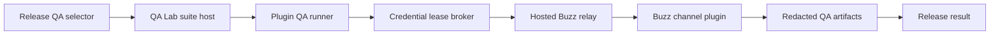

Codex review: found issues before merge. _Reviewed July 30, 2026, 7:47 PM ET / 23:47 UTC._

# ClawSweeper review

## What this changes

Adds a plugin-owned live QA Lab runner for Buzz that leases dedicated relay credentials, executes canary and mention-gating scenarios, redacts artifacts, and selects the lane from release validation.

## Merge readiness

⚠️ **Needs maintainer review before merge - 6 items remain**

Keep this PR open for human approval: it has credible exact-head live Buzz proof, but it still adds an unapproved `nostr-tools` dependency to the credential broker and expands the plugin QA contract while making Buzz a selected release QA lane.

**Priority:** P2
**Reviewed head:** `c5c7e70e8d9cd50d0a6dcf80b36e24944b00dafd`
**Owner decision:** Required. See [Decision needed](#decision-needed).

## Review scores

| Measure | Result | What it means |
|---|---|---|
| **Overall readiness** | 🦐 gold shrimp **(3/6)** | The real behavior evidence is strong, but the patch remains blocked by a required dependency authorization and unresolved owner scope for shared release infrastructure. |
| **Proof confidence** | 🦞 diamond lobster **(5/6)** | Sufficient (live_output): Redacted exact-head hosted output demonstrates both real Buzz relay scenarios passing through the plugin and reports a completed artifact secret scan; no additional contributor proof is needed. |
| **Patch quality** | 🦐 gold shrimp **(3/6)** | Security review found an item that needs attention. |

## Verification

| Check | Result | Evidence |
|---|---|---|
| **Real behavior** | Verified | Sufficient (live_output): Redacted exact-head hosted output demonstrates both real Buzz relay scenarios passing through the plugin and reports a completed artifact secret scan; no additional contributor proof is needed. |
| **Evidence reviewed** | 6 items | Unapproved broker dependency: The branch adds pinned `nostr-tools` to the Convex credential broker, and the dependency-graph guard explicitly requires exact-head admin or secops authorization; the visible contributor request is not that authorization.<br>Credential broker uses the new dependency around sensitive QA payloads: The dependency is imported by the broker payload validator that parses Buzz private-key material before credential rows are accepted, making the repository approval gate security-relevant rather than routine package churn.<br>Plugin QA contract expansion: The PR adds a credential-host capability to every QA transport factory context, so the new public Plugin SDK contract needs an owner decision rather than being treated as a Buzz-only test helper. |
| **Findings** | 1 actionable finding | [P1] Obtain exact-head approval for the broker dependency |
| **Security** | Needs attention | Broker dependency lacks required exact-head authorization: The PR adds `nostr-tools` to code that parses Buzz private keys in the credential broker, but the repository dependency guard reports no admin or secops approval for this head. |

## How this fits together

QA Lab discovers plugin-provided transport runners and starts an ephemeral gateway against real channel infrastructure. This change feeds leased Buzz relay credentials into that runner and reports scenario evidence back to release-validation workflows.



## Decision needed

| Question | Recommendation |
|---|---|
| Should OpenClaw permanently add the hosted Buzz lane as a selected release QA requirement and expose the accompanying credential-host capability through the Plugin SDK? | **Keep Buzz QA non-blocking:** Retain the runner as an opt-in QA path but remove it from blocking release selection until relay ownership and the plugin contract are explicitly sponsored. |

Why: This is a product and operational contract decision: it changes both the supported plugin seam and the release system's dependency on a credential broker and external relay.

## Before merge

- [ ] **Obtain exact-head approval for the broker dependency (P1)** - `nostr-tools` is newly added to the Convex broker dependency graph, but the dependency guard has rejected this exact head until a repository admin or secops owner authorizes it. The contributor's request is not that authorization, so the branch cannot merge while this required gate remains blocked.
- [ ] **Resolve security concern: Broker dependency lacks required exact-head authorization** - The PR adds `nostr-tools` to code that parses Buzz private keys in the credential broker, but the repository dependency guard reports no admin or secops approval for this head.
- [ ] **Resolve merge risk (P1)** - The new `nostr-tools` dependency executes in the Convex broker that validates leased private-key payloads; landing it without the repository's exact-head dependency authorization bypasses the intended supply-chain review gate.
- [ ] **Resolve merge risk (P1)** - The new Plugin SDK credential-host contract and release-selected hosted Buzz lane create a lasting compatibility and release-automation commitment that has not received visible owner confirmation.
- [ ] **Resolve merge risk (P1)** - A release run can now depend on a pooled Buzz credential and hosted relay availability, so its blocking status needs explicit operational ownership.

## Findings

- [P1] Obtain exact-head approval for the broker dependency — `qa/convex-credential-broker/package.json:13`
- [medium] Broker dependency lacks required exact-head authorization — `qa/convex-credential-broker/package.json:13`


<details>
<summary><strong>Agent review details</strong></summary>

### Security

Needs attention: The new third-party dependency is security-sensitive because the affected broker validates and leases private-key-bearing QA credentials, and its required exact-head authorization is absent.

### PR surface

Source +734, Tests +874, Docs +100, Config +137, Other +132. Total +1977 across 33 files.

<details>
<summary>View PR surface stats</summary>

| Area | Files | Added | Removed | Net |
|---|---:|---:|---:|---:|
| Source | 13 | 740 | 6 | +734 |
| Tests | 10 | 876 | 2 | +874 |
| Docs | 6 | 122 | 22 | +100 |
| Config | 3 | 140 | 3 | +137 |
| Generated | 0 | 0 | 0 | 0 |
| Other | 1 | 132 | 0 | +132 |
| **Total** | **33** | **2010** | **33** | **+1977** |

</details>

### Review metrics

| Metric | Value | Why it matters |
|---|---|---|
| **Release QA lanes** | 1 new hosted Buzz lane selected by release validation | This changes release automation from a local QA capability into an operational dependency on a credential pool and relay. |
| **Plugin QA contract** | 1 credential-host capability added to transport factory context | All transport adapters receive the new SDK context, so it is a compatibility-sensitive shared seam. |

### Stored data model

Persistent data-model change detected: `serialized state: extensions/qa-lab/src/gateway-log-redaction.test.ts`. Confirm migration or upgrade compatibility proof before merge.

### Merge-risk options

**Maintainer options:**
1. **Authorize and document the release contract (recommended)**  
   A repository admin or secops owner should authorize the exact broker dependency head and an owner should confirm the Plugin SDK and blocking-release scope before merge.
2. **Narrow to an opt-in lane**  
   Remove the blocking release selector and public contract expansion if maintainers want Buzz QA available without making hosted relay health a release dependency.
3. **Pause pending ownership**  
   Do not land the hosted credential-broker integration until a responsible owner accepts its supply-chain and release-operation obligations.

<details>
<summary>Copy recommended automerge instruction</summary>

```text
@clawsweeper automerge

Special instructions:
After exact-head dependency authorization, confirm the credential-host Plugin SDK contract and that the Buzz lane is intended to remain selected by release validation.
```

</details>

### Technical review

Best possible solution:

Authorize or remove the broker dependency, then obtain owner confirmation that the credential-host SDK addition and blocking Buzz release lane are the intended long-term contracts before merging.

Do we have a high-confidence way to reproduce the issue?

Not applicable: this PR adds a new QA and release-validation capability rather than repairing a reported current-main failure. The contributor supplied credible after-fix evidence for the proposed hosted path.

Is this the best way to solve the issue?

Unclear: the plugin-owned QA runner is a coherent implementation, but the shared Plugin SDK credential seam and blocking release inclusion need explicit owner acceptance before this can be called the best long-term solution.

Full review comments:

- [P1] Obtain exact-head approval for the broker dependency — `qa/convex-credential-broker/package.json:13`
  `nostr-tools` is newly added to the Convex broker dependency graph, but the dependency guard has rejected this exact head until a repository admin or secops owner authorizes it. The contributor's request is not that authorization, so the branch cannot merge while this required gate remains blocked.
  Confidence: 0.99

Overall correctness: patch is incorrect
Overall confidence: 0.95

AGENTS.md: found and applied where relevant.

Codex review notes: model internal, reasoning high; reviewed against [a473fc6f3e21](https://github.com/openclaw/openclaw/commit/a473fc6f3e21489147ade3b4dfa1bac6a5a09a08).

### Labels

Label justifications:

- `P2`: The PR improves release QA but its unresolved approval and ownership questions are important without demonstrating a current user-facing outage.
- `merge-risk: 🚨 compatibility`: The PR adds a shared Plugin SDK credential-host contract and changes the supported release-validation behavior.
- `merge-risk: 🚨 security-boundary`: It adds a third-party dependency to the broker that validates and leases credentials containing private-key material.
- `merge-risk: 🚨 automation`: Release validation newly selects a hosted Buzz lane whose successful execution depends on broker and relay operations.
- `rating: 🦐 gold shrimp`: Overall readiness is 🦐 gold shrimp; proof is 🦞 diamond lobster and patch quality is 🦐 gold shrimp.
- `status: ⏳ waiting on author`: ClawSweeper has contributor-facing work open and is waiting for author action. Sufficient (live_output): Redacted exact-head hosted output demonstrates both real Buzz relay scenarios passing through the plugin and reports a completed artifact secret scan; no additional contributor proof is needed.
- `proof: sufficient`: Contributor real behavior proof is sufficient. Redacted exact-head hosted output demonstrates both real Buzz relay scenarios passing through the plugin and reports a completed artifact secret scan; no additional contributor proof is needed.

### Evidence

Security concerns:

- [medium] Broker dependency lacks required exact-head authorization — `qa/convex-credential-broker/package.json:13`
  The PR adds `nostr-tools` to code that parses Buzz private keys in the credential broker, but the repository dependency guard reports no admin or secops approval for this head.
  Confidence: 0.99

What I checked:

- **Unapproved broker dependency:** The branch adds pinned `nostr-tools` to the Convex credential broker, and the dependency-graph guard explicitly requires exact-head admin or secops authorization; the visible contributor request is not that authorization. ([`qa/convex-credential-broker/package.json:13`](https://github.com/openclaw/openclaw/blob/c5c7e70e8d9c/qa/convex-credential-broker/package.json#L13), [c5c7e70e8d9c](https://github.com/openclaw/openclaw/commit/c5c7e70e8d9c))
- **Credential broker uses the new dependency around sensitive QA payloads:** The dependency is imported by the broker payload validator that parses Buzz private-key material before credential rows are accepted, making the repository approval gate security-relevant rather than routine package churn. ([`qa/convex-credential-broker/convex/payload_validation.ts:2`](https://github.com/openclaw/openclaw/blob/c5c7e70e8d9c/qa/convex-credential-broker/convex/payload_validation.ts#L2), [c5c7e70e8d9c](https://github.com/openclaw/openclaw/commit/c5c7e70e8d9c))
- **Plugin QA contract expansion:** The PR adds a credential-host capability to every QA transport factory context, so the new public Plugin SDK contract needs an owner decision rather than being treated as a Buzz-only test helper. ([`src/plugin-sdk/qa-runner-runtime.ts:188`](https://github.com/openclaw/openclaw/blob/c5c7e70e8d9c/src/plugin-sdk/qa-runner-runtime.ts#L188), [c5c7e70e8d9c](https://github.com/openclaw/openclaw/commit/c5c7e70e8d9c))
- **Release inclusion changes:** The release workflow adds a Buzz live-lane selector and enables it in the release QA selection path, introducing a hosted credential and relay dependency into release automation. ([`.github/workflows/openclaw-release-checks.yml:334`](https://github.com/openclaw/openclaw/blob/c5c7e70e8d9c/.github/workflows/openclaw-release-checks.yml#L334), [c5c7e70e8d9c](https://github.com/openclaw/openclaw/commit/c5c7e70e8d9c))
- **Exact-head real behavior proof:** The contributor posted redacted output for head c5c7e70e showing the hosted real-relay canary and mention-gating scenarios passing 2/2 through the Buzz plugin, with a post-run artifact secret scan reporting zero matches. ([c5c7e70e8d9c](https://github.com/openclaw/openclaw/commit/c5c7e70e8d9c))
- **Prior review continuity:** The latest completed ClawSweeper review at the same head identified exact-head dependency authorization as its remaining P1 blocker; no admin or secops authorization appears in the supplied subsequent discussion. ([`qa/convex-credential-broker/package.json:13`](https://github.com/openclaw/openclaw/blob/c5c7e70e8d9c/qa/convex-credential-broker/package.json#L13), [c5c7e70e8d9c](https://github.com/openclaw/openclaw/commit/c5c7e70e8d9c))

Likely related people:

- **steipete:** The contributor explicitly requested exact-head dependency authorization from this person after the dependency guard blocked the broker package change. (role: requested approval owner; confidence: medium; files: `qa/convex-credential-broker/package.json`, `.github/workflows/qa-live-transports-convex.yml`)

### Rank-up moves

Optional improvements that raise the rating; they are not merge blockers.

- Obtain repository-admin or secops authorization for the exact dependency-changing head.
- Have an owner explicitly accept or narrow the Plugin SDK credential-host and release-lane contracts.

### Rating scale

| Score | Internal tier | Crab rank | Meaning |
|---:|:---:|---|---|
| **6/6** | S | 🦀 challenger crab | Exceptional readiness |
| **5/6** | A | 🦞 diamond lobster | Very strong readiness |
| **4/6** | B | 🐚 platinum hermit | Good normal PR; ordinary maintainer review |
| **3/6** | C | 🦐 gold shrimp | Useful, but confidence is limited |
| **2/6** | D | 🦪 silver shellfish | Proof or implementation needs work |
| **1/6** | F | 🧂 unranked krab | Not merge-ready |
| N/A | NA | 🌊 off-meta tidepool | Rating does not apply |

Overall follows the weaker of proof and patch quality.
Shiny media proof means a screenshot, video, or linked artifact directly shows the changed behavior. Runtime, network, CSP, and security claims still need visible diagnostics.

### Workflow

- ClawSweeper keeps one durable marker-backed review comment per issue or PR.
- Re-runs edit this comment so the latest verdict, findings, and automation markers stay together instead of adding duplicate bot comments.
- A fresh review can be triggered by eligible `@clawsweeper re-review` comments, exact-item GitHub events, scheduled/background review runs, or manual workflow dispatch.
- PR/issue authors and users with repository write access can comment `@clawsweeper re-review` or `@clawsweeper re-run` on an open PR or issue to request a fresh review only.
- Maintainers can also comment `@clawsweeper review` to request a fresh review only.
- Fresh-review commands do not start repair, autofix, rebase, CI repair, or automerge.
- Maintainer-only repair and merge flows require explicit commands such as `@clawsweeper autofix`, `@clawsweeper automerge`, `@clawsweeper fix ci`, or `@clawsweeper address review`.
- Maintainers can comment `@clawsweeper explain` to ask for more context, or `@clawsweeper stop` to stop active automation.

### History

<details>
<summary>Review history (7 earlier review cycles)</summary>

<!-- clawsweeper-review-history v=1 total=7 -->
- reviewed 2026-07-30T07:55:11.112Z sha 573f8b017f341cbbc8fdcb7fb615889475622e98 :: needs real behavior proof before merge. :: [P2] Prove the ACP scenario can complete before exposing its live lane
- reviewed 2026-07-30T21:21:36.927Z sha 53160a66e6698837abc1d6924a2f49b3dc0e58b8 :: needs real behavior proof before merge. :: none
- reviewed 2026-07-30T22:06:59.232Z sha 2bd5f49145961b54153ab414485c67de4e92a452 :: found issues before merge. :: [P1] Remove or authorize the broker dependency
- reviewed 2026-07-30T22:38:17.384Z sha a87b0347406c15cb86b5a35839f480aafbf7471f :: found issues before merge. :: [P1] Remove or authorize the broker dependency
- reviewed 2026-07-30T22:48:34.514Z sha d00ec301f184629bb254d03c4184e623981e3565 :: found issues before merge. :: [P1] Obtain exact-head approval for the broker dependency
- reviewed 2026-07-30T23:37:52.793Z sha c5c7e70e8d9cd50d0a6dcf80b36e24944b00dafd :: needs real behavior proof before merge. :: [P1] Obtain exact-head approval for the broker dependency
- reviewed 2026-07-30T23:43:54.491Z sha c5c7e70e8d9cd50d0a6dcf80b36e24944b00dafd :: found issues before merge. :: [P1] Obtain exact-head approval for the broker dependency

</details>

</details>

<!-- clawsweeper-security:security-sensitive item=116298 sha=c5c7e70e8d9cd50d0a6dcf80b36e24944b00dafd confidence=high updated_at=2026-07-30T23:46:34Z reviewed_at=2026-07-30T23:47:42.048Z lease_owner=github-run-30591494532-1 lease_comment_id=5137440754 source_revision=f8946893786a563e4f161f003707beb98e98fbe95875f14ec13336456b6c4707 -->
<!-- clawsweeper-verdict:needs-human item=116298 sha=c5c7e70e8d9cd50d0a6dcf80b36e24944b00dafd confidence=high updated_at=2026-07-30T23:46:34Z reviewed_at=2026-07-30T23:47:42.048Z lease_owner=github-run-30591494532-1 lease_comment_id=5137440754 source_revision=f8946893786a563e4f161f003707beb98e98fbe95875f14ec13336456b6c4707 -->

<!-- clawsweeper-review-version item=116298 reviewed_at=2026-07-30T23:47:42.048Z sha=c5c7e70e8d9cd50d0a6dcf80b36e24944b00dafd source_revision=f8946893786a563e4f161f003707beb98e98fbe95875f14ec13336456b6c4707 lease_owner=github-run-30591494532-1 lease_comment_id=5137440754 v=1 -->

<!-- clawsweeper-review item=116298 -->