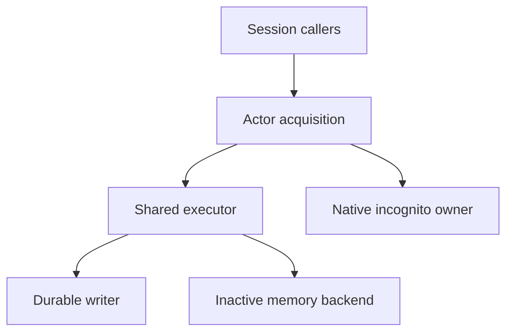

Codex review: needs changes before merge.

## What this changes

This PR shares session actor execution policies and adds an inactive memory backend for incognito sessions.

**Example:** Production acquires agent:main:dashboard:incognito-declined.
- **Before:** The native incognito owner retains the session.
- **After:** Acquisition still preserves that owner without creating a memory actor.

## Review scores

| Measure | Result | What it means |
|---|---|---|
| **Overall readiness** | 🦐 gold shrimp **(3/6)** | Useful approved preparation with meaningful owner-boundary coverage and no identified introduced defect. |
| **Proof confidence** | 🦐 gold shrimp **(3/6)** | This maintainer-authored preparation is outside the ordinary contributor proof gate; supplied evidence reports focused actor harness coverage and a durable Gateway workload, while source confirms memory remains excluded from production acquisition. |
| **Patch quality** | 🐚 platinum hermit **(4/6)** | No actionable review findings were identified. |

## Product

**Kind:** Refactor · **Worth it:** Yes · **Fix scope:** Complete
**User problem:** Native incognito sessions retain a separate SQLite owner that prevents the session actor from eliminating their database work.
**Reason:** Maintainer authorship establishes direction for this explicitly inactive preparation step and its later complete cutover.

## Merge readiness

⛔ **Needs changes before merge - 1 item remains**

Keep this maintainer-directed inactive refactor open; the earlier wrapper finding is fixed, and no new actionable patch defect was established.

**Priority:** P2
**Reviewed head:** `1e816ebb450adceafe8aa979d6b3174a1c6c96f6`

## Before merge

- [ ] **Complete next step** - Establish whether the current-head terminal-canvas timeout is inherited or diff-caused using matching baseline evidence or a head-versus-revert comparison, and repair only a demonstrated diff-caused failure.

## Findings

None.

### Tests

- Missing end-to-end proof: The supplied evidence does not complete the published v2026.10.1 driver × candidate Doctor update cell with existing configuration and session data intact.

<strong>Agent review details</strong>

### How this fits together

Session callers submit typed commands to the actor, which returns committed state and receipts through the existing durable writer or explicit memory acquisition.

### Technical review

Best possible solution:

Preserve the shared actor owner and activate memory only with the documented complete consumer cutover.

Do we have a high-confidence way to reproduce the issue?

This is a staged refactor rather than a bug report; source confirms production incognito acquisition remains unchanged, and no target code was executed during review.

Is this the best way to solve the issue?

Sharing lifetime, phase, receipt, and pure-policy ownership follows the existing actor design while the approved staging plan prevents competing production writers.

AGENTS.md: found and applied where relevant.

Codex review notes: model internal, reasoning medium; reviewed against [3529142cc84f](https://github.com/openclaw/openclaw/commit/3529142cc84f8b45d00bda9c78e03d29e82dfd7d).

### Provenance checked

- `Actor lifetime, phases, and receipts` keeps the original intent (d5173ccc77b9ff5395cdbc38a8c37b45349d46e0: Use the existing writer with scoped receipts, accepted-work drainage, and an intentional native-incognito decline.)
- `Goal policies` keeps the original intent (047470456ff2e47175edd82e1f3464358ed40022: Commit typed Goal transitions and retry receipts atomically with session admission.)
- `Pending-input custody` keeps the original intent (6c9954cbb69880960257eb7811581b0b5dedc774: Retain canonical input before acknowledgment and promote it through its admitted execution owner.)
- `CLI history account coverage` keeps the original intent (e20b56c0b26eec6db2af373da4598c8f40bee626: Recover only contiguous history belonging to the admitted credential.)
- `Snapshot attachment` keeps the original intent (ae6a88438de360932c02007849e6727fa6fe1848: Separate cold snapshots from metadata while preserving complete entries where required.)
- `Cache-TTL prefix replay` keeps the original intent (0257a7dab0ffcf51af96c91844b18c2aab09cf25: Replay bounded deltas from their checkpoint without rewriting accepted transcript bytes.)
- `Prepared transcript append ancestry` keeps the original intent (80e7d21dda532bac1f7204d96dded8c35283cceb: Allow late Talk history bookkeeping without treating it as newly admitted user work.)
- `Harness completion input predicates` keeps the original intent (48c022a42c131ec026291c4be79937722119b2f9: Carry prepared source facts while preserving live authority and transaction-local source predicates.)

### Testing

Proof path: in-process harness.

### Security

None.

### Evidence

What I checked:

- **Production activation remains excluded:** Native-incognito acquisition returns not-actor-owned before the memory branch; the production input-acquisition caller still selects the native-incognito target. Current main retains the same decline. ([`src/config/sessions/session-actor-durable.ts:104`](https://github.com/openclaw/openclaw/blob/1e816ebb450adceafe8aa979d6b3174a1c6c96f6/src/config/sessions/session-actor-durable.ts#L104), [1e816ebb450a](https://github.com/openclaw/openclaw/commit/1e816ebb450adceafe8aa979d6b3174a1c6c96f6))
- **Previous finding resolved:** The introduced wrapper inventory includes the extracted executor, SQLite executor, snapshot-values helper, and transcript-parent helper. ([`scripts/pr-lib/wrapper-components.txt:347`](https://github.com/openclaw/openclaw/blob/1e816ebb450adceafe8aa979d6b3174a1c6c96f6/scripts/pr-lib/wrapper-components.txt#L347), [1e816ebb450a](https://github.com/openclaw/openclaw/commit/1e816ebb450adceafe8aa979d6b3174a1c6c96f6))
- **Accepted staging boundary:** The maintainer-authored body explicitly defers production selection until complete consumer migration and requires correction of distinct inputId/transcriptInputId collected-custody retries before activation; this PR leaves that path inactive. ([`src/config/sessions/session-actor-memory-messages.ts:107`](https://github.com/openclaw/openclaw/blob/1e816ebb450adceafe8aa979d6b3174a1c6c96f6/src/config/sessions/session-actor-memory-messages.ts#L107), [1e816ebb450a](https://github.com/openclaw/openclaw/commit/1e816ebb450adceafe8aa979d6b3174a1c6c96f6))
- **Memory commit boundary:** The memory owner authorizes the complete postimage and checks caller lifetime, owner currentness, and authority immediately before installing its synchronous working state. ([`src/config/sessions/session-actor-memory.ts:228`](https://github.com/openclaw/openclaw/blob/1e816ebb450adceafe8aa979d6b3174a1c6c96f6/src/config/sessions/session-actor-memory.ts#L228), [1e816ebb450a](https://github.com/openclaw/openclaw/commit/1e816ebb450adceafe8aa979d6b3174a1c6c96f6))
- **Verified no-migration case:** Doctor edits redirect imports to the extracted snapshot attachment policy; the introduced changes preserve its implementation and add no durable schema, serialization, retention, or production backend migration. ([`src/config/sessions/session-entry-snapshot-values.ts:12`](https://github.com/openclaw/openclaw/blob/1e816ebb450adceafe8aa979d6b3174a1c6c96f6/src/config/sessions/session-entry-snapshot-values.ts#L12), [1e816ebb450a](https://github.com/openclaw/openclaw/commit/1e816ebb450adceafe8aa979d6b3174a1c6c96f6))
- **Current required UI failure remains unattributed:** Current-head annotations report a hidden terminal-canvas timeout in https://github.com/openclaw/openclaw/actions/runs/38150937761/job/114504439497. The base CI run https://github.com/openclaw/openclaw/actions/runs/38150613853 skipped UI E2E, so its successful conclusion does not establish inheritance. Full job-log retrieval was blocked by the host allowlist; no diff-caused failure is claimed. ([`ui/src/e2e/chat-panel-layout.e2e.test.ts:379`](https://github.com/openclaw/openclaw/blob/1e816ebb450adceafe8aa979d6b3174a1c6c96f6/ui/src/e2e/chat-panel-layout.e2e.test.ts#L379), [1e816ebb450a](https://github.com/openclaw/openclaw/commit/1e816ebb450adceafe8aa979d6b3174a1c6c96f6))

Likely related people:

- **Peter Steinberger:** Raw commit d5173ccc77b9ff5395cdbc38a8c37b45349d46e0 adds src/config/sessions/session-actor-durable.ts:100 relative to its recorded parents. This identifies author metadata, not feature responsibility or a PR merger. (role: source-line author; confidence: high; commits: [d5173ccc77b9](https://github.com/openclaw/openclaw/commit/d5173ccc77b9ff5395cdbc38a8c37b45349d46e0); files: `src/config/sessions/session-actor-durable.ts`)

### PR surface

PR surface statistics unavailable: the file list is incomplete.

### Review metrics

| Metric | Value | Why it matters |
|---|---|---|
| **Production versus test LOC** | Production TypeScript +4074/−1588; tests +1496/−6 | Growth supplies the approved inactive memory implementation and contract coverage; removal of native and pinned-worker owners belongs to the final cutover. |

### Labels

Label changes:

No label changes.

Label justifications:

- `P2`: This is an internal session refactor with production memory activation explicitly excluded.
- `rating: 🦐 gold shrimp`: Overall readiness is 🦐 gold shrimp; proof is 🦐 gold shrimp and patch quality is 🐚 platinum hermit.
- `status: ⏳ waiting on author`: ClawSweeper has contributor-facing work open and is waiting for author action.

### Rating scale

6/6 🦀 challenger crab · 5/6 🦞 diamond lobster · 4/6 🐚 platinum hermit · 3/6 🦐 gold shrimp · 2/6 🦪 silver shellfish · 1/6 🧂 unranked krab. Overall follows the weaker of proof and patch quality; ✨ marks media proof (a screenshot, video, or linked artifact) that directly shows the changed behavior.

### Workflow

ClawSweeper edits this one comment on every review. Comment `@clawsweeper re-review` for a fresh review only; repair and merge need explicit maintainer commands such as `@clawsweeper autofix` or `@clawsweeper automerge`.

### History

Review history (4 earlier review cycles)

<!-- clawsweeper-review-history v=1 total=4 -->
- reviewed 2026-10-11T13:33:09.536Z sha 52cb3aa1cad777e0fb840983ef0e925fd8f730ff :: needs changes before merge. :: [P1] Include the extracted modules in the trusted wrapper inventory
- reviewed 2026-10-11T13:50:08.291Z sha d4c46c42e14f55623b1859619b2333c11b6b3f9a :: needs changes before merge. :: none
- reviewed 2026-10-11T14:08:03.982Z sha c8b22b5972cbbc17776163ff7eddf1e3c11f6119 :: needs changes before merge. :: none
- reviewed 2026-10-11T15:07:32.299Z sha cc8c94e01cb8a30f881d1bf0f783fd9a9ce2d08a :: needs changes before merge. :: none

_Reviewed October 11, 2026, 11:29 AM ET / 15:29 UTC (Revision 5)._

<!-- clawsweeper-verdict:needs-human item=169124 sha=1e816ebb450adceafe8aa979d6b3174a1c6c96f6 confidence=high updated_at=2026-10-11T15:24:18Z reviewed_at=2026-10-11T15:29:48.003Z lease_owner=github-run-38151048769-1 lease_comment_id=6110558498 source_revision=87a300e817666bb20defe629fc9cd52542e9e9200808f9d5daf5f5e5a666093a live_verification=absent hold=blocked findings=0 -->
<!-- clawsweeper-review-state:needs-changes item=169124 sha=1e816ebb450adceafe8aa979d6b3174a1c6c96f6 v=1 -->

<!-- clawsweeper-review-version item=169124 reviewed_at=2026-10-11T15:29:48.003Z sha=1e816ebb450adceafe8aa979d6b3174a1c6c96f6 source_revision=87a300e817666bb20defe629fc9cd52542e9e9200808f9d5daf5f5e5a666093a lease_owner=github-run-38151048769-1 lease_comment_id=6110558498 v=1 -->

<!-- clawsweeper-review item=169124 -->