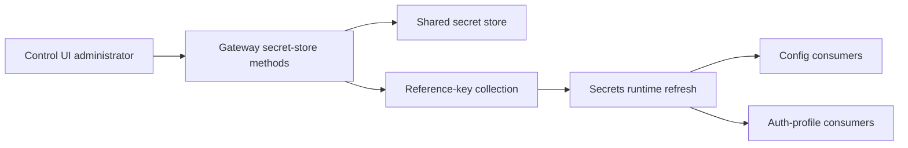

Codex review: found issues before merge. _Reviewed August 11, 2026, 1:59 AM ET / 05:59 UTC._

# ClawSweeper review

## What this changes

Adds three admin-scoped Gateway RPCs and a Control UI Secrets page for managing team secret and environment entries with automatic runtime refresh.

## Merge readiness

⚠️ **Ready for maintainer review - 5 items remain**

Keep open: deleting a store value used only by an active auth profile can retain the old credential as last-known-good, because the new force-cold collector traverses config but not the separate auth-store snapshot.

**Priority:** P1
**Reviewed head:** `20ea605354d2b08bd687ca58b52f0e46c972ca09`

## Review scores

| Measure | Result | What it means |
|---|---|---|
| **Overall readiness** | 🦐 gold shrimp **(3/6)** | The feature has substantial validation and visible UI evidence, but the unresolved auth-profile deletion path is a merge-blocking correctness and security concern. |
| **Proof confidence** | 🌊 off-meta tidepool | Not applicable: This maintainer-authored PR includes UI screenshots and focused test evidence; the external-contributor real-behavior-proof gate does not apply. |
| **Patch quality** | 🦐 gold shrimp **(3/6)** | Security review found an item that needs attention. |

## Verification

| Check | Result | Evidence |
|---|---|---|
| **Real behavior** | Not applicable | Not applicable: This maintainer-authored PR includes UI screenshots and focused test evidence; the external-contributor real-behavior-proof gate does not apply. |
| **Evidence reviewed** | 6 items | Force-cold collector omits auth stores: The PR collector walks only the supplied configuration tree, so it cannot discover a store SecretRef held exclusively in the active authStores snapshot. Auth profiles are a separate runtime input: Current main loads auth stores separately and feeds each store to collectAuthStoreAssignments, rather than placing those refs in sourceConfig. Existing runtime can preserve credential bytes: The auth-store rollback path retains a current key or token when its SecretRef and provider definition are unchanged, which is the stale value this PR intends to prevent after a store mutation. |
| **Findings** | 1 actionable finding | [P1] Include auth-store refs in force-cold reloads |
| **Security** | Needs attention | Deleted auth-profile credentials can remain active: The mutation refresh key set excludes active auth-store SecretRefs, allowing last-known-good key or token material to survive a successful delete. |

## How this fits together

The Control UI calls Gateway secret-store methods to edit the shared SQLite-backed store. Gateway refreshes the active secrets runtime so configured providers, agents, and auth profiles use the new value or become unavailable after a deletion.

## Before merge

- [ ] **Include auth-store refs in force-cold reloads (P1)** - This collector only traverses `sourceConfig`, but auth-profile `keyRef` and `tokenRef` values are held in the separate `authStores` snapshot. Deleting a name used only there passes no force-cold key, so reload can retain the old credential as last-known-good. Union those references and add a delete-to-cold regression.
- [ ] **Resolve security concern: Deleted auth-profile credentials can remain active** - The mutation refresh key set excludes active auth-store SecretRefs, allowing last-known-good key or token material to survive a successful delete.
- [ ] **Resolve merge risk (P1)** - A deleted secret referenced only by an auth profile can remain active as last-known-good, undermining the UI’s claimed runtime refresh and credential revocation behavior.
- [ ] **Resolve merge risk (P1)** - The browser dotenv parser’s claimed parity with dotenv v17 remains unverified in this read-only, dependency-less checkout.
- [ ] **Complete next step (P2)** - This protected maintainer PR needs its author or an assigned reviewer to resolve the concrete P1 auth-profile refresh defect before normal merge handling.

## Findings

- [P1] Include auth-store refs in force-cold reloads — `src/secrets/runtime-state.ts:89-100`
- [high] Deleted auth-profile credentials can remain active — `src/secrets/runtime-state.ts:89`

<strong>Agent review details</strong>

### Security

Needs attention: The new credential-management surface can retain a deleted auth-profile credential until the force-cold set includes auth-store references.

### PR surface

Source +1540, Tests +885, Docs +6, Generated 0, Other +188. Total +2619 across 51 files.

View PR surface stats

| Area | Files | Added | Removed | Net |
|---|---:|---:|---:|---:|
| Source | 27 | 1552 | 12 | +1540 |
| Tests | 16 | 891 | 6 | +885 |
| Docs | 5 | 16 | 10 | +6 |
| Config | 0 | 0 | 0 | 0 |
| Generated | 1 | 66 | 66 | 0 |
| Other | 2 | 188 | 0 | +188 |
| **Total** | **51** | **2713** | **94** | **+2619** |

### Review metrics

| Metric | Value | Why it matters |
|---|---|---|
| **Production versus test LOC** | production ~+1.56k/-12; tests +887/-6; generated +251/-66; docs +16/-10 | This is substantial feature growth across Gateway, protocol clients, and Control UI, so the auth-profile refresh invariant needs direct regression coverage before merge. |
| **Gateway control-plane API** | 3 admin-scoped methods added | The new list, set, and delete methods expand the authenticated Gateway protocol and must preserve revocation semantics for all credential consumers. |

### Stored data model

Persistent data-model change detected: `unknown-data-model-change: packages/gateway-protocol/src/schema/secrets.ts`, `vector/embedding metadata: docs/gateway/protocol.md`, `vector/embedding metadata: packages/gateway-protocol/src/schema/secrets.test.ts`, `vector/embedding metadata: src/gateway/server-methods/secrets.ts`. Confirm migration or upgrade compatibility proof before merge.

### Merge-risk options

**Maintainer options:**
1. **Force-cold auth-profile references (recommended)**  
   Union matching store refs from active auth stores into the mutation set and prove that deleting either a keyRef or tokenRef removes the prepared credential.

### Technical review

Best possible solution:

Make the mutation refresh collect matching canonical store keys from both sourceConfig and active authStores, then add a delete-to-cold regression for keyRef and tokenRef credentials.

Do we have a high-confidence way to reproduce the issue?

Yes, from source: create an active auth profile whose keyRef or tokenRef is a store value, delete that value through the new RPC, and inspect the next prepared runtime snapshot for the old credential.

Is this the best way to solve the issue?

No. The config-only collector is too narrow; the existing auth-store assignment path is the owning sibling surface that must be included.

Full review comments:

- [P1] Include auth-store refs in force-cold reloads — `src/secrets/runtime-state.ts:89-100`
  This collector only traverses `sourceConfig`, but auth-profile `keyRef` and `tokenRef` values are held in the separate `authStores` snapshot. Deleting a name used only there passes no force-cold key, so reload can retain the old credential as last-known-good. Union those references and add a delete-to-cold regression.
  Confidence: 0.98

Overall correctness: patch is incorrect
Overall confidence: 0.97

AGENTS.md: found and applied where relevant.

Codex review notes: model internal, reasoning high; reviewed against [1220a7609a02](https://github.com/openclaw/openclaw/commit/1220a7609a02c6a9acfbfd26bfa4bfc952a78457).

### Labels

Label justifications:

- `P1`: An administrator can delete a credential while an active auth profile continues using its old bytes.
- `merge-risk: 🚨 auth-provider`: The new mutation path can leave deleted store credentials active for auth-profile keyRef or tokenRef consumers.
- `merge-risk: 🚨 security-boundary`: A secret-management delete operation must revoke the affected runtime credential rather than retain it silently.
- `rating: 🦐 gold shrimp`: Overall readiness is 🦐 gold shrimp; proof is 🌊 off-meta tidepool and patch quality is 🦐 gold shrimp.
- `status: ⏳ waiting on author`: ClawSweeper has contributor-facing work open and is waiting for author action. Not applicable: This maintainer-authored PR includes UI screenshots and focused test evidence; the external-contributor real-behavior-proof gate does not apply.

### Evidence

Security concerns:

- [high] Deleted auth-profile credentials can remain active — `src/secrets/runtime-state.ts:89`
  The mutation refresh key set excludes active auth-store SecretRefs, allowing last-known-good key or token material to survive a successful delete.
  Confidence: 0.98

What I checked:

- **Force-cold collector omits auth stores:** The PR collector walks only the supplied configuration tree, so it cannot discover a store SecretRef held exclusively in the active authStores snapshot. ([`src/secrets/runtime-state.ts:89`](https://github.com/openclaw/openclaw/blob/20ea605354d2/src/secrets/runtime-state.ts#L89), [20ea605354d2](https://github.com/openclaw/openclaw/commit/20ea605354d2))
- **Auth profiles are a separate runtime input:** Current main loads auth stores separately and feeds each store to collectAuthStoreAssignments, rather than placing those refs in sourceConfig. ([`src/secrets/runtime.ts:283`](https://github.com/openclaw/openclaw/blob/1220a7609a02/src/secrets/runtime.ts#L283), [1220a7609a02](https://github.com/openclaw/openclaw/commit/1220a7609a02))
- **Existing runtime can preserve credential bytes:** The auth-store rollback path retains a current key or token when its SecretRef and provider definition are unchanged, which is the stale value this PR intends to prevent after a store mutation. ([`src/secrets/runtime-state.ts:463`](https://github.com/openclaw/openclaw/blob/1220a7609a02/src/secrets/runtime-state.ts#L463), [1220a7609a02](https://github.com/openclaw/openclaw/commit/1220a7609a02))
- **Prior blocker remains applicable:** The latest completed ClawSweeper review identified the same missing auth-profile force-cold path; the supplied final commit is a descriptor-test adjustment, not a secrets-runtime repair. ([`src/gateway/methods/core-descriptors.since.test.ts:1`](https://github.com/openclaw/openclaw/blob/20ea605354d2/src/gateway/methods/core-descriptors.since.test.ts#L1), [20ea605354d2](https://github.com/openclaw/openclaw/commit/20ea605354d2))
- **Area history:** Peter Steinberger authored the recent secrets-runtime and reload-degradation work, including the current main implementations used by this path. ([`src/secrets/runtime-state.ts:463`](https://github.com/openclaw/openclaw/blob/9ae35833759a/src/secrets/runtime-state.ts#L463), [9ae35833759a](https://github.com/openclaw/openclaw/commit/9ae35833759a))
- **Dependency inspection limitation:** The new browser-safe dotenv parser states it mirrors dotenv v17, but the read-only checkout has no installed dotenv source and network resolution prevented retrieving missing objects; its parity is therefore not independently verified here. ([`src/secrets/store/dotenv.ts:1`](https://github.com/openclaw/openclaw/blob/20ea605354d2/src/secrets/store/dotenv.ts#L1), [20ea605354d2](https://github.com/openclaw/openclaw/commit/20ea605354d2))

Likely related people:

- **steipete:** Peter Steinberger authored the current secrets-runtime ownership and degradation code and the PR’s maintained feature branch. (role: recent secrets-runtime contributor; confidence: high; commits: [9ae35833759a](https://github.com/openclaw/openclaw/commit/9ae35833759a4c35f69aec765f50571448190d78), [8a5c8690e102](https://github.com/openclaw/openclaw/commit/8a5c8690e102f5625323e666ae0eb074f804ba50), [347ee4589503](https://github.com/openclaw/openclaw/commit/347ee45895033b461649b1bcd2035b23fd221d5b); files: `src/secrets/runtime-state.ts`, `src/secrets/runtime.ts`, `src/secrets/runtime-owner-assignments.ts`)

### Rank-up moves

Optional improvements that raise the rating; they are not merge blockers.

- Union active auth-store store references into the force-cold set.
- Add a runtime regression covering delete-to-cold for auth-profile keyRef and tokenRef entries.

### Rating scale

| Score | Internal tier | Crab rank | Meaning |
|---:|:---:|---|---|
| **6/6** | S | 🦀 challenger crab | Exceptional readiness |
| **5/6** | A | 🦞 diamond lobster | Very strong readiness |
| **4/6** | B | 🐚 platinum hermit | Good normal PR; ordinary maintainer review |
| **3/6** | C | 🦐 gold shrimp | Useful, but confidence is limited |
| **2/6** | D | 🦪 silver shellfish | Proof or implementation needs work |
| **1/6** | F | 🧂 unranked krab | Not merge-ready |
| N/A | NA | 🌊 off-meta tidepool | Rating does not apply |

Overall follows the weaker of proof and patch quality.
Shiny media proof means a screenshot, video, or linked artifact directly shows the changed behavior. Runtime, network, CSP, and security claims still need visible diagnostics.

### Workflow

- ClawSweeper keeps one durable marker-backed review comment per issue or PR.
- Re-runs edit this comment so the latest verdict, findings, and automation markers stay together instead of adding duplicate bot comments.
- A fresh review can be triggered by eligible `@clawsweeper re-review` comments, exact-item GitHub events, scheduled/background review runs, or manual workflow dispatch.
- PR/issue authors and users with repository write access can comment `@clawsweeper re-review` or `@clawsweeper re-run` on an open PR or issue to request a fresh review only.
- Maintainers can also comment `@clawsweeper review` to request a fresh review only.
- Fresh-review commands do not start repair, autofix, rebase, CI repair, or automerge.
- Maintainer-only repair and merge flows require explicit commands such as `@clawsweeper autofix`, `@clawsweeper automerge`, `@clawsweeper fix ci`, or `@clawsweeper address review`.
- Maintainers can comment `@clawsweeper explain` to ask for more context, or `@clawsweeper stop` to stop active automation.

### History

Review history (5 earlier review cycles)

<!-- clawsweeper-review-history v=1 total=5 -->
- reviewed 2026-08-10T20:58:45.995Z sha 338fc0b4a0df73dcd8a55fd713903c37062c8a41 :: found issues before merge. :: [P1] Invalidate last-known-good values after store deletion | [P2] Require advertised methods for the optional Secrets page | [P2] Remove the release-owned changelog entry
- reviewed 2026-08-10T22:00:42.660Z sha 049abfebc629a6dfc75d4db2acef67017943d432 :: found issues before merge. :: [P1] Include active auth-store refs in mutation refresh | [P2] Remove the release-owned changelog entry
- reviewed 2026-08-10T23:56:54.907Z sha 3fa26834cacc8eec4d7a19864096eb024235b407 :: found issues before merge. :: [P1] Refresh auth-profile store references | [P2] Remove the release-owned changelog entry
- reviewed 2026-08-11T03:06:08.633Z sha a4508f57bbb423b21176bd8f3c1633758b223d90 :: needs changes before merge. :: [P2] Remove the release-owned changelog entry
- reviewed 2026-08-11T04:58:55.731Z sha 7eadf140ed4b45fe360e3c47f1a6c727998742d1 :: found issues before merge. :: [P1] Include auth-profile refs in force-cold reloads

<!-- clawsweeper-security:security-sensitive item=121724 sha=20ea605354d2b08bd687ca58b52f0e46c972ca09 confidence=high updated_at=2026-08-11T05:55:34Z reviewed_at=2026-08-11T05:59:10.971Z lease_owner=github-run-31463154252-1 lease_comment_id=5249509170 source_revision=efa6fd35a7dffba26f778255d09bbd2c2ac5f16ed8a8d8403fa8f35a92a4f7cf -->
<!-- clawsweeper-verdict:needs-human item=121724 sha=20ea605354d2b08bd687ca58b52f0e46c972ca09 confidence=high updated_at=2026-08-11T05:55:34Z reviewed_at=2026-08-11T05:59:10.971Z lease_owner=github-run-31463154252-1 lease_comment_id=5249509170 source_revision=efa6fd35a7dffba26f778255d09bbd2c2ac5f16ed8a8d8403fa8f35a92a4f7cf -->

<!-- clawsweeper-review-version item=121724 reviewed_at=2026-08-11T05:59:10.971Z sha=20ea605354d2b08bd687ca58b52f0e46c972ca09 source_revision=efa6fd35a7dffba26f778255d09bbd2c2ac5f16ed8a8d8403fa8f35a92a4f7cf lease_owner=github-run-31463154252-1 lease_comment_id=5249509170 v=1 -->

<!-- clawsweeper-review item=121724 -->