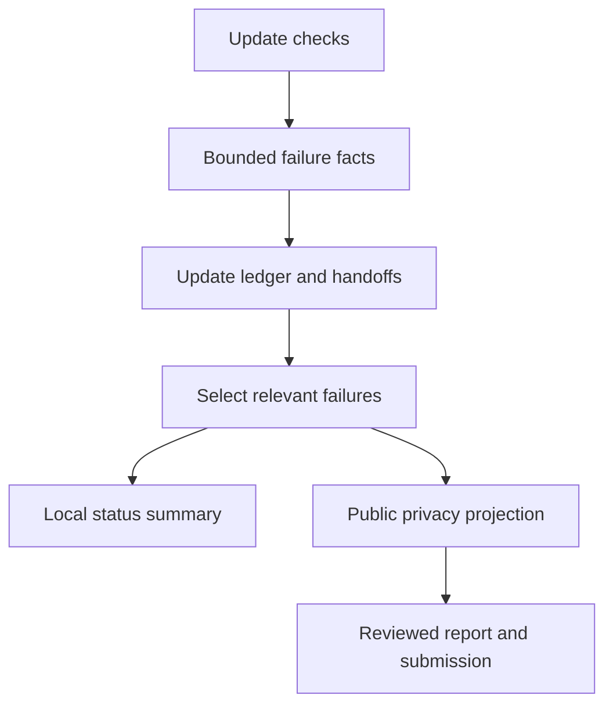

Codex review: needs maintainer review before merge. _Reviewed September 12, 2026, 6:20 AM ET / 10:20 UTC (Revision 15)._

# ClawSweeper review

## What this changes

Preserve bounded failing-check details through update history, subprocess handoffs, local summaries, and privacy-filtered GitHub reports.

## Merge readiness

✅ **Ready for maintainer review**

Keep open for landing. The diagnostic repair remains necessary, the previous integration blocker is resolved, and the inspected patch has no actionable correctness or security findings.

**Priority:** P2
**Reviewed head:** `266f505e72cf9c5d83d327df44a7f0381281d364`

## Review scores

| Measure | Result | What it means |
|---|---|---|
| **Overall readiness** | 🐚 platinum hermit **(4/6)** | A coherent diagnostic repair with useful runtime evidence, meaningful regressions, and no remaining actionable findings. |
| **Proof confidence** | 🦞 diamond lobster **(5/6)** | Sufficient (live_output): Captured real readiness failures reached the verification owner and ledger; replay through the repaired renderers preserved the check in local and public output. Published-driver upgrade evidence is recorded separately, while failed restoration/rollback qualification remains explicitly outside the accepted reporting proof. |
| **Patch quality** | 🐚 platinum hermit **(4/6)** | No actionable review findings were identified. |

## Verification

| Check | Result | Evidence |
|---|---|---|
| **Real behavior** | Verified | Sufficient (live_output): Captured real readiness failures reached the verification owner and ledger; replay through the repaired renderers preserved the check in local and public output. Published-driver upgrade evidence is recorded separately, while failed restoration/rollback qualification remains explicitly outside the accepted reporting proof. |
| **Evidence reviewed** | 9 items | Pinned introduction and integrated source: Reviewed the base-to-head diagnostic changes at the pinned head. Raw commit records confirm the original head has the recorded prior-head and base parents; the stale GitHub test merge was not used to infer removals. Previous integration blocker resolved: Compared prior-head files fetched through GitHub contents with the checked-out files after local historical-blob access failed. The canary retains snapshot observations, typed capacity failures, and cleanup directories; the ledger schema and step adapter retain snapshotCapacity alongside failureFacts. Canonical report projection: Report preparation checks attempt identity, enriches failures in ledger order, preserves measured exits and direct-success precedence, and applies public filtering before calculating the preview digest. |
| **Findings** | None | None. |
| **Security** | None | None. |

## How this fits together

The updater collects results from package installation, Doctor, plugins, and Gateway verification. Its reporting layer combines those observations with the update ledger to produce local status and consent-reviewed public reports.

## Before merge

None.

<strong>Agent review details</strong>

### Security

None.

### PR surface

Source +977, Tests +1107, Docs +12. Total +2096 across 68 files.

View PR surface stats

| Area | Files | Added | Removed | Net |
|---|---:|---:|---:|---:|
| Source | 48 | 1284 | 307 | +977 |
| Tests | 19 | 1239 | 132 | +1107 |
| Docs | 1 | 12 | 0 | +12 |
| Config | 0 | 0 | 0 | 0 |
| Generated | 0 | 0 | 0 | 0 |
| Other | 0 | 0 | 0 | 0 |
| **Total** | **68** | **2535** | **439** | **+2096** |

### Review metrics

| Metric | Value | Why it matters |
|---|---|---|
| **Production versus regression coverage** | Production net +977 lines; tests/support net +1,107 lines | The stated growth covers six diagnostic producers, existing transport/storage contracts, and the public privacy projection. |
| **Diagnostic bounds** | 5 facts per step; 200 characters per message; 3 selected failed steps | Explicit limits keep richer diagnostics bounded across history and report rendering. |

### Stored data model

Persistent data-model change detected: `migration/backfill/repair: src/cli/update-cli/update-command-convergence.ts`, `migration/backfill/repair: src/cli/update-cli/update-command-fresh-doctor.ts`, `migration/backfill/repair: src/cli/update-cli/update-finalization-lifecycle.ts`, `migration/backfill/repair: src/flows/doctor-health.ts`, `migration/backfill/repair: src/infra/update-failure-public-identifiers.ts`, `unknown-data-model-change: src/cli/update-cli/update-command-fresh-doctor.ts`, and 1 more. Migration or upgrade compatibility proof is recorded; maintainers should verify it before merge.

### Root-cause cluster

Relationship: `canonical`
Canonical: https://github.com/openclaw/openclaw/pull/145390
Summary: This is the consolidated diagnostic-facts implementation; underlying update failures remain separate.

Members:
- `fixed_by_candidate`: https://github.com/openclaw/openclaw/issues/144945 - Addresses the report's diagnostic-loss component, without establishing a fix for its slow MCP startup.
- `partial_overlap`: https://github.com/openclaw/openclaw/pull/144923 - Its runtime-preflight metadata is absorbed into the shared facts contract.
- `partial_overlap`: https://github.com/openclaw/openclaw/pull/144281 - The merged same-attempt ledger enrichment is retained and extended.
- `partial_overlap`: https://github.com/openclaw/openclaw/pull/144811 - Also improves update health-check diagnostics, with distinct progress wording and repetition handling.
- `adjacent_distinct`: https://github.com/openclaw/openclaw/pull/145321 - The merged settlement correction governs recovery claims rather than failing-check preservation.

Proposal only: this assessment does not dispatch repair, suppress jobs, mutate sibling items, close, or merge anything.

### Technical review

Best possible solution:

Keep diagnostics with their existing producers and report owner, while tracking updater recovery qualification separately from reporting correctness.

Do we have a high-confidence way to reproduce the issue?

Yes, for diagnostic loss: current main drops structured Doctor metadata before reporting, and supplied captures demonstrate failure details surviving only after the repair; no local runtime reproduction was executed.

Is this the best way to solve the issue?

Yes. A shared bounded fact contract preserves producer observations through existing reporting paths, with separate public disclosure filtering and unchanged recovery authority.

AGENTS.md: found and applied where relevant.

Codex review notes: model internal, reasoning medium; reviewed against [bd9ed86c268c](https://github.com/openclaw/openclaw/commit/bd9ed86c268cd6f3db761753cb8e699989626f3e).

### Labels

Label justifications:

- `P2`: This repairs actionable update diagnostics without changing installation or recovery policy.
- `rating: 🐚 platinum hermit`: Overall readiness is 🐚 platinum hermit; proof is 🦞 diamond lobster and patch quality is 🐚 platinum hermit.
- `status: 👀 ready for maintainer look`: ClawSweeper has no concrete contributor-facing blocker left for this PR. Sufficient (live_output): Captured real readiness failures reached the verification owner and ledger; replay through the repaired renderers preserved the check in local and public output. Published-driver upgrade evidence is recorded separately, while failed restoration/rollback qualification remains explicitly outside the accepted reporting proof.
- `proof: sufficient`: Contributor real behavior proof is sufficient. Captured real readiness failures reached the verification owner and ledger; replay through the repaired renderers preserved the check in local and public output. Published-driver upgrade evidence is recorded separately, while failed restoration/rollback qualification remains explicitly outside the accepted reporting proof.

### Evidence

What I checked:

- **Pinned introduction and integrated source:** Reviewed the base-to-head diagnostic changes at the pinned head. Raw commit records confirm the original head has the recorded prior-head and base parents; the stale GitHub test merge was not used to infer removals. ([266f505e72cf](https://github.com/openclaw/openclaw/commit/266f505e72cf9c5d83d327df44a7f0381281d364))
- **Previous integration blocker resolved:** Compared prior-head files fetched through GitHub contents with the checked-out files after local historical-blob access failed. The canary retains snapshot observations, typed capacity failures, and cleanup directories; the ledger schema and step adapter retain snapshotCapacity alongside failureFacts. ([`src/infra/update-candidate-canary.ts:328`](https://github.com/openclaw/openclaw/blob/266f505e72cf9c5d83d327df44a7f0381281d364/src/infra/update-candidate-canary.ts#L328), [266f505e72cf](https://github.com/openclaw/openclaw/commit/266f505e72cf9c5d83d327df44a7f0381281d364))
- **Canonical report projection:** Report preparation checks attempt identity, enriches failures in ledger order, preserves measured exits and direct-success precedence, and applies public filtering before calculating the preview digest. ([`src/infra/update-failure-report-prepare.ts:134`](https://github.com/openclaw/openclaw/blob/266f505e72cf9c5d83d327df44a7f0381281d364/src/infra/update-failure-report-prepare.ts#L134), [266f505e72cf](https://github.com/openclaw/openclaw/commit/266f505e72cf9c5d83d327df44a7f0381281d364))
- **Privacy and authority:** Public facts use source-owned checks, shipped plugin catalogs, recognized causes, and config-key families. The Gateway handler retains owner checks, connection/run liveness checks, and consent-digest validation; diagnostics do not grant authority. ([`src/gateway/server-methods/update-report.ts:171`](https://github.com/openclaw/openclaw/blob/266f505e72cf9c5d83d327df44a7f0381281d364/src/gateway/server-methods/update-report.ts#L171), [266f505e72cf](https://github.com/openclaw/openclaw/commit/266f505e72cf9c5d83d327df44a7f0381281d364))
- **Behavioral regression coverage:** Inspected coverage for six failure families, original-failure retention after recovery failures, poisoned public diagnostics, private plugin identifiers, same-attempt enrichment, and direct-success precedence. Tests were not executed during this read-only review. ([`src/gateway/server-methods/update-report-run.test.ts:209`](https://github.com/openclaw/openclaw/blob/266f505e72cf9c5d83d327df44a7f0381281d364/src/gateway/server-methods/update-report-run.test.ts#L209), [266f505e72cf](https://github.com/openclaw/openclaw/commit/266f505e72cf9c5d83d327df44a7f0381281d364))
- **Complete captured proof and maintainer disposition:** Read the full 13,078-unit PR body and verified SHA-256 9582dfadf9f39a41e75fe9857e0fb47b4fdb303445d5f16cec170a0a1f13130a matches the supplied snapshot. It records a published-driver upgrade, twelve real readiness 503 responses preserved in result/history, and renderer replay retaining that check in local and public reports. It explicitly accepts the bounded diagnostic change while leaving restoration and rollback qualification unproved. ([266f505e72cf](https://github.com/openclaw/openclaw/commit/266f505e72cf9c5d83d327df44a7f0381281d364))

Likely related people:

- **steipete:** Suggested for follow-up; no historical authorship or introduction is verified. (role: unverified routing candidate; confidence: low)
- **jason-allen-oneal:** Suggested for follow-up; no historical authorship or introduction is verified. (role: unverified routing candidate; confidence: low)

### Rating scale

| Score | Internal tier | Crab rank | Meaning |
|---:|:---:|---|---|
| **6/6** | S | 🦀 challenger crab | Exceptional readiness |
| **5/6** | A | 🦞 diamond lobster | Very strong readiness |
| **4/6** | B | 🐚 platinum hermit | Good normal PR; ordinary maintainer review |
| **3/6** | C | 🦐 gold shrimp | Useful, but confidence is limited |
| **2/6** | D | 🦪 silver shellfish | Proof or implementation needs work |
| **1/6** | F | 🧂 unranked krab | Not merge-ready |
| N/A | NA | 🌊 off-meta tidepool | Rating does not apply |

Overall follows the weaker of proof and patch quality.
Shiny media proof means a screenshot, video, or linked artifact directly shows the changed behavior. Runtime, network, CSP, and security claims still need visible diagnostics.

### Workflow

- ClawSweeper keeps one durable marker-backed review comment per issue or PR.
- Re-runs edit this comment so the latest verdict, findings, and automation markers stay together instead of adding duplicate bot comments.
- A fresh review can be triggered by eligible `@clawsweeper re-review` comments, exact-item GitHub events, scheduled/background review runs, or manual workflow dispatch.
- PR/issue authors and users with repository write access can comment `@clawsweeper re-review` or `@clawsweeper re-run` on an open PR or issue to request a fresh review only.
- Maintainers can also comment `@clawsweeper review` to request a fresh review only.
- Fresh-review commands do not start repair, autofix, rebase, CI repair, or automerge.
- Maintainer-only repair and merge flows require explicit commands such as `@clawsweeper autofix`, `@clawsweeper automerge`, `@clawsweeper fix ci`, or `@clawsweeper address review`.
- Maintainers can comment `@clawsweeper explain` to ask for more context, or `@clawsweeper stop` to stop active automation.

### History

Review history (14 earlier review cycles; latest 8 shown)

<!-- clawsweeper-review-history v=1 total=14 -->
- reviewed 2026-09-12T07:45:53.791Z sha eef9b7a240e632ae26dbf3194d7903a73da642a5 :: blocked before merge. :: none
- reviewed 2026-09-12T08:11:18.919Z sha 530e248fe9ca699e9d1121e5c3c57893bceaff0b :: blocked before merge. :: none
- reviewed 2026-09-12T08:34:02.203Z sha 530e248fe9ca699e9d1121e5c3c57893bceaff0b :: blocked before merge. :: none
- reviewed 2026-09-12T08:58:46.536Z sha 530e248fe9ca699e9d1121e5c3c57893bceaff0b :: blocked before merge. :: none
- reviewed 2026-09-12T09:17:05.725Z sha 06a8e475e0b8ce8610c8a18f9ca01318a05935ff :: blocked before merge. :: none
- reviewed 2026-09-12T09:28:09.303Z sha 06a8e475e0b8ce8610c8a18f9ca01318a05935ff :: blocked before merge. :: none
- reviewed 2026-09-12T09:43:29.623Z sha 98d127190210229995580f54744ea2aa87a647e5 :: needs maintainer review before merge. :: none
- reviewed 2026-09-12T09:58:16.817Z sha 98d127190210229995580f54744ea2aa87a647e5 :: blocked before merge. :: none

<!-- clawsweeper-verdict:needs-human item=145390 sha=266f505e72cf9c5d83d327df44a7f0381281d364 confidence=high updated_at=2026-09-12T10:17:41Z reviewed_at=2026-09-12T10:20:39.573Z lease_owner=github-run-34687981754-1 lease_comment_id=5645277848 source_revision=9b30955ad7304c67a42db4771b94b4bea1d25aa72810708ac1ddbd780052644c live_verification=absent -->
<!-- clawsweeper-review-state:ready item=145390 sha=266f505e72cf9c5d83d327df44a7f0381281d364 v=1 -->

<!-- clawsweeper-review-version item=145390 reviewed_at=2026-09-12T10:20:39.573Z sha=266f505e72cf9c5d83d327df44a7f0381281d364 source_revision=9b30955ad7304c67a42db4771b94b4bea1d25aa72810708ac1ddbd780052644c lease_owner=github-run-34687981754-1 lease_comment_id=5645277848 v=1 -->

<!-- clawsweeper-review item=145390 -->