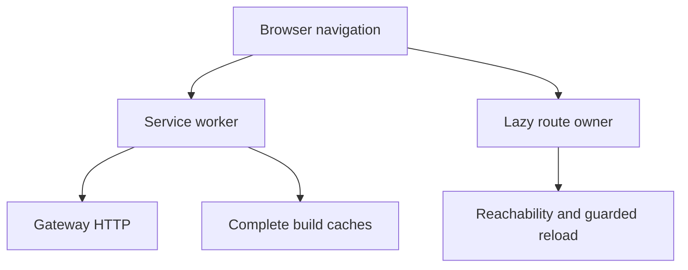

Codex review: needs changes before merge.

## What this changes

This PR expands cached offline navigation, retries lazy routes after outages, retains a complete predecessor cache, and bounds worker refresh.

**Example:** A prepared browser reloads /settings/connection during a VPN outage while navigator.onLine remains true.
- **Before:** Navigation ends on a browser network error.
- **After:** Navigation falls back to the cached app shell after failure or a 10-second timeout.

## Review scores

| Measure | Result | What it means |
|---|---|---|
| **Overall readiness** | 🦪 silver shellfish **(2/6)** | Useful direction with focused owner tests, but concrete recovery regressions and a diff-caused browser assertion failure block merging. |
| **Proof confidence** | 🦐 gold shrimp **(3/6)** | This maintainer-authored PR is outside the ordinary contributor proof gate; supplied evidence consists of owner tests and CI, with no successful browser demonstration of the complete changed outage behavior. |
| **Patch quality** | 🦪 silver shellfish **(2/6)** | 5 actionable review findings remain. |

## Product

**Kind:** Bug fix · **Worth it:** Yes · **Fix scope:** Complete
**User problem:** Reloading or opening an unvisited page during a temporary connection failure can replace usable work with an error or a full reload.
**Reason:** The maintainer-authored direction has clear user value and reuses existing owners without adding settings or public APIs.

## Merge readiness

⛔ **Needs changes before merge - 6 items remain**

Keep open: this maintainer-authored PR addresses real offline failures, but introduces recovery regressions and admits standalone plugin documents into app-shell fallback.

**Priority:** P2
**Reviewed head:** `5724bea6468f27d38e53f8ebb49e2bb9951e26d4`

## Before merge

- [ ] **Keep caller cancellation out of the shared recovery wait (P1)** - The pending recovery is shared by storage identity and build, but this predicate captures the first caller's canReload. If a connection starts recovery and is replaced by another connection targeting the same build, the replacement joins that promise; retiring the first connection now resolves it false for both callers. Recovery stops despite the replacement still owning the target. Exact-head CI fails both the replacement-owner and resumed-connection cases. Preserve per-caller checks at the final reload without letting the retired caller cancel its successor's shared wait.
- [ ] **Preserve recovery for caught non-route import failures (P1)** - Switching exclusively to unhandledrejection drops failures that existing callers handle. APP_SIDEBAR_ELEMENT is preloaded through LazyCustomElementRequestController.preload(), whose rejection handler suppresses the error by default. It uses neither retryControlUiImport nor another automatic recovery path, so a failed sidebar download leaves navigation missing after connectivity returns. Exact-head browser CI times out in both sidebar recovery scenarios. Give these consumers recovery ownership before removing their Vite-event safety net.
- [ ] **Retain a worker-free escape for broken-worker startup (P1)** - Removing cleanup from both failed probes and Try again revives the incident documented in https://github.com/openclaw/openclaw/pull/128167: worker-mediated fetches fail while direct navigation works. Automatic probes keep traversing that worker, and Try again reloads under the same registration, leaving users stuck until they use browser tooling. Preserve registrations on ordinary outages, but retain an explicit, app-scoped worker-reset recovery path for this established failure.
- [ ] **Exclude the singular plugin HTTP namespace from fallback (P2)** - DYNAMIC_ROUTE_PATH_PARAMS contains plugin, so this filter emits /plugin/. A navigation to a registered standalone endpoint such as /plugin/secure/report during an outage consequently receives the Control UI shell. Gateway plugin HTTP tests explicitly support that path, while the UI's fallback plugin route is exact /plugin. Exclude plugin as well as plugins from generated prefixes and cover the singular namespace exclusion.
- [ ] **Update the phone test for worker-mediated online navigation (P2)** - The new navigation handler intentionally serves successful online responses through respondWith(), making response.fromServiceWorker() true. This unchanged assertion requires false for all four recovery documents, and exact-head CI fails with precisely that difference despite status 200 and no-cache throughout. Update the provenance expectation for the worker-enabled scenario while retaining the navigation-count, artifact, cache-policy, and worker-disabled assertions.
- [ ] **Explain or restore the original intent of Shared build-recovery ownership** - c8f88a8b38338e2eeacc599cbbe6354986ff2a9a: A newer authoritative recovery must survive an older failed probe and reload only its current target.

## Findings

- [P1] Keep caller cancellation out of the shared recovery wait — `ui/src/app/stale-chunk-reload.ts:199`
- [P1] Preserve recovery for caught non-route import failures — `ui/src/app/stale-chunk-reload.ts:373-374`
- [P1] Retain a worker-free escape for broken-worker startup — `ui/index.html:627-629`

### Provenance

- `Shared build-recovery ownership` changes intended behavior without addressing why it exists (c8f88a8b38338e2eeacc599cbbe6354986ff2a9a: A newer authoritative recovery must survive an older failed probe and reload only its current target.)

### Tests

- Missing end-to-end proof: The supplied evidence does not demonstrate successful outage fallback, import recovery, and cache rollover through a browser, or base-fail/head-pass runs for the added regressions.

<strong>Agent review details</strong>

### How this fits together

The Control UI service worker handles browser navigation and immutable assets, while the route and reload owners recover failed module downloads without bypassing Gateway authorization.

### Technical review

Best possible solution:

Keep the offline fallback while preserving replacement-owner recovery, standalone HTTP routes, caught-import recovery, and an in-product escape from broken workers.

Do we have a high-confidence way to reproduce the issue?

Current main visibly restricts shell fallback to explicit browser-offline navigation, and exact-head CI failure traces corroborate the introduced shared-wait and sidebar regressions; no target code was executed during this review.

Is this the best way to solve the issue?

The existing service-worker and recovery owners are appropriate, but the patch must preserve their established callers and failure escapes rather than replacing those contracts globally.

Full review comments:

- [P1] Keep caller cancellation out of the shared recovery wait — `ui/src/app/stale-chunk-reload.ts:199`
  The pending recovery is shared by storage identity and build, but this predicate captures the first caller's canReload. If a connection starts recovery and is replaced by another connection targeting the same build, the replacement joins that promise; retiring the first connection now resolves it false for both callers. Recovery stops despite the replacement still owning the target. Exact-head CI fails both the replacement-owner and resumed-connection cases. Preserve per-caller checks at the final reload without letting the retired caller cancel its successor's shared wait.
  Confidence: 0.99
- [P1] Preserve recovery for caught non-route import failures — `ui/src/app/stale-chunk-reload.ts:373-374`
  Switching exclusively to unhandledrejection drops failures that existing callers handle. APP_SIDEBAR_ELEMENT is preloaded through LazyCustomElementRequestController.preload(), whose rejection handler suppresses the error by default. It uses neither retryControlUiImport nor another automatic recovery path, so a failed sidebar download leaves navigation missing after connectivity returns. Exact-head browser CI times out in both sidebar recovery scenarios. Give these consumers recovery ownership before removing their Vite-event safety net.
  Confidence: 0.98
- [P1] Retain a worker-free escape for broken-worker startup — `ui/index.html:627-629`
  Removing cleanup from both failed probes and Try again revives the incident documented in https://github.com/openclaw/openclaw/pull/128167: worker-mediated fetches fail while direct navigation works. Automatic probes keep traversing that worker, and Try again reloads under the same registration, leaving users stuck until they use browser tooling. Preserve registrations on ordinary outages, but retain an explicit, app-scoped worker-reset recovery path for this established failure.
  Confidence: 0.96
- [P2] Exclude the singular plugin HTTP namespace from fallback — `ui/src/app-route-paths.ts:453-455`
  DYNAMIC_ROUTE_PATH_PARAMS contains plugin, so this filter emits /plugin/. A navigation to a registered standalone endpoint such as /plugin/secure/report during an outage consequently receives the Control UI shell. Gateway plugin HTTP tests explicitly support that path, while the UI's fallback plugin route is exact /plugin. Exclude plugin as well as plugins from generated prefixes and cover the singular namespace exclusion.
  Confidence: 0.99
- [P2] Update the phone test for worker-mediated online navigation — `ui/src/e2e/phone-stale-build-recovery.e2e.test.ts:511-515`
  The new navigation handler intentionally serves successful online responses through respondWith(), making response.fromServiceWorker() true. This unchanged assertion requires false for all four recovery documents, and exact-head CI fails with precisely that difference despite status 200 and no-cache throughout. Update the provenance expectation for the worker-enabled scenario while retaining the navigation-count, artifact, cache-policy, and worker-disabled assertions.
  Confidence: 0.99

Overall correctness: patch is incorrect
Overall confidence: 0.97

AGENTS.md: found and applied where relevant.

Codex review notes: model internal, reasoning medium; reviewed against [330ce7f06f38](https://github.com/openclaw/openclaw/commit/330ce7f06f38bd51ce6c080fd2a932fe87ed27a0).

### Provenance checked

- `Native HTTP authentication navigation` keeps the original intent (388ba3218bf234f2cacebaf74e740a8bd79b7ecc: Service-worker responses suppress browser HTTP authentication dialogs.)
- `Previous-build cache retention` changes intended behavior with a stated reason (163104ac31bb56972a3ec7e43c175786059d855b: Previous generations were removed to reduce retention machinery because guarded reload was an accepted recovery.)
- `Pre-entry worker cleanup` changes intended behavior with a stated reason (9dbc72a544a89412adc3c63d0be14a1369a89513: A recorded broken-worker incident prevented fetch-based recovery until the worker was unregistered.)
- `Lazy-import reload recovery` changes intended behavior with a stated reason (24cd8481dd81e4583364751f68bfe3b7386fdab6: Persistent guarded recovery repaired failed assets after intermittent network outages.)
- `Worker refresh lifetime` keeps the original intent (65c4b49282889f2f4ef871afc7009588725f3d4d: Suspended tabs reconcile active-worker identity while preserving document and reconnect ownership.)

### Testing

Proof path: in-process harness.

### Security

None.

### Evidence

Acceptance criteria:

- pnpm test ui/src/app/stale-chunk-reload.test.ts ui/src/app/gateway-store.auth.test.ts ui/src/app/mount-fallback.test.ts ui/src/app/service-worker-cache.test.ts ui/src/app/vite-config-cache.node.test.ts --maxWorkers=1
- pnpm test ui/src/e2e/boot-module-boundaries.e2e.test.ts ui/src/e2e/phone-stale-build-recovery.e2e.test.ts --maxWorkers=1
- pnpm tsgo:ui
- git diff --check

What I checked:

- **Introduced patch:** Reviewed the pinned introduction range rather than attributing base movement to this PR; the checkout remains clean. ([5724bea6468f](https://github.com/openclaw/openclaw/commit/5724bea6468f27d38e53f8ebb49e2bb9951e26d4))
- **Standalone plugin namespace:** The generated prefixes include /plugin/, although Gateway tests register /plugin/secure/report as a standalone HTTP endpoint; this independently confirms the existing review comment. ([`ui/src/app-route-paths.ts:454`](https://github.com/openclaw/openclaw/blob/5724bea6468f27d38e53f8ebb49e2bb9951e26d4/ui/src/app-route-paths.ts#L454), [5724bea6468f](https://github.com/openclaw/openclaw/commit/5724bea6468f27d38e53f8ebb49e2bb9951e26d4))
- **Recovery ownership failures:** Exact-head CI reports both the replacement-owner regression in stale-chunk-reload.test.ts and the resumed-connection regression in gateway-store.auth.test.ts; the newly added caller predicate explains both failures. ([`ui/src/app/stale-chunk-reload.ts:199`](https://github.com/openclaw/openclaw/blob/5724bea6468f27d38e53f8ebb49e2bb9951e26d4/ui/src/app/stale-chunk-reload.ts#L199), [5724bea6468f](https://github.com/openclaw/openclaw/commit/5724bea6468f27d38e53f8ebb49e2bb9951e26d4))
- **Previously observed broken-worker incident:** https://github.com/openclaw/openclaw/pull/128167 records worker-mediated fetch failures despite working direct navigation; unregistering the worker healed that incident, and this PR removes both recovery calls. ([`ui/index.html:629`](https://github.com/openclaw/openclaw/blob/9dbc72a544a89412adc3c63d0be14a1369a89513/ui/index.html#L629), [9dbc72a544a8](https://github.com/openclaw/openclaw/commit/9dbc72a544a89412adc3c63d0be14a1369a89513))
- **Caught sidebar failures lose recovery:** Sidebar preloading handles import rejections without reporting them, so the replacement unhandledrejection listener never sees them; exact-head browser CI times out waiting for recovery in both sidebar-width scenarios. ([`ui/src/app/lazy-custom-element.ts:92`](https://github.com/openclaw/openclaw/blob/5724bea6468f27d38e53f8ebb49e2bb9951e26d4/ui/src/app/lazy-custom-element.ts#L92), [5724bea6468f](https://github.com/openclaw/openclaw/commit/5724bea6468f27d38e53f8ebb49e2bb9951e26d4))
- **Intentional navigation change needs matching test:** Exact-head browser CI reaches all four successful phone recovery documents through the worker, while the existing assertion requires fromWorker:false. ([`ui/src/e2e/phone-stale-build-recovery.e2e.test.ts:514`](https://github.com/openclaw/openclaw/blob/5724bea6468f27d38e53f8ebb49e2bb9951e26d4/ui/src/e2e/phone-stale-build-recovery.e2e.test.ts#L514), [5724bea6468f](https://github.com/openclaw/openclaw/commit/5724bea6468f27d38e53f8ebb49e2bb9951e26d4))

Likely related people:

- **Peter Steinberger:** Raw commit c59d07b9a8336f0461421c42e48f89ca61e47880 adds ui/src/app/stale-chunk-reload.ts:60 relative to its recorded parents. This identifies author metadata, not feature responsibility or a PR merger. (role: source-line author; confidence: high; commits: [c59d07b9a833](https://github.com/openclaw/openclaw/commit/c59d07b9a8336f0461421c42e48f89ca61e47880); files: `ui/src/app/stale-chunk-reload.ts`)
- **morluto:** Raw commit 5f46433d62586a76decc3bdeaef972ff4bb90e2b adds ui/src/app/stale-chunk-reload.ts:62 relative to its recorded parents. This identifies author metadata, not feature responsibility or a PR merger. (role: source-line author; confidence: medium; commits: [5f46433d6258](https://github.com/openclaw/openclaw/commit/5f46433d62586a76decc3bdeaef972ff4bb90e2b); files: `ui/src/app/stale-chunk-reload.ts`)
- **Nayrosk:** Raw commit 388ba3218bf234f2cacebaf74e740a8bd79b7ecc adds ui/public/sw.js:56 relative to its recorded parents. This identifies author metadata, not feature responsibility or a PR merger. (role: source-line author; confidence: medium; commits: [388ba3218bf2](https://github.com/openclaw/openclaw/commit/388ba3218bf234f2cacebaf74e740a8bd79b7ecc); files: `ui/public/sw.js`)

### PR surface

Source +129, Tests +327, Docs +11. Total +467 across 18 files. Added test files: 0.

View PR surface stats

| Area | Files | Added | Removed | Net |
|---|---:|---:|---:|---:|
| Source | 8 | 218 | 89 | +129 |
| Tests | 9 | 362 | 35 | +327 |
| Docs | 1 | 21 | 10 | +11 |
| Config | 0 | 0 | 0 | 0 |
| Generated | 0 | 0 | 0 | 0 |
| Other | 0 | 0 | 0 | 0 |
| **Total** | **18** | **601** | **134** | **+467** |

### Labels

Label changes:

- add `P2`: This is a useful reliability repair with concrete, focused merge blockers.
- add `merge-risk: 🚨 compatibility`: Existing broken-worker installations and replacement connections lose recovery paths that current main provides.
- add `rating: 🦪 silver shellfish`: Overall readiness is 🦪 silver shellfish; proof is 🦐 gold shrimp and patch quality is 🦪 silver shellfish.
- add `status: ⏳ waiting on author`: ClawSweeper has contributor-facing work open and is waiting for author action.

Label justifications:

- `P2`: This is a useful reliability repair with concrete, focused merge blockers.
- `merge-risk: 🚨 compatibility`: Existing broken-worker installations and replacement connections lose recovery paths that current main provides.
- `rating: 🦪 silver shellfish`: Overall readiness is 🦪 silver shellfish; proof is 🦐 gold shrimp and patch quality is 🦪 silver shellfish.
- `status: ⏳ waiting on author`: ClawSweeper has contributor-facing work open and is waiting for author action.

### Rating scale

6/6 🦀 challenger crab · 5/6 🦞 diamond lobster · 4/6 🐚 platinum hermit · 3/6 🦐 gold shrimp · 2/6 🦪 silver shellfish · 1/6 🧂 unranked krab. Overall follows the weaker of proof and patch quality; ✨ marks media proof (a screenshot, video, or linked artifact) that directly shows the changed behavior.

### Workflow

ClawSweeper edits this one comment on every review. Comment `@clawsweeper re-review` for a fresh review only. Repair and merge execution lanes are retired.

_Reviewed October 16, 2026, 5:09 AM ET / 09:09 UTC._

<!-- clawsweeper-verdict:needs-changes item=174043 sha=5724bea6468f27d38e53f8ebb49e2bb9951e26d4 confidence=high updated_at=2026-10-16T09:04:02Z reviewed_at=2026-10-16T09:09:15.500Z lease_owner=github-run-38877748582-1 lease_comment_id=6211994996 source_revision=be4adf5100a92310f3d95e6c9645286d9810f790038d7b8dc2ab2c8788eb6340 -->
<!-- clawsweeper-review-state:needs-changes item=174043 sha=5724bea6468f27d38e53f8ebb49e2bb9951e26d4 v=1 -->

<!-- clawsweeper-review-version item=174043 reviewed_at=2026-10-16T09:09:15.500Z sha=5724bea6468f27d38e53f8ebb49e2bb9951e26d4 source_revision=be4adf5100a92310f3d95e6c9645286d9810f790038d7b8dc2ab2c8788eb6340 lease_owner=github-run-38877748582-1 lease_comment_id=6211994996 v=1 -->

<!-- clawsweeper-review item=174043 -->