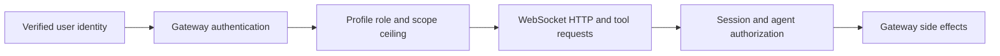

Codex review: needs real behavior proof before merge. _Reviewed August 24, 2026, 4:08 AM ET / 08:08 UTC._

# ClawSweeper review

## What this changes

This PR adds profile-bound Gateway roles that cap cross-session access, allowed agents, and operator scopes for authenticated team users.

## Merge readiness

⛔ **Blocked until stronger real behavior proof is added - 11 items remain**

Keep open: a role downgrade can retain an old admin scope through an awaited tool hook, and the documented identity-only setup has no safe first-maintainer bootstrap path.

**Priority:** P1
**Reviewed head:** `6176265d0e83e99c68a581afbc75bf1c95f650ed`
**Owner decision:** Required. See [Decision needed](#decision-needed).

## Review scores

| Measure | Result | What it means |
|---|---|---|
| **Overall readiness** | 🦪 silver shellfish **(2/6)** | The broad role-policy implementation has useful coverage, but two high-impact authorization and setup defects remain unaddressed. |
| **Proof confidence** | 🦐 gold shrimp **(3/6)** | Needs stronger real behavior proof before merge: Authority-chain proof required: the posted loopback trace proves reconnect-time revocation but not a role downgrade during an awaited hook; show the demoted operator is rejected before an admin Gateway final effect. After adding proof, update the PR body; ClawSweeper should re-review automatically. If it does not, the PR author or someone with repository write access can comment `@clawsweeper re-review`. |
| **Patch quality** | 🦪 silver shellfish **(2/6)** | Security review found an item that needs attention. |

## Verification

| Check | Result | Evidence |
|---|---|---|
| **Real behavior** | Needs proof | Needs stronger real behavior proof before merge: Authority-chain proof required: the posted loopback trace proves reconnect-time revocation but not a role downgrade during an awaited hook; show the demoted operator is rejected before an admin Gateway final effect. After adding proof, update the PR body; ClawSweeper should re-review automatically. If it does not, the PR author or someone with repository write access can comment `@clawsweeper re-review`. |
| **Evidence reviewed** | 7 items | Stale authority after an await: Tool invocation awaits the before-tool hook, then installs the pre-await profile and scope snapshot as in-process authority. The dispatcher builds a synthetic client from that snapshot, and method authorization accepts a retained operator.admin scope without a current role-policy lookup. Disconnect does not revoke retained synthetic authority: users.setRole invalidates and closes matching WebSocket clients, but the production disconnect path only mutates live clients; it cannot clear a previously-created synthetic tool client. The existing test simulates revocation by mutating a local scopes object rather than exercising that path. Required authority proof remains absent: The in-process-dispatch test proves authority expires after an invocation completes, not that a role change during an awaited hook blocks an admin method before dispatch. The provided PR trace covers reconnect-time revocation, not this race. |
| **Findings** | 2 actionable findings | [P1] Revalidate role scopes before in-process tool dispatch [P1] Provide a non-escalating role bootstrap path |
| **Security** | Needs attention | Role revocation does not reach retained tool authority: An awaited tool hook can outlive a user’s role downgrade while retaining the old `operator.admin` scope in a synthetic client; Gateway method routing trusts that stale scope before a privileged side effect. |

## How this fits together

Gateway converts authenticated identity into operator scopes before routing WebSocket, HTTP, and tool requests. This change stores a role on the user profile and applies its ceiling across session and agent operations, including in-process tool calls.

## Decision needed

| Question | Recommendation |
|---|---|
| Which safe bootstrap authority should an identity-only Gateway use to assign its first named role without granting every default guest operator.admin? | **Require an explicit scoped bootstrap path:** Add a narrowly bounded bootstrap authority or setup flow that can assign the first role without making the default role administrative. |

Why: The feature’s least-privilege model cannot be made operable by a warning alone; choosing a bootstrap mechanism determines the public configuration and recovery contract.

## Before merge

- [ ] **Add real behavior proof** - Needs stronger real behavior proof before merge: Authority-chain proof required: the posted loopback trace proves reconnect-time revocation but not a role downgrade during an awaited hook; show the demoted operator is rejected before an admin Gateway final effect. After adding proof, update the PR body; ClawSweeper should re-review automatically. If it does not, the PR author or someone with repository write access can comment `@clawsweeper re-review`.
- [ ] **Revalidate role scopes before in-process tool dispatch (P1)** - A role downgrade during `runBeforeToolCallHook` leaves the retained AsyncLocal authority with its original scopes. The synthetic client then carries those scopes into method authorization, which accepts `operator.admin` without consulting the now-downgraded role. Closing the WebSocket only rejects buffered frames and does not revoke this in-process client, so a hook-delayed tool can still make an admin Gateway call after `users.setRole`. Re-resolve the role ceiling or generation immediately before the routed final effect and add the hook-race test.
- [ ] **Provide a non-escalating role bootstrap path (P1)** - The documented configuration assigns every unassigned identity to `guest`, whose ceiling strips the identity’s `operator.admin` grant, while `users.setRole` is the only documented assignment path and itself requires that scope. An identity-only deployment using this example therefore cannot promote its first maintainer; putting admin in the default role instead grants it to every guest. Add a scoped bootstrap mechanism or reject activation until one is configured, and cover the trusted-proxy setup end-to-end.
- [ ] **Resolve security concern: Role revocation does not reach retained tool authority** - An awaited tool hook can outlive a user’s role downgrade while retaining the old `operator.admin` scope in a synthetic client; Gateway method routing trusts that stale scope before a privileged side effect.
- [ ] **Resolve merge risk (P1)** - The PR’s acknowledged sessions.patch owner-stamping gap can hide a role-capped user’s newly created session until its canonical repair is linked or landed.
- [ ] **Resolve merge risk (P1)** - Exact-head CI remains in progress in the supplied context; it does not affect the two source-proven blockers.
- [ ] **Complete next step (P2)** - Maintainers must choose the bootstrap contract and require the missing revocation-before-I/O proof before this cross-cutting role feature can merge.
- [ ] **Improve patch quality** - Add a paused-hook role-downgrade test that proves an admin method is rejected before dispatch.
- [ ] **Improve patch quality** - Choose and prove a safe first-maintainer bootstrap flow for trusted identity authentication.
- [ ] **Improve patch quality** - Link or land the sessions.patch owner-stamping repair before claiming own-session access coverage.

## Findings

- [P1] Revalidate role scopes before in-process tool dispatch — `src/gateway/server-plugin-in-process-dispatch.ts:161-195`
- [P1] Provide a non-escalating role bootstrap path — `docs/gateway/configuration-reference.md:715-727`
- [high] Role revocation does not reach retained tool authority — `src/gateway/server-plugin-in-process-dispatch.ts:161`

<strong>Agent review details</strong>

### Security

Needs attention: The diff permits stale administrator authority to cross a role-revocation boundary into an in-process Gateway side effect.

### Review metrics

| Metric | Value | Why it matters |
|---|---|---|
| **Role policy surface** | 1 config subtree added; 1 persisted nullable profile field; 1 Gateway role-assignment RPC added | This creates configuration, stored-state, and administrative contracts whose bootstrap and upgrade behavior must be safe. |
| **Production and test LOC** | PR body reports approximately production +2.2k and tests +4.1k | The cross-entry-point authorization surface needs final-effect revocation proof beyond the current test coverage. |

### Stored data model

Persistent data-model change detected: `database schema: docs/reference/database-schemas.md`, `database schema: src/state/user-profiles.test.ts`, `serialized state: src/gateway/agent-turn/agent-session-persist.test.ts`, `serialized state: src/gateway/session-create-service.ts`, `serialized state: src/gateway/session-group-defaults-access.ts`, `serialized state: src/gateway/session-group-mutation-targets.ts`, and 28 more. Confirm migration or upgrade compatibility proof before merge.

### Merge-risk options

**Maintainer options:**
1. **Repair revocation and bootstrap before merge (recommended)**  
   Fence each routed in-process effect with current role authority, add the awaited-hook demotion proof, and provide a least-privilege first-maintainer path.
2. **Pause the feature**  
   Do not land team roles until maintainers choose and validate an operable bootstrap contract.

### Technical review

Best possible solution:

Add a non-escalating first-maintainer bootstrap path and revalidate live role authority immediately before each in-process final effect, with trusted-identity end-to-end proof for both.

Do we have a high-confidence way to reproduce the issue?

Yes, from source: pause the before-tool hook for an administrator, demote that profile through users.setRole, then resume a tool that dispatches an admin Gateway method; the retained synthetic client still carries the old scope. The bootstrap lockout follows directly from the documented guest ceiling and admin-only assignment method.

Is this the best way to solve the issue?

No. Closing a WebSocket is not a live authorization check for retained in-process clients, and a Doctor warning cannot bootstrap an administrator; use a current-policy fence plus a deliberate scoped bootstrap authority.

Full review comments:

- [P1] Revalidate role scopes before in-process tool dispatch — `src/gateway/server-plugin-in-process-dispatch.ts:161-195`
  A role downgrade during `runBeforeToolCallHook` leaves the retained AsyncLocal authority with its original scopes. The synthetic client then carries those scopes into method authorization, which accepts `operator.admin` without consulting the now-downgraded role. Closing the WebSocket only rejects buffered frames and does not revoke this in-process client, so a hook-delayed tool can still make an admin Gateway call after `users.setRole`. Re-resolve the role ceiling or generation immediately before the routed final effect and add the hook-race test.
  Confidence: 0.97
- [P1] Provide a non-escalating role bootstrap path — `docs/gateway/configuration-reference.md:715-727`
  The documented configuration assigns every unassigned identity to `guest`, whose ceiling strips the identity’s `operator.admin` grant, while `users.setRole` is the only documented assignment path and itself requires that scope. An identity-only deployment using this example therefore cannot promote its first maintainer; putting admin in the default role instead grants it to every guest. Add a scoped bootstrap mechanism or reject activation until one is configured, and cover the trusted-proxy setup end-to-end.
  Confidence: 0.96

Overall correctness: patch is incorrect
Overall confidence: 0.95

AGENTS.md: found and applied where relevant.

Codex review notes: model internal, reasoning high; reviewed against [23df5799fd01](https://github.com/openclaw/openclaw/commit/23df5799fd01b8256c016f4a6d2924e68b46a322).

### Labels

Label changes:

- add `merge-risk: 🚨 auth-provider`: The role ceiling changes trusted-proxy and Tailscale identity authentication behavior, including whether their granted scopes survive.
- add `rating: 🦪 silver shellfish`: Overall readiness is 🦪 silver shellfish; proof is 🦐 gold shrimp and patch quality is 🦪 silver shellfish.
- remove `rating: 🧂 unranked krab`: Current PR rating is `rating: 🦪 silver shellfish`, so this older rating label is no longer current.

Label justifications:

- `P1`: The advertised team-role flow can either retain revoked admin authority or leave an identity-only deployment unable to assign its first maintainer.
- `merge-risk: 🚨 compatibility`: Enabling the documented default role can remove an existing identity-granted admin scope with no operable upgrade path.
- `merge-risk: 🚨 security-boundary`: A demoted operator can retain operator.admin in an in-process synthetic client after the role change.
- `merge-risk: 🚨 auth-provider`: The role ceiling changes trusted-proxy and Tailscale identity authentication behavior, including whether their granted scopes survive.
- `rating: 🦪 silver shellfish`: Overall readiness is 🦪 silver shellfish; proof is 🦐 gold shrimp and patch quality is 🦪 silver shellfish.
- `status: 📣 needs proof`: The PR needs real behavior proof before ClawSweeper can clear the contributor ask. Needs stronger real behavior proof before merge: Authority-chain proof required: the posted loopback trace proves reconnect-time revocation but not a role downgrade during an awaited hook; show the demoted operator is rejected before an admin Gateway final effect. After adding proof, update the PR body; ClawSweeper should re-review automatically. If it does not, the PR author or someone with repository write access can comment `@clawsweeper re-review`.

### Evidence

Security concerns:

- [high] Role revocation does not reach retained tool authority — `src/gateway/server-plugin-in-process-dispatch.ts:161`
  An awaited tool hook can outlive a user’s role downgrade while retaining the old `operator.admin` scope in a synthetic client; Gateway method routing trusts that stale scope before a privileged side effect.
  Confidence: 0.97

Acceptance criteria:

- [P1] Configure identity-only Gateway roles with a default guest and establish the first maintainer without giving guests operator.admin.
- [P1] Pause a before-tool hook, demote the active profile, then verify an admin Gateway call is denied before its final effect.
- [P1] Create and re-open a session through sessions.patch as a role-capped profile after the owner-stamping repair.

What I checked:

- **Stale authority after an await:** Tool invocation awaits the before-tool hook, then installs the pre-await profile and scope snapshot as in-process authority. The dispatcher builds a synthetic client from that snapshot, and method authorization accepts a retained operator.admin scope without a current role-policy lookup. ([`src/gateway/tools-invoke-shared.ts:394`](https://github.com/openclaw/openclaw/blob/6176265d0e83/src/gateway/tools-invoke-shared.ts#L394), [6176265d0e83](https://github.com/openclaw/openclaw/commit/6176265d0e83))
- **Disconnect does not revoke retained synthetic authority:** users.setRole invalidates and closes matching WebSocket clients, but the production disconnect path only mutates live clients; it cannot clear a previously-created synthetic tool client. The existing test simulates revocation by mutating a local scopes object rather than exercising that path. ([`src/gateway/server-request-context.ts:368`](https://github.com/openclaw/openclaw/blob/6176265d0e83/src/gateway/server-request-context.ts#L368), [6176265d0e83](https://github.com/openclaw/openclaw/commit/6176265d0e83))
- **Required authority proof remains absent:** The in-process-dispatch test proves authority expires after an invocation completes, not that a role change during an awaited hook blocks an admin method before dispatch. The provided PR trace covers reconnect-time revocation, not this race. ([`src/gateway/server-plugin-in-process-dispatch.authorization.test.ts:210`](https://github.com/openclaw/openclaw/blob/6176265d0e83/src/gateway/server-plugin-in-process-dispatch.authorization.test.ts#L210), [6176265d0e83](https://github.com/openclaw/openclaw/commit/6176265d0e83))
- **Documented configuration locks out first role assignment:** The example gives the identity an admin grant but then applies a default guest role whose ceiling omits operator.admin; the only documented role-assignment method requires administrator scope. Adding admin to the default would instead grant it to all guests. Public docs: [`docs/gateway/configuration-reference.md`](https://docs.openclaw.ai/gateway/configuration-reference). ([`docs/gateway/configuration-reference.md:715`](https://docs.openclaw.ai/gateway/configuration-reference), [6176265d0e83](https://github.com/openclaw/openclaw/commit/6176265d0e83))
- **Known session-owner gap affects the advertised role flow:** The sessions.patch creation path authorizes a missing entry and writes the projected entry without the canonical creation stamp, while catalog visibility treats createdActor as ownership. The PR body identifies this as a separate follow-up; no canonical repair is linked here. ([`src/gateway/server-methods/sessions-patch-engine.ts:197`](https://github.com/openclaw/openclaw/blob/6176265d0e83/src/gateway/server-methods/sessions-patch-engine.ts#L197), [6176265d0e83](https://github.com/openclaw/openclaw/commit/6176265d0e83))
- **Current-main and release status:** Current main is 23df5799fd and does not contain src/gateway/operator-role-policy.ts; no version tag contains the PR head. The feature is therefore neither implemented on current main nor released. ([`src/gateway/operator-role-policy.ts`](https://github.com/openclaw/openclaw/blob/23df5799fd01/src/gateway/operator-role-policy.ts), [23df5799fd01](https://github.com/openclaw/openclaw/commit/23df5799fd01))

Likely related people:

- **steipete:** Grafted-head blame attributes the role-dispatch and role-configuration surface to this contributor. (role: current feature contributor; confidence: medium; commits: [6176265d0e83](https://github.com/openclaw/openclaw/commit/6176265d0e83e99c68a581afbc75bf1c95f650ed); files: `src/gateway/server-plugin-in-process-dispatch.ts`, `src/gateway/server-request-context.ts`, `docs/gateway/configuration-reference.md`)

### Rating scale

| Score | Internal tier | Crab rank | Meaning |
|---:|:---:|---|---|
| **6/6** | S | 🦀 challenger crab | Exceptional readiness |
| **5/6** | A | 🦞 diamond lobster | Very strong readiness |
| **4/6** | B | 🐚 platinum hermit | Good normal PR; ordinary maintainer review |
| **3/6** | C | 🦐 gold shrimp | Useful, but confidence is limited |
| **2/6** | D | 🦪 silver shellfish | Proof or implementation needs work |
| **1/6** | F | 🧂 unranked krab | Not merge-ready |
| N/A | NA | 🌊 off-meta tidepool | Rating does not apply |

Overall follows the weaker of proof and patch quality.
Shiny media proof means a screenshot, video, or linked artifact directly shows the changed behavior. Runtime, network, CSP, and security claims still need visible diagnostics.

### Workflow

- ClawSweeper keeps one durable marker-backed review comment per issue or PR.
- Re-runs edit this comment so the latest verdict, findings, and automation markers stay together instead of adding duplicate bot comments.
- A fresh review can be triggered by eligible `@clawsweeper re-review` comments, exact-item GitHub events, scheduled/background review runs, or manual workflow dispatch.
- PR/issue authors and users with repository write access can comment `@clawsweeper re-review` or `@clawsweeper re-run` on an open PR or issue to request a fresh review only.
- Maintainers can also comment `@clawsweeper review` to request a fresh review only.
- Fresh-review commands do not start repair, autofix, rebase, CI repair, or automerge.
- Maintainer-only repair and merge flows require explicit commands such as `@clawsweeper autofix`, `@clawsweeper automerge`, `@clawsweeper fix ci`, or `@clawsweeper address review`.
- Maintainers can comment `@clawsweeper explain` to ask for more context, or `@clawsweeper stop` to stop active automation.

### History

Review history (2 earlier review cycles)

<!-- clawsweeper-review-history v=1 total=2 -->
- reviewed 2026-08-24T06:07:12.653Z sha 9b7e1ac355edb0f2fe2b2dc886845fe40faaa4f1 :: needs real behavior proof before merge. :: none
- reviewed 2026-08-24T07:24:23.670Z sha 3ba58e25e155d6ccab9b04a1d57ed21facd741dd :: needs real behavior proof before merge. :: [P1] Revalidate the role immediately before tool execution

<!-- clawsweeper-security:security-sensitive item=128548 sha=6176265d0e83e99c68a581afbc75bf1c95f650ed confidence=high updated_at=2026-08-24T08:03:23Z reviewed_at=2026-08-24T08:08:25.678Z lease_owner=github-run-32704209862-1 lease_comment_id=5392349803 source_revision=a149475eda2ea7de07dc99b73425acf6b392a0b22177b482bed827afe4e7b756 -->
<!-- clawsweeper-verdict:needs-human item=128548 sha=6176265d0e83e99c68a581afbc75bf1c95f650ed confidence=high updated_at=2026-08-24T08:03:23Z reviewed_at=2026-08-24T08:08:25.678Z lease_owner=github-run-32704209862-1 lease_comment_id=5392349803 source_revision=a149475eda2ea7de07dc99b73425acf6b392a0b22177b482bed827afe4e7b756 -->

<!-- clawsweeper-review-version item=128548 reviewed_at=2026-08-24T08:08:25.678Z sha=6176265d0e83e99c68a581afbc75bf1c95f650ed source_revision=a149475eda2ea7de07dc99b73425acf6b392a0b22177b482bed827afe4e7b756 lease_owner=github-run-32704209862-1 lease_comment_id=5392349803 v=1 -->

<!-- clawsweeper-review item=128548 -->