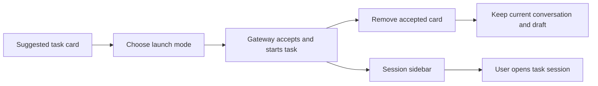

Codex review: needs maintainer review before merge. _Reviewed September 18, 2026, 4:29 AM ET / 08:29 UTC (Revision 2)._

# ClawSweeper review

## What this changes

The PR keeps suggested-task launches in the background, preserves the current conversation and draft, and updates tests and documentation.

## Merge readiness

✅ **Ready for maintainer review**

The change remains useful: current main and the latest release still navigate away after acceptance. No actionable correctness or security findings remain, and the supplied visual proof supports the intended result.

Likely related people: steipete — routing candidate based on prior work on task-launch choices and dismissal.

**Priority:** P2
**Reviewed head:** `07f8b65d4cbfd6f90a0d3df2105eb7ec950748be`

## Review scores

| Measure | Result | What it means |
|---|---|---|
| **Overall readiness** | 🐚 platinum hermit **(4/6)** | A focused, maintainable fix with directly relevant screenshots and regression coverage; no actionable defects found. |
| **Proof confidence** | 🦞 diamond lobster **(5/6)** ✨ media proof bonus | Sufficient (screenshot): Inspected before/after Chrome screenshots against the declared synthetic Gateway fixture directly show the changed UI acceptance outcome: Main stays selected and the composer draft survives. Browser assertions supplement the visible proof across all three launch modes. |
| **Patch quality** | 🐚 platinum hermit **(4/6)** | No actionable review findings were identified. |

## Verification

| Check | Result | Evidence |
|---|---|---|
| **Real behavior** | Verified | Sufficient (screenshot): Inspected before/after Chrome screenshots against the declared synthetic Gateway fixture directly show the changed UI acceptance outcome: Main stays selected and the composer draft survives. Browser assertions supplement the visible proof across all three launch modes. |
| **Evidence reviewed** | 8 items | Introduced change preserves existing request safeguards: The pinned introduction delta removes the acceptance-result navigation only. Request parameters, duplicate-operation protection, connection/session guards, card removal, and error handling remain intact. Current main still needs the change: Fetched main still calls onPaneSessionChange with the accepted session key for non-session launch modes. No equivalent background-launch behavior is present in this owner. Latest release retains automatic navigation: Reading the file from v2026.9.4 through GitHub's contents endpoint confirmed that acceptance assigns result.key and calls onPaneSessionChange. The requested behavior is not already shipped in the supplied latest release. |
| **Findings** | None | None. |
| **Security** | None | None. |

## How this fits together

Control UI task cards send the selected launch mode to the Gateway, which creates and starts the task. The UI then removes the accepted card while session discovery remains with the shared sidebar roster.

## Before merge

None.

<strong>Agent review details</strong>

### Security

None.

### PR surface

Source -9, Tests +2, Docs +8. Total +1 across 4 files.

View PR surface stats

| Area | Files | Added | Removed | Net |
|---|---:|---:|---:|---:|
| Source | 1 | 1 | 10 | -9 |
| Tests | 2 | 18 | 16 | +2 |
| Docs | 1 | 8 | 0 | +8 |
| Config | 0 | 0 | 0 | 0 |
| Generated | 0 | 0 | 0 | 0 |
| Other | 0 | 0 | 0 | 0 |
| **Total** | **4** | **27** | **26** | **+1** |

### Review metrics

None.

### Technical review

Best possible solution:

Keep task execution Gateway-owned and let users choose when to open the new session without disturbing their current conversation.

Do we have a high-confidence way to reproduce the issue?

Yes, from source: accepting a new-session or worktree suggestion on current main invokes session navigation after the response. The supplied browser proof corroborates this; this review did not execute the application.

Is this the best way to solve the issue?

Yes. Removing the UI navigation callback repairs the presentation behavior at its owner without duplicating Gateway task execution or changing the RPC contract.

AGENTS.md: found and applied where relevant.

Codex review notes: model internal, reasoning medium; reviewed against [bd3633bdf871](https://github.com/openclaw/openclaw/commit/bd3633bdf871490724c9e10e70369f9f071aac64).

### Labels

Label justifications:

- `P2`: Unexpected navigation interrupts the current conversation during an optional task-launch workflow.
- `rating: 🐚 platinum hermit`: Overall readiness is 🐚 platinum hermit; proof is 🦞 diamond lobster and patch quality is 🐚 platinum hermit.
- `status: 👀 ready for maintainer look`: ClawSweeper has no concrete contributor-facing blocker left for this PR. Sufficient (screenshot): Inspected before/after Chrome screenshots against the declared synthetic Gateway fixture directly show the changed UI acceptance outcome: Main stays selected and the composer draft survives. Browser assertions supplement the visible proof across all three launch modes.
- `proof: sufficient`: Contributor real behavior proof is sufficient. Inspected before/after Chrome screenshots against the declared synthetic Gateway fixture directly show the changed UI acceptance outcome: Main stays selected and the composer draft survives. Browser assertions supplement the visible proof across all three launch modes.
- `proof: 📸 screenshot`: Contributor real behavior proof includes screenshot evidence. Inspected before/after Chrome screenshots against the declared synthetic Gateway fixture directly show the changed UI acceptance outcome: Main stays selected and the composer draft survives. Browser assertions supplement the visible proof across all three launch modes.

### Evidence

What I checked:

- **Introduced change preserves existing request safeguards:** The pinned introduction delta removes the acceptance-result navigation only. Request parameters, duplicate-operation protection, connection/session guards, card removal, and error handling remain intact. ([`ui/src/pages/chat/chat-pane-task-suggestions.ts:238`](https://github.com/openclaw/openclaw/blob/07f8b65d4cbfd6f90a0d3df2105eb7ec950748be/ui/src/pages/chat/chat-pane-task-suggestions.ts#L238), [07f8b65d4cbf](https://github.com/openclaw/openclaw/commit/07f8b65d4cbfd6f90a0d3df2105eb7ec950748be))
- **Current main still needs the change:** Fetched main still calls onPaneSessionChange with the accepted session key for non-session launch modes. No equivalent background-launch behavior is present in this owner. ([`ui/src/pages/chat/chat-pane-task-suggestions.ts:254`](https://github.com/openclaw/openclaw/blob/bd3633bdf871490724c9e10e70369f9f071aac64/ui/src/pages/chat/chat-pane-task-suggestions.ts#L254), [bd3633bdf871](https://github.com/openclaw/openclaw/commit/bd3633bdf871490724c9e10e70369f9f071aac64))
- **Latest release retains automatic navigation:** Reading the file from v2026.9.4 through GitHub's contents endpoint confirmed that acceptance assigns result.key and calls onPaneSessionChange. The requested behavior is not already shipped in the supplied latest release. ([`ui/src/pages/chat/chat-pane-task-suggestions.ts:224`](https://github.com/openclaw/openclaw/blob/3a9d69db306cd7f081e06254cb89c4bcc14a7107/ui/src/pages/chat/chat-pane-task-suggestions.ts#L224), [3a9d69db306c](https://github.com/openclaw/openclaw/commit/3a9d69db306cd7f081e06254cb89c4bcc14a7107))
- **Regression coverage matches the changed boundary:** Browser cases cover local, worktree, and current-session acceptance, checking unchanged URL, retained composer draft, card removal, and one acceptance request. Lifecycle coverage retains event-before-response deduplication and rejects stale reconnect results. The body reports before-fix failures and passing focused suites; tests were inspected but not executed during this read-only review. ([`ui/src/e2e/chat-flow.task-suggestions.e2e.test.ts:141`](https://github.com/openclaw/openclaw/blob/07f8b65d4cbfd6f90a0d3df2105eb7ec950748be/ui/src/e2e/chat-flow.task-suggestions.e2e.test.ts#L141), [07f8b65d4cbf](https://github.com/openclaw/openclaw/commit/07f8b65d4cbfd6f90a0d3df2105eb7ec950748be))
- **Inspected before-and-after browser proof:** Both prepared images embedded in the captured PR body were inspected. The before image shows New session selected with an empty composer; the after image shows Main with the draft retained. The body identifies a real Chrome profile against a synthetic Gateway fixture, which directly exercises the changed presentation behavior. Sources: https://github.com/user-attachments/assets/3d8814ff-fc35-45d9-98a7-c2f2ef6bccdf and https://github.com/user-attachments/assets/faf8a9ea-fba3-48f8-bfcc-3bf6bfdac0d2. ([07f8b65d4cbf](https://github.com/openclaw/openclaw/commit/07f8b65d4cbfd6f90a0d3df2105eb7ec950748be))
- **Prior area history supports reviewer routing:** Current-main history identifies Peter Steinberger's prior launch-choice, dismissal, and startup work. GitHub commit metadata maps the launch-choice commit to steipete. Exact historical blame was unavailable because older blobs were missing; no source-line introduction attribution is claimed. ([`ui/src/pages/chat/chat-pane-task-suggestions.ts`](https://github.com/openclaw/openclaw/blob/69bde3225e80127361d2ee634dd8d869edaef30f/ui/src/pages/chat/chat-pane-task-suggestions.ts), [69bde3225e80](https://github.com/openclaw/openclaw/commit/69bde3225e80127361d2ee634dd8d869edaef30f))

Likely related people:

- **steipete:** Suggested for follow-up; no historical authorship or introduction is verified. (role: unverified routing candidate; confidence: low)

### Rating scale

| Score | Internal tier | Crab rank | Meaning |
|---:|:---:|---|---|
| **6/6** | S | 🦀 challenger crab | Exceptional readiness |
| **5/6** | A | 🦞 diamond lobster | Very strong readiness |
| **4/6** | B | 🐚 platinum hermit | Good normal PR; ordinary maintainer review |
| **3/6** | C | 🦐 gold shrimp | Useful, but confidence is limited |
| **2/6** | D | 🦪 silver shellfish | Proof or implementation needs work |
| **1/6** | F | 🧂 unranked krab | Not merge-ready |
| N/A | NA | 🌊 off-meta tidepool | Rating does not apply |

Overall follows the weaker of proof and patch quality.
Shiny media proof means a screenshot, video, or linked artifact directly shows the changed behavior. Runtime, network, CSP, and security claims still need visible diagnostics.

### Workflow

- ClawSweeper keeps one durable marker-backed review comment per issue or PR.
- Re-runs edit this comment so the latest verdict, findings, and automation markers stay together instead of adding duplicate bot comments.
- A fresh review can be triggered by eligible `@clawsweeper re-review` comments, exact-item GitHub events, scheduled/background review runs, or manual workflow dispatch.
- PR/issue authors and users with repository write access can comment `@clawsweeper re-review` or `@clawsweeper re-run` on an open PR or issue to request a fresh review only.
- Maintainers can also comment `@clawsweeper review` to request a fresh review only.
- Fresh-review commands do not start repair, autofix, rebase, CI repair, or automerge.
- Maintainer-only repair and merge flows require explicit commands such as `@clawsweeper autofix`, `@clawsweeper automerge`, `@clawsweeper fix ci`, or `@clawsweeper address review`.
- Maintainers can comment `@clawsweeper explain` to ask for more context, or `@clawsweeper stop` to stop active automation.

### History

Review history (1 earlier review cycle)

<!-- clawsweeper-review-history v=1 total=1 -->
- reviewed 2026-09-18T08:14:54.794Z sha 07f8b65d4cbfd6f90a0d3df2105eb7ec950748be :: needs maintainer review before merge. :: none

<!-- clawsweeper-verdict:needs-human item=151611 sha=07f8b65d4cbfd6f90a0d3df2105eb7ec950748be confidence=high updated_at=2026-09-18T08:27:37Z reviewed_at=2026-09-18T08:29:45.939Z lease_owner=github-run-35324275484-1 lease_comment_id=5727348087 source_revision=1a471310b1161b9912879563cab479e38335030cdd8def376dfd43596dfc03d3 live_verification=absent -->
<!-- clawsweeper-review-state:ready item=151611 sha=07f8b65d4cbfd6f90a0d3df2105eb7ec950748be v=1 -->

<!-- clawsweeper-review-version item=151611 reviewed_at=2026-09-18T08:29:45.939Z sha=07f8b65d4cbfd6f90a0d3df2105eb7ec950748be source_revision=1a471310b1161b9912879563cab479e38335030cdd8def376dfd43596dfc03d3 lease_owner=github-run-35324275484-1 lease_comment_id=5727348087 v=1 -->

<!-- clawsweeper-review item=151611 -->