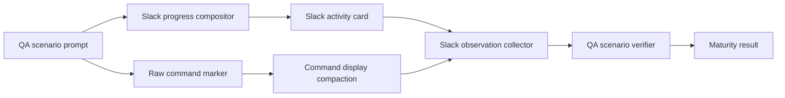

Codex review: needs maintainer review before merge. _Reviewed August 26, 2026, 5:42 PM ET / 21:42 UTC._

# ClawSweeper review

## What this changes

Updates Slack QA scenarios to recognize the renderer’s single activity-card row and preserve the tool marker through raw-command compaction.

## Regression provenance

Possible regression — probable (reviewed change; failure trace). No predecessor PR is attributed.

## Merge readiness

⚠️ **Ready for maintainer review - 2 items remain**

Keep open for maintainer review. The focused QA-oracle change matches the current Slack card renderer, but a credentialed current-head maturity run remains the unresolved transport-boundary proof before merge.

**Priority:** P3
**Reviewed head:** `bc1af97953cd1c8003dac345609a6a39fd651027`
**Owner decision:** Required. See [Decision needed](#decision-needed).

## Review scores

| Measure | Result | What it means |
|---|---|---|
| **Overall readiness** | 🐚 platinum hermit **(4/6)** | The narrowly scoped patch follows the current renderer and collector contracts, with one remaining live-transport confirmation for maintainers. |
| **Proof confidence** | 🌊 off-meta tidepool | Not applicable: Not applicable to this maintainer-authored QA-only PR; a current-head Slack maturity run remains the specific maintainer-facing validation gap. |
| **Patch quality** | 🐚 platinum hermit **(4/6)** | No actionable review findings were identified. |

## Verification

| Check | Result | Evidence |
|---|---|---|
| **Real behavior** | Not applicable | Not applicable: Not applicable to this maintainer-authored QA-only PR; a current-head Slack maturity run remains the specific maintainer-facing validation gap. |
| **Evidence reviewed** | 5 items | Current-main mismatch: Current main still requires separate `Update` and marker entries, so it cannot recognize the renderer’s one-string activity row.<br>Renderer contract: The Slack owner converts ordinary progress lines to label `Update`, and the card renderer emits each line as one `label — detail` activity row.<br>Observation boundary: The QA collector recursively retains complete Slack block text, so the verifier's exact single-row comparison matches the observable field rather than inferring it from separate blocks. |
| **Findings** | None | None. |
| **Security** | None | None. |


### Live Verification

**Command:** `pnpm test extensions/qa-lab/src/live-transports/slack/slack-live.runtime.test.ts`

**Result:** FAIL (failed) — step 1 `run` `pnpm test extensions/qa-lab/src/live-transports/slack/slack-live.runtime.test.ts`: `previous terminal command was still running after 30 seconds: "pnpm test extensions/qa-lab/src/live-transports/slack/slack-live.runtime.test.ts"`

```text
$ node --import tsx scripts/test-projects.mts extensions/qa-lab/src/live-transports/slack/slack-live.runtime.test.ts
[test] starting test/vitest/vitest.extension-qa.config.ts

 RUN  v4.1.11 /tmp/clawsweeper-live-proof-130354-vwWD1N/target
```

**Assertions:**

- FAIL `expect_output`: passed

## How this fits together

Slack renders progress updates into one activity-card block, while QA Lab observes Slack message text and blocks to validate the delivery scenario. The changed fixture is the verifier between that rendered card and maturity results.



## Decision needed

| Question | Recommendation |
|---|---|
| Should this protected maintainer QA fix merge on the source and CI evidence, or wait for the existing credentialed Slack maturity workflow to observe the current head? | **Run the maturity slice first:** Run the existing credentialed Slack maturity scenarios against this head and merge after the observed card satisfies the updated verifier. |

Why: The patch is narrowly source-proven, but only the credentialed maturity lane can confirm the final Slack observation shape in the real transport.

## Before merge

- [ ] **Resolve merge risk (P1)** - A credentialed current-head maturity run has not yet shown that the live Slack observation path returns the exact new activity-card text; focused tests and source inspection do not observe that transport response.


<details>
<summary><strong>Agent review details</strong></summary>

### Security

None.

### PR surface

Source -3, Tests +3. Total 0 across 2 files.

<details>
<summary>View PR surface stats</summary>

| Area | Files | Added | Removed | Net |
|---|---:|---:|---:|---:|
| Source | 1 | 2 | 5 | -3 |
| Tests | 1 | 5 | 2 | +3 |
| Docs | 0 | 0 | 0 | 0 |
| Config | 0 | 0 | 0 | 0 |
| Generated | 0 | 0 | 0 | 0 |
| Other | 0 | 0 | 0 | 0 |
| **Total** | **2** | **7** | **7** | **0** |

</details>

### Review metrics

| Metric | Value | Why it matters |
|---|---|---|
| **Production versus QA support** | production +0/-0; QA test/support +7/-7 | The patch changes only the maturity fixture and its focused assertions, leaving Slack runtime behavior unchanged. |

### Merge-risk options

**Maintainer options:**
1. **Verify the live observation contract (recommended)**  
   Run the credentialed Slack maturity scenarios on the current head so the collector’s observed block text confirms the new verifier before merge.
2. **Accept the bounded QA risk**  
   Merge based on the renderer and collector source contract if maintainers accept that this head lacks a current live Slack observation.

### Technical review

Best possible solution:

Keep one QA classifier aligned with the Slack renderer and record a successful current-head Slack maturity run before merging.

Do we have a high-confidence way to reproduce the issue?

Yes, source-reproducible: current main’s one-row `Update` card conflicts with the QA verifier’s separate-block requirement. A credentialed rerun is still needed to observe that shape through Slack.

Is this the best way to solve the issue?

Yes. The change repairs the QA consumer of the Slack card contract without altering Slack delivery or adding a second renderer policy.

AGENTS.md: found and applied where relevant.

Codex review notes: model internal, reasoning high; reviewed against [a482a50cda88](https://github.com/openclaw/openclaw/commit/a482a50cda8850e9479d28a1ae29785a509841b2).

### Labels

Label changes:

- add `merge-risk: 🚨 other`: Only a credentialed Slack maturity run can confirm the collector sees the renderer’s exact block text on this head.

Label justifications:

- `P3`: This is a small QA-observation correction rather than a user-facing runtime change.
- `merge-risk: 🚨 other`: Only a credentialed Slack maturity run can confirm the collector sees the renderer’s exact block text on this head.
- `rating: 🐚 platinum hermit`: Overall readiness is 🐚 platinum hermit; proof is 🌊 off-meta tidepool and patch quality is 🐚 platinum hermit.
- `status: 👀 ready for maintainer look`: ClawSweeper has no concrete contributor-facing blocker left for this PR. Not applicable: Not applicable to this maintainer-authored QA-only PR; a current-head Slack maturity run remains the specific maintainer-facing validation gap.

### Evidence

What I checked:

- **Current-main mismatch:** Current main still requires separate `Update` and marker entries, so it cannot recognize the renderer’s one-string activity row. ([`extensions/qa-lab/src/live-transports/slack/slack-live.scenario-fixtures.ts:92`](https://github.com/openclaw/openclaw/blob/a482a50cda88/extensions/qa-lab/src/live-transports/slack/slack-live.scenario-fixtures.ts#L92), [a482a50cda88](https://github.com/openclaw/openclaw/commit/a482a50cda88))
- **Renderer contract:** The Slack owner converts ordinary progress lines to label `Update`, and the card renderer emits each line as one `label — detail` activity row. ([`extensions/slack/src/monitor/message-handler/dispatch-progress-render.ts:27`](https://github.com/openclaw/openclaw/blob/a482a50cda88/extensions/slack/src/monitor/message-handler/dispatch-progress-render.ts#L27), [a482a50cda88](https://github.com/openclaw/openclaw/commit/a482a50cda88))
- **Observation boundary:** The QA collector recursively retains complete Slack block text, so the verifier's exact single-row comparison matches the observable field rather than inferring it from separate blocks. ([`extensions/qa-lab/src/live-transports/slack/slack-live.observations.ts:96`](https://github.com/openclaw/openclaw/blob/a482a50cda88/extensions/qa-lab/src/live-transports/slack/slack-live.observations.ts#L96), [a482a50cda88](https://github.com/openclaw/openclaw/commit/a482a50cda88))
- **Focused coverage:** The PR exercises true, false, omitted, and verbose-dedupe scenarios and asserts the new exact activity-row representation plus the suffix marker. ([`extensions/qa-lab/src/live-transports/slack/slack-live.runtime.test.ts:630`](https://github.com/openclaw/openclaw/blob/bc1af97953cd/extensions/qa-lab/src/live-transports/slack/slack-live.runtime.test.ts#L630), [bc1af97953cd](https://github.com/openclaw/openclaw/commit/bc1af97953cd))
- **Prior QA provenance:** Earlier merged QA work used this same exact one-row classifier and suffix marker; current main subsequently contains the older split-block fixture, so this PR restores the source-backed form rather than adding a parallel policy. ([`extensions/qa-lab/src/live-transports/slack/slack-live.scenario-fixtures.ts:92`](https://github.com/openclaw/openclaw/blob/d3d25737cf31/extensions/qa-lab/src/live-transports/slack/slack-live.scenario-fixtures.ts#L92), [d3d25737cf31](https://github.com/openclaw/openclaw/commit/d3d25737cf31))

Likely related people:

- **Dallin Romney:** Authored the current focused repair and has substantial recorded history across the QA and Slack progress files. (role: recent QA scenario contributor; confidence: high; commits: [bc1af97953cd](https://github.com/openclaw/openclaw/commit/bc1af97953cd1c8003dac345609a6a39fd651027); files: `extensions/qa-lab/src/live-transports/slack/slack-live.scenario-fixtures.ts`, `extensions/qa-lab/src/live-transports/slack/slack-live.runtime.test.ts`)
- **vincentkoc:** Authored the earlier merged QA classifier implementation and the related broader open proposal. (role: prior QA classifier contributor; confidence: high; commits: [d3d25737cf31](https://github.com/openclaw/openclaw/commit/d3d25737cf31547bd70ef9f0e1fcf2e3e7115f64); files: `extensions/qa-lab/src/live-transports/slack/slack-live.scenario-fixtures.ts`)
- **Peter Steinberger:** Current-main blame associates the active card-rendering lines with this archived renderer state; incomplete promisor history prevents stronger introduction attribution. (role: recent Slack card contributor; confidence: low; commits: [71a7283792e4](https://github.com/openclaw/openclaw/commit/71a7283792e4fd57e108acd4e356d7a9c6474db3); files: `extensions/slack/src/progress-blocks.ts`, `extensions/slack/src/monitor/message-handler/dispatch-progress-render.ts`)

### Rank-up moves

Optional improvements that raise the rating; they are not merge blockers.

- Run the credentialed Slack maturity scenarios against the current head and retain the resulting observed verifier output.

### Rating scale

| Score | Internal tier | Crab rank | Meaning |
|---:|:---:|---|---|
| **6/6** | S | 🦀 challenger crab | Exceptional readiness |
| **5/6** | A | 🦞 diamond lobster | Very strong readiness |
| **4/6** | B | 🐚 platinum hermit | Good normal PR; ordinary maintainer review |
| **3/6** | C | 🦐 gold shrimp | Useful, but confidence is limited |
| **2/6** | D | 🦪 silver shellfish | Proof or implementation needs work |
| **1/6** | F | 🧂 unranked krab | Not merge-ready |
| N/A | NA | 🌊 off-meta tidepool | Rating does not apply |

Overall follows the weaker of proof and patch quality.
Shiny media proof means a screenshot, video, or linked artifact directly shows the changed behavior. Runtime, network, CSP, and security claims still need visible diagnostics.

### Workflow

- ClawSweeper keeps one durable marker-backed review comment per issue or PR.
- Re-runs edit this comment so the latest verdict, findings, and automation markers stay together instead of adding duplicate bot comments.
- A fresh review can be triggered by eligible `@clawsweeper re-review` comments, exact-item GitHub events, scheduled/background review runs, or manual workflow dispatch.
- PR/issue authors and users with repository write access can comment `@clawsweeper re-review` or `@clawsweeper re-run` on an open PR or issue to request a fresh review only.
- Maintainers can also comment `@clawsweeper review` to request a fresh review only.
- Fresh-review commands do not start repair, autofix, rebase, CI repair, or automerge.
- Maintainer-only repair and merge flows require explicit commands such as `@clawsweeper autofix`, `@clawsweeper automerge`, `@clawsweeper fix ci`, or `@clawsweeper address review`.
- Maintainers can comment `@clawsweeper explain` to ask for more context, or `@clawsweeper stop` to stop active automation.

### History

<details>
<summary>Review history (1 earlier review cycle)</summary>

<!-- clawsweeper-review-history v=1 total=1 -->
- reviewed 2026-08-26T20:57:50.261Z sha bc1af97953cd1c8003dac345609a6a39fd651027 :: needs maintainer review before merge. :: none

</details>

</details>

<!-- clawsweeper-verdict:needs-human item=130354 sha=bc1af97953cd1c8003dac345609a6a39fd651027 confidence=high updated_at=2026-08-26T21:37:05Z reviewed_at=2026-08-26T21:42:14.785Z lease_owner=github-run-33016071748-1 lease_comment_id=5431413588 source_revision=7330c19584f4a7a6a467a8a7bdf14dcfeeea2132fb0cc963bbf3c084b6c5f85f -->

<!-- clawsweeper-review-version item=130354 reviewed_at=2026-08-26T21:42:14.785Z sha=bc1af97953cd1c8003dac345609a6a39fd651027 source_revision=7330c19584f4a7a6a467a8a7bdf14dcfeeea2132fb0cc963bbf3c084b6c5f85f lease_owner=github-run-33016071748-1 lease_comment_id=5431413588 v=1 -->

<!-- clawsweeper-review item=130354 -->