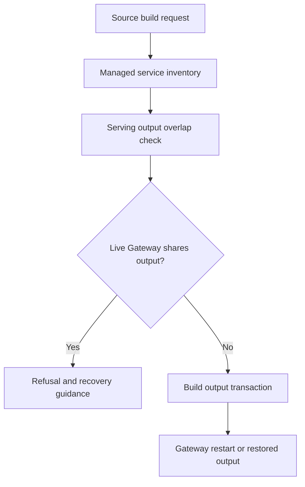

Codex review: blocked before merge. _Reviewed September 28, 2026, 3:30 AM ET / 07:30 UTC (Revision 68)._

# ClawSweeper review

## What this changes

The branch makes source builds refuse to replace output used by a running managed Gateway, adds guarded source-update recovery and Windows Scheduled Task start behavior, and documents operator recovery.

## Merge readiness

⛔ **Blocked before merge - 2 items remain**

This PR remains useful: current main has the service-inspection prerequisite but does not contain the live-dist build fence. The reviewed head has no new actionable code finding. Published Windows updater runs have not yet established settled outcomes against the exact candidate package.

**Priority:** P1
**Reviewed head:** `38a9d0b9b407eb5391aea4a91de7ee07ce9a1b2d`

## Review scores

| Measure | Result | What it means |
|---|---|---|
| **Overall readiness** | 🐚 platinum hermit **(4/6)** | The patch has substantial boundary coverage and real component proof, with exact-package published Windows upgrade qualification still outstanding. |
| **Proof confidence** | 🦞 diamond lobster **(5/6)** ✨ media proof bonus | Sufficient (linked_artifact): The changed build admission and source-update owner have a recorded Linux published-shell run showing a healthy Gateway before and after the build, plus native Windows failed-build recovery and foreign-Task refusal traces; the disabled-Task start also has packaged CLI proof. These are positive proof of the stated component behaviors, while neither the historical runs nor local tests establish settled published 9.3 and 9.4 upgrades against this exact candidate package. No stored-data contract changes. |
| **Patch quality** | 🐚 platinum hermit **(4/6)** | No actionable review findings were identified. |

## Verification

| Check | Result | Evidence |
|---|---|---|
| **Real behavior** | Verified | Sufficient (linked_artifact): The changed build admission and source-update owner have a recorded Linux published-shell run showing a healthy Gateway before and after the build, plus native Windows failed-build recovery and foreign-Task refusal traces; the disabled-Task start also has packaged CLI proof. These are positive proof of the stated component behaviors, while neither the historical runs nor local tests establish settled published 9.3 and 9.4 upgrades against this exact candidate package. No stored-data contract changes. |
| **Evidence reviewed** | 8 items | Introduced build admission: The pinned PR delta calls the managed-Gateway fence before build steps can clean or restore output. Fence boundary: The fence reads discovered managed bindings, checks physical output overlap and live process state, and refuses matching builds; unavailable inspection remains fail-open. Current-main necessity: The fetched main tree has neither new fence nor source-update transaction file, and its tsdown build still reaches output cleanup without this fence. The merged service-inspection prerequisite is distinct from the proposed build behavior. |
| **Findings** | None | None. |
| **Security** | None | None. |

## How this fits together

OpenClaw’s source build tools write the runtime files from which a managed Gateway can still load modules. Service inspection identifies Gateways using those files; build admission either permits the write or returns stop, build, and start guidance.

## Before merge

- [ ] **Resolve merge risk (P1)** - Published Windows 2026.9.3 and 2026.9.4 updater commands have not both settled against the exact candidate package. An upgrade could leave command completion or the selected Scheduled Task’s final state uncertain.
- [ ] **Complete next step (P2)** - Obtain settled published Windows 2026.9.3 and 2026.9.4 updater outcomes against the exact candidate package, including final Scheduled Task state and cleanup.

<strong>Agent review details</strong>

### Security

None.

### PR surface

Source +407, Tests +3366, Docs +63, Other +730. Total +4566 across 56 files.

View PR surface stats

| Area | Files | Added | Removed | Net |
|---|---:|---:|---:|---:|
| Source | 8 | 431 | 24 | +407 |
| Tests | 38 | 4207 | 841 | +3366 |
| Docs | 2 | 63 | 0 | +63 |
| Config | 0 | 0 | 0 | 0 |
| Generated | 0 | 0 | 0 | 0 |
| Other | 8 | 869 | 139 | +730 |
| **Total** | **56** | **5570** | **1004** | **+4566** |

### Review metrics

| Metric | Value | Why it matters |
|---|---|---|
| **Production and test delta** | production +1300/−163, tests and support +4207/−841, docs +63 | The substantial production growth serves service discovery and guarded update recovery, while the larger test delta exercises their lifecycle boundaries. |

### Root-cause cluster

Relationship: `fixed_by_candidate`
Canonical: https://github.com/openclaw/openclaw/issues/152284
Summary: This PR is the candidate fix for the live-dist mutation reported in the linked issue; the in-agent restart drain and Windows Startup discovery are distinct remaining behaviors.

Members:
- `canonical`: https://github.com/openclaw/openclaw/issues/152284 - The PR explicitly links and addresses this report’s managed-Gateway source-build outage.
- `partial_overlap`: https://github.com/openclaw/openclaw/issues/152823 - It includes live-dist mutation but also reports an in-agent systemd restart drain cycle.
- `adjacent_distinct`: https://github.com/openclaw/openclaw/pull/151674 - That open PR owns Windows Startup-folder sibling discovery beyond this PR’s managed-definition census.

Proposal only: this assessment does not dispatch repair, suppress jobs, mutate sibling items, close, or merge anything.

### Merge-risk options

**Maintainer options:**
1. **Qualify published Windows upgrades (recommended)**  
   Run both published updater versions against the exact candidate package and record command settlement, final Task state, and cleanup.
2. **Pause this package transition**  
   Keep the PR open while the unresolved published-driver outcomes are diagnosed.

### Technical review

Best possible solution:

Keep the physical-overlap fence and native recovery ownership, then qualify the exact candidate package with settled published Windows updater outcomes and final Task-state observations before landing.

Do we have a high-confidence way to reproduce the issue?

Yes. The linked report identifies a live source-checkout Gateway and a build that replaces its hashed modules; the build and service paths show how that outage occurs. This read-only review did not execute the scenario.

Is this the best way to solve the issue?

Yes for the reported live-dist mutation: checking physical overlap at the destructive build entry points and using the existing native owner for update recovery fits the code boundaries. The exact Windows published-upgrade outcome remains unqualified.

AGENTS.md: found and applied where relevant.

Codex review notes: model internal, reasoning medium; reviewed against [267da052ea26](https://github.com/openclaw/openclaw/commit/267da052ea2674f4d122e09f7178e0c6b1a63e3d).

### Labels

Label changes:

No label changes.

Label justifications:

- `P1`: Rebuilding serving output can make a live managed Gateway unable to load modules, affecting active users.
- `merge-risk: 🚨 compatibility`: The intentional stop-first build rule changes existing source-checkout workflows, and published Windows upgrade behavior remains to be qualified.
- `merge-risk: 🚨 availability`: An unsettled published updater or uncertain Scheduled Task state could leave the Gateway unavailable after an upgrade.
- `rating: 🐚 platinum hermit`: Overall readiness is 🐚 platinum hermit; proof is 🦞 diamond lobster and patch quality is 🐚 platinum hermit.
- `status: 👀 ready for maintainer look`: ClawSweeper has no concrete contributor-facing blocker left for this PR. Sufficient (linked_artifact): The changed build admission and source-update owner have a recorded Linux published-shell run showing a healthy Gateway before and after the build, plus native Windows failed-build recovery and foreign-Task refusal traces; the disabled-Task start also has packaged CLI proof. These are positive proof of the stated component behaviors, while neither the historical runs nor local tests establish settled published 9.3 and 9.4 upgrades against this exact candidate package. No stored-data contract changes.
- `proof: sufficient`: Contributor real behavior proof is sufficient. The changed build admission and source-update owner have a recorded Linux published-shell run showing a healthy Gateway before and after the build, plus native Windows failed-build recovery and foreign-Task refusal traces; the disabled-Task start also has packaged CLI proof. These are positive proof of the stated component behaviors, while neither the historical runs nor local tests establish settled published 9.3 and 9.4 upgrades against this exact candidate package. No stored-data contract changes.

### Evidence

What I checked:

- **Introduced build admission:** The pinned PR delta calls the managed-Gateway fence before build steps can clean or restore output. ([`scripts/build-all.mts:551`](https://github.com/openclaw/openclaw/blob/38a9d0b9b407eb5391aea4a91de7ee07ce9a1b2d/scripts/build-all.mts#L551), [38a9d0b9b407](https://github.com/openclaw/openclaw/commit/38a9d0b9b407eb5391aea4a91de7ee07ce9a1b2d))
- **Fence boundary:** The fence reads discovered managed bindings, checks physical output overlap and live process state, and refuses matching builds; unavailable inspection remains fail-open. ([`scripts/lib/live-gateway-dist-fence.mts:208`](https://github.com/openclaw/openclaw/blob/38a9d0b9b407eb5391aea4a91de7ee07ce9a1b2d/scripts/lib/live-gateway-dist-fence.mts#L208), [38a9d0b9b407](https://github.com/openclaw/openclaw/commit/38a9d0b9b407eb5391aea4a91de7ee07ce9a1b2d))
- **Current-main necessity:** The fetched main tree has neither new fence nor source-update transaction file, and its tsdown build still reaches output cleanup without this fence. The merged service-inspection prerequisite is distinct from the proposed build behavior. ([`scripts/tsdown-build.mts:1095`](https://github.com/openclaw/openclaw/blob/267da052ea2674f4d122e09f7178e0c6b1a63e3d/scripts/tsdown-build.mts#L1095), [267da052ea26](https://github.com/openclaw/openclaw/commit/267da052ea2674f4d122e09f7178e0c6b1a63e3d))
- **Service-history context:** The merged service-inspection work is recorded in commit 244d4419 and supplies the prerequisite used by this branch; it does not supply the build fence. ([`src/daemon/inspect.ts`](https://github.com/openclaw/openclaw/blob/244d4419723259463411c8c89fdeaf1c657b9bd7/src/daemon/inspect.ts), [244d44197232](https://github.com/openclaw/openclaw/commit/244d4419723259463411c8c89fdeaf1c657b9bd7))
- **Release check:** No local release tag contains this unmerged PR head; no shipped-fix claim is made. ([38a9d0b9b407](https://github.com/openclaw/openclaw/commit/38a9d0b9b407eb5391aea4a91de7ee07ce9a1b2d))
- **Authority checks:** The introduced Windows start path fingerprints the selected command before enabling a disabled Task and rechecks it before running; focused tests cover foreign commands, changed definitions, and lost authority. ([`src/daemon/schtasks-control.ts:497`](https://github.com/openclaw/openclaw/blob/38a9d0b9b407eb5391aea4a91de7ee07ce9a1b2d/src/daemon/schtasks-control.ts#L497), [38a9d0b9b407](https://github.com/openclaw/openclaw/commit/38a9d0b9b407eb5391aea4a91de7ee07ce9a1b2d))

Likely related people:

- **steipete:** Suggested for follow-up; no historical authorship or introduction is verified. (role: unverified routing candidate; confidence: low)
- **GGbond:** Suggested for follow-up; no historical authorship or introduction is verified. (role: unverified routing candidate; confidence: low)

### Rank-up moves

Optional improvements that raise the rating; they are not merge blockers.

- Record settled published Windows 2026.9.3 and 2026.9.4 updater outcomes against the exact candidate package, including final Task state and cleanup.

### Rating scale

| Score | Internal tier | Crab rank | Meaning |
|---:|:---:|---|---|
| **6/6** | S | 🦀 challenger crab | Exceptional readiness |
| **5/6** | A | 🦞 diamond lobster | Very strong readiness |
| **4/6** | B | 🐚 platinum hermit | Good normal PR; ordinary maintainer review |
| **3/6** | C | 🦐 gold shrimp | Useful, but confidence is limited |
| **2/6** | D | 🦪 silver shellfish | Proof or implementation needs work |
| **1/6** | F | 🧂 unranked krab | Not merge-ready |
| N/A | NA | 🌊 off-meta tidepool | Rating does not apply |

Overall follows the weaker of proof and patch quality.
Shiny media proof means a screenshot, video, or linked artifact directly shows the changed behavior. Runtime, network, CSP, and security claims still need visible diagnostics.

### Workflow

- ClawSweeper keeps one durable marker-backed review comment per issue or PR.
- Re-runs edit this comment so the latest verdict, findings, and automation markers stay together instead of adding duplicate bot comments.
- A fresh review can be triggered by eligible `@clawsweeper re-review` comments, exact-item GitHub events, scheduled/background review runs, or manual workflow dispatch.
- PR/issue authors and users with repository write access can comment `@clawsweeper re-review` or `@clawsweeper re-run` on an open PR or issue to request a fresh review only.
- Maintainers can also comment `@clawsweeper review` to request a fresh review only.
- Fresh-review commands do not start repair, autofix, rebase, CI repair, or automerge.
- Maintainer-only repair and merge flows require explicit commands such as `@clawsweeper autofix`, `@clawsweeper automerge`, `@clawsweeper fix ci`, or `@clawsweeper address review`.
- Maintainers can comment `@clawsweeper explain` to ask for more context, or `@clawsweeper stop` to stop active automation.

### History

Review history (67 earlier review cycles; latest 8 shown)

<!-- clawsweeper-review-history v=1 total=67 -->
- reviewed 2026-09-27T15:55:00.122Z sha ff1ac71d37d63636db69c0f2045f9b1e7673bab5 :: blocked before merge. :: none
- reviewed 2026-09-27T17:57:14.088Z sha 3d00d8dac05ae043f2bd95494641d291e2135a39 :: blocked before merge. :: none
- reviewed 2026-09-27T19:01:29.062Z sha 3d00d8dac05ae043f2bd95494641d291e2135a39 :: blocked before merge. :: none
- reviewed 2026-09-27T20:54:07.453Z sha 8c4332095a4bf9e1f17e44f8e40b8b5752bacacc :: blocked before merge. :: none
- reviewed 2026-09-27T21:14:25.330Z sha 8c4332095a4bf9e1f17e44f8e40b8b5752bacacc :: blocked before merge. :: none
- reviewed 2026-09-27T21:59:27.999Z sha d44b984c6f6a186b49d27ca259a4b2bfea759b52 :: blocked before merge. :: none
- reviewed 2026-09-28T01:03:12.602Z sha d44b984c6f6a186b49d27ca259a4b2bfea759b52 :: blocked before merge. :: none
- reviewed 2026-09-28T06:56:40.989Z sha 38a9d0b9b407eb5391aea4a91de7ee07ce9a1b2d :: blocked before merge. :: none

<!-- clawsweeper-verdict:needs-human item=152875 sha=38a9d0b9b407eb5391aea4a91de7ee07ce9a1b2d confidence=high updated_at=2026-09-28T07:27:00Z reviewed_at=2026-09-28T07:30:20.104Z lease_owner=github-run-36391551930-1 lease_comment_id=5865389419 source_revision=21a57fe9e8217daaf81a2a6dfd6d320be8464fd03c69cb9204285ad099b4f5bb live_verification=absent -->
<!-- clawsweeper-review-state:blocked item=152875 sha=38a9d0b9b407eb5391aea4a91de7ee07ce9a1b2d v=1 -->

<!-- clawsweeper-review-version item=152875 reviewed_at=2026-09-28T07:30:20.104Z sha=38a9d0b9b407eb5391aea4a91de7ee07ce9a1b2d source_revision=21a57fe9e8217daaf81a2a6dfd6d320be8464fd03c69cb9204285ad099b4f5bb lease_owner=github-run-36391551930-1 lease_comment_id=5865389419 v=1 -->

<!-- clawsweeper-review item=152875 -->