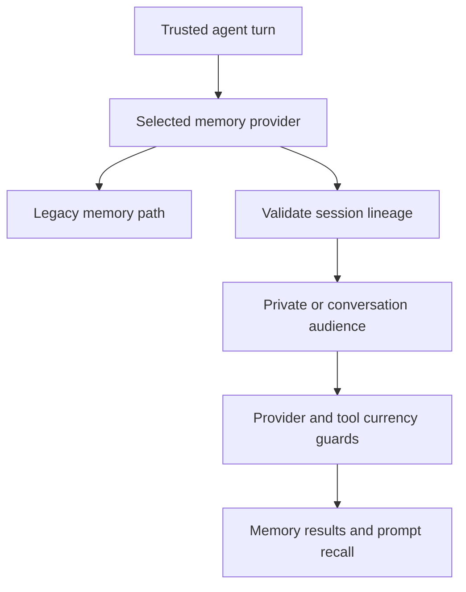

Codex review: blocked before merge. _Reviewed October 2, 2026, 6:12 PM ET / 22:12 UTC (Revision 13)._

# ClawSweeper review

## What this changes

The host determines each turn’s private or conversation memory access, carries it through memory providers, tools and hooks, and reports native provider health.

## Merge readiness

⛔ **Blocked before merge - 1 item remains**

This remains distinct, useful work beyond the merged provider runtime. Earlier findings are resolved, and the recorded interface and upgrade decisions cover the current change; no new blocking defect was identified.

**Priority:** P2
**Reviewed head:** `a3c9bbdfc24b4bc86afa554d6d36f3cdfb772c75`

## Review scores

| Measure | Result | What it means |
|---|---|---|
| **Overall readiness** | 🐚 platinum hermit **(4/6)** | Strong production-path isolation and revocation proof supports a coherent patch with no remaining concrete review finding. |
| **Proof confidence** | 🦞 diamond lobster **(5/6)** | Sufficient (logs): The hash-matched full body records isolated-Gateway turns through real admission, spawn, reset, provider and recall owners: owner access succeeds, groups cannot read private records, ancestor revocation prevents tool I/O and stale prompt publication. Older-state denial and respawn recovery, plus legacy differential checks, support the accepted additive lineage contract. |
| **Patch quality** | 🐚 platinum hermit **(4/6)** | No actionable review findings were identified. |

## Verification

| Check | Result | Evidence |
|---|---|---|
| **Real behavior** | Verified | Sufficient (logs): The hash-matched full body records isolated-Gateway turns through real admission, spawn, reset, provider and recall owners: owner access succeeds, groups cannot read private records, ancestor revocation prevents tool I/O and stale prompt publication. Older-state denial and respawn recovery, plus legacy differential checks, support the accepted additive lineage contract. |
| **Evidence reviewed** | 11 items | Pinned introduction and review continuity: Reviewed the introduced delta from 0dc63eecaddd06b66c3db3f92ab67644a526e954 to a3c9bbdfc24b4bc86afa554d6d36f3cdfb772c75. The change since the previous reviewed head only adds lineage expectations to two consult-session tests; it introduces no new production or configuration behavior. Still necessary on current main: Fetched main still supplies senderIsOwner/chatType on session memory authority and has no host memory-audience resolver at the added path. The merged prerequisite https://github.com/openclaw/openclaw/pull/162175 supplies the provider runtime, not this audience lifecycle. Release boundary: The new memory-audience source path is absent from both fetched main and the supplied latest release, v2026.9.7; no merged fixing PR establishes that this request is already implemented. |
| **Findings** | None | None. |
| **Security** | None | None. |

## How this fits together

OpenClaw’s memory subsystem supplies recalled information to agent turns. The host uses trusted sender facts and stored parent-session lineage to determine which memory a provider may expose.

## Before merge

- [ ] **Review config compatibility** - Confirm compatibility and upgrade impact for the changed config or default surface before merge.

<strong>Agent review details</strong>

### Security

None.

### PR surface

PR surface statistics unavailable: the file list is incomplete.

### Review metrics

| Metric | Value | Why it matters |
|---|---|---|
| **Production versus test growth** | production +1345 net lines; tests and test support +2416 net lines | Production growth implements the stated host authority lifecycle and its consumer cutover; regression coverage accounts for most net growth. |
| **Durable lineage receipt** | 3 optional session fields; no SQL DDL | These fields carry parent incarnation and owner facts, with an explicitly accepted and demonstrated older-row recovery path. |

### Stored data model

Persistent data-model change detected: `migration/backfill/repair: src/gateway/server-methods/doctor-memory-provider-status.ts`, `migration/backfill/repair: src/gateway/server-methods/doctor-memory-target.ts`, `migration/backfill/repair: src/gateway/server-methods/doctor.ts`, `unknown-data-model-change: src/gateway/server-methods/doctor-memory-provider-status.ts`, `unknown-data-model-change: src/gateway/server-methods/doctor-memory-target.ts`, `unknown-data-model-change: src/gateway/server-methods/doctor.ts`, and 8 more. Migration or upgrade compatibility proof is recorded; maintainers should verify it before merge.

### Technical review

Best possible solution:

Keep memory partition selection and revocation with the host, while providers enforce visibility using the supplied live audience and legacy providers retain their established behavior.

Do we have a high-confidence way to reproduce the issue?

Not applicable as a feature request; the supplied runtime traces directly exercise the new memory audience behavior and its rejection cases.

Is this the best way to solve the issue?

Yes. Centralizing audience resolution and currency with the host avoids competing provider-side authority logic, and the recorded decisions cover the interface and upgrade tradeoff.

AGENTS.md: found and applied where relevant.

Codex review notes: model internal, reasoning medium; reviewed against [99f1f78b6bcf](https://github.com/openclaw/openclaw/commit/99f1f78b6bcf39f2f90ed6446ca5ddef64617bcb).

### Labels

Label changes:

No label changes.

Label justifications:

- `P2`: This is a bounded memory-provider capability improvement without evidence of an urgent current-user outage.
- `merge-risk: 🚨 compatibility`: The accepted interface and older-child fail-closed behavior affect native providers; upgrade denial and respawn recovery are documented and demonstrated.
- `merge-risk: 🚨 security-boundary`: Audiences delegate private-memory authority across sessions; inspected guards and runtime traces cover conversation isolation and revocation before effects.
- `rating: 🐚 platinum hermit`: Overall readiness is 🐚 platinum hermit; proof is 🦞 diamond lobster and patch quality is 🐚 platinum hermit.
- `status: 👀 ready for maintainer look`: ClawSweeper has no concrete contributor-facing blocker left for this PR. Sufficient (logs): The hash-matched full body records isolated-Gateway turns through real admission, spawn, reset, provider and recall owners: owner access succeeds, groups cannot read private records, ancestor revocation prevents tool I/O and stale prompt publication. Older-state denial and respawn recovery, plus legacy differential checks, support the accepted additive lineage contract.
- `proof: sufficient`: Contributor real behavior proof is sufficient. The hash-matched full body records isolated-Gateway turns through real admission, spawn, reset, provider and recall owners: owner access succeeds, groups cannot read private records, ancestor revocation prevents tool I/O and stale prompt publication. Older-state denial and respawn recovery, plus legacy differential checks, support the accepted additive lineage contract.

### Evidence

What I checked:

- **Pinned introduction and review continuity:** Reviewed the introduced delta from 0dc63eecaddd06b66c3db3f92ab67644a526e954 to a3c9bbdfc24b4bc86afa554d6d36f3cdfb772c75. The change since the previous reviewed head only adds lineage expectations to two consult-session tests; it introduces no new production or configuration behavior. ([`src/talk/agent-consult-runtime.test.ts:758`](https://github.com/openclaw/openclaw/blob/a3c9bbdfc24b4bc86afa554d6d36f3cdfb772c75/src/talk/agent-consult-runtime.test.ts#L758), [a3c9bbdfc24b](https://github.com/openclaw/openclaw/commit/a3c9bbdfc24b4bc86afa554d6d36f3cdfb772c75))
- **Still necessary on current main:** Fetched main still supplies senderIsOwner/chatType on session memory authority and has no host memory-audience resolver at the added path. The merged prerequisite https://github.com/openclaw/openclaw/pull/162175 supplies the provider runtime, not this audience lifecycle. ([`src/plugins/memory-provider-types.ts:5`](https://github.com/openclaw/openclaw/blob/99f1f78b6bcf39f2f90ed6446ca5ddef64617bcb/src/plugins/memory-provider-types.ts#L5), [99f1f78b6bcf](https://github.com/openclaw/openclaw/commit/99f1f78b6bcf39f2f90ed6446ca5ddef64617bcb))
- **Release boundary:** The new memory-audience source path is absent from both fetched main and the supplied latest release, v2026.9.7; no merged fixing PR establishes that this request is already implemented. ([`src/plugins/memory-audience.ts`](https://github.com/openclaw/openclaw/blob/c074824a27c96d3983043f9eeb33823cd1772d8c/src/plugins/memory-audience.ts), [c074824a27c9](https://github.com/openclaw/openclaw/commit/c074824a27c96d3983043f9eeb33823cd1772d8c))
- **Authority lifecycle:** The resolver validates exact parent identities and lifecycle revisions, retains generation leases, binds delegated audiences to child sessions, and rejects released or stale grants. Provider opening incorporates audience currency into the callback supplied to provider code; bound calls also check before and after asynchronous operations. ([`src/plugins/memory-audience.ts:182`](https://github.com/openclaw/openclaw/blob/a3c9bbdfc24b4bc86afa554d6d36f3cdfb772c75/src/plugins/memory-audience.ts#L182), [a3c9bbdfc24b](https://github.com/openclaw/openclaw/commit/a3c9bbdfc24b4bc86afa554d6d36f3cdfb772c75))
- **Accepted plugin interface:** The recorded decision at https://github.com/openclaw/openclaw/pull/162176#issuecomment-5948334947 accepts host-minted audiences and the non-empty recallToolNames gate requiring every declared tool to be allowed. Current source retains the legacy deterministic-tool permission check and documents the native gate. ([`extensions/active-memory/index.ts:383`](https://github.com/openclaw/openclaw/blob/a3c9bbdfc24b4bc86afa554d6d36f3cdfb772c75/extensions/active-memory/index.ts#L383), [a3c9bbdfc24b](https://github.com/openclaw/openclaw/commit/a3c9bbdfc24b4bc86afa554d6d36f3cdfb772c75))
- **Accepted upgrade tradeoff:** The decision at https://github.com/openclaw/openclaw/pull/162176#issuecomment-5948962426 explicitly accepts withholding native-provider memory from older spawned rows without receipts, with a warning and respawn recovery. Top-level sessions and Memory Core/runtime-only providers remain outside that restriction. This accepted limitation is retained as compatibility context, not a renewed blocker. ([`src/agents/embedded-agent-runner/run/attempt-memory-audience.ts:38`](https://github.com/openclaw/openclaw/blob/a3c9bbdfc24b4bc86afa554d6d36f3cdfb772c75/src/agents/embedded-agent-runner/run/attempt-memory-audience.ts#L38), [a3c9bbdfc24b](https://github.com/openclaw/openclaw/commit/a3c9bbdfc24b4bc86afa554d6d36f3cdfb772c75))

Likely related people:

- **Josh Lehman:** Raw commit 0dc63eecaddd06b66c3db3f92ab67644a526e954 adds src/plugins/memory-runtime.ts:322 relative to its recorded parents. This identifies author metadata, not feature responsibility or a PR merger. (role: source-line author; confidence: high; commits: [0dc63eecaddd](https://github.com/openclaw/openclaw/commit/0dc63eecaddd06b66c3db3f92ab67644a526e954); files: `src/plugins/memory-runtime.ts`)
- **Peter Steinberger:** Raw commit 50b3415dba9e1c21410a3813a6d6f9b29e415979 adds src/config/sessions/session-delivery-generation.ts:396 relative to its recorded parents. This identifies author metadata, not feature responsibility or a PR merger. (role: source-line author; confidence: high; commits: [50b3415dba9e](https://github.com/openclaw/openclaw/commit/50b3415dba9e1c21410a3813a6d6f9b29e415979); files: `src/config/sessions/session-delivery-generation.ts`)

### Rating scale

| Score | Internal tier | Crab rank | Meaning |
|---:|:---:|---|---|
| **6/6** | S | 🦀 challenger crab | Exceptional readiness |
| **5/6** | A | 🦞 diamond lobster | Very strong readiness |
| **4/6** | B | 🐚 platinum hermit | Good normal PR; ordinary maintainer review |
| **3/6** | C | 🦐 gold shrimp | Useful, but confidence is limited |
| **2/6** | D | 🦪 silver shellfish | Proof or implementation needs work |
| **1/6** | F | 🧂 unranked krab | Not merge-ready |
| N/A | NA | 🌊 off-meta tidepool | Rating does not apply |

Overall follows the weaker of proof and patch quality.
Shiny media proof means a screenshot, video, or linked artifact directly shows the changed behavior. Runtime, network, CSP, and security claims still need visible diagnostics.

### Workflow

- ClawSweeper keeps one durable marker-backed review comment per issue or PR.
- Re-runs edit this comment so the latest verdict, findings, and automation markers stay together instead of adding duplicate bot comments.
- A fresh review can be triggered by eligible `@clawsweeper re-review` comments, exact-item GitHub events, scheduled/background review runs, or manual workflow dispatch.
- PR/issue authors and users with repository write access can comment `@clawsweeper re-review` or `@clawsweeper re-run` on an open PR or issue to request a fresh review only.
- Maintainers can also comment `@clawsweeper review` to request a fresh review only.
- Fresh-review commands do not start repair, autofix, rebase, CI repair, or automerge.
- Maintainer-only repair and merge flows require explicit commands such as `@clawsweeper autofix`, `@clawsweeper automerge`, `@clawsweeper fix ci`, or `@clawsweeper address review`.
- Maintainers can comment `@clawsweeper explain` to ask for more context, or `@clawsweeper stop` to stop active automation.

### History

Review history (12 earlier review cycles; latest 8 shown)

<!-- clawsweeper-review-history v=1 total=12 -->
- reviewed 2026-10-01T21:14:19.889Z sha 2538b39be11759fe9ca1dc50e534a6ba897b3630 :: blocked before merge. :: none
- reviewed 2026-10-01T23:19:38.405Z sha d26746cb2b8555221db99718922b942b42296cd9 :: needs real behavior proof before merge. :: [P1] [P1] Preserve the deterministic recall tool’s permission check
- reviewed 2026-10-02T06:21:50.326Z sha b539626dede12d42c066a1e2140c64205f67e94d :: needs real behavior proof before merge. :: [P3] [P3] Document the native trigger-recall permission gate
- reviewed 2026-10-02T12:15:15.433Z sha 70f9b8e3df1627e8c717ad216f3247727faa294f :: blocked before merge. :: none
- reviewed 2026-10-02T18:23:31.264Z sha 56e5fb175d573e80fd134abb9df0d1b546ff8eee :: blocked before merge. :: [P2] Forward the audience into Codex prompt-hook context
- reviewed 2026-10-02T20:36:44.062Z sha 56e5fb175d573e80fd134abb9df0d1b546ff8eee :: blocked before merge. :: [P2] Forward the audience into Codex prompt-hook context
- reviewed 2026-10-02T20:48:19.661Z sha 52357e4d35f4e904c16e509bbc7c5aab8e8b9b69 :: blocked before merge. :: none
- reviewed 2026-10-02T21:35:39.395Z sha ac370e8edd51450f89dff4a7dd5d4e9934af8258 :: blocked before merge. :: none

<!-- clawsweeper-verdict:needs-human item=162176 sha=a3c9bbdfc24b4bc86afa554d6d36f3cdfb772c75 confidence=high updated_at=2026-10-02T22:09:04Z reviewed_at=2026-10-02T22:12:49.369Z lease_owner=github-run-37070827858-1 lease_comment_id=5962251996 source_revision=fda6ad93be262c9de7c4be912fedafe93d7e6a819304e2e13f319a105fbe57b1 live_verification=absent -->
<!-- clawsweeper-review-state:blocked item=162176 sha=a3c9bbdfc24b4bc86afa554d6d36f3cdfb772c75 v=1 -->

<!-- clawsweeper-review-version item=162176 reviewed_at=2026-10-02T22:12:49.369Z sha=a3c9bbdfc24b4bc86afa554d6d36f3cdfb772c75 source_revision=fda6ad93be262c9de7c4be912fedafe93d7e6a819304e2e13f319a105fbe57b1 lease_owner=github-run-37070827858-1 lease_comment_id=5962251996 v=1 -->

<!-- clawsweeper-review item=162176 -->