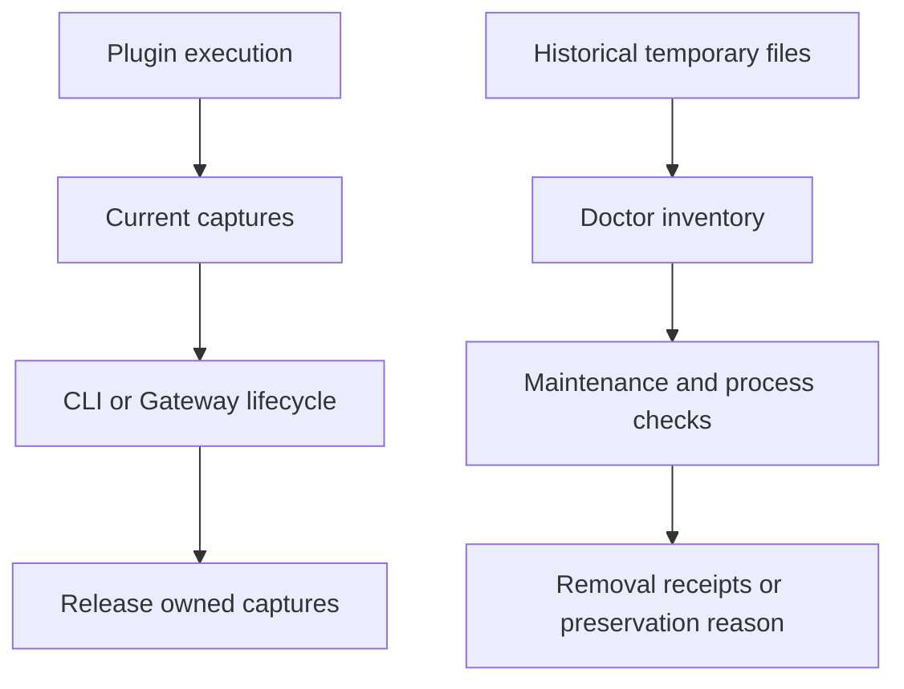

Codex review: blocked before merge. _Reviewed September 21, 2026, 2:58 AM ET / 06:58 UTC (Revision 4)._

# ClawSweeper review

## What this changes

The PR adds guarded Doctor cleanup of historical plugin temporary files on Linux and macOS, broadens directory reporting, and releases plugin captures when CLI commands finish or exit.

## Merge readiness

⛔ **Blocked before merge - 4 items remain**

Keep open: current main does not provide this recovery, and the CLI cleanup remains useful. No concrete correctness defect was found, but the expanded platform coverage and update compatibility are not fully validated.

**Priority:** P2
**Reviewed head:** `a2d8c1c86f60af6dda8e9aa1361b2a38fb80b130`

## Review scores

| Measure | Result | What it means |
|---|---|---|
| **Overall readiness** | 🦐 gold shrimp **(3/6)** | The implementation is coherent and has meaningful regression coverage, but recorded runtime evidence trails the expanded scope. |
| **Proof confidence** | 🦐 gold shrimp **(3/6)** | Not applicable: Real behavior proof is not required for maintainer- or bot-authored pull requests. |
| **Patch quality** | 🐚 platinum hermit **(4/6)** | No actionable review findings were identified. |

## Verification

| Check | Result | Evidence |
|---|---|---|
| **Real behavior** | Not applicable | Not applicable: Real behavior proof is not required for maintainer- or bot-authored pull requests. |
| **Evidence reviewed** | 10 items | Current main still lacks legacy recovery: Fetched main explicitly preserves legacy captures even with --fix and offers manual removal guidance; its CLI invocation creates an operation cache without the retirement registration introduced here. Shipped allocation boundary: The latest supplied release allocates captures beneath the explicit worker directory or system temporary directory, matching the historical directory layout reported by users. Cleanup admission and final effect: Doctor requires held maintenance and a fresh process census. The removal owner reinspects identity, custody, completeness, and nested-file recency before repeating admission and invoking best-effort deletion; tests cover preservation and removal receipts. |
| **Findings** | None | None. |
| **Security** | None | None. |

## How this fits together

OpenClaw copies plugin files into temporary captures for execution. The plugin lifecycle owns current captures, while Doctor inventories historical leftovers and decides whether maintenance can safely remove them.

## Before merge

- [ ] **Resolve merge risk (P1)** - Update-time recursive inventory now runs outside optional-inspection budget admission; completion with the published updater, existing state, and a representative legacy backlog remains unverified.
- [ ] **Resolve merge risk (P1)** - The new macOS cleanup path lacks recorded real-platform validation of successful reclamation and preservation when another producer or an unreadable live process is present.
- [ ] **Complete next step (P2)** - Update the PR body for the current macOS and CLI-exit behavior, attach the missing platform evidence, and resolve the outstanding published-updater compatibility check.
- [ ] **Add data-model compatibility proof** - Confirm migration or upgrade compatibility proof before merge.

<strong>Agent review details</strong>

### Security

None.

### PR surface

Source +519, Tests +632, Docs +22. Total +1173 across 21 files.

View PR surface stats

| Area | Files | Added | Removed | Net |
|---|---:|---:|---:|---:|
| Source | 12 | 601 | 82 | +519 |
| Tests | 8 | 745 | 113 | +632 |
| Docs | 1 | 30 | 8 | +22 |
| Config | 0 | 0 | 0 | 0 |
| Generated | 0 | 0 | 0 | 0 |
| Other | 0 | 0 | 0 | 0 |
| **Total** | **21** | **1376** | **203** | **+1173** |

### Review metrics

None.

### Stored data model

Persistent data-model change detected: `migration/backfill/repair: src/commands/doctor-plugin-source-captures.ts`, `migration/backfill/repair: src/flows/doctor-health-contributions-initial.ts`, `unknown-data-model-change: src/commands/doctor-plugin-source-captures.ts`. Confirm migration or upgrade compatibility proof before merge.

### Root-cause cluster

Relationship: `fixed_by_candidate`
Canonical: https://github.com/openclaw/openclaw/issues/154322
Summary: The current branch is a candidate repair for standalone CLI capture retention and the reported macOS recovery gap.

Members:
- `canonical`: https://github.com/openclaw/openclaw/issues/154322 - The open report describes CLI captures surviving exit and historical recovery on macOS, both addressed by the latest commit.
- `partial_overlap`: https://github.com/openclaw/openclaw/issues/154149 - The closed report supplies Linux temporary-storage exhaustion evidence and discussion of remaining historical captures.
- `adjacent_distinct`: https://github.com/openclaw/openclaw/pull/153038 - The merged repair bounds catalog-generation retention but explicitly leaves historical captures behind.

Proposal only: this assessment does not dispatch repair, suppress jobs, mutate sibling items, close, or merge anything.

### Merge-risk options

**Maintainer options:**
1. **Validate upgrade and macOS recovery (recommended)**  
   Supply the published-updater compatibility result and real macOS cleanup evidence before landing the expanded recovery path.
2. **Narrow the unproven paths**  
   Retain macOS report-only behavior and defer legacy inventory during updates until those paths have suitable evidence.

### Technical review

Best possible solution:

Keep cleanup with the existing lifecycle owners and provide guarded Doctor recovery, with update-time inventory demonstrated to fit the published updater's budget.

Do we have a high-confidence way to reproduce the issue?

Yes, at source level: current main explicitly leaves historical captures untouched and omits system temporary-directory inspection. No current-main runtime reproduction was executed during this read-only review.

Is this the best way to solve the issue?

Yes in design: reusing invocation retirement, capture custody, and Doctor maintenance avoids a competing cleanup owner. Platform and upgrade evidence must catch up with the expanded head.

AGENTS.md: found and applied where relevant.

Codex review notes: model internal, reasoning medium; reviewed against [22d80d386848](https://github.com/openclaw/openclaw/commit/22d80d386848a80448862d4fa0f78ceefb0cef7e).

### Labels

Label changes:

- add `rating: 🦐 gold shrimp`: Overall readiness is 🦐 gold shrimp; proof is 🦐 gold shrimp and patch quality is 🐚 platinum hermit.
- remove `proof: sufficient`: Current real behavior proof status is not_applicable, not sufficient.
- remove `rating: 🐚 platinum hermit`: Current PR rating is `rating: 🦐 gold shrimp`, so this older rating label is no longer current.

Label justifications:

- `P2`: This is a bounded recovery and resource-lifecycle repair for plugin temporary-storage accumulation.
- `merge-risk: 🚨 compatibility`: Existing installations gain recursive inventory during update without a demonstrated published-updater transition on a representative backlog.
- `rating: 🦐 gold shrimp`: Overall readiness is 🦐 gold shrimp; proof is 🦐 gold shrimp and patch quality is 🐚 platinum hermit.
- `status: 👀 ready for maintainer look`: ClawSweeper has no concrete contributor-facing blocker left for this PR. Not applicable: Real behavior proof is not required for maintainer- or bot-authored pull requests.

### Evidence

What I checked:

- **Current main still lacks legacy recovery:** Fetched main explicitly preserves legacy captures even with --fix and offers manual removal guidance; its CLI invocation creates an operation cache without the retirement registration introduced here. ([`src/commands/doctor-plugin-source-captures.ts:14`](https://github.com/openclaw/openclaw/blob/22d80d386848a80448862d4fa0f78ceefb0cef7e/src/commands/doctor-plugin-source-captures.ts#L14), [22d80d386848](https://github.com/openclaw/openclaw/commit/22d80d386848a80448862d4fa0f78ceefb0cef7e))
- **Shipped allocation boundary:** The latest supplied release allocates captures beneath the explicit worker directory or system temporary directory, matching the historical directory layout reported by users. ([`src/plugins/plugin-package-metadata-capture.ts:653`](https://github.com/openclaw/openclaw/blob/ec9c1a13db8938e5a3eaa51fca2e981cde2395a9/src/plugins/plugin-package-metadata-capture.ts#L653), [ec9c1a13db89](https://github.com/openclaw/openclaw/commit/ec9c1a13db8938e5a3eaa51fca2e981cde2395a9))
- **Cleanup admission and final effect:** Doctor requires held maintenance and a fresh process census. The removal owner reinspects identity, custody, completeness, and nested-file recency before repeating admission and invoking best-effort deletion; tests cover preservation and removal receipts. ([`src/plugins/plugin-source-capture-report.ts:122`](https://github.com/openclaw/openclaw/blob/a2d8c1c86f60af6dda8e9aa1361b2a38fb80b130/src/plugins/plugin-source-capture-report.ts#L122), [a2d8c1c86f60](https://github.com/openclaw/openclaw/commit/a2d8c1c86f60af6dda8e9aa1361b2a38fb80b130))
- **Walker dependency contract verified:** The patch imports walkDirectory through OpenClaw's filesystem facade. npm metadata verifies this dependency's repository; the pinned v0.17.0 implementation includes symlinks without following them, deduplicates visited directories, and records directory failures. ([`src/walk.ts`](https://github.com/openclaw/fs-safe/blob/38b312a519002e29900d248beff22864127a3a57/src/walk.ts), [38b312a51900](https://github.com/openclaw/fs-safe/commit/38b312a519002e29900d248beff22864127a3a57))
- **Recorded Linux proof remains useful:** The captured PR body records an isolated supported-CLI run removing two legacy roots totaling 196,608 bytes, retaining foreign and token-bearing sentinels, and printing receipts. An earlier probe preserved files when it detected a live peer. This evidence covers the earlier Linux implementation; the cited Testbox run is cancelled as disclosed after lease cleanup, which is not itself a failed behavioral assertion. ([1d46be9e4680](https://github.com/openclaw/openclaw/commit/1d46be9e4680773ce7f82063a4323a231ec982c0))
- **New macOS behavior exceeds recorded proof:** The current head adds native sysctl, executable-path, and platform-signature inspection that permits macOS legacy deletion. Its tests mock those native calls. The complete captured body and live body still describe macOS as report-only and provide no macOS execution result. ([`src/process/supervisor/darwin-process-command.ts:94`](https://github.com/openclaw/openclaw/blob/a2d8c1c86f60af6dda8e9aa1361b2a38fb80b130/src/process/supervisor/darwin-process-command.ts#L94), [a2d8c1c86f60](https://github.com/openclaw/openclaw/commit/a2d8c1c86f60af6dda8e9aa1361b2a38fb80b130))

Likely related people:

- **steipete:** Suggested for follow-up; no historical authorship or introduction is verified. (role: unverified routing candidate; confidence: low)
- **unknown:** The claimed source-line change could not be verified from bounded local history. (role: source history unknown; confidence: low)

### Rank-up moves

Optional improvements that raise the rating; they are not merge blockers.

- Record real macOS reclamation and preservation results for the current native census and CLI cleanup paths, then update the PR body.
- Complete the previously requested published v2026.9.5 updater-to-candidate check with existing state and a representative legacy backlog.

### Rating scale

| Score | Internal tier | Crab rank | Meaning |
|---:|:---:|---|---|
| **6/6** | S | 🦀 challenger crab | Exceptional readiness |
| **5/6** | A | 🦞 diamond lobster | Very strong readiness |
| **4/6** | B | 🐚 platinum hermit | Good normal PR; ordinary maintainer review |
| **3/6** | C | 🦐 gold shrimp | Useful, but confidence is limited |
| **2/6** | D | 🦪 silver shellfish | Proof or implementation needs work |
| **1/6** | F | 🧂 unranked krab | Not merge-ready |
| N/A | NA | 🌊 off-meta tidepool | Rating does not apply |

Overall follows the weaker of proof and patch quality.
Shiny media proof means a screenshot, video, or linked artifact directly shows the changed behavior. Runtime, network, CSP, and security claims still need visible diagnostics.

### Workflow

- ClawSweeper keeps one durable marker-backed review comment per issue or PR.
- Re-runs edit this comment so the latest verdict, findings, and automation markers stay together instead of adding duplicate bot comments.
- A fresh review can be triggered by eligible `@clawsweeper re-review` comments, exact-item GitHub events, scheduled/background review runs, or manual workflow dispatch.
- PR/issue authors and users with repository write access can comment `@clawsweeper re-review` or `@clawsweeper re-run` on an open PR or issue to request a fresh review only.
- Maintainers can also comment `@clawsweeper review` to request a fresh review only.
- Fresh-review commands do not start repair, autofix, rebase, CI repair, or automerge.
- Maintainer-only repair and merge flows require explicit commands such as `@clawsweeper autofix`, `@clawsweeper automerge`, `@clawsweeper fix ci`, or `@clawsweeper address review`.
- Maintainers can comment `@clawsweeper explain` to ask for more context, or `@clawsweeper stop` to stop active automation.

### History

Review history (3 earlier review cycles)

<!-- clawsweeper-review-history v=1 total=3 -->
- reviewed 2026-09-21T02:58:08.887Z sha 1d46be9e4680773ce7f82063a4323a231ec982c0 :: blocked before merge. :: none
- reviewed 2026-09-21T03:15:08.802Z sha 1d46be9e4680773ce7f82063a4323a231ec982c0 :: blocked before merge. :: none
- reviewed 2026-09-21T03:32:49.318Z sha 1d46be9e4680773ce7f82063a4323a231ec982c0 :: blocked before merge. :: none

<!-- clawsweeper-verdict:needs-human item=154324 sha=a2d8c1c86f60af6dda8e9aa1361b2a38fb80b130 confidence=high updated_at=2026-09-21T06:53:37Z reviewed_at=2026-09-21T06:58:15.192Z lease_owner=github-run-35570267911-1 lease_comment_id=5756557125 source_revision=616b6de1b8a382835cad2f45490ec9c4d6d0b29dfc329c243d4b2cf97a22b75d live_verification=absent -->
<!-- clawsweeper-review-state:blocked item=154324 sha=a2d8c1c86f60af6dda8e9aa1361b2a38fb80b130 v=1 -->

<!-- clawsweeper-review-version item=154324 reviewed_at=2026-09-21T06:58:15.192Z sha=a2d8c1c86f60af6dda8e9aa1361b2a38fb80b130 source_revision=616b6de1b8a382835cad2f45490ec9c4d6d0b29dfc329c243d4b2cf97a22b75d lease_owner=github-run-35570267911-1 lease_comment_id=5756557125 v=1 -->

<!-- clawsweeper-review item=154324 -->