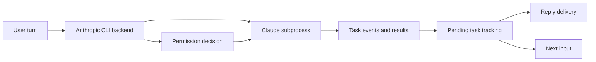

Codex review: needs maintainer review before merge. _Reviewed September 29, 2026, 12:35 PM ET / 16:35 UTC (Revision 2)._

# ClawSweeper review

## What this changes

The Anthropic Claude CLI plugin tracks unsettled Bash, agent, and workflow completions until their notification results arrive, then releases the turn for the next input.

## Merge readiness

✅ **Ready for maintainer review**

Keep open. Current main still has the reported hold behavior. The updated head addresses the prior review finding, and the supplied process-boundary evidence supports the repair.

**Priority:** P1
**Reviewed head:** `644a3d02fa1a2b6883fba179d280c56e2a43a489`

## Review scores

| Measure | Result | What it means |
|---|---|---|
| **Overall readiness** | 🐚 platinum hermit **(4/6)** | The focused patch has meaningful native and subprocess-boundary evidence, including coverage of the prior finding and stale permission decisions. |
| **Proof confidence** | 🐚 platinum hermit **(4/6)** | Sufficient (terminal): The changed Anthropic CLI turn owner was exercised through real Claude Code 2.1.272 with a synthetic provider; the PR reports overlapping and inline completion results followed by successful next input on the same subprocess. A changed test exercises the production JSONL transport and observes an old-turn allow become a deny in the subprocess response after reuse. No stored-data contract changes. |
| **Patch quality** | 🐚 platinum hermit **(4/6)** | No actionable review findings were identified. |

## Verification

| Check | Result | Evidence |
|---|---|---|
| **Real behavior** | Verified | Sufficient (terminal): The changed Anthropic CLI turn owner was exercised through real Claude Code 2.1.272 with a synthetic provider; the PR reports overlapping and inline completion results followed by successful next input on the same subprocess. A changed test exercises the production JSONL transport and observes an old-turn allow become a deny in the subprocess response after reuse. No stored-data contract changes. |
| **Evidence reviewed** | 8 items | Current main still needs the repair: The fetched main revision still uses the live-background-task flag and lacks the branch's per-task notification settlement. Notification settlement: The proposed adapter retains pending task IDs after they leave the live list, consumes queued notification results individually, and ends a turn on a failed result. Prior finding addressed: The earlier review identified failed notification settlement. The current head consumes a queued task only for a successful result; its changed subprocess tests assert retirement after queued error and malformed-output results. |
| **Findings** | None | None. |
| **Security** | None | None. |

## How this fits together

The Anthropic plugin runs Claude Code as a persistent subprocess for OpenClaw agent turns. It converts CLI task events and permission callbacks into replies and decides when that subprocess can accept another input.

## Before merge

None.

<strong>Agent review details</strong>

### Security

None.

### PR surface

Source +37, Tests +137. Total +174 across 3 files.

View PR surface stats

| Area | Files | Added | Removed | Net |
|---|---:|---:|---:|---:|
| Source | 1 | 73 | 36 | +37 |
| Tests | 2 | 184 | 47 | +137 |
| Docs | 0 | 0 | 0 | 0 |
| Config | 0 | 0 | 0 | 0 |
| Generated | 0 | 0 | 0 | 0 |
| Other | 0 | 0 | 0 | 0 |
| **Total** | **3** | **257** | **83** | **+174** |

### Review metrics

| Metric | Value | Why it matters |
|---|---|---|
| **Production versus test growth** | production net +37 lines; tests and support net +137 lines | The production growth records per-turn acknowledgement state; most added code covers subprocess transport regressions. |

### Technical review

Best possible solution:

Keep task acknowledgement in the Anthropic CLI adapter while preserving nonblocking explicit background commands and the final control-response permission check.

Do we have a high-confidence way to reproduce the issue?

Yes. Current-main source and the reported pre-fix Claude trace give a high-confidence path involving an automatically backgrounded foreground Bash task whose completion has no replay receipt; this read-only review did not execute it.

Is this the best way to solve the issue?

Yes. The existing Anthropic adapter is the narrow owner of the task and result ordering, and the changed transport tests cover queued results, inline receipts, failure retirement, and warm reuse.

AGENTS.md: found and applied where relevant.

Codex review notes: model internal, reasoning high; reviewed against [e47d0ce424bc](https://github.com/openclaw/openclaw/commit/e47d0ce424bcb800dec2112ec57192026724eea0).

### Labels

Label changes:

- add `proof: sufficient`: Contributor real behavior proof is sufficient. The changed Anthropic CLI turn owner was exercised through real Claude Code 2.1.272 with a synthetic provider; the PR reports overlapping and inline completion results followed by successful next input on the same subprocess. A changed test exercises the production JSONL transport and observes an old-turn allow become a deny in the subprocess response after reuse. No stored-data contract changes.
- add `rating: 🐚 platinum hermit`: Overall readiness is 🐚 platinum hermit; proof is 🐚 platinum hermit and patch quality is 🐚 platinum hermit.
- add `status: 👀 ready for maintainer look`: ClawSweeper has no concrete contributor-facing blocker left for this PR. Sufficient (terminal): The changed Anthropic CLI turn owner was exercised through real Claude Code 2.1.272 with a synthetic provider; the PR reports overlapping and inline completion results followed by successful next input on the same subprocess. A changed test exercises the production JSONL transport and observes an old-turn allow become a deny in the subprocess response after reuse. No stored-data contract changes.
- remove `rating: 🦪 silver shellfish`: Current PR rating is `rating: 🐚 platinum hermit`, so this older rating label is no longer current.
- remove `status: 📣 needs proof`: Current PR status label is `status: 👀 ready for maintainer look`.

Label justifications:

- `P1`: Affected Claude CLI turns can remain open until the watchdog ends a user-facing agent workflow.
- `merge-risk: 🚨 message-delivery`: The changed settlement order determines whether overlapping task replies are retained and delivered.
- `merge-risk: 🚨 security-boundary`: Warm subprocess reuse affects stale permission decisions; the final-response denial path has scoped test coverage.
- `rating: 🐚 platinum hermit`: Overall readiness is 🐚 platinum hermit; proof is 🐚 platinum hermit and patch quality is 🐚 platinum hermit.
- `status: 👀 ready for maintainer look`: ClawSweeper has no concrete contributor-facing blocker left for this PR. Sufficient (terminal): The changed Anthropic CLI turn owner was exercised through real Claude Code 2.1.272 with a synthetic provider; the PR reports overlapping and inline completion results followed by successful next input on the same subprocess. A changed test exercises the production JSONL transport and observes an old-turn allow become a deny in the subprocess response after reuse. No stored-data contract changes.
- `proof: sufficient`: Contributor real behavior proof is sufficient. The changed Anthropic CLI turn owner was exercised through real Claude Code 2.1.272 with a synthetic provider; the PR reports overlapping and inline completion results followed by successful next input on the same subprocess. A changed test exercises the production JSONL transport and observes an old-turn allow become a deny in the subprocess response after reuse. No stored-data contract changes.

### Evidence

What I checked:

- **Current main still needs the repair:** The fetched main revision still uses the live-background-task flag and lacks the branch's per-task notification settlement. ([`extensions/anthropic/cli.runtime.ts`](https://github.com/openclaw/openclaw/blob/e47d0ce424bcb800dec2112ec57192026724eea0/extensions/anthropic/cli.runtime.ts), [e47d0ce424bc](https://github.com/openclaw/openclaw/commit/e47d0ce424bcb800dec2112ec57192026724eea0))
- **Notification settlement:** The proposed adapter retains pending task IDs after they leave the live list, consumes queued notification results individually, and ends a turn on a failed result. ([`extensions/anthropic/cli.runtime.ts:282`](https://github.com/openclaw/openclaw/blob/644a3d02fa1a2b6883fba179d280c56e2a43a489/extensions/anthropic/cli.runtime.ts#L282), [644a3d02fa1a](https://github.com/openclaw/openclaw/commit/644a3d02fa1a2b6883fba179d280c56e2a43a489))
- **Prior finding addressed:** The earlier review identified failed notification settlement. The current head consumes a queued task only for a successful result; its changed subprocess tests assert retirement after queued error and malformed-output results. ([`extensions/anthropic/cli-runtime.test.ts:902`](https://github.com/openclaw/openclaw/blob/644a3d02fa1a2b6883fba179d280c56e2a43a489/extensions/anthropic/cli-runtime.test.ts#L902), [644a3d02fa1a](https://github.com/openclaw/openclaw/commit/644a3d02fa1a2b6883fba179d280c56e2a43a489))
- **Final permission boundary:** The adapter rechecks that the admitted turn is active when forming a control response; the transport invokes that response immediately before sending it to the subprocess. ([`extensions/anthropic/cli.runtime.ts:447`](https://github.com/openclaw/openclaw/blob/644a3d02fa1a2b6883fba179d280c56e2a43a489/extensions/anthropic/cli.runtime.ts#L447), [644a3d02fa1a](https://github.com/openclaw/openclaw/commit/644a3d02fa1a2b6883fba179d280c56e2a43a489))
- **Stale decision test:** A changed subprocess-boundary test resolves an old-turn Bash allow after the next turn starts and checks that the subprocess receives a deny response. ([`extensions/anthropic/cli-runtime.test.ts:800`](https://github.com/openclaw/openclaw/blob/644a3d02fa1a2b6883fba179d280c56e2a43a489/extensions/anthropic/cli-runtime.test.ts#L800), [644a3d02fa1a](https://github.com/openclaw/openclaw/commit/644a3d02fa1a2b6883fba179d280c56e2a43a489))
- **Reported real behavior proof:** The captured PR body reports two after-fix runs of real Claude Code 2.1.272 through the patched adapter and a synthetic provider: overlapping and inline completions delivered their results, then the same warm process accepted another input. It also reports 47 passing production-transport tests. These are contributor-reported observations, not commands run by this read-only review.

Likely related people:

- **Vito Cappello:** Suggested for follow-up; no historical authorship or introduction is verified. (role: unverified routing candidate; confidence: low)
- **Marvinthebored:** Suggested for follow-up; no historical authorship or introduction is verified. (role: unverified routing candidate; confidence: low)
- **Peter Steinberger:** Suggested for follow-up; no historical authorship or introduction is verified. (role: unverified routing candidate; confidence: low)

### Rating scale

| Score | Internal tier | Crab rank | Meaning |
|---:|:---:|---|---|
| **6/6** | S | 🦀 challenger crab | Exceptional readiness |
| **5/6** | A | 🦞 diamond lobster | Very strong readiness |
| **4/6** | B | 🐚 platinum hermit | Good normal PR; ordinary maintainer review |
| **3/6** | C | 🦐 gold shrimp | Useful, but confidence is limited |
| **2/6** | D | 🦪 silver shellfish | Proof or implementation needs work |
| **1/6** | F | 🧂 unranked krab | Not merge-ready |
| N/A | NA | 🌊 off-meta tidepool | Rating does not apply |

Overall follows the weaker of proof and patch quality.
Shiny media proof means a screenshot, video, or linked artifact directly shows the changed behavior. Runtime, network, CSP, and security claims still need visible diagnostics.

### Workflow

- ClawSweeper keeps one durable marker-backed review comment per issue or PR.
- Re-runs edit this comment so the latest verdict, findings, and automation markers stay together instead of adding duplicate bot comments.
- A fresh review can be triggered by eligible `@clawsweeper re-review` comments, exact-item GitHub events, scheduled/background review runs, or manual workflow dispatch.
- PR/issue authors and users with repository write access can comment `@clawsweeper re-review` or `@clawsweeper re-run` on an open PR or issue to request a fresh review only.
- Maintainers can also comment `@clawsweeper review` to request a fresh review only.
- Fresh-review commands do not start repair, autofix, rebase, CI repair, or automerge.
- Maintainer-only repair and merge flows require explicit commands such as `@clawsweeper autofix`, `@clawsweeper automerge`, `@clawsweeper fix ci`, or `@clawsweeper address review`.
- Maintainers can comment `@clawsweeper explain` to ask for more context, or `@clawsweeper stop` to stop active automation.

### History

Review history (1 earlier review cycle)

<!-- clawsweeper-review-history v=1 total=1 -->
- reviewed 2026-09-29T15:48:08.892Z sha 567962729f41b7ec1db21d17a24d9231ba6f9601 :: needs real behavior proof before merge. :: [P1] Preserve pending Bash work when notification results fail

<!-- clawsweeper-verdict:needs-human item=161260 sha=644a3d02fa1a2b6883fba179d280c56e2a43a489 confidence=high updated_at=2026-09-29T16:31:57Z reviewed_at=2026-09-29T16:35:34.076Z lease_owner=github-run-36598105919-1 lease_comment_id=5894396356 source_revision=5db12e0a17d17e4c2ddf5220ad376ff276ace5b953d4b42a8ab38bc3c67952ac live_verification=absent -->
<!-- clawsweeper-review-state:ready item=161260 sha=644a3d02fa1a2b6883fba179d280c56e2a43a489 v=1 -->

<!-- clawsweeper-review-version item=161260 reviewed_at=2026-09-29T16:35:34.076Z sha=644a3d02fa1a2b6883fba179d280c56e2a43a489 source_revision=5db12e0a17d17e4c2ddf5220ad376ff276ace5b953d4b42a8ab38bc3c67952ac lease_owner=github-run-36598105919-1 lease_comment_id=5894396356 v=1 -->

<!-- clawsweeper-review item=161260 -->