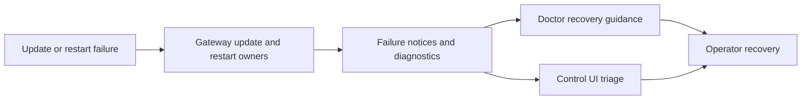

Codex review: blocked before merge. _Reviewed September 3, 2026, 8:30 AM ET / 12:30 UTC._

# ClawSweeper review

## What this changes

This PR adds update/restart diagnostics, owner-aware recovery guidance, health checks, and related tests for Gateway update and restart flows.

## Merge readiness

⛔ **Blocked before merge - 7 items remain**

Keep open: the branch improves update and restart diagnostics, but its introduced recovery guidance still makes terminal commands the only resolution for disabled LaunchAgent and update-failure states, contrary to the stated in-product recovery direction.

**Priority:** P1
**Reviewed head:** `cd4c3c08147b64be17146f84605eff43a90d9137`
**Owner decision:** Required. See [Decision needed](#decision-needed).

## Review scores

| Measure | Result | What it means |
|---|---|---|
| **Overall readiness** | 🦐 gold shrimp **(3/6)** | The diagnostics and owner-bound authorization work are substantive, but the required in-product recovery flow remains incomplete. |
| **Proof confidence** | 🐚 platinum hermit **(4/6)** | Not applicable: This member-authored branch supplies local owner and socket-test evidence; the merge blocker is the missing recovery capability, not an unproven claimed implementation path. |
| **Patch quality** | 🦐 gold shrimp **(3/6)** | 1 actionable review finding remain. |

## Verification

| Check | Result | Evidence |
|---|---|---|
| **Real behavior** | Not applicable | Not applicable: This member-authored branch supplies local owner and socket-test evidence; the merge blocker is the missing recovery capability, not an unproven claimed implementation path. |
| **Evidence reviewed** | 7 items | Introduced terminal-only recovery guidance: The introduced macOS diagnosis tells an operator to run gateway start, update, doctor, and triage commands; it does not provide an in-product recovery action. Existing UI triage is navigation only: The Control UI failure alert exposes only an action to navigate to Updates; no typed retry, restore, or report/recovery operation is available. Owner setup guidance is intentionally operator-facing: The command-owner helper preserves configured owners and emits an operator command, while the reply gate supplies it to authorized non-owners; this makes the missing product recovery surface material rather than a reason to weaken authorization. |
| **Findings** | 1 actionable finding | [P1] Keep recovery inside the product |
| **Security** | None | None. |

## How this fits together

Gateway update and restart owners report failures through notices, Doctor diagnostics, and the Control UI. These outputs guide an operator from a failed update or disabled service toward recovery actions.

## Decision needed

| Question | Recommendation |
|---|---|
| Should this PR require typed in-product recovery controls for update, restart, and disabled LaunchAgent failures before merge, rather than accepting terminal-only resolution? | **Require in-product recovery:** Add capability-checked retry, restore, or issue-report actions with truthful Gateway results before merging. |

Why: The required recovery action changes product and authorization UX: controls must expose only safe, currently authorized operations and report their real outcome.

## Before merge

- [ ] **Keep recovery inside the product (P1)** - These introduced messages make terminal commands the required recovery path for an installed-but-disabled Gateway. The existing Control UI triage action only opens Updates, so it cannot retry, restore, or report a recovery outcome. Add capability-checked, idempotent in-product controls backed by truthful Gateway results; retain CLI guidance only as supplemental developer-facing information.
- [ ] **Resolve merge risk (P1)** - Merging leaves disabled LaunchAgent and update-failure recovery dependent on terminal commands despite the available Control UI triage surface and the member-stated in-product recovery requirement.
- [ ] **Resolve merge risk (P1)** - The branch changes Telegram-visible recovery replies without Test Server event proof.
- [ ] **Resolve merge risk (P1)** - The branch has a classified production net increase of 112 lines; the recovery work required to meet the product direction must stay owner-bound rather than add a parallel guidance path.
- [ ] **Complete next step (P2)** - Add capability-checked, idempotent in-product recovery actions backed by truthful Gateway outcomes, then provide matching boundary and UI proof.
- [ ] **Resolve maintainer decision** - Resolve the maintainer decision shown above before merge.
- [ ] **Add data-model compatibility proof** - Confirm migration or upgrade compatibility proof before merge.

## Findings

- [P1] Keep recovery inside the product — `src/commands/doctor-platform-notes.ts:76-77`

<strong>Agent review details</strong>

### Security

None.

### PR surface

Source +100, Tests +610, Docs +23. Total +733 across 43 files.

View PR surface stats

| Area | Files | Added | Removed | Net |
|---|---:|---:|---:|---:|
| Source | 13 | 188 | 88 | +100 |
| Tests | 26 | 1034 | 424 | +610 |
| Docs | 4 | 24 | 1 | +23 |
| Config | 0 | 0 | 0 | 0 |
| Generated | 0 | 0 | 0 | 0 |
| Other | 0 | 0 | 0 | 0 |
| **Total** | **43** | **1246** | **513** | **+733** |

### Review metrics

| Metric | Value | Why it matters |
|---|---|---|
| **Production versus test LOC** | production +212/-100 (net +112); tests/support +1010/-412 (net +598); docs +24/-1 | The diagnostics and authorization work add production code, while the unresolved recovery surface determines whether that growth reaches a complete operator flow. |

### Stored data model

Persistent data-model change detected: `migration/backfill/repair: src/agents/tools/gateway-tool.ts`, `migration/backfill/repair: src/auto-reply/reply/command-gates.ts`, `migration/backfill/repair: src/commands/doctor-command-owner.ts`, `migration/backfill/repair: src/commands/doctor-platform-notes.ts`, `migration/backfill/repair: src/flows/doctor-health-contribution-runners.gateway.ts`, `migration/backfill/repair: src/gateway/server-methods/update.ts`, and 3 more. Confirm migration or upgrade compatibility proof before merge.

### Merge-risk options

**Maintainer options:**
1. **Add typed recovery controls (recommended)**  
   Implement and prove the capability-checked in-product actions so terminal instructions are not the only resolution.
2. **Accept CLI-only recovery explicitly**  
   Merge only if maintainers intentionally accept the existing support and usability tradeoff for failed recovery paths.

### Technical review

Best possible solution:

Hold the PR until failures expose capability-checked, idempotent Control UI recovery actions backed by truthful Gateway outcomes, with CLI guidance retained only as developer-facing fallback information.

Do we have a high-confidence way to reproduce the issue?

No high-confidence runtime reproduction was executed; source inspection directly shows the introduced terminal-only guidance and the existing UI's navigation-only action.

Is this the best way to solve the issue?

No: diagnostics alone do not meet the stated recovery contract because the product lacks typed, authorized in-app actions for the reported failure states.

Full review comments:

- [P1] Keep recovery inside the product — `src/commands/doctor-platform-notes.ts:76-77`
  These introduced messages make terminal commands the required recovery path for an installed-but-disabled Gateway. The existing Control UI triage action only opens Updates, so it cannot retry, restore, or report a recovery outcome. Add capability-checked, idempotent in-product controls backed by truthful Gateway results; retain CLI guidance only as supplemental developer-facing information.
  Confidence: 0.94

Overall correctness: patch is incorrect
Overall confidence: 0.91

AGENTS.md: found and applied where relevant.

Codex review notes: model internal, reasoning high; reviewed against [6b1d8119e189](https://github.com/openclaw/openclaw/commit/6b1d8119e189408371491d1742693c1adcb5785c).

### Labels

Label changes:

- add `merge-risk: 🚨 compatibility`: Existing macOS Gateway installations may receive new recovery guidance that requires terminal intervention instead of a supported product control.
- add `rating: 🦐 gold shrimp`: Overall readiness is 🦐 gold shrimp; proof is 🐚 platinum hermit and patch quality is 🦐 gold shrimp.
- add `status: ⏳ waiting on author`: ClawSweeper has contributor-facing work open and is waiting for author action. Not applicable: This member-authored branch supplies local owner and socket-test evidence; the merge blocker is the missing recovery capability, not an unproven claimed implementation path.
- remove `rating: 🐚 platinum hermit`: Current PR rating is `rating: 🦐 gold shrimp`, so this older rating label is no longer current.
- remove `merge-risk: 🚨 security-boundary`: Current PR review merge-risk labels are `merge-risk: 🚨 compatibility`.
- remove `status: 👀 ready for maintainer look`: Current PR status label is `status: ⏳ waiting on author`.

Label justifications:

- `P1`: A failed update or disabled Gateway can leave real operators without an in-product recovery path.
- `merge-risk: 🚨 compatibility`: Existing macOS Gateway installations may receive new recovery guidance that requires terminal intervention instead of a supported product control.
- `rating: 🦐 gold shrimp`: Overall readiness is 🦐 gold shrimp; proof is 🐚 platinum hermit and patch quality is 🦐 gold shrimp.
- `status: ⏳ waiting on author`: ClawSweeper has contributor-facing work open and is waiting for author action. Not applicable: This member-authored branch supplies local owner and socket-test evidence; the merge blocker is the missing recovery capability, not an unproven claimed implementation path.
- `proof: telegram-e2e`: This PR needs Telegram Test Server proof with the repository E2E skill. The PR changes Telegram-visible recovery replies, but the supplied evidence does not include a Telegram Test Server event proof.

### Evidence

Acceptance criteria:

- [P1] Add Gateway boundary coverage for each exposed recovery action, including unavailable and revoked-capability states.
- [P1] Add Control UI coverage proving no failure path requires terminal-only resolution.
- [P1] Use Telegram Test Server proof for the changed Telegram recovery reply path when feasible.

What I checked:

- **Introduced terminal-only recovery guidance:** The introduced macOS diagnosis tells an operator to run gateway start, update, doctor, and triage commands; it does not provide an in-product recovery action. ([`src/commands/doctor-platform-notes.ts:76`](https://github.com/openclaw/openclaw/blob/11a7378106bd15dccc0ad6d6ae188bea5106a4ef/src/commands/doctor-platform-notes.ts#L76), [11a7378106bd](https://github.com/openclaw/openclaw/commit/11a7378106bd15dccc0ad6d6ae188bea5106a4ef))
- **Existing UI triage is navigation only:** The Control UI failure alert exposes only an action to navigate to Updates; no typed retry, restore, or report/recovery operation is available. ([`ui/src/app/update-triage.runtime.ts:74`](https://github.com/openclaw/openclaw/blob/cd4c3c08147b64be17146f84605eff43a90d9137/ui/src/app/update-triage.runtime.ts#L74), [cd4c3c08147b](https://github.com/openclaw/openclaw/commit/cd4c3c08147b64be17146f84605eff43a90d9137))
- **Owner setup guidance is intentionally operator-facing:** The command-owner helper preserves configured owners and emits an operator command, while the reply gate supplies it to authorized non-owners; this makes the missing product recovery surface material rather than a reason to weaken authorization. ([`src/commands/doctor-command-owner.ts:44`](https://github.com/openclaw/openclaw/blob/1427a3fe1f6328e5191856d6a3095e4acba7e7b1/src/commands/doctor-command-owner.ts#L44), [1427a3fe1f63](https://github.com/openclaw/openclaw/commit/1427a3fe1f6328e5191856d6a3095e4acba7e7b1))
- **Effect-site ownership remains guarded:** Update handling rechecks external requester ownership from current runtime configuration, including after awaited acknowledgement and before managed or unsupervised effects. ([`src/gateway/server-methods/update.ts:241`](https://github.com/openclaw/openclaw/blob/cd4c3c08147b64be17146f84605eff43a90d9137/src/gateway/server-methods/update.ts#L241), [cd4c3c08147b](https://github.com/openclaw/openclaw/commit/cd4c3c08147b64be17146f84605eff43a90d9137))
- **Maintainer product direction:** A member review comment on this PR requires capability-checked, idempotent in-product Retry, Restore previous version, or Report issue actions with truthful outcomes; it says CLI guidance cannot be the required resolution.
- **Codex boundary checked directly:** The directly inspected sibling Codex CLI source implements its own stdio/UDS relay and interactive CLI configuration flow. This PR changes OpenClaw Gateway and CLI behavior and has no affirmative Codex runtime or protocol dependency signal. (`codex-rs/cli/src/main.rs:220`, `41e22fee981a63b3698df7ed36bad393cda24715`)

Likely related people:

- **fuller-stack-dev:** Suggested for follow-up; no historical authorship or introduction is verified. (role: unverified routing candidate; confidence: low)
- **steipete:** Suggested for follow-up; no historical authorship or introduction is verified. (role: unverified routing candidate; confidence: low)

### Rank-up moves

Optional improvements that raise the rating; they are not merge blockers.

- Add the typed capability-checked recovery controls and boundary/UI proof.
- Capture Telegram Test Server evidence for the changed recovery reply path when feasible.

### Rating scale

| Score | Internal tier | Crab rank | Meaning |
|---:|:---:|---|---|
| **6/6** | S | 🦀 challenger crab | Exceptional readiness |
| **5/6** | A | 🦞 diamond lobster | Very strong readiness |
| **4/6** | B | 🐚 platinum hermit | Good normal PR; ordinary maintainer review |
| **3/6** | C | 🦐 gold shrimp | Useful, but confidence is limited |
| **2/6** | D | 🦪 silver shellfish | Proof or implementation needs work |
| **1/6** | F | 🧂 unranked krab | Not merge-ready |
| N/A | NA | 🌊 off-meta tidepool | Rating does not apply |

Overall follows the weaker of proof and patch quality.
Shiny media proof means a screenshot, video, or linked artifact directly shows the changed behavior. Runtime, network, CSP, and security claims still need visible diagnostics.

### Workflow

- ClawSweeper keeps one durable marker-backed review comment per issue or PR.
- Re-runs edit this comment so the latest verdict, findings, and automation markers stay together instead of adding duplicate bot comments.
- A fresh review can be triggered by eligible `@clawsweeper re-review` comments, exact-item GitHub events, scheduled/background review runs, or manual workflow dispatch.
- PR/issue authors and users with repository write access can comment `@clawsweeper re-review` or `@clawsweeper re-run` on an open PR or issue to request a fresh review only.
- Maintainers can also comment `@clawsweeper review` to request a fresh review only.
- Fresh-review commands do not start repair, autofix, rebase, CI repair, or automerge.
- Maintainer-only repair and merge flows require explicit commands such as `@clawsweeper autofix`, `@clawsweeper automerge`, `@clawsweeper fix ci`, or `@clawsweeper address review`.
- Maintainers can comment `@clawsweeper explain` to ask for more context, or `@clawsweeper stop` to stop active automation.

### History

Review history (6 earlier review cycles)

<!-- clawsweeper-review-history v=1 total=6 -->
- reviewed 2026-09-03T04:47:33.727Z sha ff22c0c0f7bfa9713b3433a94164c805a976fc3b :: blocked before merge. :: none
- reviewed 2026-09-03T07:57:08.795Z sha 7b9530205a34e83cb61b69f47286771cd6225294 :: blocked before merge. :: [P1] Preserve existing command owners in the setup hint | [P1] Render skipped updates as a non-failure outcome
- reviewed 2026-09-03T08:17:21.305Z sha 57720edac934e8be6a77b99b4f2caab6c2ea0514 :: blocked before merge. :: [P1] Preserve existing owners in recovery guidance | [P1] Distinguish skipped updates from failures
- reviewed 2026-09-03T08:45:07.917Z sha 80c3b52e24f9e32a134cfec66ad1831c1bd7bc0f :: blocked before merge. :: [P1] Do not disclose configured owners in recovery replies
- reviewed 2026-09-03T09:29:13.737Z sha 80c3b52e24f9e32a134cfec66ad1831c1bd7bc0f :: blocked before merge. :: none
- reviewed 2026-09-03T09:58:52.678Z sha 81d6ed0c0bdacb4c293f342bc8aa792df100fb92 :: blocked before merge. :: none

<!-- clawsweeper-verdict:needs-human item=136995 sha=cd4c3c08147b64be17146f84605eff43a90d9137 confidence=high updated_at=2026-09-03T12:26:05Z reviewed_at=2026-09-03T12:30:09.104Z lease_owner=github-run-33754965709-1 lease_comment_id=5525724449 source_revision=49a6658871091f1fe884fa08200929b742966ad26caf3d9ff5a87eee7c27d40d live_verification=absent -->
<!-- clawsweeper-review-state:blocked item=136995 sha=cd4c3c08147b64be17146f84605eff43a90d9137 v=1 -->

<!-- clawsweeper-review-version item=136995 reviewed_at=2026-09-03T12:30:09.104Z sha=cd4c3c08147b64be17146f84605eff43a90d9137 source_revision=49a6658871091f1fe884fa08200929b742966ad26caf3d9ff5a87eee7c27d40d lease_owner=github-run-33754965709-1 lease_comment_id=5525724449 v=1 -->

<!-- clawsweeper-review item=136995 -->