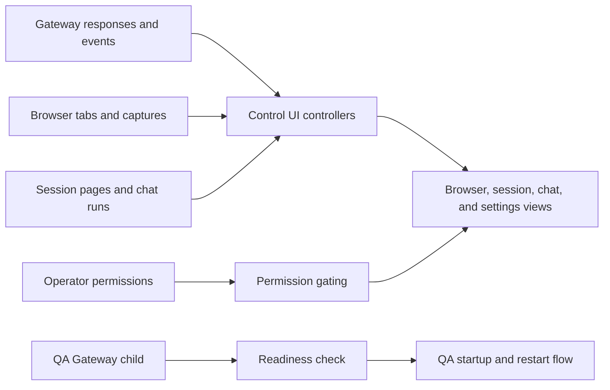

Codex review: needs maintainer review before merge. _Reviewed July 28, 2026, 8:26 AM ET / 12:26 UTC._

# ClawSweeper review

## What this changes

This PR makes the Control UI preserve ownership of asynchronous browser, session, chat-tool, media, permission, and navigation updates, makes QA Gateway startup wait for readiness, and separates an overloaded CI test shard.

## Merge readiness

⚠️ **Ready for maintainer review - 5 items remain**

Keep this PR open for maintainer review rather than cleanup. It is a broad but coherent Control UI reliability bundle with concrete regression coverage and real Chromium/terminal proof; however, its head is behind current `main`, it changes shared session and browser ownership plus CI scheduling, and the protected `maintainer` label requires a fresh current-base merge review before landing.

**Priority:** P1
**Reviewed head:** `fabbc37b3376e55dc18fa1e7c92638a78847871b`
**Owner decision:** Required. See [Decision needed](#decision-needed).

## Review scores

| Measure | Result | What it means |
|---|---|---|
| **Overall readiness** | 🐚 platinum hermit **(4/6)** | Strong focused proof and regression coverage support a useful patch; the remaining quality gate is a current-main merge review and completion of exact-head hosted checks, not missing contributor evidence. |
| **Proof confidence** | 🦞 diamond lobster **(5/6)** | Sufficient (terminal): The PR body includes final-head terminal proof for stale browser capture ownership and `/readyz` startup behavior, plus actual Chromium UI scenarios; private values should remain redacted if further artifacts are posted. |
| **Patch quality** | 🐚 platinum hermit **(4/6)** | No actionable review findings were identified. |

## Verification

| Check | Result | Evidence |
|---|---|---|
| **Real behavior** | Verified | Sufficient (terminal): The PR body includes final-head terminal proof for stale browser capture ownership and `/readyz` startup behavior, plus actual Chromium UI scenarios; private values should remain redacted if further artifacts are posted. |
| **Evidence reviewed** | 6 items | Browser lifecycle ownership: The branch moves browser snapshot, capture, navigation, and input lifetime checks into a dedicated ownership component, with failing-first regression suites for stale capture and tab races.<br>Session and chat identity fixes: The branch adds Gateway-backed sidebar pagination and keys live tool cards by the pair of run ID and tool-call ID, covering overlapping runs that legitimately reuse a tool-call ID.<br>Readiness contract: QA Gateway startup now probes only `/readyz`; the accompanying test holds readiness at 503 while listener liveness would be healthy and asserts retry before startup succeeds. |
| **Findings** | None | None. |
| **Security** | None | None. |

## How this fits together

Gateway snapshots, browser responses, agent events, and operator permissions feed Control UI controllers that render browser, chat, session, and administration surfaces. The PR adds explicit lifecycle ownership so stale asynchronous work cannot update newer UI state, while QA Lab waits for the Gateway to accept work before proceeding.



## Decision needed

| Question | Recommendation |
|---|---|
| After a current-main rebase and exact-head hosted checks, should this intentionally atomic Control UI reliability bundle land as one PR rather than be split across its ten linked regressions? | **Land atomically after refresh:** Rebase the branch, require the remaining exact-head hosted checks to pass, then merge the integrated reliability bundle as proposed. |

Why: The PR spans shared Control UI state ownership, authorization presentation, QA startup behavior, and CI scheduling; the supplied evidence supports the bundle, but maintainers must decide whether that release and review scope is acceptable after reviewing the current merge result.

## Before merge

- [ ] **Resolve merge risk (P1)** - The branch is behind current `main`; rebase or inspect the current three-way merge result before approving shared Control UI ownership and permission changes.
- [ ] **Resolve merge risk (P1)** - Session pagination and run-scoped tool-card identity changes affect state that persists across reconnects and history hydration, so final-head session regressions and hosted checks should complete on the rebased head.
- [ ] **Resolve merge risk (P1)** - The QA readiness and CI planner changes can alter startup latency and test-job placement; final hosted QA and shard checks are required to validate the intended operational behavior.
- [ ] **Complete next step (P2)** - A maintainer must review the current-base merge result and decide whether to land this intentionally atomic, cross-owner reliability bundle after exact-head hosted checks complete.


<details>
<summary><strong>Agent review details</strong></summary>

### Security

None.

### PR surface

Source +1307, Tests +2621, Other +2. Total +3930 across 44 files.

<details>
<summary>View PR surface stats</summary>

| Area | Files | Added | Removed | Net |
|---|---:|---:|---:|---:|
| Source | 26 | 1741 | 434 | +1307 |
| Tests | 17 | 2633 | 12 | +2621 |
| Docs | 0 | 0 | 0 | 0 |
| Config | 0 | 0 | 0 | 0 |
| Generated | 0 | 0 | 0 | 0 |
| Other | 1 | 3 | 1 | +2 |
| **Total** | **44** | **4377** | **447** | **+3930** |

</details>

### Review metrics

| Metric | Value | Why it matters |
|---|---|---|
| **Public contract surfaces** | 0 config, protocol, database-schema, or provider-contract changes claimed | The bundle changes internal UI and QA lifecycle behavior rather than adding an upgrade-visible configuration or protocol surface. |

### Stored data model

Persistent data-model change detected: `persistent cache schema: ui/src/pages/chat/components/chat-message-attachments.ts`, `serialized state: ui/src/components/session-data-controller-pagination.ts`, `serialized state: ui/src/components/session-data-controller.ts`, `serialized state: ui/src/pages/chat/tool-stream-identity.ts`, `serialized state: ui/src/test-helpers/app-sidebar-cases/session-pagination.ts`, `serialized state: ui/src/test-helpers/app-sidebar-cases/sessions.ts`, and 3 more. Confirm migration or upgrade compatibility proof before merge.

### Merge-risk options

**Maintainer options:**
1. **Refresh the exact merge result (recommended)**  
   Rebase onto current main and require final-head session, UI, QA readiness, and hosted checks before merging shared lifecycle changes.
2. **Accept the integrated release unit**  
   Maintain the atomic bundle only if maintainers accept its shared UI, QA, and CI scheduling blast radius after reviewing the fresh merge result.
3. **Split the non-UI scheduler change**  
   Pause or narrow the PR by moving the CI scheduling estimate to a separate review if rollback isolation is more important than atomic delivery.

<details>
<summary>Copy recommended automerge instruction</summary>

```text
@clawsweeper automerge

Special instructions:
Rebase onto current main, preserve the canonical permission and lifecycle paths, and rerun exact-head UI, QA readiness, session, type, lint, and CI-planner checks.
```

</details>

### Technical review

Best possible solution:

Rebase onto current `main`, retain the demonstrated lifecycle ownership boundaries and existing permission helpers, then land the bundle atomically only after the exact-head hosted UI, QA readiness, type, lint, and CI-sharding checks are green.

Do we have a high-confidence way to reproduce the issue?

No independent live reproduction was run in this read-only review, but the supplied current-main repro paths, failing-first regressions, and final-head browser/QA assertions make the affected behaviors source-reproducible with high confidence.

Is this the best way to solve the issue?

Unclear until the current-base merge result is reviewed. The ownership-based fixes reuse existing permission, pagination, and readiness contracts and appear preferable to ad-hoc stale-result guards, but the branch must be refreshed against current main before calling it the best final solution.

AGENTS.md: found and applied where relevant.

Codex review notes: model internal, reasoning high; reviewed against [2c5aff01f62d](https://github.com/openclaw/openclaw/commit/2c5aff01f62d16cecaad9ba4268d492216467ae5).

### Labels

Label changes:

- add `merge-risk: 🚨 automation`: The CI test-plan timing estimate changes compact-shard assignment and therefore post-merge CI scheduling behavior.
- add `rating: 🐚 platinum hermit`: Overall readiness is 🐚 platinum hermit; proof is 🦞 diamond lobster and patch quality is 🐚 platinum hermit.
- remove `rating: 🦐 gold shrimp`: Current PR rating is `rating: 🐚 platinum hermit`, so this older rating label is no longer current.

Label justifications:

- `P1`: Concurrent tool-card attribution, stale browser state, and QA readiness can disrupt active Control UI and QA workflows for affected users.
- `merge-risk: 🚨 session-state`: The PR changes live tool-stream identity, history reconciliation, session-page ownership, and reconnect-sensitive UI state.
- `merge-risk: 🚨 availability`: Changing QA Gateway readiness from liveness fallback to `/readyz` can alter startup and restart completion behavior.
- `merge-risk: 🚨 automation`: The CI test-plan timing estimate changes compact-shard assignment and therefore post-merge CI scheduling behavior.
- `rating: 🐚 platinum hermit`: Overall readiness is 🐚 platinum hermit; proof is 🦞 diamond lobster and patch quality is 🐚 platinum hermit.
- `status: 👀 ready for maintainer look`: ClawSweeper has no concrete contributor-facing blocker left for this PR. Sufficient (terminal): The PR body includes final-head terminal proof for stale browser capture ownership and `/readyz` startup behavior, plus actual Chromium UI scenarios; private values should remain redacted if further artifacts are posted.
- `proof: sufficient`: Contributor real behavior proof is sufficient. The PR body includes final-head terminal proof for stale browser capture ownership and `/readyz` startup behavior, plus actual Chromium UI scenarios; private values should remain redacted if further artifacts are posted.

### Evidence

What I checked:

- **Browser lifecycle ownership:** The branch moves browser snapshot, capture, navigation, and input lifetime checks into a dedicated ownership component, with failing-first regression suites for stale capture and tab races. ([`ui/src/components/browser/browser-panel-operation-ownership.ts:1`](https://github.com/openclaw/openclaw/blob/fabbc37b3376/ui/src/components/browser/browser-panel-operation-ownership.ts#L1), [fabbc37b3376](https://github.com/openclaw/openclaw/commit/fabbc37b3376))
- **Session and chat identity fixes:** The branch adds Gateway-backed sidebar pagination and keys live tool cards by the pair of run ID and tool-call ID, covering overlapping runs that legitimately reuse a tool-call ID. ([`ui/src/pages/chat/tool-stream-identity.ts:19`](https://github.com/openclaw/openclaw/blob/fabbc37b3376/ui/src/pages/chat/tool-stream-identity.ts#L19), [fabbc37b3376](https://github.com/openclaw/openclaw/commit/fabbc37b3376))
- **Readiness contract:** QA Gateway startup now probes only `/readyz`; the accompanying test holds readiness at 503 while listener liveness would be healthy and asserts retry before startup succeeds. ([`extensions/qa-lab/src/gateway-child.ts:958`](https://github.com/openclaw/openclaw/blob/fabbc37b3376/extensions/qa-lab/src/gateway-child.ts#L958), [fabbc37b3376](https://github.com/openclaw/openclaw/commit/fabbc37b3376))
- **Real behavior proof:** The PR body supplies final-head terminal evidence for browser ownership and Gateway readiness plus 21 actual Chromium scenarios; the supplied checks also show the dedicated Real behavior proof job succeeded. ([fabbc37b3376](https://github.com/openclaw/openclaw/commit/fabbc37b3376))
- **Current-base status:** The review context reports the PR as mergeable but behind: its recorded base is 4fb33559 while current main is 2c5aff01. A three-way/current-base review is still needed; being behind alone is not evidence that the merge deletes current-main behavior. ([2c5aff01f62d](https://github.com/openclaw/openclaw/commit/2c5aff01f62d))
- **Branch provenance:** The supplied branch history shows eight focused commits, ending with the cron permission-contract reconciliation; the recent work consistently spans the affected Control UI, QA Lab, and CI-planning paths. ([`ui/src/pages/cron/cron-page.ts:58`](https://github.com/openclaw/openclaw/blob/fabbc37b3376/ui/src/pages/cron/cron-page.ts#L58), [fabbc37b3376](https://github.com/openclaw/openclaw/commit/fabbc37b3376))

Likely related people:

- **steipete:** The supplied PR history attributes all eight focused commits and the linked reproductions to this contributor across the browser, session, permissions, QA readiness, and CI-planning changes. (role: recent area contributor; confidence: medium; commits: [841b8443a0f1](https://github.com/openclaw/openclaw/commit/841b8443a0f15c75d1ab66f6131ecfbbba2e6326), [c5f4c380dce4](https://github.com/openclaw/openclaw/commit/c5f4c380dce4c74492ef27c92dddbd520a43725d), [fabbc37b3376](https://github.com/openclaw/openclaw/commit/fabbc37b3376e55dc18fa1e7c92638a78847871b); files: `ui/src/components/browser/browser-panel-controller.ts`, `ui/src/pages/chat/tool-stream.ts`, `extensions/qa-lab/src/gateway-child.ts`)

### Rank-up moves

Optional improvements that raise the rating; they are not merge blockers.

- Rebase or inspect the three-way merge result against current main.
- Wait for the exact-head hosted UI, QA, type, lint, and CI-sharding checks before merge.

### Rating scale

| Score | Internal tier | Crab rank | Meaning |
|---:|:---:|---|---|
| **6/6** | S | 🦀 challenger crab | Exceptional readiness |
| **5/6** | A | 🦞 diamond lobster | Very strong readiness |
| **4/6** | B | 🐚 platinum hermit | Good normal PR; ordinary maintainer review |
| **3/6** | C | 🦐 gold shrimp | Useful, but confidence is limited |
| **2/6** | D | 🦪 silver shellfish | Proof or implementation needs work |
| **1/6** | F | 🧂 unranked krab | Not merge-ready |
| N/A | NA | 🌊 off-meta tidepool | Rating does not apply |

Overall follows the weaker of proof and patch quality.
Shiny media proof means a screenshot, video, or linked artifact directly shows the changed behavior. Runtime, network, CSP, and security claims still need visible diagnostics.

### Workflow

- ClawSweeper keeps one durable marker-backed review comment per issue or PR.
- Re-runs edit this comment so the latest verdict, findings, and automation markers stay together instead of adding duplicate bot comments.
- A fresh review can be triggered by eligible `@clawsweeper re-review` comments, exact-item GitHub events, scheduled/background review runs, or manual workflow dispatch.
- PR/issue authors and users with repository write access can comment `@clawsweeper re-review` or `@clawsweeper re-run` on an open PR or issue to request a fresh review only.
- Maintainers can also comment `@clawsweeper review` to request a fresh review only.
- Fresh-review commands do not start repair, autofix, rebase, CI repair, or automerge.
- Maintainer-only repair and merge flows require explicit commands such as `@clawsweeper autofix`, `@clawsweeper automerge`, `@clawsweeper fix ci`, or `@clawsweeper address review`.
- Maintainers can comment `@clawsweeper explain` to ask for more context, or `@clawsweeper stop` to stop active automation.

### History

<details>
<summary>Review history (7 earlier review cycles)</summary>

<!-- clawsweeper-review-history v=1 total=7 -->
- reviewed 2026-07-28T09:32:20.173Z sha 343d4be617db83e36b28f05f64c686ea3631a5cb :: needs real behavior proof before merge. :: none
- reviewed 2026-07-28T09:56:31.059Z sha 45f4dde9d1f02b86fa36d34f49b63a12b635b24a :: needs real behavior proof before merge. :: none
- reviewed 2026-07-28T10:04:11.886Z sha 45f4dde9d1f02b86fa36d34f49b63a12b635b24a :: needs real behavior proof before merge. :: none
- reviewed 2026-07-28T10:14:45.405Z sha ec466ae588829d3127d7a8491d86f78c98aa9ab3 :: needs real behavior proof before merge. :: none
- reviewed 2026-07-28T10:42:01.112Z sha fca81644cc1305b72333ddb1338fd4c0bd8fc89a :: needs maintainer review before merge. :: none
- reviewed 2026-07-28T10:56:49.724Z sha 76b9b0dde2e8f15d43c6b569e5be87d09c3b70d6 :: needs maintainer review before merge. :: none
- reviewed 2026-07-28T12:15:54.096Z sha ad5bc648f7ae09b004b6ec5e1ceb1bdaf4c08293 :: needs maintainer review before merge. :: none

</details>

</details>

<!-- clawsweeper-verdict:needs-human item=115110 sha=fabbc37b3376e55dc18fa1e7c92638a78847871b confidence=medium updated_at=2026-07-28T12:25:21Z reviewed_at=2026-07-28T12:26:57.357Z lease_owner=github-run-30358780814-1 lease_comment_id=5104111794 source_revision=b488e22b4b1514987bf9835d04d3ef47824a18700839303e73c8cf52b8b486b1 -->

<!-- clawsweeper-review-version item=115110 reviewed_at=2026-07-28T12:26:57.357Z sha=fabbc37b3376e55dc18fa1e7c92638a78847871b source_revision=b488e22b4b1514987bf9835d04d3ef47824a18700839303e73c8cf52b8b486b1 lease_owner=github-run-30358780814-1 lease_comment_id=5104111794 v=1 -->

<!-- clawsweeper-review item=115110 -->