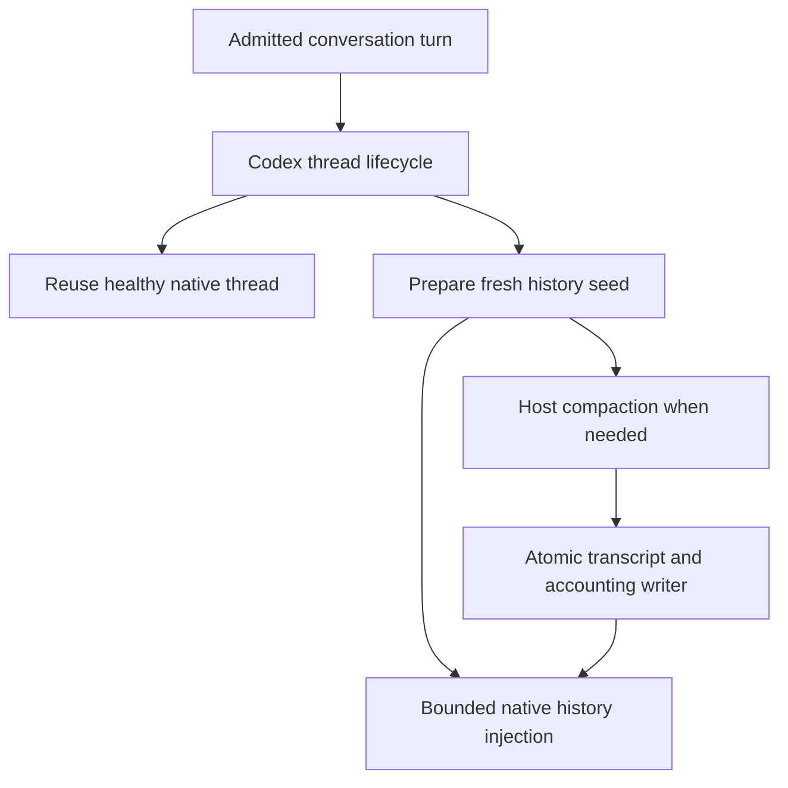

Codex review: needs maintainer review before merge.

## What this changes

This PR defers host transcript compaction until a fresh Codex thread needs bounded history.

**Example:** An ordinary Codex turn has an oversized host transcript mirror.
- **Before:** The supplied five-repeat campaign recorded one host compaction and one summary request per turn.
- **After:** It recorded zero host compactions and zero summary requests, while retaining all three historical facts.

## Review scores

| Measure | Result | What it means |
|---|---|---|
| **Overall readiness** | 🦞 diamond lobster **(5/6)** | Approved direction, relevant shipped-path evidence, exact-head gates, and no actionable introduced findings support readiness. |
| **Proof confidence** | 🦞 diamond lobster **(5/6)** | Sufficient (live_output): Supplied real CLI/native-runtime results exercise ordinary reuse, bounded fresh seeds, subsequent rotations, manual compaction, refresh input, and forced-cold upgrades; retained callbacks and reset-during-seeding scenarios reject stale summary or injection effects, and the reviewed head is production-identical to the executed after revision. |
| **Patch quality** | 🦞 diamond lobster **(5/6)** | No actionable review findings were identified. |

## Product

**Kind:** Bug fix · **Worth it:** Yes · **Fix scope:** Complete
**User problem:** Ordinary Codex replies can repeatedly wait for host summarization even when the native conversation remains healthy.
**Reason:** Recorded maintainer direction supports the changed timing and additive capability, and runtime comparisons demonstrate reduced unnecessary work.

## Merge readiness

✅ **Ready for maintainer review**

This PR implements the approved lazy-seeding direction, addresses repeated Codex host compaction, and has no actionable introduced defects after review.

**Priority:** P1
**Reviewed head:** `7083100abbdcc77bb9a28ac1afc41e647e299ead`

## Before merge

None.

## Findings

None.

<strong>Agent review details</strong>

### How this fits together

OpenClaw stores conversation history independently of Codex native threads; the host prepares bounded history for fresh threads while Codex owns native compaction.

### Technical review

Best possible solution:

Keep host summarization at fresh-seed consumption, preserving native reuse, atomic accounting, active input, and explicit context-engine ownership.

Do we have a high-confidence way to reproduce the issue?

Current main evaluates host transcript byte pressure independently of native compaction, explaining repeated summaries; the supplied before/after runtime campaigns corroborate that path.

Is this the best way to solve the issue?

Moving the guard to fresh-seed consumption addresses its original bootstrap purpose and reuses the existing compactor and atomic writer without competing persistence ownership.

AGENTS.md: found and applied where relevant.

Codex review notes: model internal, reasoning medium; reviewed against [08b19021512e](https://github.com/openclaw/openclaw/commit/08b19021512ef1e6f56f2c048e3a723aacf324da).

### Provenance checked

- `Codex host byte preflight` changes intended behavior with a stated reason (4e651a43f46fd8bff320776c270d99a67991a402: Bound host history because it supplies fresh native bootstrap payloads.)
- `Atomic compaction persistence and writer fencing` keeps the original intent (9d982698026a2239a1b6d5d02b3616fbe39f720d: Commit transcript boundaries, accounting, and latch state together under current writer authority.)
- `Selected native history delivery` keeps the original intent (d64c9bbcd66d73e5c38f5e6f2261c2a6410911ca: Deliver selected history without a second silent cutoff and avoid duplicate injection.)
- `Bounded fallback context` changes intended behavior with a stated reason (17cc94a953e7ab864fafc5cdd1af7b03271d2677: Continue replies with bounded whole-turn history and a visible omission notice when compaction cannot satisfy the bound.)
- `Manual native compaction` keeps the original intent (34ddb38956688e338123978753559e7990bc067e: Restore native manual and preflight compaction through the existing authority and settlement owners.)

### Testing

Proof path: shipped entry point.

### Security

None.

### Evidence

What I checked:

- **Maintainer direction:** The discussion at https://github.com/openclaw/openclaw/pull/158044#issuecomment-6230255672 explicitly selects lazy fresh-thread seeding instead of host-first manual compaction and credits scotthuang's diagnosis; this maintainer-authored PR records approval of the additive capability.
- **Current main retains eager preflight:** Fetched main still lets Codex sessions evaluate the host byte guard; the introduced diff adds the Codex early return and removes the retired preflight claim machinery. ([`src/auto-reply/reply/agent-runner-memory.ts:160`](https://github.com/openclaw/openclaw/blob/08b19021512ef1e6f56f2c048e3a723aacf324da/src/auto-reply/reply/agent-runner-memory.ts#L160), [08b19021512e](https://github.com/openclaw/openclaw/commit/08b19021512ef1e6f56f2c048e3a723aacf324da))
- **Bounded seed and atomic persistence:** The host captures the target and budget, preserves active refresh input, accounts for restored media, attempts one existing compactor operation, and persists through the existing writer with explicit null latch clearing. ([`src/agents/harness/host-seed.ts:204`](https://github.com/openclaw/openclaw/blob/7083100abbdcc77bb9a28ac1afc41e647e299ead/src/agents/harness/host-seed.ts#L204), [7083100abbdc](https://github.com/openclaw/openclaw/commit/7083100abbdcc77bb9a28ac1afc41e647e299ead))
- **Final-effect authority:** Source assertions and writer ownership accompany summary persistence; fresh native injection passes the binding assertion, cancellation signal, and current-authority operation to the transport. ([`extensions/codex/src/app-server/context-engine-history.ts:309`](https://github.com/openclaw/openclaw/blob/7083100abbdcc77bb9a28ac1afc41e647e299ead/extensions/codex/src/app-server/context-engine-history.ts#L309), [7083100abbdc](https://github.com/openclaw/openclaw/commit/7083100abbdcc77bb9a28ac1afc41e647e299ead))
- **Native protocol contract inspected:** The patch invokes thread/inject_items, making this dependency's contract relevant: the inspected implementation checks direct-input permission and awaits history injection; thread/compact/start separately submits Op::Compact. ([`codex-rs/app-server/src/request_processors/turn_processor.rs:985`](https://github.com/openai/codex/blob/c1382380de69521303b416720a52f42d51af6248/codex-rs/app-server/src/request_processors/turn_processor.rs#L985), [c1382380de69](https://github.com/openai/codex/commit/c1382380de69521303b416720a52f42d51af6248))
- **Supplied runtime and upgrade evidence:** The complete body records real CLI/native-runtime comparisons, fresh rotation, repeated rotation, disabled compaction, forced-cold upgrade, and reset/revocation rejection with zero stale effects; private artifacts were not independently inspected. ([7083100abbdc](https://github.com/openclaw/openclaw/commit/7083100abbdcc77bb9a28ac1afc41e647e299ead))

### PR surface

Source +98, Tests -115, Docs -1, Generated 0. Total -18 across 36 files. Added test files: 1.

View PR surface stats

| Area | Files | Added | Removed | Net |
|---|---:|---:|---:|---:|
| Source | 22 | 460 | 362 | +98 |
| Tests | 8 | 487 | 602 | -115 |
| Docs | 5 | 41 | 42 | -1 |
| Config | 0 | 0 | 0 | 0 |
| Generated | 1 | 2 | 2 | 0 |
| Other | 0 | 0 | 0 | 0 |
| **Total** | **36** | **990** | **1008** | **-18** |

### Review metrics

| Metric | Value | Why it matters |
|---|---|---|
| **Production versus test LOC** | Production +460/-362; tests +487/-602 | The increase supplies bounded seed preparation while removing eager preflight machinery; tests move to seed, persistence, media, and authority contracts. |

### Root-cause cluster

Relationship: `canonical`
Canonical: https://github.com/openclaw/openclaw/pull/175256
Summary: This PR implements the maintainer-selected replacement for eager host compaction; the memory-flush replay-boundary report remains distinct.

Members:
- `superseded`: https://github.com/openclaw/openclaw/pull/158044 - Its discussion explicitly selects this lazy-seed direction over host-first manual compaction.
- `adjacent_distinct`: https://github.com/openclaw/openclaw/issues/126171 - It concerns forced memory flushing across native compaction cycles, which this PR explicitly leaves unchanged.

Proposal only: this assessment does not dispatch repair, suppress jobs, mutate sibling items, close, or merge anything.

### Labels

Label changes:

No label changes.

Label justifications:

- `P1`: Oversized Codex conversations can repeatedly delay ordinary replies with unnecessary host summarization.
- `merge-risk: 🚨 compatibility`: The public host capability gains an optional method and the configured byte guard changes timing; the current PR records owner acceptance and upgrade evidence.
- `merge-risk: 🚨 session-state`: Fresh-thread selection and summary persistence affect delivered conversation context; bounded omission is explicitly accepted, and active-input and authority scenarios are covered.
- `rating: 🦞 diamond lobster`: Overall readiness is 🦞 diamond lobster; proof is 🦞 diamond lobster and patch quality is 🦞 diamond lobster.
- `status: 👀 ready for maintainer look`: ClawSweeper has no concrete contributor-facing blocker left for this PR.
- `proof: sufficient`: Contributor real behavior proof is sufficient.

### Rating scale

6/6 🦀 challenger crab · 5/6 🦞 diamond lobster · 4/6 🐚 platinum hermit · 3/6 🦐 gold shrimp · 2/6 🦪 silver shellfish · 1/6 🧂 unranked krab. Overall follows the weaker of proof and patch quality; ✨ marks media proof (a screenshot, video, or linked artifact) that directly shows the changed behavior.

### Workflow

ClawSweeper edits this one comment on every review. Comment `@clawsweeper re-review` for a fresh review only. Repair and merge execution lanes are retired.

### History

Review history (7 earlier review cycles)

<!-- clawsweeper-review-history v=1 total=7 -->
- reviewed 2026-10-17T07:10:08.161Z sha cbac0e73a741d1a00ea7d3c227153729bc7ea738 :: blocked before merge. :: [P1] [P1] Fit fresh seeds to the final history delivery allowance | [P1] [P1] Preserve the original task when seeding a refresh continuation
- reviewed 2026-10-17T07:29:21.738Z sha cbac0e73a741d1a00ea7d3c227153729bc7ea738 :: needs real behavior proof before merge. :: [P1] Fit fresh seeds to the final history delivery allowance | [P1] Preserve the original task when seeding a refresh continuation
- reviewed 2026-10-17T07:44:43.058Z sha 86ef5b5fb6067769098e78f36dc10af71315e536 :: needs real behavior proof before merge. :: [P2] Include restored media in the fresh-seed delivery bound
- reviewed 2026-10-17T08:27:53.677Z sha 86091feecbdf5d09a351c375912949595e960d25 :: needs real behavior proof before merge. :: none
- reviewed 2026-10-17T09:24:57.977Z sha 8fc2f464bb8c40f79d770de6b66ca99dd3b3dc58 :: needs real behavior proof before merge. :: [P1] Preserve the active refresh exchange outside the history byte cap
- reviewed 2026-10-17T10:11:00.882Z sha c9ab46031e50fcaf9beb840657d9bad17a957175 :: needs real behavior proof before merge. :: none
- reviewed 2026-10-17T17:15:51.647Z sha 7083100abbdcc77bb9a28ac1afc41e647e299ead :: needs maintainer review before merge. :: none

_Reviewed October 17, 2026, 1:23 PM ET / 17:23 UTC (Revision 8)._

<!-- clawsweeper-verdict:needs-human item=175256 sha=7083100abbdcc77bb9a28ac1afc41e647e299ead confidence=high updated_at=2026-10-17T17:18:19Z reviewed_at=2026-10-17T17:23:01.196Z lease_owner=github-run-39053052702-1 lease_comment_id=6237302185 source_revision=38a1dce2a48ed7da85e315ad0b0d93841579909f41e72ef19848eee71bb7d33d hold=not_opted_in findings=0 -->
<!-- clawsweeper-review-state:ready item=175256 sha=7083100abbdcc77bb9a28ac1afc41e647e299ead v=1 -->

<!-- clawsweeper-review-version item=175256 reviewed_at=2026-10-17T17:23:01.196Z sha=7083100abbdcc77bb9a28ac1afc41e647e299ead source_revision=38a1dce2a48ed7da85e315ad0b0d93841579909f41e72ef19848eee71bb7d33d lease_owner=github-run-39053052702-1 lease_comment_id=6237302185 v=1 -->

<!-- clawsweeper-review item=175256 -->