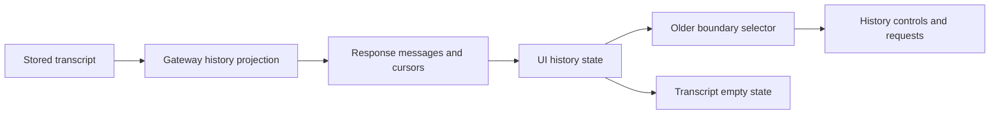

Codex review: needs changes before merge.

## What this changes

This PR derives history continuation from source cursors and hides earlier-history controls when no loaded source can anchor a request.

**Example:** A tool-only conversation displays a read of synthetic.txt without a cursor or native source ID.
- **Before:** The UI offers earlier history and then displays “Couldn't load earlier messages.”
- **After:** The loaded tool activity remains visible without the invalid paging control or error.

## Review scores

| Measure | Result | What it means |
|---|---|---|
| **Overall readiness** | 🦐 gold shrimp **(3/6)** | The visible repair has credible proof and green exact-head CI, but an introduced empty-state regression needs correction. |
| **Proof confidence** | 🐚 platinum hermit **(4/6)** ✨ media proof bonus | Sufficient (screenshot): Inspected before/after screenshots exercise the real Control UI with a mocked Gateway: synthetic tool activity remains visible and the invalid retry boundary disappears; Gateway continuation and synthetic-prefix reopening are supported by the reported owner regressions rather than live Gateway media. |
| **Patch quality** | 🦐 gold shrimp **(3/6)** | 1 actionable review finding remain. |

## Product

**Kind:** Bug fix · **Worth it:** Yes · **Fix scope:** Complete
**User problem:** Tool-only history can offer an earlier-history action that immediately fails despite the loaded activity remaining usable.
**Reason:** The reported failure is concrete, and the maintainer-authored direction repairs it without new configuration or persistent formats.

## Merge readiness

⛔ **Needs changes before merge - 2 items remain**

This PR addresses a concrete history-loading failure, but introduces an empty-state regression by treating an unavailable paging boundary as a complete conversation.

**Priority:** P2
**Reviewed head:** `330ff2112eb8bdfeb1fb7b55e86d11357a2b6439`

## Before merge

- [ ] **Preserve incomplete-history state when hiding the paging control (P2)** - For an unanchored partial window, such as tool-only cached history with tool activity hidden, the selector returns null even though state.chatHistoryPagination.hasMore remains true. This change then omits historyPagination from the transcript props. chat-transcript-projection.ts:204–208 interprets that omission as no remaining history, and chat-thread-view.tsx:191–192 renders ChatWelcome when there are no displayable rows. An existing conversation is therefore presented as empty while its authoritative history is still unresolved. Keep boundary availability separate from the completeness fact used by the empty-state owner, and cover this partial-window case without restoring the invalid paging control.
- [ ] **Explain or restore the original intent of Incomplete-window presentation** - https://github.com/openclaw/openclaw/pull/171009: Avoid presenting an incomplete or preference-hidden history window as a new conversation.

## Findings

- [P2] Preserve incomplete-history state when hiding the paging control — `ui/src/pages/chat/chat-pane-render.ts:204-206`

### Provenance

- `Incomplete-window presentation` changes intended behavior without addressing why it exists (https://github.com/openclaw/openclaw/pull/171009: Avoid presenting an incomplete or preference-hidden history window as a new conversation.)

### Tests

- Missing end-to-end proof: The supplied browser scenario does not cover an unanchored partial window with no displayable rows and verify that the new-chat welcome screen stays absent.

<strong>Agent review details</strong>

### How this fits together

Gateway history projection converts stored transcript rows into bounded messages and continuation cursors; the Control UI combines those results with cached history to render conversations and request earlier pages.

### Technical review

Best possible solution:

Keep the shared nullable boundary selector while passing history completeness independently to the transcript’s empty-state owner.

Do we have a high-confidence way to reproduce the issue?

Source inspection establishes both the original boundary failure and the introduced empty-state path; supplied screenshots reproduce the original visible error, but no fresh execution was performed during this review.

Is this the best way to solve the issue?

The Gateway correction and shared UI selector fit existing owners, but selector availability must not replace the separate fact that the loaded history remains incomplete.

Full review comments:

- [P2] Preserve incomplete-history state when hiding the paging control — `ui/src/pages/chat/chat-pane-render.ts:204-206`
  For an unanchored partial window, such as tool-only cached history with tool activity hidden, the selector returns null even though state.chatHistoryPagination.hasMore remains true. This change then omits historyPagination from the transcript props. chat-transcript-projection.ts:204–208 interprets that omission as no remaining history, and chat-thread-view.tsx:191–192 renders ChatWelcome when there are no displayable rows. An existing conversation is therefore presented as empty while its authoritative history is still unresolved. Keep boundary availability separate from the completeness fact used by the empty-state owner, and cover this partial-window case without restoring the invalid paging control.
  Confidence: 0.94

Overall correctness: patch is incorrect
Overall confidence: 0.94

AGENTS.md: found and applied where relevant.

Codex review notes: model internal, reasoning medium; reviewed against [90d82c2c9bf2](https://github.com/openclaw/openclaw/commit/90d82c2c9bf2f0578fa7575b05cd19390e0a05e3).

### Provenance checked

- `UI source-bound selectors and cache reopening` keeps the original intent (https://github.com/openclaw/openclaw/pull/187219: Use admitted source boundaries instead of moving offsets, preserve held rows, and reopen trimmed caches without skipping history.)
- `Gateway continuation calculation` changes intended behavior with a stated reason (df1273803188cbc4bf7c2d282a9f9f14e3bbf393: Budget large history replies while retaining pagination; subsequent source cursors account for rows consumed before display filtering.)

### Testing

Proof path: shipped entry point.

### Security

None.

### Evidence

Acceptance criteria:

- pnpm exec vitest run --config ui/vitest.config.ts ui/src/pages/chat/chat-pane-history.test.ts ui/src/pages/chat/components/chat-transcript-controller.test.tsx
- pnpm exec vitest run --config ui/vitest.e2e.config.ts ui/src/e2e/chat-history-loading.e2e.test.ts
- git diff --check

What I checked:

- **Introduced change:** The pinned merge-base-to-head diff changes continuation metadata and reuses one nullable selector for rendering and request admission. ([`ui/src/pages/chat/chat-history-request.ts:370`](https://github.com/openclaw/openclaw/blob/330ff2112eb8bdfeb1fb7b55e86d11357a2b6439/ui/src/pages/chat/chat-history-request.ts#L370), [330ff2112eb8](https://github.com/openclaw/openclaw/commit/330ff2112eb8bdfeb1fb7b55e86d11357a2b6439))
- **Empty-state regression:** The changed render selector removes historyPagination for an unanchored partial window, while transcript projection uses historyPagination.hasMore to suppress the empty-conversation state. ([`ui/src/pages/chat/components/chat-transcript-projection.ts:204`](https://github.com/openclaw/openclaw/blob/330ff2112eb8bdfeb1fb7b55e86d11357a2b6439/ui/src/pages/chat/components/chat-transcript-projection.ts#L204), [330ff2112eb8](https://github.com/openclaw/openclaw/commit/330ff2112eb8bdfeb1fb7b55e86d11357a2b6439))
- **Visible consequence:** An empty transcript projection renders ChatWelcome; ordinary tool results can be excluded by the existing showToolCalls preference. ([`ui/src/pages/chat/components/chat-thread-view.tsx:191`](https://github.com/openclaw/openclaw/blob/330ff2112eb8bdfeb1fb7b55e86d11357a2b6439/ui/src/pages/chat/components/chat-thread-view.tsx#L191), [330ff2112eb8](https://github.com/openclaw/openclaw/commit/330ff2112eb8bdfeb1fb7b55e86d11357a2b6439))
- **Existing presentation contract:** https://github.com/openclaw/openclaw/pull/171009 explicitly preserves existing-conversation identity when an incomplete history window has no visible messages. ([89aa2740aa23](https://github.com/openclaw/openclaw/commit/89aa2740aa23c591e394e7cc316fbdd344d45586))
- **Inspected visual proof:** The downloaded before and after screenshots show synthetic.txt activity retained while the invalid retry boundary disappears; the declared environment is the native Control UI runner with a mocked Gateway. ([330ff2112eb8](https://github.com/openclaw/openclaw/commit/330ff2112eb8bdfeb1fb7b55e86d11357a2b6439))
- **Exact-head validation:** Paginated check reads show no failed or unfinished checks, and openclaw/ci-gate succeeded at the reviewed head: https://github.com/openclaw/openclaw/actions/runs/41064445991/job/124096964745. ([330ff2112eb8](https://github.com/openclaw/openclaw/commit/330ff2112eb8bdfeb1fb7b55e86d11357a2b6439))

### PR surface

Source +16, Tests 0, Docs +2. Total +18 across 10 files. Added test files: 0.

View PR surface stats

| Area | Files | Added | Removed | Net |
|---|---:|---:|---:|---:|
| Source | 6 | 36 | 20 | +16 |
| Tests | 3 | 60 | 60 | 0 |
| Docs | 1 | 2 | 0 | +2 |
| Config | 0 | 0 | 0 | 0 |
| Generated | 0 | 0 | 0 | 0 |
| Other | 0 | 0 | 0 | 0 |
| **Total** | **10** | **98** | **80** | **+18** |

### Labels

Label changes:

- add `P2`: The original paging error and introduced empty-conversation presentation affect a limited chat-history flow without demonstrated data loss.
- add `proof: sufficient`: Contributor real behavior proof is sufficient.
- add `proof: 📸 screenshot`: Contributor real behavior proof includes screenshot evidence.
- add `rating: 🦐 gold shrimp`: Overall readiness is 🦐 gold shrimp; proof is 🐚 platinum hermit and patch quality is 🦐 gold shrimp.
- add `status: ⏳ waiting on author`: ClawSweeper has contributor-facing work open and is waiting for author action.

Label justifications:

- `P2`: The original paging error and introduced empty-conversation presentation affect a limited chat-history flow without demonstrated data loss.
- `rating: 🦐 gold shrimp`: Overall readiness is 🦐 gold shrimp; proof is 🐚 platinum hermit and patch quality is 🦐 gold shrimp.
- `status: ⏳ waiting on author`: ClawSweeper has contributor-facing work open and is waiting for author action.
- `proof: sufficient`: Contributor real behavior proof is sufficient.
- `proof: 📸 screenshot`: Contributor real behavior proof includes screenshot evidence.

### Rating scale

6/6 🦀 challenger crab · 5/6 🦞 diamond lobster · 4/6 🐚 platinum hermit · 3/6 🦐 gold shrimp · 2/6 🦪 silver shellfish · 1/6 🧂 unranked krab. Overall follows the weaker of proof and patch quality; ✨ marks media proof (a screenshot, video, or linked artifact) that directly shows the changed behavior.

### Workflow

ClawSweeper edits this one comment on every review. Comment `@clawsweeper re-review` for a fresh review only. Repair and merge execution lanes are retired.

_Reviewed October 30, 2026, 9:51 AM ET / 13:51 UTC._

<!-- clawsweeper-verdict:needs-changes item=188372 sha=330ff2112eb8bdfeb1fb7b55e86d11357a2b6439 confidence=high updated_at=2026-10-30T13:46:47Z reviewed_at=2026-10-30T13:51:37.034Z lease_owner=github-run-41065839758-1 lease_comment_id=6524323576 source_revision=ae3ef846fff9c538ac6068fcaa3439d9c87f8a1a6314cd3cf109f3fd648fef51 -->
<!-- clawsweeper-review-state:needs-changes item=188372 sha=330ff2112eb8bdfeb1fb7b55e86d11357a2b6439 v=1 -->

<!-- clawsweeper-review-version item=188372 reviewed_at=2026-10-30T13:51:37.034Z sha=330ff2112eb8bdfeb1fb7b55e86d11357a2b6439 source_revision=ae3ef846fff9c538ac6068fcaa3439d9c87f8a1a6314cd3cf109f3fd648fef51 lease_owner=github-run-41065839758-1 lease_comment_id=6524323576 v=1 -->

<!-- clawsweeper-review item=188372 -->