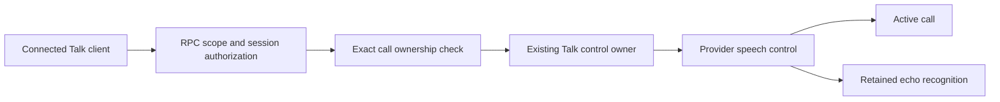

Codex review: needs real behavior proof before merge.

## What this changes

Adds talk.client.say so an authenticated client can submit bounded speech through its own active Talk call without starting an agent task.

**Example:** A connected watch submits “The dial is ready.” after a separate device action.
- **Before:** Speech synthesis returns audio, while steering requires an active agent run.
- **After:** The watch can submit the announcement through its ready Gateway-controlled call and receive accepted: true after submission.

## Review scores

| Measure | Result | What it means |
|---|---|---|
| **Overall readiness** | 🧂 unranked krab **(1/6)** | The feature and owner placement are sound, but required authority evidence is absent. |
| **Proof confidence** | 🧂 unranked krab **(1/6)** | Real behavior proof is necessary before merge. See [Before merge](#before-merge). |
| **Patch quality** | 🦐 gold shrimp **(3/6)** | Security review found an item that needs attention. |

## Product

**Kind:** Feature · **Worth it:** Yes · **Fix scope:** Complete
**User problem:** A device cannot announce a separately completed action through its existing Talk call without starting agent work.
**Reason:** The maintainer-authored issue and PR approve this narrow capability, and a merged device consumer needs the endpoint.

## Merge readiness

⛔ **Blocked before merge - 3 items remain**

Keep this PR open: it implements a concrete, maintainer-approved device capability through the existing Talk owner, and source review found no definite introduced bug.

**Priority:** P2
**Reviewed head:** `1d0069cd451e058e72e5b8b2ebdebf941f3a11a9`

## Before merge

- [ ] **Add real behavior proof** - Authority-chain proof required: the new talk.client.say handler reaches provider control after synchronous session, request, target, and connection checks, but supplied tests mock the WebSocket and lack forbidden-caller and revocation traces at real provider I/O; provide redacted terminal output or logs showing allowed submission and zero sends after rejection, removing IPs, keys, phone numbers, and non-public endpoints. After adding proof, update the PR body, then request a new review with `@clawsweeper re-review`. The PR author or someone with repository write access can request it.
- [ ] **Resolve security review attention item** - No concrete authorization bypass was found, but the new speech authority boundary needs final-effect validation.
- [ ] **Resolve merge risk** - Before merge, the PR owner must establish that a different connection or revoked session grant cannot cause speech at the provider boundary.

## Findings

None.

### Tests

- Missing end-to-end proof: Provide final-effect evidence through production RPC and provider transport for an allowed caller, a different connection, and revoked session authority.

<strong>Agent review details</strong>

### How this fits together

The Gateway authenticates the speech RPC, authorizes its session target, and passes text to the connection-bound Talk owner, which sends an exact-speech message through the existing provider control.

### Technical review

Best possible solution:

Retain the bounded RPC on the existing Talk owner and establish allowed and forbidden caller behavior at final provider submission.

Do we have a high-confidence way to reproduce the issue?

Source inspection confirms the capability is absent from fetched main and cannot be supplied by synthesis or idle-run steering; no target code was executed.

Is this the best way to solve the issue?

The implementation uses the appropriate existing owner, preserves ordinary caller authority, and adds bounded echo handling without a competing speech manager.

AGENTS.md: found and applied where relevant.

Codex review notes: model internal, reasoning medium; reviewed against [8c4437c4281b](https://github.com/openclaw/openclaw/commit/8c4437c4281b950c61f3102aac98806a141b6ead).

### Merge-risk options

**Maintainer options:**
1. **Establish the final-effect authority boundary (recommended)**  
   The PR owner should provide a production-path trace showing authorized submission and zero provider sends for another connection and a revoked session grant.

### Provenance checked

- `Talk caller authority` keeps the original intent (0b75ea3cefcd1e4532f9b5c08d455433debdcba7: https://github.com/openclaw/openclaw/pull/125392 constrained voice-only consults to caller-permitted tools; the relocated authority function preserves that behavior.)
- `Call lifecycle and delegation ownership` keeps the original intent (5aaf44006b306d33450ab92bc43520eb3242a93d: https://github.com/openclaw/openclaw/pull/129186 binds results to the exact current Talk owner and protects completion claims; playback echoes now bypass consultation without consuming those claims.)
- `Shared exact-speech protocol` keeps the original intent (df4e6666c6ba79e2a6c7e98049b9e41e046c8b14: https://github.com/openclaw/openclaw/pull/122668 moved generic exact-speech policy into the Talk owner; this PR reuses its formatter and leaves the existing classifier intact.)
- `Internal authority and type placement` changes intended behavior with a stated reason (92085d207f9a00e464140baf3db8cf7ba71cfda7: https://github.com/openclaw/openclaw/pull/181702 localized private implementation frames; the PR explains moving existing authority logic and types to existing modules to accommodate the owner line limit.)

### Testing

Proof path: in-process harness.

### Security

Needs attention: No concrete authorization bypass was found, but the new speech authority boundary needs final-effect validation.

### Evidence

What I checked:

- **Approved product direction:** The maintainer-authored linked issue specifies bounded announcements through an exact active call and explains why talk.speak and talk.client.steer are insufficient.
- **Synchronous authorization before submission:** The handler validates UTF-8 size, rechecks session mutation and request authority, validates the prepared target, and synchronously invokes the existing call owner. ([`src/gateway/talk/handlers/client.ts:118`](https://github.com/openclaw/openclaw/blob/1d0069cd451e058e72e5b8b2ebdebf941f3a11a9/src/gateway/talk/handlers/client.ts#L118), [1d0069cd451e](https://github.com/openclaw/openclaw/commit/1d0069cd451e058e72e5b8b2ebdebf941f3a11a9))
- **Existing lifecycle owner reused:** Speech requires readiness, the current owner, matching connection and complete session identity; retained echoes are bounded and cleared at close, without another task queue or persistent model. ([`src/gateway/talk/client-gateway-control.ts:467`](https://github.com/openclaw/openclaw/blob/1d0069cd451e058e72e5b8b2ebdebf941f3a11a9/src/gateway/talk/client-gateway-control.ts#L467), [1d0069cd451e](https://github.com/openclaw/openclaw/commit/1d0069cd451e058e72e5b8b2ebdebf941f3a11a9))
- **Authority proof boundary:** The added native tests exercise production dispatch and provider integration with a mocked WebSocket; the owner tests reject different connections and replaced calls, but supplied evidence does not demonstrate revoked session authority being rejected before real provider I/O. ([`src/gateway/talk/handlers/client-native-control.test-support.ts:86`](https://github.com/openclaw/openclaw/blob/1d0069cd451e058e72e5b8b2ebdebf941f3a11a9/src/gateway/talk/handlers/client-native-control.test-support.ts#L86), [1d0069cd451e](https://github.com/openclaw/openclaw/commit/1d0069cd451e058e72e5b8b2ebdebf941f3a11a9))
- **Current main lacks this operation:** Fetched main registers client creation, transcript, close, toolCall and steer, but no client.say; its steering handler explicitly requires active owned work. ([`src/gateway/methods/core-descriptors.ts:99`](https://github.com/openclaw/openclaw/blob/8c4437c4281b950c61f3102aac98806a141b6ead/src/gateway/methods/core-descriptors.ts#L99), [8c4437c4281b](https://github.com/openclaw/openclaw/commit/8c4437c4281b950c61f3102aac98806a141b6ead))
- **Concrete downstream consumer:** https://github.com/openclaw/esp-openclaw-node/pull/97 is merged and explicitly depends on this Gateway capability; its body defers hardware speech verification until the endpoint exists.

### PR surface

Source +161, Tests +279, Docs +9. Total +449 across 32 files. Added test files: 2.

View PR surface stats

| Area | Files | Added | Removed | Net |
|---|---:|---:|---:|---:|
| Source | 20 | 5534 | 5373 | +161 |
| Tests | 10 | 305 | 26 | +279 |
| Docs | 2 | 9 | 0 | +9 |
| Config | 0 | 0 | 0 | 0 |
| Generated | 0 | 0 | 0 | 0 |
| Other | 0 | 0 | 0 | 0 |
| **Total** | **32** | **5848** | **5399** | **+449** |

### Review metrics

| Metric | Value | Why it matters |
|---|---|---|
| **New public RPC** | 1 method; 1,024 UTF-8 bytes maximum | The additive operator.talk operation preserves existing method indices and introduces no configuration or persistent state. |

### Root-cause cluster

Relationship: `same_root_cause`
Canonical: https://github.com/openclaw/openclaw/issues/184481
Summary: This PR implements the exact-call announcement capability requested by the linked feature issue.

Members:
- `canonical`: https://github.com/openclaw/openclaw/issues/184481 - Defines the missing capability, authorization boundary, byte limit, and concrete device consumer.

Proposal only: this assessment does not dispatch repair, suppress jobs, mutate sibling items, close, or merge anything.

### Labels

Label changes:

- add `P2`: A bounded feature enables a concrete device workflow without evidence of an urgent existing-user regression.
- add `merge-risk: 🚨 security-boundary`: The endpoint adds authenticated caller-to-provider speech authority whose forbidden-caller and revocation behavior lacks final-effect proof.
- add `rating: 🧂 unranked krab`: Overall readiness is 🧂 unranked krab; proof is 🧂 unranked krab and patch quality is 🦐 gold shrimp.
- add `status: 📣 needs proof`: The PR needs real behavior proof before ClawSweeper can clear the contributor ask.

Label justifications:

- `P2`: A bounded feature enables a concrete device workflow without evidence of an urgent existing-user regression.
- `merge-risk: 🚨 security-boundary`: The endpoint adds authenticated caller-to-provider speech authority whose forbidden-caller and revocation behavior lacks final-effect proof.
- `rating: 🧂 unranked krab`: Overall readiness is 🧂 unranked krab; proof is 🧂 unranked krab and patch quality is 🦐 gold shrimp.
- `status: 📣 needs proof`: The PR needs real behavior proof before ClawSweeper can clear the contributor ask.

### Rank-up moves

Optional improvements that raise the rating; they are not merge blockers.

- Add final-effect proof for another connection and prove revoked session authority is rejected before provider I/O.

### Rating scale

6/6 🦀 challenger crab · 5/6 🦞 diamond lobster · 4/6 🐚 platinum hermit · 3/6 🦐 gold shrimp · 2/6 🦪 silver shellfish · 1/6 🧂 unranked krab. Overall follows the weaker of proof and patch quality; ✨ marks media proof (a screenshot, video, or linked artifact) that directly shows the changed behavior.

### Workflow

ClawSweeper edits this one comment on every review. Comment `@clawsweeper re-review` for a fresh review only. Repair and merge execution lanes are retired.

_Reviewed October 26, 2026, 7:55 AM ET / 11:55 UTC._

<!-- clawsweeper-security:security-sensitive item=184546 sha=1d0069cd451e058e72e5b8b2ebdebf941f3a11a9 confidence=high updated_at=2026-10-26T11:52:21Z reviewed_at=2026-10-26T11:55:53.220Z lease_owner=github-run-40318142620-1 lease_comment_id=6415318989 source_revision=aeb072d558730a53f8cfcab1ae52ce287fc6bf6edb4c82d2758141f762714420 -->
<!-- clawsweeper-verdict:needs-human item=184546 sha=1d0069cd451e058e72e5b8b2ebdebf941f3a11a9 confidence=high updated_at=2026-10-26T11:52:21Z reviewed_at=2026-10-26T11:55:53.220Z lease_owner=github-run-40318142620-1 lease_comment_id=6415318989 source_revision=aeb072d558730a53f8cfcab1ae52ce287fc6bf6edb4c82d2758141f762714420 hold=security findings=0 -->
<!-- clawsweeper-review-state:blocked item=184546 sha=1d0069cd451e058e72e5b8b2ebdebf941f3a11a9 v=1 -->

<!-- clawsweeper-review-version item=184546 reviewed_at=2026-10-26T11:55:53.220Z sha=1d0069cd451e058e72e5b8b2ebdebf941f3a11a9 source_revision=aeb072d558730a53f8cfcab1ae52ce287fc6bf6edb4c82d2758141f762714420 lease_owner=github-run-40318142620-1 lease_comment_id=6415318989 v=1 -->

<!-- clawsweeper-review item=184546 -->