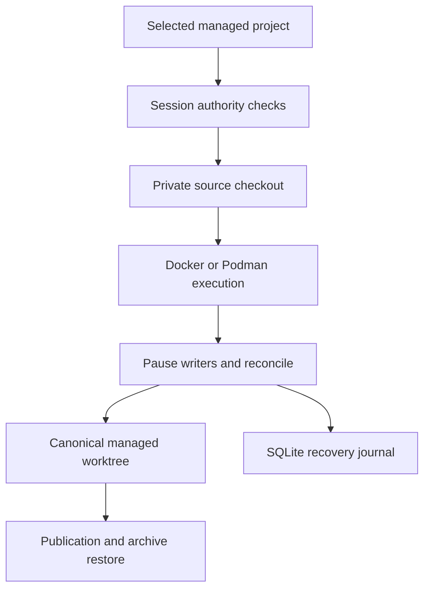

Codex review: blocked before merge. _Reviewed September 19, 2026, 10:12 AM ET / 14:12 UTC (Revision 8)._

# ClawSweeper review

## What this changes

The PR gives sandboxed managed-project sessions private Docker or Podman checkouts and reconciles accepted edits into the canonical worktree, including archive and restore.

> [!WARNING]
> **SQLite table change**
>
> This PR modifies persisted SQLite tables in `src/state/openclaw-state-schema.sql`. Prefer a design that avoids changing persisted SQLite tables. Migration or upgrade compatibility proof is recorded, but maintainers should still confirm that the schema change is necessary.

## Merge readiness

⛔ **Blocked before merge - 3 items remain**

This remains useful work: current main lacks the private managed-project execution path. No blocking defect was established, and the earlier authority findings remain addressed. The recorded compatibility decisions do not warrant another approval cycle.

**Priority:** P1
**Reviewed head:** `1473d22e57ba0272a1658dfb7bbddf119e1fdd2f`

## Review scores

| Measure | Result | What it means |
|---|---|---|
| **Overall readiness** | 🐚 platinum hermit **(4/6)** | Useful, coherent work with production-boundary proof and resolved prior findings; compatibility limits are explicit and already accepted. |
| **Proof confidence** | 🐚 platinum hermit **(4/6)** | Sufficient (live_output): Recorded real Podman runs exercise the production projection and execution owners through allowed writes, revoked input, termination, replacement-runtime survival, and archive recovery. The inspected harness matches those paths; browser shutdown remains mocked and no authenticated provider turn or remote publication is claimed. |
| **Patch quality** | 🐚 platinum hermit **(4/6)** | No actionable review findings were identified. |

## Verification

| Check | Result | Evidence |
|---|---|---|
| **Real behavior** | Verified | Sufficient (live_output): Recorded real Podman runs exercise the production projection and execution owners through allowed writes, revoked input, termination, replacement-runtime survival, and archive recovery. The inspected harness matches those paths; browser shutdown remains mocked and no authenticated provider turn or remote publication is claimed. |
| **Evidence reviewed** | 8 items | Still necessary on current main: Current main still applies workspace containment before required-sandbox worktree preparation. The new local projection module is absent from both fetched main and the supplied latest-release commit; no merged replacement was established. Review continuity: Tree-object comparison found 78 of the 82 introduced-path blobs unchanged since the previous completed review. A pinned GitHub comparison identifies the four differing files as wrapper-manifest and node-worker schema additions from integration. The supplied introduction delta separately identifies this PR’s additions. Missing historical blobs prevented some local textual comparisons; the GitHub read supplied the relevant patches. Retained input and cleanup authority: Pipe and PTY writes revalidate captured child authority immediately before writing. Docker/Podman cleanup retains an immutable container ID and a fixed termination operation, while interrupts retain live execution checks. HTTP request input also checks the child owner before sending. |
| **Findings** | None | None. |
| **Security** | None | None. |

## How this fits together

Managed worktrees hold a session’s accepted project files. The sandbox projection supplies isolated files and Git metadata to execution tools, then returns accepted changes through the existing reconciliation and recovery machinery.

## Before merge

- [ ] **Resolve merge risk (P1)** - Existing sandboxed managed-project sessions using other backends will refuse execution, and new host-only files require staging before guest admission; these intentional compatibility limits are recorded as approved.
- [ ] **Resolve merge risk (P1)** - Older binaries cannot reconcile projection receipts. Full older-Gateway recovery and real Docker browser retirement are not covered by the recorded proof.
- [ ] **Review config compatibility** - Confirm compatibility and upgrade impact for the changed config or default surface before merge.

<strong>Agent review details</strong>

### Security

None.

### PR surface

PR surface statistics unavailable: the file list is incomplete.

### Review metrics

| Metric | Value | Why it matters |
|---|---|---|
| **Production versus test growth** | Production/tooling net +2,789 lines; tests/support net +3,287 lines | The growth implements private checkout custody and recovery while reusing existing reconciliation machinery. |
| **Persistent storage** | 1 additive first-use table; 0 schema-version bumps | Older readers preserve the table but cannot apply its pending projection receipts. |
| **Plugin contract** | 1 SDK helper export and 1 optional backend cleanup capability | The Codex consumer moves to the shared termination owner while backends without the capability retain their existing cleanup path. |

### Stored data model

Persistent data-model change detected: `database schema: src/state/openclaw-state-schema.sql`, `unknown-truncated-pull-files`. Migration or upgrade compatibility proof is recorded; maintainers should verify it before merge.

### Merge-risk options

**Maintainer options:**
1. **Retain the approved compatibility contract (recommended)**  
   Proceed with the documented backend restrictions, explicit source admission, and supporting-version recovery limits already recorded as accepted.

### Technical review

Best possible solution:

Retain the approved private-projection design, canonical worktree ownership, and documented supporting-version recovery contract.

Do we have a high-confidence way to reproduce the issue?

Not applicable as a conventional regression reproduction: this adds an approved isolated execution path where current main intentionally enforces workspace containment. That existing rejection is source-verifiable.

Is this the best way to solve the issue?

Yes. A private checkout with guarded reconciliation enables managed-project work without exposing host Git metadata or creating another canonical file owner.

AGENTS.md: found and applied where relevant.

Codex review notes: model internal, reasoning medium; reviewed against [e985a41468d5](https://github.com/openclaw/openclaw/commit/e985a41468d52692647e8e5d82ba7d674f738bbf).

### Labels

Label justifications:

- `P1`: The change restores a blocked project-editing workflow for sessions required to execute inside a sandbox.
- `merge-risk: 🚨 compatibility`: Backend refusal, host-file admission, and downgrade recovery have intentional operator-visible limits that ordinary CI cannot erase.
- `rating: 🐚 platinum hermit`: Overall readiness is 🐚 platinum hermit; proof is 🐚 platinum hermit and patch quality is 🐚 platinum hermit.
- `status: 👀 ready for maintainer look`: ClawSweeper has no concrete contributor-facing blocker left for this PR. Sufficient (live_output): Recorded real Podman runs exercise the production projection and execution owners through allowed writes, revoked input, termination, replacement-runtime survival, and archive recovery. The inspected harness matches those paths; browser shutdown remains mocked and no authenticated provider turn or remote publication is claimed.
- `proof: sufficient`: Contributor real behavior proof is sufficient. Recorded real Podman runs exercise the production projection and execution owners through allowed writes, revoked input, termination, replacement-runtime survival, and archive recovery. The inspected harness matches those paths; browser shutdown remains mocked and no authenticated provider turn or remote publication is claimed.

### Evidence

What I checked:

- **Still necessary on current main:** Current main still applies workspace containment before required-sandbox worktree preparation. The new local projection module is absent from both fetched main and the supplied latest-release commit; no merged replacement was established. ([`src/gateway/session-worktree-preparation.ts:241`](https://github.com/openclaw/openclaw/blob/e985a41468d52692647e8e5d82ba7d674f738bbf/src/gateway/session-worktree-preparation.ts#L241), [e985a41468d5](https://github.com/openclaw/openclaw/commit/e985a41468d52692647e8e5d82ba7d674f738bbf))
- **Review continuity:** Tree-object comparison found 78 of the 82 introduced-path blobs unchanged since the previous completed review. A pinned GitHub comparison identifies the four differing files as wrapper-manifest and node-worker schema additions from integration. The supplied introduction delta separately identifies this PR’s additions. Missing historical blobs prevented some local textual comparisons; the GitHub read supplied the relevant patches. ([1473d22e57ba](https://github.com/openclaw/openclaw/commit/1473d22e57ba0272a1658dfb7bbddf119e1fdd2f))
- **Retained input and cleanup authority:** Pipe and PTY writes revalidate captured child authority immediately before writing. Docker/Podman cleanup retains an immutable container ID and a fixed termination operation, while interrupts retain live execution checks. HTTP request input also checks the child owner before sending. ([`extensions/codex/src/app-server/sandbox-exec-server/processes.ts:346`](https://github.com/openclaw/openclaw/blob/1473d22e57ba0272a1658dfb7bbddf119e1fdd2f/extensions/codex/src/app-server/sandbox-exec-server/processes.ts#L346), [1473d22e57ba](https://github.com/openclaw/openclaw/commit/1473d22e57ba0272a1658dfb7bbddf119e1fdd2f))
- **Recorded production-path proof:** The supplied body snapshot, sourceRevision 2f58f4a6ca75c8ed68b0b0711e7dc52201a434ce16f1aac0582c16ba1ac9b069, records successful real Podman preparation, edits, revocation, termination, reconciliation, archive/restore, and replacement-runtime survival. The inspected proof helper uses the production sandbox context, filesystem bridge, engine client, publication snapshot, and worktree service. The separate recorded Codex run accepted authorized input, rotated session authority, rejected subsequent input, and observed no unauthorized bytes or remaining child owners. This review did not execute those runs. ([`src/gateway/worker-environments/local-workspace-podman.test-support.ts:12`](https://github.com/openclaw/openclaw/blob/1473d22e57ba0272a1658dfb7bbddf119e1fdd2f/src/gateway/worker-environments/local-workspace-podman.test-support.ts#L12), [1473d22e57ba](https://github.com/openclaw/openclaw/commit/1473d22e57ba0272a1658dfb7bbddf119e1fdd2f))
- **Persistence and compatibility:** The projection store creates an additive first-use table and uses revision-checked synchronous writes. Coverage exercises unchanged schema version, database reopen, interrupted acceptance, replacement-session rejection, and retained archive receipts. The body records maintainer acceptance of the supporting-version recovery contract and explicitly excludes full older-Gateway recovery claims. ([`src/gateway/worker-environments/local-workspace-store.ts:40`](https://github.com/openclaw/openclaw/blob/1473d22e57ba0272a1658dfb7bbddf119e1fdd2f/src/gateway/worker-environments/local-workspace-store.ts#L40), [1473d22e57ba](https://github.com/openclaw/openclaw/commit/1473d22e57ba0272a1658dfb7bbddf119e1fdd2f))
- **Codex dependency signal:** The changed process/start and process/write handlers implement Codex exec-server RPC behavior, and the PR explicitly claims actual Codex subprocess lifecycle proof. This establishes an affirmative dependency-contract signal. ([`extensions/codex/src/app-server/sandbox-exec-server/processes.ts:25`](https://github.com/openclaw/openclaw/blob/1473d22e57ba0272a1658dfb7bbddf119e1fdd2f/extensions/codex/src/app-server/sandbox-exec-server/processes.ts#L25), [1473d22e57ba](https://github.com/openclaw/openclaw/commit/1473d22e57ba0272a1658dfb7bbddf119e1fdd2f))

Likely related people:

- **steipete:** Suggested for follow-up; no historical authorship or introduction is verified. (role: unverified routing candidate; confidence: low)

### Rating scale

| Score | Internal tier | Crab rank | Meaning |
|---:|:---:|---|---|
| **6/6** | S | 🦀 challenger crab | Exceptional readiness |
| **5/6** | A | 🦞 diamond lobster | Very strong readiness |
| **4/6** | B | 🐚 platinum hermit | Good normal PR; ordinary maintainer review |
| **3/6** | C | 🦐 gold shrimp | Useful, but confidence is limited |
| **2/6** | D | 🦪 silver shellfish | Proof or implementation needs work |
| **1/6** | F | 🧂 unranked krab | Not merge-ready |
| N/A | NA | 🌊 off-meta tidepool | Rating does not apply |

Overall follows the weaker of proof and patch quality.
Shiny media proof means a screenshot, video, or linked artifact directly shows the changed behavior. Runtime, network, CSP, and security claims still need visible diagnostics.

### Workflow

- ClawSweeper keeps one durable marker-backed review comment per issue or PR.
- Re-runs edit this comment so the latest verdict, findings, and automation markers stay together instead of adding duplicate bot comments.
- A fresh review can be triggered by eligible `@clawsweeper re-review` comments, exact-item GitHub events, scheduled/background review runs, or manual workflow dispatch.
- PR/issue authors and users with repository write access can comment `@clawsweeper re-review` or `@clawsweeper re-run` on an open PR or issue to request a fresh review only.
- Maintainers can also comment `@clawsweeper review` to request a fresh review only.
- Fresh-review commands do not start repair, autofix, rebase, CI repair, or automerge.
- Maintainer-only repair and merge flows require explicit commands such as `@clawsweeper autofix`, `@clawsweeper automerge`, `@clawsweeper fix ci`, or `@clawsweeper address review`.
- Maintainers can comment `@clawsweeper explain` to ask for more context, or `@clawsweeper stop` to stop active automation.

### History

Review history (7 earlier review cycles)

<!-- clawsweeper-review-history v=1 total=7 -->
- reviewed 2026-09-19T06:59:22.464Z sha c03d9b17a2d13158d8fc6301cbf8ac3fcc6a74c8 :: needs real behavior proof before merge. :: [P1] Revalidate workspace authority at filesystem command dispatch | [P2] Fence runtime allocation and restart after awaited preparation
- reviewed 2026-09-19T07:43:26.152Z sha 75516fc59137d67c56b82efa817816cedeed5317 :: needs real behavior proof before merge. :: [P1] Preserve teardown authority for already-running guest processes | [P2] Map the selected subdirectory into the private checkout
- reviewed 2026-09-19T10:16:20.988Z sha 68386fd716e0575e5f0b857ac9a768a9caea1a83 :: blocked before merge. :: none
- reviewed 2026-09-19T10:57:43.411Z sha 218d565013fefe374f7b849d211949913d894937 :: needs real behavior proof before merge. :: [P1] [P1] Carry workspace authority through retained process input
- reviewed 2026-09-19T11:36:38.221Z sha 13f3ced7a4f0aa1acd4c8d1d43778e374541fe1e :: blocked before merge. :: none
- reviewed 2026-09-19T12:28:54.591Z sha 9ba9c87c4cabc6e5a016aba8c3b173771620b4e7 :: blocked before merge. :: none
- reviewed 2026-09-19T13:34:11.058Z sha bc442c6787f398920e62aab7c425f44e866d0888 :: blocked before merge. :: none

<!-- clawsweeper-verdict:needs-human item=152641 sha=1473d22e57ba0272a1658dfb7bbddf119e1fdd2f confidence=high updated_at=2026-09-19T14:08:43Z reviewed_at=2026-09-19T14:12:10.206Z lease_owner=github-run-35447749407-1 lease_comment_id=5742519797 source_revision=2f58f4a6ca75c8ed68b0b0711e7dc52201a434ce16f1aac0582c16ba1ac9b069 live_verification=absent -->
<!-- clawsweeper-review-state:blocked item=152641 sha=1473d22e57ba0272a1658dfb7bbddf119e1fdd2f v=1 -->

<!-- clawsweeper-review-version item=152641 reviewed_at=2026-09-19T14:12:10.206Z sha=1473d22e57ba0272a1658dfb7bbddf119e1fdd2f source_revision=2f58f4a6ca75c8ed68b0b0711e7dc52201a434ce16f1aac0582c16ba1ac9b069 lease_owner=github-run-35447749407-1 lease_comment_id=5742519797 v=1 -->

<!-- clawsweeper-review item=152641 -->