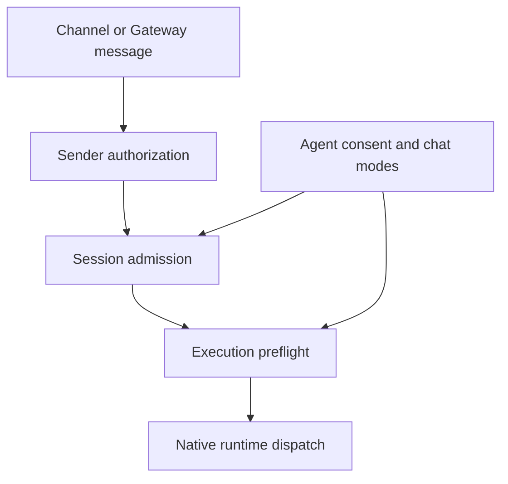

Codex review: needs maintainer review before merge.

## What this changes

Applies remembered native-runtime consent to owner turns with unset chat modes while preserving explicit restrictions.

**Example:** An owner sends a Telegram message using Muse with nativeRuntimeConsent set to ["muse"] and tools.allow set to ["message"].
- **Before:** The unset chat modes prevent remembered consent from applying, so Muse is refused.
- **After:** The owner’s turn reaches Muse; a subsequent non-owner turn in the same unset-mode chat remains refused.

## Review scores

| Measure | Result | What it means |
|---|---|---|
| **Overall readiness** | 🦞 diamond lobster **(5/6)** | A focused repair with shipped-entry-point authority evidence, latest-stable upgrade output, meaningful boundary tests, and no actionable finding. |
| **Proof confidence** | 🦞 diamond lobster **(5/6)** | Sufficient (live_output): The updated exact-head evidence exercises packaged Gateway admission and real Telegram ingress through the production Muse transport to a fixture process: owner turns dispatch, same-chat guest turns do not, and a queued revoked-owner turn is rejected after restart before turn/start; this satisfies both prior authority-proof requests. |
| **Patch quality** | 🦞 diamond lobster **(5/6)** | No actionable review findings were identified. |

## Product

**Kind:** Bug fix · **Worth it:** Yes · **Fix scope:** Complete
**User problem:** Owners who accepted native permissions during setup still receive tool-policy refusals in their channel chats.
**Reason:** The feature owner’s scoped repair fulfills the setup-consent promise for owner chats while explicitly deferring subagents that lack live owner authority.

## Merge readiness

✅ **Ready for maintainer review**

This PR fixes owner channel chats without broadening consent to subagents; the added channel revocation and latest-stable upgrade evidence resolves the previous review’s blockers.

**Priority:** P2
**Reviewed head:** `4fc58ee46e7d1c1b135b32bb6719240aff529fcb`

## Before merge

None.

## Findings

None.

<strong>Agent review details</strong>

### How this fits together

Gateway admission and agent preflight combine agent consent, session modes, sandbox policy, and sender authority before dispatching to a host-native runtime.

### Technical review

Best possible solution:

Land the scoped owner-chat fix through the normal gates, retaining explicit restrictions and leaving child authority propagation to separate work.

Do we have a high-confidence way to reproduce the issue?

Current main’s explicit-mode checks establish the owner-channel failure path, and the PR reports a base-red owner-chat regression; no target code was executed during this review.

Is this the best way to solve the issue?

The patch uses the existing consent owner for both admission and preflight, derives effective modes without persisting promotion, and preserves mandatory boundaries.

AGENTS.md: found and applied where relevant.

Codex review notes: model internal, reasoning medium; reviewed against [71acfa454e1b](https://github.com/openclaw/openclaw/commit/71acfa454e1b278b821c074ffeafc7889a5a2141).

### Provenance checked

- `Remembered native-runtime consent eligibility` changes intended behavior with a stated reason (8f1a499eb5083e8e1387ce8ff4ab7a6fcb574891: Remember approval per agent while preserving session identity, explicit restrictions, and revocation before native dispatch.)
- `Native runtime permission and containment checks` keeps the original intent (8cd38b03ceb822718ab2e5e1693340f15df22b14: Allow explicit native-permission consent while preserving required sandbox, remote execution, and workspace boundaries.)
- `Muse setup documentation and deterministic Gateway fixture` keeps the original intent (https://github.com/openclaw/openclaw/pull/170487: Exercise the packaged Gateway through the Muse protocol; this PR extends that existing fixture with consent scenarios.)

### Testing

Proof path: shipped entry point.

### Security

None.

### Evidence

What I checked:

- **Pinned introduced change:** The introduced diff shares owner-mode interpretation between admission and execution preflight, preserves explicit modes, and adds no persisted fields. ([`src/config/native-runtime-consent.ts:55`](https://github.com/openclaw/openclaw/blob/4fc58ee46e7d1c1b135b32bb6719240aff529fcb/src/config/native-runtime-consent.ts#L55), [4fc58ee46e7d](https://github.com/openclaw/openclaw/commit/4fc58ee46e7d1c1b135b32bb6719240aff529fcb))
- **Current main still requires explicit modes:** Fetched main requires stored permissionMode full and sandboxMode off for remembered consent, leaving the owner channel-chat case unresolved. ([`src/agents/harness/execution-environment.ts:294`](https://github.com/openclaw/openclaw/blob/71acfa454e1b278b821c074ffeafc7889a5a2141/src/agents/harness/execution-environment.ts#L294), [71acfa454e1b](https://github.com/openclaw/openclaw/commit/71acfa454e1b278b821c074ffeafc7889a5a2141))
- **Channel final-effect evidence:** The updated PR body reports real Telegram Test Server ingress: owner and wait prompts reach Muse turn/start, while the same-chat guest and a revoked owner’s queued turn after restart do not; the recorded native prompt list is ["owner", "wait"]. ([4fc58ee46e7d](https://github.com/openclaw/openclaw/commit/4fc58ee46e7d1c1b135b32bb6719240aff529fcb))
- **Latest-stable upgrade evidence:** Reported output covers published openclaw@2026.10.7 state through candidate Doctor migration: explicit Full access and unset chats retain their modes, explicit Full access still dispatches for a non-owner, and unset modes distinguish owner from non-owner. ([4fc58ee46e7d](https://github.com/openclaw/openclaw/commit/4fc58ee46e7d1c1b135b32bb6719240aff529fcb))
- **Final dispatch guard retained:** Immediately before harness.runAttempt, selection rechecks execution consent with readRuntimeConfig and rejects work whose previously granted consent disappeared. ([`src/agents/harness/selection.ts:297`](https://github.com/openclaw/openclaw/blob/4fc58ee46e7d1c1b135b32bb6719240aff529fcb/src/agents/harness/selection.ts#L297), [4fc58ee46e7d](https://github.com/openclaw/openclaw/commit/4fc58ee46e7d1c1b135b32bb6719240aff529fcb))
- **Original feature intent:** https://github.com/openclaw/openclaw/pull/172607 established agent-scoped remembered consent and dispatch-time revocation; https://github.com/openclaw/openclaw/pull/172610 records consent during setup. Their downloaded screenshots show predecessor UI behavior, rather than proof of this PR’s channel change. ([`src/config/native-runtime-consent.ts:13`](https://github.com/openclaw/openclaw/blob/8f1a499eb5083e8e1387ce8ff4ab7a6fcb574891/src/config/native-runtime-consent.ts#L13), [8f1a499eb508](https://github.com/openclaw/openclaw/commit/8f1a499eb5083e8e1387ce8ff4ab7a6fcb574891))

Likely related people:

- **Ayaan Zaidi:** Raw commit 8f1a499eb5083e8e1387ce8ff4ab7a6fcb574891 adds src/config/native-runtime-consent.ts:3 relative to its recorded parents. This identifies author metadata, not feature responsibility or a PR merger. (role: source-line author; confidence: high; commits: [8f1a499eb508](https://github.com/openclaw/openclaw/commit/8f1a499eb5083e8e1387ce8ff4ab7a6fcb574891); files: `src/config/native-runtime-consent.ts`)

### PR surface

Source +22, Tests +64, Docs +1, Other +64. Total +151 across 9 files. Added test files: 0.

View PR surface stats

| Area | Files | Added | Removed | Net |
|---|---:|---:|---:|---:|
| Source | 2 | 36 | 14 | +22 |
| Tests | 1 | 64 | 0 | +64 |
| Docs | 2 | 3 | 2 | +1 |
| Config | 0 | 0 | 0 | 0 |
| Generated | 0 | 0 | 0 | 0 |
| Other | 4 | 76 | 12 | +64 |
| **Total** | **9** | **179** | **28** | **+151** |

### Labels

Label changes:

- add `proof: sufficient`: Contributor real behavior proof is sufficient.
- add `rating: 🦞 diamond lobster`: Overall readiness is 🦞 diamond lobster; proof is 🦞 diamond lobster and patch quality is 🦞 diamond lobster.
- add `status: 👀 ready for maintainer look`: ClawSweeper has no concrete contributor-facing blocker left for this PR.
- remove `rating: 🦪 silver shellfish`: Current PR rating is `rating: 🦞 diamond lobster`, so this older rating label is no longer current.
- remove `status: 📣 needs proof`: Current PR status label is `status: 👀 ready for maintainer look`.

Label justifications:

- `P2`: A focused correction to remembered consent for owner channel turns, with explicit chat restrictions preserved.
- `merge-risk: 🚨 security-boundary`: The change lets owner turns use remembered native permissions without stored Full-access modes; the maintainer-authored direction and supplied allowed, forbidden, and revoked-owner evidence address this intentional authority expansion.
- `rating: 🦞 diamond lobster`: Overall readiness is 🦞 diamond lobster; proof is 🦞 diamond lobster and patch quality is 🦞 diamond lobster.
- `status: 👀 ready for maintainer look`: ClawSweeper has no concrete contributor-facing blocker left for this PR.
- `proof: sufficient`: Contributor real behavior proof is sufficient.

### Rating scale

6/6 🦀 challenger crab · 5/6 🦞 diamond lobster · 4/6 🐚 platinum hermit · 3/6 🦐 gold shrimp · 2/6 🦪 silver shellfish · 1/6 🧂 unranked krab. Overall follows the weaker of proof and patch quality; ✨ marks media proof (a screenshot, video, or linked artifact) that directly shows the changed behavior.

### Workflow

ClawSweeper edits this one comment on every review. Comment `@clawsweeper re-review` for a fresh review only. Repair and merge execution lanes are retired.

### History

Review history (3 earlier review cycles)

<!-- clawsweeper-review-history v=1 total=3 -->
- reviewed 2026-10-27T07:07:17.280Z sha 2883ae6ae30a7649f7da512b8b2c7d9eb0cd4678 :: needs real behavior proof before merge. :: none
- reviewed 2026-10-27T08:07:50.142Z sha c93a3e799cbe41b5ebd94b564f8e1613e35fcfdf :: needs real behavior proof before merge. :: none
- reviewed 2026-10-27T08:58:22.509Z sha 4fc58ee46e7d1c1b135b32bb6719240aff529fcb :: needs real behavior proof before merge. :: none

_Reviewed October 27, 2026, 5:43 AM ET / 09:43 UTC (Revision 4)._

<!-- clawsweeper-verdict:needs-human item=185597 sha=4fc58ee46e7d1c1b135b32bb6719240aff529fcb confidence=high updated_at=2026-10-27T09:40:31Z reviewed_at=2026-10-27T09:43:51.807Z lease_owner=github-run-40482450514-1 lease_comment_id=6438492176 source_revision=b79782270b1f5fcf5c28d081c7cd06075f89e2227c592a82c09282226c74a887 hold=not_opted_in findings=0 -->
<!-- clawsweeper-review-state:ready item=185597 sha=4fc58ee46e7d1c1b135b32bb6719240aff529fcb v=1 -->

<!-- clawsweeper-review-version item=185597 reviewed_at=2026-10-27T09:43:51.807Z sha=4fc58ee46e7d1c1b135b32bb6719240aff529fcb source_revision=b79782270b1f5fcf5c28d081c7cd06075f89e2227c592a82c09282226c74a887 lease_owner=github-run-40482450514-1 lease_comment_id=6438492176 v=1 -->

<!-- clawsweeper-review item=185597 -->