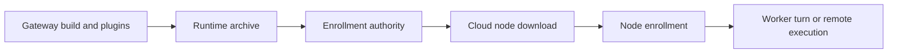

Codex review: found issues before merge. _Reviewed August 29, 2026, 11:56 PM ET / August 30, 2026, 03:56 UTC._

# ClawSweeper review

## What this changes

The PR makes cloud nodes download a digest-identified runtime archive from the running Gateway before enrollment, replacing version-based package selection and per-profile runtime setup.

## Merge readiness

⛔ **Blocked by patch quality or review findings - 9 items remain**

Keep this PR open: two introduced P1 blockers prevent its cloud-bootstrap path from being safe and usable in all supported deployments.

**Priority:** P1
**Reviewed head:** `1f7e86f49da52e168876c708c8abe587c4fb7172`

## Review scores

| Measure | Result | What it means |
|---|---|---|
| **Overall readiness** | 🧂 unranked krab **(1/6)** | The intended repair is well-scoped, but two P1 defects in the new bootstrap boundary make this head not ready to merge. |
| **Proof confidence** | 🌊 off-meta tidepool | Not applicable: The PR is maintainer-authored, so the external-contributor proof gate does not apply; its stated Testbox evidence does not cover the installed-package import closure or an explicit ws:// bootstrap endpoint. |
| **Patch quality** | 🧂 unranked krab **(1/6)** | Security review found an item that needs attention. |

## Verification

| Check | Result | Evidence |
|---|---|---|
| **Real behavior** | Not applicable | Not applicable: The PR is maintainer-authored, so the external-contributor proof gate does not apply; its stated Testbox evidence does not cover the installed-package import closure or an explicit ws:// bootstrap endpoint. |
| **Evidence reviewed** | 8 items | Unshipped runtime dependency: The newly introduced artifact builder imports a source script, while the published package allowlist does not include that script; a published Gateway therefore fails while instantiating the builder. Production entry point: First cloud provisioning dynamically imports the artifact builder, so the missing packaged module is reached before an archive can be prepared. Cleartext bootstrap authority: The introduced URL conversion maps any non-WSS pairing address to HTTP, and the introduced Crabbox bootstrap sends the artifact bearer in its Authorization header over that transport. |
| **Findings** | 2 actionable findings | [P1] Ship the dependency validator with the Gateway package [P1] Require TLS for bootstrap artifact downloads |
| **Security** | Needs attention | Bootstrap bearer can traverse cleartext HTTP: Cloud enrollment derives an HTTP artifact URL from a ws:// pairing endpoint, then the provider sends its bearer token in an Authorization header; an on-path party can race to obtain the private runtime archive. |

## How this fits together

Gateway cloud placement allocates a machine, prepares its node runtime, enrolls it, then launches worker turns or remote execution. The new bootstrap route delivers the runtime archive and short-lived enrollment authority before the node can connect.

## Before merge

- [ ] **Ship the dependency validator with the Gateway package (P1)** - `node-bootstrap-artifact` is dynamically loaded on the first cloud provision, but this new import targets `scripts/package-source-dependencies.mjs`, which is not in the package `files` allowlist. Source-tree fixtures hide it; installed npm Gateways fail module instantiation before preparing an artifact. Move the validator into the packaged runtime (or ship its complete closure) and add an installed-layout regression.
- [ ] **Require TLS for bootstrap artifact downloads (P1)** - The new URL conversion turns an allowed `ws://` pairing address into `http://`, and the Crabbox setup immediately sends the one-use artifact bearer in the Authorization header. An on-path observer can redeem it before the node. Reject non-WSS pairing URLs for cloud bootstrap and remove the HTTP transport branch, with explicit ws:// rejection coverage.
- [ ] **Resolve security concern: Bootstrap bearer can traverse cleartext HTTP** - Cloud enrollment derives an HTTP artifact URL from a ws:// pairing endpoint, then the provider sends its bearer token in an Authorization header; an on-path party can race to obtain the private runtime archive.
- [ ] **Resolve merge risk (P1)** - Published npm installations cannot load the new builder because its source-script dependency is absent from the package allowlist, leaving cloud provisioning unable to prepare a runtime archive.
- [ ] **Resolve merge risk (P1)** - A configured ws:// pairing address causes the new one-use artifact bearer to be transmitted over HTTP, allowing an on-path observer to redeem it before the intended cloud node.
- [ ] **Resolve merge risk (P1)** - Direct inspection of the Codex runtime source named in the PR evidence was unavailable, so its contract-preservation claim still needs maintainer verification after the local blockers are repaired.
- [ ] **Complete next step (P2)** - The two blockers are concrete, but this active maintainer-authored PR carries a protected label and needs its author or a maintainer to revise the new security and packaging boundary.
- [ ] **Improve patch quality** - Add an installed-package regression that loads the dynamically imported builder from the exact npm package layout.
- [ ] **Improve patch quality** - Reject ws:// cloud bootstrap configuration before minting or forwarding the bearer, and prove the bearer never reaches an HTTP transport.

## Findings

- [P1] Ship the dependency validator with the Gateway package — `src/gateway/worker-environments/node-bootstrap-artifact.ts:10`
- [P1] Require TLS for bootstrap artifact downloads — `src/gateway/worker-environments/node-enrollment.ts:177-181`
- [high] Bootstrap bearer can traverse cleartext HTTP — `src/gateway/worker-environments/node-enrollment.ts:178`

<strong>Agent review details</strong>

### Security

Needs attention: The introduced bootstrap bearer can be sent over cleartext HTTP when pairing is configured with ws://.

### PR surface

Source +1184, Tests +1542, Docs 0, Other -18. Total +2708 across 56 files.

View PR surface stats

| Area | Files | Added | Removed | Net |
|---|---:|---:|---:|---:|
| Source | 30 | 1724 | 540 | +1184 |
| Tests | 20 | 1759 | 217 | +1542 |
| Docs | 2 | 25 | 25 | 0 |
| Config | 0 | 0 | 0 | 0 |
| Generated | 0 | 0 | 0 | 0 |
| Other | 4 | 33 | 51 | -18 |
| **Total** | **56** | **3541** | **833** | **+2708** |

### Review metrics

| Metric | Value | Why it matters |
|---|---|---|
| **Implementation growth** | production +1,729/-590 (net +1,139); tests/support +1,787/-218 (net +1,569) | The new pre-enrollment distribution is a substantial new runtime boundary, making packaged-install and transport-security coverage material before merge. |

### Stored data model

Persistent data-model change detected: `durable storage schema: src/gateway/worker-environments/artifact-transfer-http.ts`, `durable storage schema: src/gateway/worker-environments/artifact-transfer-service.ts`, `durable storage schema: src/gateway/worker-environments/node-bootstrap-artifact.ts`, `durable storage schema: src/gateway/worker-environments/node-bootstrap-plugins.ts`, `durable storage schema: src/gateway/worker-environments/node-enrollment.ts`, `durable storage schema: src/gateway/worker-environments/node-worker-bundle-transfer-http.ts`, and 22 more. Confirm migration or upgrade compatibility proof before merge.

### Root-cause cluster

Relationship: `fixed_by_candidate`
Canonical: https://github.com/openclaw/openclaw/issues/133025
Summary: This PR is the proposed implementation for the open source-build cloud-session failure; its predecessor issue covers manual package creation rather than the remaining automatic-bootstrap behavior.

Members:
- `canonical`: https://github.com/openclaw/openclaw/issues/133025 - The PR explicitly links to this open report, whose expected behavior is the same Gateway-owned runtime bootstrap.
- `partial_overlap`: https://github.com/openclaw/openclaw/issues/130702 - That closed report addressed constructing a complete custom distribution, while this PR adds automatic preparation and delivery by the running Gateway.

Proposal only: this assessment does not dispatch repair, suppress jobs, mutate sibling items, close, or merge anything.

### Merge-risk options

**Maintainer options:**
1. **Repair packaged and encrypted bootstrap (recommended)**  
   Move the validator into a packaged runtime closure or ship its closure, then reject non-TLS cloud bootstrap URLs before a bearer is minted or forwarded.

### Technical review

Best possible solution:

Retain the Gateway-owned digest bootstrap, but move or ship its validator closure with the runtime, require HTTPS for every cloud bootstrap URL, and cover installed-package plus explicit-ws rejection paths.

Do we have a high-confidence way to reproduce the issue?

Yes. Source establishes a published-install path that imports an absent package file and a ws:// configuration path that sends the new bootstrap bearer via HTTP; neither requires a speculative external service response.

Is this the best way to solve the issue?

No. The Gateway-owned archive is a coherent direction, but it must keep its runtime imports inside the published package and fail closed on non-TLS artifact transport.

Full review comments:

- [P1] Ship the dependency validator with the Gateway package — `src/gateway/worker-environments/node-bootstrap-artifact.ts:10`
  `node-bootstrap-artifact` is dynamically loaded on the first cloud provision, but this new import targets `scripts/package-source-dependencies.mjs`, which is not in the package `files` allowlist. Source-tree fixtures hide it; installed npm Gateways fail module instantiation before preparing an artifact. Move the validator into the packaged runtime (or ship its complete closure) and add an installed-layout regression.
  Confidence: 0.99
- [P1] Require TLS for bootstrap artifact downloads — `src/gateway/worker-environments/node-enrollment.ts:177-181`
  The new URL conversion turns an allowed `ws://` pairing address into `http://`, and the Crabbox setup immediately sends the one-use artifact bearer in the Authorization header. An on-path observer can redeem it before the node. Reject non-WSS pairing URLs for cloud bootstrap and remove the HTTP transport branch, with explicit ws:// rejection coverage.
  Confidence: 0.96

Overall correctness: patch is incorrect
Overall confidence: 0.98

AGENTS.md: found and applied where relevant.

Codex review notes: model internal, reasoning high; reviewed against [5d07c11ccef2](https://github.com/openclaw/openclaw/commit/5d07c11ccef2755ca569082b7c278f5eeb5bf67b).

### Labels

Label changes:

- add `merge-risk: 🚨 security-boundary`: An artifact-download bearer is sent over HTTP whenever the configured pairing URL resolves to ws://.
- add `merge-risk: 🚨 availability`: A published Gateway cannot instantiate the dynamically loaded artifact builder because its imported validator is not packaged.
- add `rating: 🧂 unranked krab`: Overall readiness is 🧂 unranked krab; proof is 🌊 off-meta tidepool and patch quality is 🧂 unranked krab.
- add `status: ⏳ waiting on author`: ClawSweeper has contributor-facing work open and is waiting for author action. Not applicable: The PR is maintainer-authored, so the external-contributor proof gate does not apply; its stated Testbox evidence does not cover the installed-package import closure or an explicit ws:// bootstrap endpoint.
- remove `rating: 🐚 platinum hermit`: Current PR rating is `rating: 🧂 unranked krab`, so this older rating label is no longer current.
- remove `merge-risk: 🚨 compatibility`: Current PR review merge-risk labels are `merge-risk: 🚨 security-boundary`, `merge-risk: 🚨 availability`.
- remove `status: 👀 ready for maintainer look`: Current PR status label is `status: ⏳ waiting on author`.

Label justifications:

- `P1`: The PR targets cloud-session startup and currently makes that path fail in published installs while exposing bootstrap authority on permitted cleartext routes.
- `merge-risk: 🚨 security-boundary`: An artifact-download bearer is sent over HTTP whenever the configured pairing URL resolves to ws://.
- `merge-risk: 🚨 availability`: A published Gateway cannot instantiate the dynamically loaded artifact builder because its imported validator is not packaged.
- `rating: 🧂 unranked krab`: Overall readiness is 🧂 unranked krab; proof is 🌊 off-meta tidepool and patch quality is 🧂 unranked krab.
- `status: ⏳ waiting on author`: ClawSweeper has contributor-facing work open and is waiting for author action. Not applicable: The PR is maintainer-authored, so the external-contributor proof gate does not apply; its stated Testbox evidence does not cover the installed-package import closure or an explicit ws:// bootstrap endpoint.

### Evidence

Security concerns:

- [high] Bootstrap bearer can traverse cleartext HTTP — `src/gateway/worker-environments/node-enrollment.ts:178`
  Cloud enrollment derives an HTTP artifact URL from a ws:// pairing endpoint, then the provider sends its bearer token in an Authorization header; an on-path party can race to obtain the private runtime archive.
  Confidence: 0.96

What I checked:

- **Unshipped runtime dependency:** The newly introduced artifact builder imports a source script, while the published package allowlist does not include that script; a published Gateway therefore fails while instantiating the builder. ([`src/gateway/worker-environments/node-bootstrap-artifact.ts:10`](https://github.com/openclaw/openclaw/blob/561d384c1aa0/src/gateway/worker-environments/node-bootstrap-artifact.ts#L10), [561d384c1aa0](https://github.com/openclaw/openclaw/commit/561d384c1aa0))
- **Production entry point:** First cloud provisioning dynamically imports the artifact builder, so the missing packaged module is reached before an archive can be prepared. ([`src/gateway/server-worker-environment-startup.ts:316`](https://github.com/openclaw/openclaw/blob/1f7e86f49da5/src/gateway/server-worker-environment-startup.ts#L316), [1f7e86f49da5](https://github.com/openclaw/openclaw/commit/1f7e86f49da5))
- **Cleartext bootstrap authority:** The introduced URL conversion maps any non-WSS pairing address to HTTP, and the introduced Crabbox bootstrap sends the artifact bearer in its Authorization header over that transport. ([`src/gateway/worker-environments/node-enrollment.ts:177`](https://github.com/openclaw/openclaw/blob/561d384c1aa0/src/gateway/worker-environments/node-enrollment.ts#L177), [561d384c1aa0](https://github.com/openclaw/openclaw/commit/561d384c1aa0))
- **Plaintext pairing remains accepted:** The shared resolver preserves explicit ws:// URLs, and its mobile-only validation permits cleartext loopback or LAN routes; cloud bootstrap adds a new bearer-protected artifact transfer to that existing route family. ([`src/pairing/setup-code.ts:206`](https://github.com/openclaw/openclaw/blob/1f7e86f49da5/src/pairing/setup-code.ts#L206), [1f7e86f49da5](https://github.com/openclaw/openclaw/commit/1f7e86f49da5))
- **Fixture coverage gap:** The artifact tests import the builder directly from the source tree and construct a synthetic package layout, so they do not exercise loading the builder from an installed OpenClaw package with its actual files allowlist. ([`src/gateway/worker-environments/node-bootstrap-artifact.test.ts:9`](https://github.com/openclaw/openclaw/blob/1f7e86f49da5/src/gateway/worker-environments/node-bootstrap-artifact.test.ts#L9), [1f7e86f49da5](https://github.com/openclaw/openclaw/commit/1f7e86f49da5))
- **Introduced-code provenance:** The artifact imports and enrollment URL construction were added by the PR's first commit, whose recorded parent is the verified merge base; blame identifies that commit for the introduced import lines. ([`src/gateway/worker-environments/node-bootstrap-artifact.ts:10`](https://github.com/openclaw/openclaw/blob/561d384c1aa0/src/gateway/worker-environments/node-bootstrap-artifact.ts#L10), [561d384c1aa0](https://github.com/openclaw/openclaw/commit/561d384c1aa0))

Likely related people:

- **steipete:** Suggested for follow-up; no historical authorship or introduction is verified. (role: unverified routing candidate; confidence: low)

### Rating scale

| Score | Internal tier | Crab rank | Meaning |
|---:|:---:|---|---|
| **6/6** | S | 🦀 challenger crab | Exceptional readiness |
| **5/6** | A | 🦞 diamond lobster | Very strong readiness |
| **4/6** | B | 🐚 platinum hermit | Good normal PR; ordinary maintainer review |
| **3/6** | C | 🦐 gold shrimp | Useful, but confidence is limited |
| **2/6** | D | 🦪 silver shellfish | Proof or implementation needs work |
| **1/6** | F | 🧂 unranked krab | Not merge-ready |
| N/A | NA | 🌊 off-meta tidepool | Rating does not apply |

Overall follows the weaker of proof and patch quality.
Shiny media proof means a screenshot, video, or linked artifact directly shows the changed behavior. Runtime, network, CSP, and security claims still need visible diagnostics.

### Workflow

- ClawSweeper keeps one durable marker-backed review comment per issue or PR.
- Re-runs edit this comment so the latest verdict, findings, and automation markers stay together instead of adding duplicate bot comments.
- A fresh review can be triggered by eligible `@clawsweeper re-review` comments, exact-item GitHub events, scheduled/background review runs, or manual workflow dispatch.
- PR/issue authors and users with repository write access can comment `@clawsweeper re-review` or `@clawsweeper re-run` on an open PR or issue to request a fresh review only.
- Maintainers can also comment `@clawsweeper review` to request a fresh review only.
- Fresh-review commands do not start repair, autofix, rebase, CI repair, or automerge.
- Maintainer-only repair and merge flows require explicit commands such as `@clawsweeper autofix`, `@clawsweeper automerge`, `@clawsweeper fix ci`, or `@clawsweeper address review`.
- Maintainers can comment `@clawsweeper explain` to ask for more context, or `@clawsweeper stop` to stop active automation.

### History

Review history (2 earlier review cycles)

<!-- clawsweeper-review-history v=1 total=2 -->
- reviewed 2026-08-30T03:01:40.887Z sha 57e3c0e41fccf3646582373294da6391598d85c0 :: found issues before merge. :: [P1] Preserve the worker-provider enrollment contract
- reviewed 2026-08-30T03:18:46.158Z sha 45242f6f62a579e145bf87ee423497d9b92f5d63 :: needs maintainer review before merge. :: none

<!-- clawsweeper-security:security-sensitive item=133037 sha=1f7e86f49da52e168876c708c8abe587c4fb7172 confidence=high updated_at=2026-08-30T03:50:14Z reviewed_at=2026-08-30T03:56:59.545Z lease_owner=github-run-33291114585-1 lease_comment_id=5466556706 source_revision=afe894f25e2e231afd65640ff50fff11c73d28b96b3e0c26e2e5789be562cee8 live_verification=absent -->
<!-- clawsweeper-verdict:needs-human item=133037 sha=1f7e86f49da52e168876c708c8abe587c4fb7172 confidence=high updated_at=2026-08-30T03:50:14Z reviewed_at=2026-08-30T03:56:59.545Z lease_owner=github-run-33291114585-1 lease_comment_id=5466556706 source_revision=afe894f25e2e231afd65640ff50fff11c73d28b96b3e0c26e2e5789be562cee8 live_verification=absent -->

<!-- clawsweeper-review-version item=133037 reviewed_at=2026-08-30T03:56:59.545Z sha=1f7e86f49da52e168876c708c8abe587c4fb7172 source_revision=afe894f25e2e231afd65640ff50fff11c73d28b96b3e0c26e2e5789be562cee8 lease_owner=github-run-33291114585-1 lease_comment_id=5466556706 v=1 -->

<!-- clawsweeper-review item=133037 -->