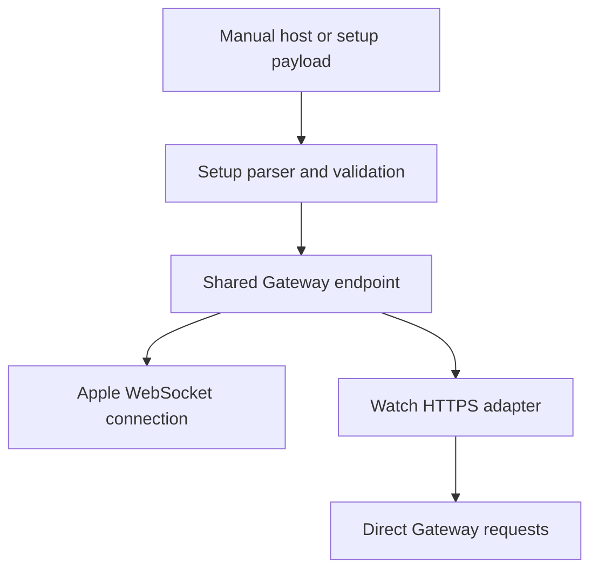

Codex review: needs maintainer review before merge.

## What this changes

This PR accepts raw IPv6 Gateway hosts in shared Apple setup parsing and derives Watch HTTPS URLs from the shared WebSocket formatter.

**Example:** A setup payload supplies host fd00::1, port 18789, and tls true.
- **Before:** URL construction fails and setup rejects the payload.
- **After:** Setup constructs wss://[fd00::1]:18789.

## Review scores

| Measure | Result | What it means |
|---|---|---|
| **Overall readiness** | 🦐 gold shrimp **(3/6)** | A focused, correct repair with meaningful reported native regressions; demonstrated behavior stops at parser and configuration tests. |
| **Proof confidence** | 🦐 gold shrimp **(3/6)** | The maintainer-authored PR is outside the ordinary contributor proof gate; its body reports shared-parser and Watch simulator regressions, while explicitly excluding live pairing and transport. |
| **Patch quality** | 🦞 diamond lobster **(5/6)** | No actionable review findings were identified. |

## Product

**Kind:** Bug fix · **Worth it:** Yes · **Fix scope:** Complete
**User problem:** Apple users supplying a valid raw IPv6 Gateway host have setup rejected, including direct Watch configuration.
**Reason:** This maintainer-authored repair restores existing address-input behavior while preserving the established endpoint and credential owners.

## Merge readiness

✅ **Ready for maintainer review**

This PR remains useful: current main and the latest release retain the raw IPv6 setup defect, and the focused repair resolves the earlier Watch finding without introducing an actionable defect.

**Priority:** P2
**Reviewed head:** `b01eba21dd511a19e0bf2e23426019679b8846a0`

## Before merge

None.

## Findings

None.

### Tests

- Missing end-to-end proof: Reported base-to-head native regressions cover URL construction and configuration, but actual Apple setup followed by Gateway transport was not exercised.

<strong>Agent review details</strong>

### How this fits together

Apple manual settings and setup payloads become shared Gateway endpoints; iOS consumes their WebSocket URLs, while Watch derives HTTPS URLs for direct requests.

### Technical review

Best possible solution:

Keep IPv6 authority formatting in the shared endpoint owner and derive Watch HTTPS URLs from it without changing stored identities or transport policy.

Do we have a high-confidence way to reproduce the issue?

The responsible raw-host assignments remain on main, and the body reports matching native base failures and repaired passes; this read-only review executed no target code.

Is this the best way to solve the issue?

The patch is the smallest complete repair: fix the shared URL authority and remove Watch's duplicate construction, with distinct formatter, parser, security, and handoff regressions.

AGENTS.md: found and applied where relevant.

Codex review notes: model internal, reasoning medium; reviewed against [fc3a42a7eb87](https://github.com/openclaw/openclaw/commit/fc3a42a7eb87a906597187f18db62201020d275b).

### Provenance checked

- `Shared endpoint URL construction` keeps the original intent (a320f775f0f3f058b612da8b1fbc2adaebca097d: The QR handoff repair introduced URLComponents-based endpoint validation; https://github.com/openclaw/openclaw/pull/120768 later moved construction into GatewayConnectEndpoint and preserved encoded context paths.)
- `Watch HTTPS construction` keeps the original intent (ca57957bde0a94dea34a700454b949a3db202576: https://github.com/openclaw/openclaw/pull/135808 established secure direct Watch endpoints and separate credential namespaces.)
- `Setup-input security regressions` keeps the original intent (b2efd1964800ca8b57b0a74eec4ef15ec837b768: https://github.com/openclaw/openclaw/pull/77162 consolidated setup parsing and protected transport validation; this patch extends host coverage without removing rejection assertions.)

### Testing

Proof path: unit tests only.

### Security

None.

### Evidence

What I checked:

- **Pinned repair:** The introduced diff brackets raw IPv6 authorities in the existing shared formatter and removes Watch's independent host construction while retaining its TLS guard. ([`apps/shared/OpenClawKit/Sources/OpenClawKit/DeepLinks.swift:479`](https://github.com/openclaw/openclaw/blob/b01eba21dd511a19e0bf2e23426019679b8846a0/apps/shared/OpenClawKit/Sources/OpenClawKit/DeepLinks.swift#L479), [b01eba21dd51](https://github.com/openclaw/openclaw/commit/b01eba21dd511a19e0bf2e23426019679b8846a0))
- **Current main still affected:** Current main still assigns raw hosts directly to URLComponents in both shared WebSocket and Watch HTTPS construction. ([`apps/shared/OpenClawKit/Sources/OpenClawKit/DeepLinks.swift:479`](https://github.com/openclaw/openclaw/blob/fc3a42a7eb87a906597187f18db62201020d275b/apps/shared/OpenClawKit/Sources/OpenClawKit/DeepLinks.swift#L479), [fc3a42a7eb87](https://github.com/openclaw/openclaw/commit/fc3a42a7eb87a906597187f18db62201020d275b))
- **Latest release still affected:** The shared formatter in v2026.10.5 retains the same unformatted host assignment. ([`apps/shared/OpenClawKit/Sources/OpenClawKit/DeepLinks.swift:479`](https://github.com/openclaw/openclaw/blob/1b58cb9a1b4f4353e1add63c8506db4d890962e8/apps/shared/OpenClawKit/Sources/OpenClawKit/DeepLinks.swift#L479), [1b58cb9a1b4f](https://github.com/openclaw/openclaw/commit/1b58cb9a1b4f4353e1add63c8506db4d890962e8))
- **Preserved caller and storage contracts:** Manual iOS URL construction consumes GatewayConnectEndpoint; Watch retains its original host-based credential namespace and Codable fields, changing only derived URL construction. ([`apps/ios/WatchApp/Sources/WatchGatewayConfiguration.swift:69`](https://github.com/openclaw/openclaw/blob/b01eba21dd511a19e0bf2e23426019679b8846a0/apps/ios/WatchApp/Sources/WatchGatewayConfiguration.swift#L69), [b01eba21dd51](https://github.com/openclaw/openclaw/commit/b01eba21dd511a19e0bf2e23426019679b8846a0))
- **Reported native regression evidence:** The complete body reports base failures followed by 47 shared tests and five Watch test functions passing, explicitly excluding live Gateway pairing; captured source identity is b8e17a73f6af932f3e695b9af788cb297cb8d01a3f199464a90b79dac4e0f77b. ([b01eba21dd51](https://github.com/openclaw/openclaw/commit/b01eba21dd511a19e0bf2e23426019679b8846a0))
- **Earlier review resolved:** Watch now consumes the shared formatter, and the refreshed branch incorporates the later setup-parser contracts underlying the prior sync request. ([`apps/ios/WatchApp/Sources/WatchGatewayConfiguration.swift:70`](https://github.com/openclaw/openclaw/blob/b01eba21dd511a19e0bf2e23426019679b8846a0/apps/ios/WatchApp/Sources/WatchGatewayConfiguration.swift#L70), [b01eba21dd51](https://github.com/openclaw/openclaw/commit/b01eba21dd511a19e0bf2e23426019679b8846a0))

Likely related people:

- **Peter Steinberger:** Raw commit ca57957bde0a94dea34a700454b949a3db202576 adds apps/ios/WatchApp/Sources/WatchGatewayConfiguration.swift:39 relative to its recorded parents. This identifies author metadata, not feature responsibility or a PR merger. (role: source-line author; confidence: high; commits: [ca57957bde0a](https://github.com/openclaw/openclaw/commit/ca57957bde0a94dea34a700454b949a3db202576); files: `apps/ios/WatchApp/Sources/WatchGatewayConfiguration.swift`)
- **Val Alexander:** Raw commit b2efd1964800ca8b57b0a74eec4ef15ec837b768 adds apps/shared/OpenClawKit/Tests/OpenClawKitTests/DeepLinksSecurityTests.swift:42 relative to its recorded parents. This identifies author metadata, not feature responsibility or a PR merger. (role: source-line author; confidence: medium; commits: [b2efd1964800](https://github.com/openclaw/openclaw/commit/b2efd1964800ca8b57b0a74eec4ef15ec837b768); files: `apps/shared/OpenClawKit/Tests/OpenClawKitTests/DeepLinksSecurityTests.swift`)
- **Mariano:** Raw commit ebae6f918e18bf075ae07def346bc2233cf52b96 adds apps/shared/OpenClawKit/Tests/OpenClawKitTests/DeepLinksSecurityTests.swift:9 relative to its recorded parents. This identifies author metadata, not feature responsibility or a PR merger. (role: source-line author; confidence: medium; commits: [ebae6f918e18](https://github.com/openclaw/openclaw/commit/ebae6f918e18bf075ae07def346bc2233cf52b96); files: `apps/shared/OpenClawKit/Tests/OpenClawKitTests/DeepLinksSecurityTests.swift`)

### PR surface

Source -2, Tests +57, Docs +4. Total +59 across 5 files. Added test files: 0.

View PR surface stats

| Area | Files | Added | Removed | Net |
|---|---:|---:|---:|---:|
| Source | 2 | 4 | 6 | -2 |
| Tests | 2 | 64 | 7 | +57 |
| Docs | 1 | 4 | 0 | +4 |
| Config | 0 | 0 | 0 | 0 |
| Generated | 0 | 0 | 0 | 0 |
| Other | 0 | 0 | 0 | 0 |
| **Total** | **5** | **72** | **13** | **+59** |

### Labels

Label changes:

- add `status: 👀 ready for maintainer look`: ClawSweeper has no concrete contributor-facing blocker left for this PR.
- remove `status: ⏳ waiting on author`: Current PR status label is `status: 👀 ready for maintainer look`.

Label justifications:

- `P2`: Raw IPv6 input breaks a bounded Apple setup path; bracketed addresses, IPv4, and hostnames remain alternatives.
- `rating: 🦐 gold shrimp`: Overall readiness is 🦐 gold shrimp; proof is 🦐 gold shrimp and patch quality is 🦞 diamond lobster.
- `status: 👀 ready for maintainer look`: ClawSweeper has no concrete contributor-facing blocker left for this PR.

### Rating scale

6/6 🦀 challenger crab · 5/6 🦞 diamond lobster · 4/6 🐚 platinum hermit · 3/6 🦐 gold shrimp · 2/6 🦪 silver shellfish · 1/6 🧂 unranked krab. Overall follows the weaker of proof and patch quality; ✨ marks media proof (a screenshot, video, or linked artifact) that directly shows the changed behavior.

### Workflow

ClawSweeper edits this one comment on every review. Comment `@clawsweeper re-review` for a fresh review only. Repair and merge execution lanes are retired.

### History

Review history (9 earlier review cycles; latest 8 shown)

<!-- clawsweeper-review-history v=1 total=9 -->
- reviewed 2026-08-25T16:37:18.103Z sha 8d45a44ecadffaac589d0575487309c1bea4f686 :: found issues before merge. :: [P2] Route Watch setup through the shared IPv6 authority formatter
- reviewed 2026-08-25T19:48:35.305Z sha dacf2f29d5a35020f793f6f79b285aa428433b10 :: needs changes before merge. :: [P2] Route Watch setup through the shared IPv6 authority formatter
- reviewed 2026-08-25T22:13:57.280Z sha 9c7401f8076de0cc991e91a88c83b1767530f4e2 :: needs maintainer review before merge. :: none
- reviewed 2026-08-29T14:38:13.893Z sha 9c7401f8076de0cc991e91a88c83b1767530f4e2 :: needs maintainer review before merge. :: none
- reviewed 2026-09-04T14:39:17.806Z sha 9c7401f8076de0cc991e91a88c83b1767530f4e2 :: blocked before merge. :: none
- reviewed 2026-09-19T12:03:29.876Z sha 35f547d77ab48230ef767afc3cf2c45629c3641a :: needs maintainer review before merge. :: none
- reviewed 2026-09-25T08:55:21.174Z sha 35f547d77ab48230ef767afc3cf2c45629c3641a :: needs changes before merge. :: none
- reviewed 2026-10-09T08:42:34.154Z sha 35f547d77ab48230ef767afc3cf2c45629c3641a :: needs changes before merge. :: none

_Reviewed October 21, 2026, 5:04 AM ET / 09:04 UTC (Revision 10)._

<!-- clawsweeper-verdict:needs-human item=129416 sha=b01eba21dd511a19e0bf2e23426019679b8846a0 confidence=high updated_at=2026-10-21T09:00:10Z reviewed_at=2026-10-21T09:04:37.674Z lease_owner=github-run-39573421383-1 lease_comment_id=6312113281 source_revision=b8e17a73f6af932f3e695b9af788cb297cb8d01a3f199464a90b79dac4e0f77b hold=not_opted_in findings=0 -->
<!-- clawsweeper-review-state:ready item=129416 sha=b01eba21dd511a19e0bf2e23426019679b8846a0 v=1 -->

<!-- clawsweeper-review-version item=129416 reviewed_at=2026-10-21T09:04:37.674Z sha=b01eba21dd511a19e0bf2e23426019679b8846a0 source_revision=b8e17a73f6af932f3e695b9af788cb297cb8d01a3f199464a90b79dac4e0f77b lease_owner=github-run-39573421383-1 lease_comment_id=6312113281 v=1 -->

<!-- clawsweeper-review item=129416 -->