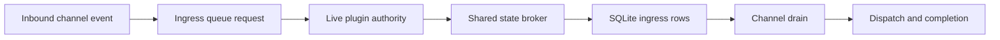

Codex review: needs maintainer review before merge. _Reviewed September 26, 2026, 2:28 PM ET / 18:28 UTC (Revision 2)._

# ClawSweeper review

## What this changes

Routes durable inbound channel queue operations through the shared SQLite state worker, gives drains one coherent pending-and-claimed listing, and forwards Telegram purge cancellation.

## Merge readiness

✅ **Ready for maintainer review**

Current main still runs operational ingress queue SQL on the Gateway thread. The merged preparation does not complete this work, and the reviewed branch remains necessary. I found no actionable defect introduced by the patch.

**Priority:** P2
**Reviewed head:** `e7cd48a0aecc6fb13a5820f0314fe9b62a73cbf0`

## Review scores

| Measure | Result | What it means |
|---|---|---|
| **Overall readiness** | 🐚 platinum hermit **(4/6)** | The cutover has focused worker, channel, and authority coverage with no discrete defect found in source review. |
| **Proof confidence** | 🐚 platinum hermit **(4/6)** | Not applicable: The supplied repository state identifies a member-authored PR, so the external-contributor proof gate does not apply. The PR reports Testbox runs of queue operations through the production SQLite worker, and source tests inspect final rows after plugin revocation; this review did not independently execute them. No stored-data contract changes. |
| **Patch quality** | 🐚 platinum hermit **(4/6)** | No actionable review findings were identified. |

## Verification

| Check | Result | Evidence |
|---|---|---|
| **Real behavior** | Not applicable | Not applicable: The supplied repository state identifies a member-authored PR, so the external-contributor proof gate does not apply. The PR reports Testbox runs of queue operations through the production SQLite worker, and source tests inspect final rows after plugin revocation; this review did not independently execute them. No stored-data contract changes. |
| **Evidence reviewed** | 9 items | Current main: The fetched main queue facade still opens the state database and imports synchronous SQLite operations for operational queue work. Broker route: The branch captures state context and dispatches queue operations through the shared state worker. Write admission: Queue mutations execute in the worker transaction and request transaction and commit grants before returning a result. |
| **Findings** | None | None. |
| **Security** | None | None. |

## How this fits together

Channel plugins queue inbound events before acknowledging transport delivery. The shared state database retains those events while the channel drain claims, dispatches, and completes them.

## Before merge

None.

<strong>Agent review details</strong>

### Security

None.

### PR surface

Source +22, Tests +522, Docs +23, Other +1. Total +568 across 37 files.

View PR surface stats

| Area | Files | Added | Removed | Net |
|---|---:|---:|---:|---:|
| Source | 15 | 958 | 936 | +22 |
| Tests | 15 | 837 | 315 | +522 |
| Docs | 4 | 41 | 18 | +23 |
| Config | 0 | 0 | 0 | 0 |
| Generated | 0 | 0 | 0 | 0 |
| Other | 3 | 3 | 2 | +1 |
| **Total** | **37** | **1839** | **1271** | **+568** |

### Review metrics

| Metric | Value | Why it matters |
|---|---|---|
| **Production versus test growth** | production net +22; tests and support net +522 | The small production increase carries worker admission and settlement; the larger test increase covers queue and authority behavior. |

### Root-cause cluster

Relationship: `canonical`
Canonical: https://github.com/openclaw/openclaw/pull/159073
Summary: The earlier merged kernel extraction prepares this distinct final worker cutover.

Members:
- `partial_overlap`: https://github.com/openclaw/openclaw/pull/158928 - It extracted listing and recovery kernels but left the operational queue facade synchronous.

Proposal only: this assessment does not dispatch repair, suppress jobs, mutate sibling items, close, or merge anything.

### Technical review

Best possible solution:

Keep one broker-backed queue owner and its compatible plugin contract, then record the planned signed-SMS process-kill replay on merged main.

Do we have a high-confidence way to reproduce the issue?

Yes, at source level: current main still opens the queue database and runs operational SQLite work on the calling path. This read-only review did not execute a Gateway reproduction.

Is this the best way to solve the issue?

Yes. Reusing the existing shared-state broker is the narrow owner cutover, and the optional listing method preserves external queue implementations.

AGENTS.md: found and applied where relevant.

Codex review notes: model internal, reasoning high; reviewed against [114994d092d5](https://github.com/openclaw/openclaw/commit/114994d092d51f10ad529f9eacec113b9992ec3b).

### Labels

Label changes:

No label changes.

Label justifications:

- `P2`: This shared channel-runtime improvement has broad reach without evidence of an urgent user outage.
- `merge-risk: 🚨 message-delivery`: A queue-ordering or settlement regression could affect durable inbound acceptance and replay across channels.
- `rating: 🐚 platinum hermit`: Overall readiness is 🐚 platinum hermit; proof is 🐚 platinum hermit and patch quality is 🐚 platinum hermit.
- `status: 👀 ready for maintainer look`: ClawSweeper has no concrete contributor-facing blocker left for this PR. Not applicable: The supplied repository state identifies a member-authored PR, so the external-contributor proof gate does not apply. The PR reports Testbox runs of queue operations through the production SQLite worker, and source tests inspect final rows after plugin revocation; this review did not independently execute them. No stored-data contract changes.

### Evidence

What I checked:

- **Current main:** The fetched main queue facade still opens the state database and imports synchronous SQLite operations for operational queue work. ([`src/channels/message/ingress-queue.ts:77`](https://github.com/openclaw/openclaw/blob/114994d092d51f10ad529f9eacec113b9992ec3b/src/channels/message/ingress-queue.ts#L77), [114994d092d5](https://github.com/openclaw/openclaw/commit/114994d092d51f10ad529f9eacec113b9992ec3b))
- **Broker route:** The branch captures state context and dispatches queue operations through the shared state worker. ([`src/channels/message/ingress-queue.ts:110`](https://github.com/openclaw/openclaw/blob/e7cd48a0aecc6fb13a5820f0314fe9b62a73cbf0/src/channels/message/ingress-queue.ts#L110), [e7cd48a0aecc](https://github.com/openclaw/openclaw/commit/e7cd48a0aecc6fb13a5820f0314fe9b62a73cbf0))
- **Write admission:** Queue mutations execute in the worker transaction and request transaction and commit grants before returning a result. ([`src/channels/message/ingress-queue.worker.ts:76`](https://github.com/openclaw/openclaw/blob/e7cd48a0aecc6fb13a5820f0314fe9b62a73cbf0/src/channels/message/ingress-queue.worker.ts#L76), [e7cd48a0aecc](https://github.com/openclaw/openclaw/commit/e7cd48a0aecc6fb13a5820f0314fe9b62a73cbf0))
- **Authority boundary:** The plugin runtime passes its live-authority assertion to queue construction; regression tests check rejected writes and resulting rows when authority is revoked before a commit grant. ([`src/plugin-state/plugin-state-store.runtime.test.ts:284`](https://github.com/openclaw/openclaw/blob/e7cd48a0aecc6fb13a5820f0314fe9b62a73cbf0/src/plugin-state/plugin-state-store.runtime.test.ts#L284), [e7cd48a0aecc](https://github.com/openclaw/openclaw/commit/e7cd48a0aecc6fb13a5820f0314fe9b62a73cbf0))
- **Plugin queue compatibility:** The coherent listing is optional in the queue contract, and the drain retains separate reads for external queues without that method. ([`src/channels/message/ingress-drain.ts:586`](https://github.com/openclaw/openclaw/blob/e7cd48a0aecc6fb13a5820f0314fe9b62a73cbf0/src/channels/message/ingress-drain.ts#L586), [e7cd48a0aecc](https://github.com/openclaw/openclaw/commit/e7cd48a0aecc6fb13a5820f0314fe9b62a73cbf0))
- **Restart coverage:** An existing Telegram test reopens the durable queue and checks replay after restart; the PR reports running routed extension tests. The planned signed-SMS process-kill replay is separately described as post-merge work. ([`extensions/telegram/src/telegram-ingress-drain.test.ts:356`](https://github.com/openclaw/openclaw/blob/e7cd48a0aecc6fb13a5820f0314fe9b62a73cbf0/extensions/telegram/src/telegram-ingress-drain.test.ts#L356), [e7cd48a0aecc](https://github.com/openclaw/openclaw/commit/e7cd48a0aecc6fb13a5820f0314fe9b62a73cbf0))

Likely related people:

- **steipete:** Suggested for follow-up; no historical authorship or introduction is verified. (role: unverified routing candidate; confidence: low)
- **Ayaan Zaidi:** Suggested for follow-up; no historical authorship or introduction is verified. (role: unverified routing candidate; confidence: low)

### Rating scale

| Score | Internal tier | Crab rank | Meaning |
|---:|:---:|---|---|
| **6/6** | S | 🦀 challenger crab | Exceptional readiness |
| **5/6** | A | 🦞 diamond lobster | Very strong readiness |
| **4/6** | B | 🐚 platinum hermit | Good normal PR; ordinary maintainer review |
| **3/6** | C | 🦐 gold shrimp | Useful, but confidence is limited |
| **2/6** | D | 🦪 silver shellfish | Proof or implementation needs work |
| **1/6** | F | 🧂 unranked krab | Not merge-ready |
| N/A | NA | 🌊 off-meta tidepool | Rating does not apply |

Overall follows the weaker of proof and patch quality.
Shiny media proof means a screenshot, video, or linked artifact directly shows the changed behavior. Runtime, network, CSP, and security claims still need visible diagnostics.

### Workflow

- ClawSweeper keeps one durable marker-backed review comment per issue or PR.
- Re-runs edit this comment so the latest verdict, findings, and automation markers stay together instead of adding duplicate bot comments.
- A fresh review can be triggered by eligible `@clawsweeper re-review` comments, exact-item GitHub events, scheduled/background review runs, or manual workflow dispatch.
- PR/issue authors and users with repository write access can comment `@clawsweeper re-review` or `@clawsweeper re-run` on an open PR or issue to request a fresh review only.
- Maintainers can also comment `@clawsweeper review` to request a fresh review only.
- Fresh-review commands do not start repair, autofix, rebase, CI repair, or automerge.
- Maintainer-only repair and merge flows require explicit commands such as `@clawsweeper autofix`, `@clawsweeper automerge`, `@clawsweeper fix ci`, or `@clawsweeper address review`.
- Maintainers can comment `@clawsweeper explain` to ask for more context, or `@clawsweeper stop` to stop active automation.

### History

Review history (1 earlier review cycle)

<!-- clawsweeper-review-history v=1 total=1 -->
- reviewed 2026-09-26T18:08:30.733Z sha 7c6b771277b3969d41fd4871d42083a8de7e23ab :: blocked before merge. :: none

<!-- clawsweeper-verdict:needs-human item=159073 sha=e7cd48a0aecc6fb13a5820f0314fe9b62a73cbf0 confidence=high updated_at=2026-09-26T18:23:55Z reviewed_at=2026-09-26T18:28:51.025Z lease_owner=github-run-36262260595-1 lease_comment_id=5848716920 source_revision=56e8a5a14d14068f3fe0166ae98710ef523c557a7f5d670f160abcded3751b5b live_verification=absent -->
<!-- clawsweeper-review-state:ready item=159073 sha=e7cd48a0aecc6fb13a5820f0314fe9b62a73cbf0 v=1 -->

<!-- clawsweeper-review-version item=159073 reviewed_at=2026-09-26T18:28:51.025Z sha=e7cd48a0aecc6fb13a5820f0314fe9b62a73cbf0 source_revision=56e8a5a14d14068f3fe0166ae98710ef523c557a7f5d670f160abcded3751b5b lease_owner=github-run-36262260595-1 lease_comment_id=5848716920 v=1 -->

<!-- clawsweeper-review item=159073 -->