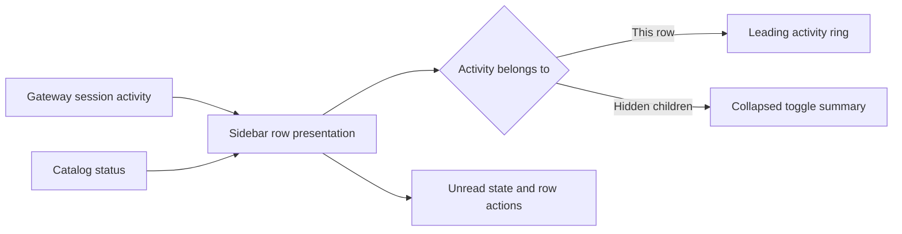

Codex review: blocked before merge. _Reviewed September 7, 2026, 6:47 AM ET / 10:47 UTC._

# ClawSweeper review

## What this changes

Moves sidebar running indicators around each row’s leading icon, preserves accessible summaries of hidden running children, and updates documentation and browser coverage.

## Merge readiness

⛔ **Blocked before merge - 1 item remains**

The previous accessibility blocker is addressed, and no remaining actionable defect was found. The improvement is still absent from current main and the latest release; this maintainer-authored PR remains a useful landing candidate.

**Priority:** P2
**Reviewed head:** `86959e4f32cda73f03271e803e2e13b58dcdb62a`

## Review scores

| Measure | Result | What it means |
|---|---|---|
| **Overall readiness** | 🐚 platinum hermit **(4/6)** | A focused implementation with relevant browser evidence and the prior accessibility finding resolved. |
| **Proof confidence** | 🐚 platinum hermit **(4/6)** | Not applicable: The ordinary contributor proof gate does not apply to this maintainer-authored PR. Supplied Chromium evidence exercises sidebar rings, hover actions, queued state, and accessibility through the mock-Gateway UI; screenshot retrieval was unavailable to this reviewer. |
| **Patch quality** | 🐚 platinum hermit **(4/6)** | No actionable review findings were identified. |

## Verification

| Check | Result | Evidence |
|---|---|---|
| **Real behavior** | Not applicable | Not applicable: The ordinary contributor proof gate does not apply to this maintainer-authored PR. Supplied Chromium evidence exercises sidebar rings, hover actions, queued state, and accessibility through the mock-Gateway UI; screenshot retrieval was unavailable to this reviewer. |
| **Evidence reviewed** | 8 items | Previous blocker addressed: The collapsed toggle now exposes Active run through aria-description only while children are collapsed. This directly addresses the retained prior finding and the contributor’s explanation at https://github.com/openclaw/openclaw/pull/141098#issuecomment-5569403787. Accessibility regression coverage: The Chromium scenario inspects the accessibility tree for the collapsed toggle’s Active run description and verifies its removal after expansion. The supplied contributor comment reports that the pre-fix assertion failed. Tests were inspected, not executed during this review. Canonical presentation owner: The row renderer reuses the existing glyph component, distinguishes each row’s own run from descendant activity, and retains queued state. Running branches bypass the quiet-child display cap, so expansion does not hide them behind ordinary pagination. |
| **Findings** | None | None. |
| **Security** | None | None. |

## How this fits together

The Control UI sidebar turns Gateway session activity and catalog status into navigation rows. Its indicators help users distinguish running, queued, unread, and hidden child activity while accessing row actions.

## Before merge

- [ ] **Resolve merge risk (P1)** - The linked before/after screenshots could not be independently inspected because attachment retrieval failed in the review environment.

<strong>Agent review details</strong>

### Security

None.

### PR surface

Source -25, Tests +148, Docs 0. Total +123 across 22 files.

View PR surface stats

| Area | Files | Added | Removed | Net |
|---|---:|---:|---:|---:|
| Source | 7 | 37 | 62 | -25 |
| Tests | 14 | 257 | 109 | +148 |
| Docs | 1 | 1 | 1 | 0 |
| Config | 0 | 0 | 0 | 0 |
| Generated | 0 | 0 | 0 | 0 |
| Other | 0 | 0 | 0 | 0 |
| **Total** | **22** | **295** | **172** | **+123** |

### Review metrics

None.

### Merge-risk options

**Maintainer options:**
1. **Decide the mitigation before merge**  
   Use the shared leading glyph for each row’s own activity while preserving accessible hidden-child summaries and stable hover actions.
2. **Pause or close**  
   Do not merge this PR until maintainers decide whether the risk is worth taking.

### Technical review

Best possible solution:

Use the shared leading glyph for each row’s own activity while preserving accessible hidden-child summaries and stable hover actions.

Do we have a high-confidence way to reproduce the issue?

Not applicable as a new failure report: this is a presentation improvement. Source inspection verifies the old placement and the repaired accessibility path; no runtime reproduction was executed.

Is this the best way to solve the issue?

Yes. Reusing the existing glyph renderer removes competing activity placement without adding configuration or changing session execution.

AGENTS.md: found and applied where relevant.

Codex review notes: model internal, reasoning medium; reviewed against [e3e2953f4b9a](https://github.com/openclaw/openclaw/commit/e3e2953f4b9a3ef1cd0568763c74c42f33067410).

### Labels

Label justifications:

- `P2`: This is a bounded sidebar usability and accessibility improvement with no demonstrated urgent runtime impact.
- `rating: 🐚 platinum hermit`: Overall readiness is 🐚 platinum hermit; proof is 🐚 platinum hermit and patch quality is 🐚 platinum hermit.
- `status: 👀 ready for maintainer look`: ClawSweeper has no concrete contributor-facing blocker left for this PR. Not applicable: The ordinary contributor proof gate does not apply to this maintainer-authored PR. Supplied Chromium evidence exercises sidebar rings, hover actions, queued state, and accessibility through the mock-Gateway UI; screenshot retrieval was unavailable to this reviewer.

### Evidence

What I checked:

- **Previous blocker addressed:** The collapsed toggle now exposes Active run through aria-description only while children are collapsed. This directly addresses the retained prior finding and the contributor’s explanation at https://github.com/openclaw/openclaw/pull/141098#issuecomment-5569403787. ([`ui/src/components/app-sidebar-session-row-render.ts:466`](https://github.com/openclaw/openclaw/blob/86959e4f32cda73f03271e803e2e13b58dcdb62a/ui/src/components/app-sidebar-session-row-render.ts#L466), [86959e4f32cd](https://github.com/openclaw/openclaw/commit/86959e4f32cda73f03271e803e2e13b58dcdb62a))
- **Accessibility regression coverage:** The Chromium scenario inspects the accessibility tree for the collapsed toggle’s Active run description and verifies its removal after expansion. The supplied contributor comment reports that the pre-fix assertion failed. Tests were inspected, not executed during this review. ([`ui/src/e2e/session-management.sidebar.e2e.test.ts:126`](https://github.com/openclaw/openclaw/blob/86959e4f32cda73f03271e803e2e13b58dcdb62a/ui/src/e2e/session-management.sidebar.e2e.test.ts#L126), [86959e4f32cd](https://github.com/openclaw/openclaw/commit/86959e4f32cda73f03271e803e2e13b58dcdb62a))
- **Canonical presentation owner:** The row renderer reuses the existing glyph component, distinguishes each row’s own run from descendant activity, and retains queued state. Running branches bypass the quiet-child display cap, so expansion does not hide them behind ordinary pagination. ([`ui/src/components/session-leading-indicator.ts:55`](https://github.com/openclaw/openclaw/blob/86959e4f32cda73f03271e803e2e13b58dcdb62a/ui/src/components/session-leading-indicator.ts#L55), [86959e4f32cd](https://github.com/openclaw/openclaw/commit/86959e4f32cda73f03271e803e2e13b58dcdb62a))
- **Still necessary on current main:** Fetched main still renders top-level activity through trailing state and passes running:false to persistent leading glyphs. The earlier merged sidebar PRs therefore do not supersede this change. ([`ui/src/components/session-leading-indicator.ts:62`](https://github.com/openclaw/openclaw/blob/e3e2953f4b9a3ef1cd0568763c74c42f33067410/ui/src/components/session-leading-indicator.ts#L62), [e3e2953f4b9a](https://github.com/openclaw/openclaw/commit/e3e2953f4b9a3ef1cd0568763c74c42f33067410))
- **Latest release comparison:** The same trailing activity implementation remains in v2026.9.2; the proposed presentation is not already shipped there. ([`ui/src/components/session-leading-indicator.ts:62`](https://github.com/openclaw/openclaw/blob/3928bad9badfcb6c7d140530435e806fb8092190/ui/src/components/session-leading-indicator.ts#L62), [3928bad9badf](https://github.com/openclaw/openclaw/commit/3928bad9badfcb6c7d140530435e806fb8092190))
- **Feature-history routing:** Current-main history shows repeated glyph and sidebar work by Peter Steinberger. Supplied merged PR context also connects fuller-stack-dev to trailing-state presentation and jesse-merhi to hover stability. Deeper blame and the earlier-head comparison encountered unavailable objects, so no line-introduction attribution is claimed. ([`ui/src/components/session-glyph.ts`](https://github.com/openclaw/openclaw/blob/e3e2953f4b9a3ef1cd0568763c74c42f33067410/ui/src/components/session-glyph.ts), [e3e2953f4b9a](https://github.com/openclaw/openclaw/commit/e3e2953f4b9a3ef1cd0568763c74c42f33067410))

Likely related people:

- **steipete:** Suggested for follow-up; no historical authorship or introduction is verified. (role: unverified routing candidate; confidence: low)
- **fuller-stack-dev:** Suggested for follow-up; no historical authorship or introduction is verified. (role: unverified routing candidate; confidence: low)
- **jesse-merhi:** Suggested for follow-up; no historical authorship or introduction is verified. (role: unverified routing candidate; confidence: low)

### Rating scale

| Score | Internal tier | Crab rank | Meaning |
|---:|:---:|---|---|
| **6/6** | S | 🦀 challenger crab | Exceptional readiness |
| **5/6** | A | 🦞 diamond lobster | Very strong readiness |
| **4/6** | B | 🐚 platinum hermit | Good normal PR; ordinary maintainer review |
| **3/6** | C | 🦐 gold shrimp | Useful, but confidence is limited |
| **2/6** | D | 🦪 silver shellfish | Proof or implementation needs work |
| **1/6** | F | 🧂 unranked krab | Not merge-ready |
| N/A | NA | 🌊 off-meta tidepool | Rating does not apply |

Overall follows the weaker of proof and patch quality.
Shiny media proof means a screenshot, video, or linked artifact directly shows the changed behavior. Runtime, network, CSP, and security claims still need visible diagnostics.

### Workflow

- ClawSweeper keeps one durable marker-backed review comment per issue or PR.
- Re-runs edit this comment so the latest verdict, findings, and automation markers stay together instead of adding duplicate bot comments.
- A fresh review can be triggered by eligible `@clawsweeper re-review` comments, exact-item GitHub events, scheduled/background review runs, or manual workflow dispatch.
- PR/issue authors and users with repository write access can comment `@clawsweeper re-review` or `@clawsweeper re-run` on an open PR or issue to request a fresh review only.
- Maintainers can also comment `@clawsweeper review` to request a fresh review only.
- Fresh-review commands do not start repair, autofix, rebase, CI repair, or automerge.
- Maintainer-only repair and merge flows require explicit commands such as `@clawsweeper autofix`, `@clawsweeper automerge`, `@clawsweeper fix ci`, or `@clawsweeper address review`.
- Maintainers can comment `@clawsweeper explain` to ask for more context, or `@clawsweeper stop` to stop active automation.

### History

Review history (2 earlier review cycles)

<!-- clawsweeper-review-history v=1 total=2 -->
- reviewed 2026-09-07T10:13:06.023Z sha eb7ca5078920d766080eadf807d06860b87519c5 :: blocked before merge. :: [P2] Preserve an accessible summary of hidden running children
- reviewed 2026-09-07T10:29:33.913Z sha 0a37bc0aadf9911e0a4d8a71309628f78bf27de7 :: blocked before merge. :: [P2] Preserve an accessible summary of hidden running children

<!-- clawsweeper-verdict:needs-human item=141098 sha=86959e4f32cda73f03271e803e2e13b58dcdb62a confidence=high updated_at=2026-09-07T10:44:41Z reviewed_at=2026-09-07T10:47:07.981Z lease_owner=github-run-34112869880-1 lease_comment_id=5569442216 source_revision=02cbe06fce5347623f3c6434da791fc343d1e08a0434217259947ad957dad40f live_verification=absent -->
<!-- clawsweeper-review-state:blocked item=141098 sha=86959e4f32cda73f03271e803e2e13b58dcdb62a v=1 -->

<!-- clawsweeper-review-version item=141098 reviewed_at=2026-09-07T10:47:07.981Z sha=86959e4f32cda73f03271e803e2e13b58dcdb62a source_revision=02cbe06fce5347623f3c6434da791fc343d1e08a0434217259947ad957dad40f lease_owner=github-run-34112869880-1 lease_comment_id=5569442216 v=1 -->

<!-- clawsweeper-review item=141098 -->