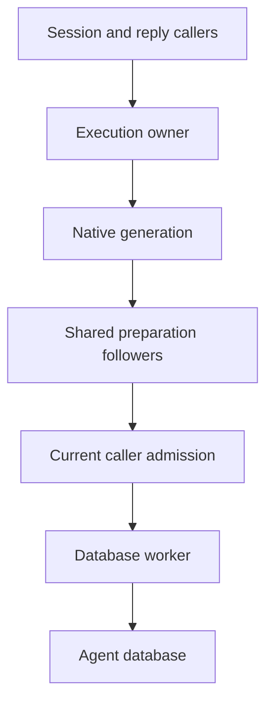

Codex review: needs maintainer review before merge.

## What this changes

Require a current caller for shared database preparation and preserve healthy borrowers after confirmed admission refusals.

**Example:** Deletion of agent:main:validation-revoked loses authority during database integrity validation.
- **Before:** Preparation recreates idx_agent_cache_expiry before rejecting the deletion.
- **After:** The index remains absent, the session and transcript remain unchanged, and refused worker custody settles.

## Review scores

| Measure | Result | What it means |
|---|---|---|
| **Overall readiness** | 🦐 gold shrimp **(3/6)** | The focused patch has no actionable finding and meaningful real-worker authority coverage; validation is reported through production-owner harnesses rather than a shipped-entry-point demonstration. |
| **Proof confidence** | 🦐 gold shrimp **(3/6)** | Sufficient (none): For this maintainer-authored PR, the authority evidence covers real lifecycle owners, SQLite workers, revocation during blocked validation, unchanged session/transcript state, absent unauthorized index repair, and persisted healthy-peer writes; the body reports these scenarios passing on the resolved candidate. |
| **Patch quality** | 🐚 platinum hermit **(4/6)** | No actionable review findings were identified. |

## Product

**Kind:** Bug fix · **Worth it:** Yes · **Fix scope:** Complete
**User problem:** Revoked deletion work can repair storage before refusal, and a refused opener can invalidate healthy borrowers.
**Reason:** The maintainer-authored direction restores existing authority and borrower-isolation contracts without adding configuration, schemas, or another lifecycle owner.

## Regression provenance

Possible regression — suspected (reviewed change). No predecessor PR is attributed.

## Merge readiness

✅ **Ready for maintainer review**

This PR fixes a current caller-authority defect without sacrificing shared database preparation; no introduced defect was found, the earlier conflict blocker is resolved, and exact-head CI remains pending.

**Priority:** P1
**Reviewed head:** `6ab6bb04830eeee99b6e9c702bdc95059ee46689`

## Before merge

None.

## Findings

None.

<strong>Agent review details</strong>

### How this fits together

The agent database executor coordinates logical borrowers, physical worker generations, preparation, and cleanup; caller authority enters through admission sources and governs worker database effects.

### Technical review

Best possible solution:

Keep preparation with the existing physical owner while requiring live follower authority and preserving borrower recovery only for confirmed uncommitted refusals.

Do we have a high-confidence way to reproduce the issue?

Current-main source exposes generation-only preparation authority, and the supplied real-worker regressions exercise revocation during validation and refusal before promotion; no target code was executed during this review.

Is this the best way to solve the issue?

The fix belongs in the shared preparation and execution owners, preserves physical preparation sharing, and distinguishes confirmed refusals from protocol faults, unknown outcomes, and cleanup failures.

AGENTS.md: found and applied where relevant.

Codex review notes: model internal, reasoning medium; reviewed against [c289fc3e057c](https://github.com/openclaw/openclaw/commit/c289fc3e057cc4e8994aa060a7b539cc5c4d0906).

### Provenance checked

- `Shared preparation authority` changes intended behavior with a stated reason (5b5a59508a814ded9d3e53fd9e4dc2ba79a1fdd3: Separate physical preparation from the initiating caller so cancellation cannot poison healthy peer chats.)
- `Physical opening and promotion` keeps the original intent (b499c60e1968e7e0ff636e34b8045f9982f6592f: Existing-file opening belongs to the physical owner; first-use creation and actual operations retain caller authority.)
- `Preparation completion and discovery` keeps the original intent (55d9dab98ad44ea0e5d05217e26eab9ad2c1f52f: Discovery must await canonical schema preparation while individual cancellation must not cancel shared creation.)
- `Worker lifetime and borrower recovery` keeps the original intent (97f27a65b0a6d2892657a3b666a931a563cbd8d3: Recover established native generations without replaying failed operations or reviving old authority.)

### Testing

Proof path: in-process harness.

### Security

None.

### Evidence

What I checked:

- **Current main still lacks follower authority:** Current main's shared preparation source checks only generation authority; the introduced diff adds caller-context checks and refuses preparation when no current follower remains. ([`src/state/openclaw-agent-execution-preparation.ts:11`](https://github.com/openclaw/openclaw/blob/c289fc3e057cc4e8994aa060a7b539cc5c4d0906/src/state/openclaw-agent-execution-preparation.ts#L11), [c289fc3e057c](https://github.com/openclaw/openclaw/commit/c289fc3e057cc4e8994aa060a7b539cc5c4d0906))
- **Authority reaches worker admission:** Shared preparation retains each follower's assertion in its original async context; native admission invokes the source assertion at preparation checkpoints, including resumption after integrity validation. ([`src/state/openclaw-agent-execution-native.ts:261`](https://github.com/openclaw/openclaw/blob/6ab6bb04830eeee99b6e9c702bdc95059ee46689/src/state/openclaw-agent-execution-native.ts#L261), [6ab6bb04830e](https://github.com/openclaw/openclaw/commit/6ab6bb04830eeee99b6e9c702bdc95059ee46689))
- **Revoked caller final-effect control:** The real-worker regression revokes deletion authority while integrity validation is held, then checks that the index remains absent, session and transcript bytes remain intact, and the added worker lease is released. ([`src/gateway/server/__tests__/server.sessions.reclamation-admission.test.ts:302`](https://github.com/openclaw/openclaw/blob/6ab6bb04830eeee99b6e9c702bdc95059ee46689/src/gateway/server/__tests__/server.sessions.reclamation-admission.test.ts#L302), [6ab6bb04830e](https://github.com/openclaw/openclaw/commit/6ab6bb04830eeee99b6e9c702bdc95059ee46689))
- **Healthy peer and retained borrower controls:** Real worker tests retain persisted peer transcripts after initiator revocation or abort, exclude the initiator's writes, and verify that a borrower survives a confirmed refusal before native promotion. ([`src/state/openclaw-agent-execution.integrity.test.ts:171`](https://github.com/openclaw/openclaw/blob/6ab6bb04830eeee99b6e9c702bdc95059ee46689/src/state/openclaw-agent-execution.integrity.test.ts#L171), [6ab6bb04830e](https://github.com/openclaw/openclaw/commit/6ab6bb04830eeee99b6e9c702bdc95059ee46689))
- **Cancellation-isolation intent preserved:** The physical-owner cancellation isolation recorded in https://github.com/openclaw/openclaw/pull/175008 and commit b499c60 is preserved; this PR restores live caller authority for preparation effects rather than restoring ownership by the initiating caller. ([`src/state/openclaw-agent-execution-native.ts:412`](https://github.com/openclaw/openclaw/blob/b499c60e1968e7e0ff636e34b8045f9982f6592f/src/state/openclaw-agent-execution-native.ts#L412), [b499c60e1968](https://github.com/openclaw/openclaw/commit/b499c60e1968e7e0ff636e34b8045f9982f6592f))
- **Resolved candidate and reported validation:** The current body identifies the reviewed head and reports 100 distinct passing focused cases, including both reclamation cases, with one unchanged platform skip; REST reports mergeable true and the CI gate pending. The earlier reviewed SHA is unavailable locally, so no patch-identity claim is made. ([6ab6bb04830e](https://github.com/openclaw/openclaw/commit/6ab6bb04830eeee99b6e9c702bdc95059ee46689))

### PR surface

Source +51, Tests +54, Docs +5. Total +110 across 9 files. Added test files: 0.

View PR surface stats

| Area | Files | Added | Removed | Net |
|---|---:|---:|---:|---:|
| Source | 4 | 98 | 47 | +51 |
| Tests | 4 | 66 | 12 | +54 |
| Docs | 1 | 5 | 0 | +5 |
| Config | 0 | 0 | 0 | 0 |
| Generated | 0 | 0 | 0 | 0 |
| Other | 0 | 0 | 0 | 0 |
| **Total** | **9** | **169** | **59** | **+110** |

### Labels

Label changes:

- add `status: 👀 ready for maintainer look`: ClawSweeper has no concrete contributor-facing blocker left for this PR.
- remove `status: ⏳ waiting on author`: Current PR status label is `status: 👀 ready for maintainer look`.

Label justifications:

- `P1`: Current preparation can perform schema repair after caller revocation, while incorrect refusal handling can invalidate healthy chats' retained database access.
- `rating: 🦐 gold shrimp`: Overall readiness is 🦐 gold shrimp; proof is 🦐 gold shrimp and patch quality is 🐚 platinum hermit.
- `status: 👀 ready for maintainer look`: ClawSweeper has no concrete contributor-facing blocker left for this PR.
- `proof: sufficient`: Contributor real behavior proof is sufficient.

### Rating scale

6/6 🦀 challenger crab · 5/6 🦞 diamond lobster · 4/6 🐚 platinum hermit · 3/6 🦐 gold shrimp · 2/6 🦪 silver shellfish · 1/6 🧂 unranked krab. Overall follows the weaker of proof and patch quality; ✨ marks media proof (a screenshot, video, or linked artifact) that directly shows the changed behavior.

### Workflow

ClawSweeper edits this one comment on every review. Comment `@clawsweeper re-review` for a fresh review only. Repair and merge execution lanes are retired.

### History

Review history (2 earlier review cycles)

<!-- clawsweeper-review-history v=1 total=2 -->
- reviewed 2026-10-17T07:57:43.430Z sha 46c94646486e6b938ac7e6db42bdbd2a52acb355 :: needs changes before merge. :: none
- reviewed 2026-10-17T09:19:47.051Z sha ec2e277cc13c556a89a26cb7461670a542fb3985 :: needs changes before merge. :: none

_Reviewed October 17, 2026, 5:27 AM ET / 09:27 UTC (Revision 3)._

<!-- clawsweeper-verdict:needs-human item=175307 sha=6ab6bb04830eeee99b6e9c702bdc95059ee46689 confidence=high updated_at=2026-10-17T09:23:43Z reviewed_at=2026-10-17T09:27:04.855Z lease_owner=github-run-39020899513-1 lease_comment_id=6232242475 source_revision=b73f0bfd9ab159a99fd943b6d9520f544fd4eaa4ecaffadc4d68951bad264cf5 hold=not_opted_in findings=0 -->
<!-- clawsweeper-review-state:ready item=175307 sha=6ab6bb04830eeee99b6e9c702bdc95059ee46689 v=1 -->

<!-- clawsweeper-review-version item=175307 reviewed_at=2026-10-17T09:27:04.855Z sha=6ab6bb04830eeee99b6e9c702bdc95059ee46689 source_revision=b73f0bfd9ab159a99fd943b6d9520f544fd4eaa4ecaffadc4d68951bad264cf5 lease_owner=github-run-39020899513-1 lease_comment_id=6232242475 v=1 -->

<!-- clawsweeper-review item=175307 -->