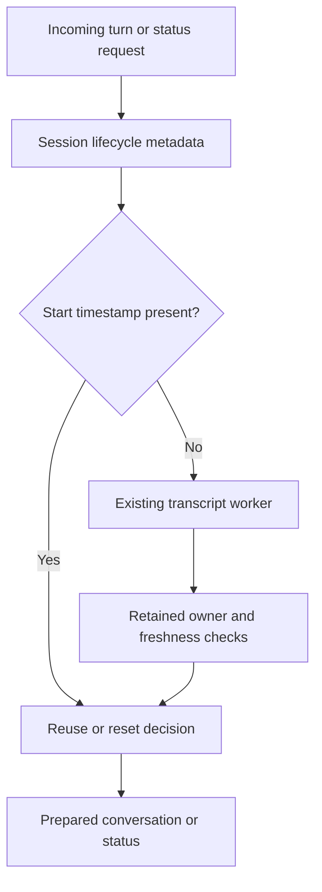

Codex review: blocked before merge. _Reviewed October 5, 2026, 6:56 AM ET / 10:56 UTC (Revision 8)._

# ClawSweeper review

## What this changes

Move missing session lifecycle timestamp reads into the existing transcript worker across agent preparation, reply initialization, status rendering, and Slack freshness checks while preserving the released synchronous plugin method.

## Merge readiness

⛔ **Blocked before merge - 3 items remain**

This PR still provides distinct, useful work absent from current main. No actionable correctness or security defect was found, and the previous integration conflicts are resolved.

**Priority:** P2
**Reviewed head:** `6ce02f9e540ad8207a2807750a44b9b417e39677`

## Review scores

| Measure | Result | What it means |
|---|---|---|
| **Overall readiness** | 🦞 diamond lobster **(5/6)** | Strong scoped measurements, meaningful boundary regressions, and coherent owner reuse support an above-average patch. |
| **Proof confidence** | 🦞 diamond lobster **(5/6)** | Sufficient (terminal): The paired isolated Gateway workload exercises lifecycle-header recovery through real SQLite and records zero after-fix caller-thread executions for that cohort. Retained-owner regressions cover foreign commits, synchronous rewrites, closure, and post-await permission revocation; final integration reports 52 passing affected cases. No schema or stored-format contract changes, and compatibility-registry metadata is declarative. |
| **Patch quality** | 🦞 diamond lobster **(5/6)** | No actionable review findings were identified. |

## Verification

| Check | Result | Evidence |
|---|---|---|
| **Real behavior** | Verified | Sufficient (terminal): The paired isolated Gateway workload exercises lifecycle-header recovery through real SQLite and records zero after-fix caller-thread executions for that cohort. Retained-owner regressions cover foreign commits, synchronous rewrites, closure, and post-await permission revocation; final integration reports 52 passing affected cases. No schema or stored-format contract changes, and compatibility-registry metadata is declarative. |
| **Evidence reviewed** | 8 items | Pinned introduced change: Reviewed the introduced base-to-head changes using the host-pinned identities. The stale GitHub test merge was not used to infer removal of current-main behavior. Existing reader owns header recovery: The lifecycle helper uses the existing timestamp reducer and transcript reader, accepts header facts through retained reader consumption, and rejects unaccepted results. The reader preserves physical identity, writer FIFO, native mutation witnessing, and cleanup checks. Post-await authorization and commit fencing: Session patch preparation rechecks admission and lifecycle generation after awaiting timestamps, evaluates creation permission afterward, and retains the existing synchronous commit guard. The changed regression covers both denied creation and permission revoked during preparation. |
| **Findings** | None | None. |
| **Security** | None | None. |

## How this fits together

Session lifecycle timestamps determine when OpenClaw reuses or resets a conversation and what duration status displays. The transcript reader supplies missing timestamps from stored headers to those decisions.

## Before merge

- [ ] **Resolve merge risk (P1)** - The fresh canonical SDK comparison for the integrated head remains pending; historical reports do not cover the latest baseline's expanded declaration closure.
- [ ] **Complete next step (P2)** - Complete and record the canonical SDK API comparison for a1ce6fb1165d383be17b106a0d74e68446272200..6ce02f9e540ad8207a2807750a44b9b417e39677.
- [ ] **Add data-model compatibility proof** - Confirm migration or upgrade compatibility proof before merge.

<strong>Agent review details</strong>

### Security

None.

### PR surface

Source +139, Tests +241, Docs +22. Total +402 across 36 files.

View PR surface stats

| Area | Files | Added | Removed | Net |
|---|---:|---:|---:|---:|
| Source | 16 | 243 | 104 | +139 |
| Tests | 18 | 461 | 220 | +241 |
| Docs | 2 | 22 | 0 | +22 |
| Config | 0 | 0 | 0 | 0 |
| Generated | 0 | 0 | 0 | 0 |
| Other | 0 | 0 | 0 | 0 |
| **Total** | **36** | **726** | **324** | **+402** |

### Review metrics

| Metric | Value | Why it matters |
|---|---|---|
| **Production versus test growth** | production +243/−104; tests/support +461/−220 | Production growth supports the existing worker cutover and released compatibility path; new boundary coverage protects freshness, revocation, and timestamp recovery. |
| **Measured SQL placement** | header cohort 439 → 0 MAIN executions; stable first-turn total −7 | The reported cohort improvement relocates substantial admission work and must not be represented as 439 statements eliminated overall. |

### Stored data model

Persistent data-model change detected: `migration/backfill/repair: src/plugins/compat/session-persistence-records.ts`. Confirm migration or upgrade compatibility proof before merge.

### Merge-risk options

**Maintainer options:**
1. **Finish integrated SDK qualification (recommended)**  
   Record the pending canonical API comparison for a1ce6fb1165d..6ce02f9e540a and resolve any PR-scoped compatibility findings before merge.

### Technical review

Best possible solution:

Keep timestamp recovery with the existing reader and reset-policy owners, preserving released synchronous callability and recording the integrated-head SDK compatibility result.

Do we have a high-confidence way to reproduce the issue?

Not applicable to a user-visible bug: the supplied paired Gateway workload establishes main-thread SQL placement, and source confirms the synchronous path remains on current main. No runtime execution was performed in this read-only review.

Is this the best way to solve the issue?

Yes. Reusing the existing transcript reader and timestamp reducer is a coherent cutover, with bundled callers migrated and the shipped synchronous plugin contract retained.

AGENTS.md: found and applied where relevant.

Codex review notes: model internal, reasoning medium; reviewed against [ae5a95772c02](https://github.com/openclaw/openclaw/commit/ae5a95772c02af57c7add70391ad0241dd5c50a8).

### Labels

Label changes:

No label changes.

Label justifications:

- `P2`: This is a bounded runtime performance improvement with preserved user-facing reset behavior.
- `merge-risk: 🚨 compatibility`: The PR adds an async plugin-runtime method while retaining its released synchronous companion, and the latest integrated SDK comparison is unfinished.
- `rating: 🦞 diamond lobster`: Overall readiness is 🦞 diamond lobster; proof is 🦞 diamond lobster and patch quality is 🦞 diamond lobster.
- `status: 👀 ready for maintainer look`: ClawSweeper has no concrete contributor-facing blocker left for this PR. Sufficient (terminal): The paired isolated Gateway workload exercises lifecycle-header recovery through real SQLite and records zero after-fix caller-thread executions for that cohort. Retained-owner regressions cover foreign commits, synchronous rewrites, closure, and post-await permission revocation; final integration reports 52 passing affected cases. No schema or stored-format contract changes, and compatibility-registry metadata is declarative.
- `proof: sufficient`: Contributor real behavior proof is sufficient. The paired isolated Gateway workload exercises lifecycle-header recovery through real SQLite and records zero after-fix caller-thread executions for that cohort. Retained-owner regressions cover foreign commits, synchronous rewrites, closure, and post-await permission revocation; final integration reports 52 passing affected cases. No schema or stored-format contract changes, and compatibility-registry metadata is declarative.

### Evidence

What I checked:

- **Pinned introduced change:** Reviewed the introduced base-to-head changes using the host-pinned identities. The stale GitHub test merge was not used to infer removal of current-main behavior. ([6ce02f9e540a](https://github.com/openclaw/openclaw/commit/6ce02f9e540ad8207a2807750a44b9b417e39677))
- **Existing reader owns header recovery:** The lifecycle helper uses the existing timestamp reducer and transcript reader, accepts header facts through retained reader consumption, and rejects unaccepted results. The reader preserves physical identity, writer FIFO, native mutation witnessing, and cleanup checks. ([`src/config/sessions/lifecycle-read.ts:25`](https://github.com/openclaw/openclaw/blob/6ce02f9e540ad8207a2807750a44b9b417e39677/src/config/sessions/lifecycle-read.ts#L25), [6ce02f9e540a](https://github.com/openclaw/openclaw/commit/6ce02f9e540ad8207a2807750a44b9b417e39677))
- **Post-await authorization and commit fencing:** Session patch preparation rechecks admission and lifecycle generation after awaiting timestamps, evaluates creation permission afterward, and retains the existing synchronous commit guard. The changed regression covers both denied creation and permission revoked during preparation. ([`src/gateway/agent-turn/agent-session-persist.ts:304`](https://github.com/openclaw/openclaw/blob/6ce02f9e540ad8207a2807750a44b9b417e39677/src/gateway/agent-turn/agent-session-persist.ts#L304), [6ce02f9e540a](https://github.com/openclaw/openclaw/commit/6ce02f9e540ad8207a2807750a44b9b417e39677))
- **Released synchronous compatibility retained:** Inspected v2026.9.8's synchronous freshness implementation and the current synchronous method, additive async companion, compatibility type assertions, and next-major removal record. The compatibility catalog adds declarative metadata, not a stored-data migration. ([`src/plugins/compat/session-persistence-records.ts:88`](https://github.com/openclaw/openclaw/blob/fc23bc864e4553c2d215e479eeec47b67a0bf943/src/plugins/compat/session-persistence-records.ts#L88), [fc23bc864e45](https://github.com/openclaw/openclaw/commit/fc23bc864e4553c2d215e479eeec47b67a0bf943))
- **Captured body fully recovered:** Read the omitted final integration section through GitHub and verified the complete body's SHA-256 equals the supplied snapshot identity, 851d3186e769cdf94858fc25fa39e87def522f77a5402aca11c6864ef8f79093. It records preservation of both channel helpers and compatibility records, 52 passing integration cases, and a still-running canonical SDK comparison for a1ce6fb1165d..6ce02f9e540a. ([6ce02f9e540a](https://github.com/openclaw/openclaw/commit/6ce02f9e540ad8207a2807750a44b9b417e39677))
- **Production-path performance proof:** The captured body reports three paired synthetic Gateway runs per revision on isolated real SQLite storage: lifecycle/header MAIN executions fall from 439 to zero on first turn. It explicitly distinguishes this cohort from remaining sharing admission: the maintenance-excluded first-turn total decreases by seven statements, and warmed totals stay unchanged. Earlier measurements retain their tested revision identities; subsequent integration coverage is reported separately. ([`src/config/sessions/lifecycle-read.ts:7`](https://github.com/openclaw/openclaw/blob/6eb1c8d4ed2f5f303f45e72153e5358056f0a680/src/config/sessions/lifecycle-read.ts#L7), [6eb1c8d4ed2f](https://github.com/openclaw/openclaw/commit/6eb1c8d4ed2f5f303f45e72153e5358056f0a680))

Likely related people:

- **steipete:** Suggested for follow-up; no historical authorship or introduction is verified. (role: unverified routing candidate; confidence: low)
- **yetval:** Suggested for follow-up; no historical authorship or introduction is verified. (role: unverified routing candidate; confidence: low)

### Rating scale

| Score | Internal tier | Crab rank | Meaning |
|---:|:---:|---|---|
| **6/6** | S | 🦀 challenger crab | Exceptional readiness |
| **5/6** | A | 🦞 diamond lobster | Very strong readiness |
| **4/6** | B | 🐚 platinum hermit | Good normal PR; ordinary maintainer review |
| **3/6** | C | 🦐 gold shrimp | Useful, but confidence is limited |
| **2/6** | D | 🦪 silver shellfish | Proof or implementation needs work |
| **1/6** | F | 🧂 unranked krab | Not merge-ready |
| N/A | NA | 🌊 off-meta tidepool | Rating does not apply |

Overall follows the weaker of proof and patch quality.
Shiny media proof means a screenshot, video, or linked artifact directly shows the changed behavior. Runtime, network, CSP, and security claims still need visible diagnostics.

### Workflow

- ClawSweeper keeps one durable marker-backed review comment per issue or PR.
- Re-runs edit this comment so the latest verdict, findings, and automation markers stay together instead of adding duplicate bot comments.
- A fresh review can be triggered by eligible `@clawsweeper re-review` comments, exact-item GitHub events, scheduled/background review runs, or manual workflow dispatch.
- PR/issue authors and users with repository write access can comment `@clawsweeper re-review` or `@clawsweeper re-run` on an open PR or issue to request a fresh review only.
- Maintainers can also comment `@clawsweeper review` to request a fresh review only.
- Fresh-review commands do not start repair, autofix, rebase, CI repair, or automerge.
- Maintainer-only repair and merge flows require explicit commands such as `@clawsweeper autofix`, `@clawsweeper automerge`, `@clawsweeper fix ci`, or `@clawsweeper address review`.
- Maintainers can comment `@clawsweeper explain` to ask for more context, or `@clawsweeper stop` to stop active automation.

### History

Review history (7 earlier review cycles)

<!-- clawsweeper-review-history v=1 total=7 -->
- reviewed 2026-10-05T06:57:28.473Z sha 6eb1c8d4ed2f5f303f45e72153e5358056f0a680 :: needs changes before merge. :: none
- reviewed 2026-10-05T07:03:34.707Z sha 6eb1c8d4ed2f5f303f45e72153e5358056f0a680 :: blocked before merge. :: none
- reviewed 2026-10-05T07:35:18.761Z sha 6eb1c8d4ed2f5f303f45e72153e5358056f0a680 :: blocked before merge. :: none
- reviewed 2026-10-05T08:09:50.484Z sha 32029df558da6caf117c14ef1e43396af188e8f2 :: blocked before merge. :: none
- reviewed 2026-10-05T08:45:32.812Z sha 32029df558da6caf117c14ef1e43396af188e8f2 :: blocked before merge. :: none
- reviewed 2026-10-05T09:44:35.794Z sha 140df4d9b3c960f9eee09783852d1ddc8d7c7198 :: blocked before merge. :: none
- reviewed 2026-10-05T10:33:04.593Z sha 140df4d9b3c960f9eee09783852d1ddc8d7c7198 :: blocked before merge. :: none

<!-- clawsweeper-verdict:needs-human item=165401 sha=6ce02f9e540ad8207a2807750a44b9b417e39677 confidence=high updated_at=2026-10-05T10:52:55Z reviewed_at=2026-10-05T10:56:25.641Z lease_owner=github-run-37299199869-1 lease_comment_id=5992977685 source_revision=cb6cea7089fa0dbf60d932b5bf2ee7ed1848e7950ad3cdbd97f522566f39aa7b live_verification=absent -->
<!-- clawsweeper-review-state:blocked item=165401 sha=6ce02f9e540ad8207a2807750a44b9b417e39677 v=1 -->

<!-- clawsweeper-review-version item=165401 reviewed_at=2026-10-05T10:56:25.641Z sha=6ce02f9e540ad8207a2807750a44b9b417e39677 source_revision=cb6cea7089fa0dbf60d932b5bf2ee7ed1848e7950ad3cdbd97f522566f39aa7b lease_owner=github-run-37299199869-1 lease_comment_id=5992977685 v=1 -->

<!-- clawsweeper-review item=165401 -->