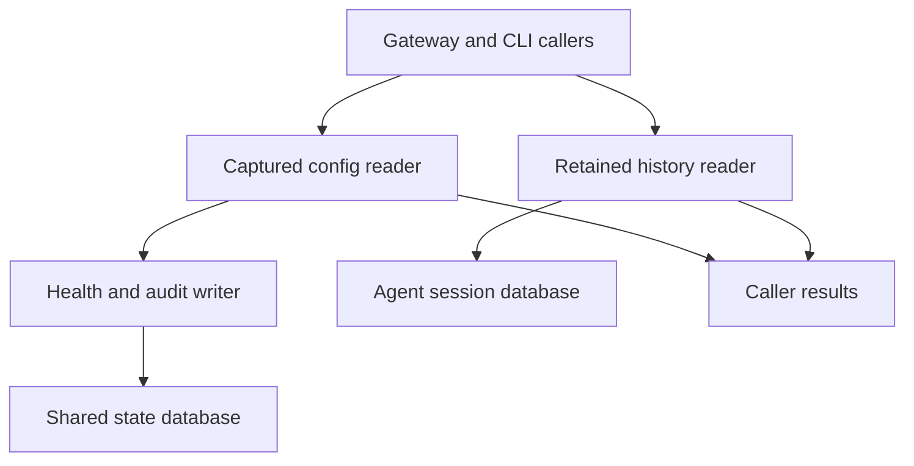

Codex review: blocked before merge.

## What this changes

This PR removes duplicate config and database lifecycle bookkeeping while reusing existing writers and history readers.

**Example:** Capture a read of /tmp/openclaw-a/openclaw.json, then change OPENCLAW_CONFIG_PATH to /tmp/openclaw-b/openclaw.json.
- **Before:** The captured read rejects because its environment selector changed.
- **After:** The captured read completes using openclaw-a; a subsequent reload selects openclaw-b.

## Review scores

| Measure | Result | What it means |
|---|---|---|
| **Overall readiness** | 🦪 silver shellfish **(2/6)** | Approved direction and substantial owner-level coverage, with a confirmed test migration defect and incomplete upgrade qualification. |
| **Proof confidence** | 🦐 gold shrimp **(3/6)** | Maintainer authorship exempts ordinary media proof; config loading and recovery changes still need fresh-install and stable-upgrade evidence preserving settings, backups, and pending user turns. |
| **Patch quality** | 🦪 silver shellfish **(2/6)** | 1 actionable review finding remain. |

## Product

**Kind:** Refactor · **Worth it:** Yes · **Fix scope:** Complete
**User problem:** Repeated admission and lifecycle machinery adds runtime work and maintenance complexity around otherwise unchanged config and session operations.
**Reason:** The feature-history owner approves the direction and documents the accepted tradeoffs; the diff consolidates existing responsibilities without adding settings or public APIs.

## Merge readiness

⛔ **Blocked before merge - 3 items remain**

Keep open: this maintainer-approved simplification remains useful, but an unmigrated ACP test expectation causes a confirmed CI failure.

**Priority:** P2
**Reviewed head:** `f3bf14b01d1a8512a583c058f2858cf2f92fd127`

## Before merge

- [ ] **Align the ACP selector test with captured-read semantics (P2)** - Removing selector fencing makes the ACP config case resolve with its captured configuration after OPENCLAW_CONFIG_PATH changes during the metadata join. The unchanged test still requires rejection at src/acp/runtime/session-meta-read.test.ts:260, and exact-head CI confirms this failure. Split that case into a positive captured-source assertion while preserving the caller- and store-revocation cases.
- [ ] **Complete next step** - Determine whether the Advisor guidance UI timeout is caused by this diff using matching base evidence, and repair it only if causation is established.
- [ ] **Add data-model compatibility proof** - The review found that existing stored data may not work after upgrade. Show that existing data still loads and works with this change.

## Findings

- [P2] Align the ACP selector test with captured-read semantics — `src/config/io.runtime.ts:137`

### Tests

- Missing end-to-end proof: No fresh-install and v2026.10.4 upgrade run demonstrates config recovery and pending-input continuity with existing settings and data intact.

<strong>Agent review details</strong>

### How this fits together

Gateway and CLI callers load captured configuration and session facts through shared-state writers and retained history workers, receiving configuration, health metadata, and transcript results.

### Technical review

Best possible solution:

Retain the approved simplification and align the remaining ACP selector test with captured-read semantics.

Do we have a high-confidence way to reproduce the issue?

Exact-head CI and the ACP fixture establish the selector-expectation mismatch; no local execution or current-main product failure is claimed.

Is this the best way to solve the issue?

The existing-owner approach matches repository policy and recorded maintainer direction; updating the stale ACP expectation avoids restoring intentionally removed fencing.

Full review comments:

- [P2] Align the ACP selector test with captured-read semantics — `src/config/io.runtime.ts:137`
  Removing selector fencing makes the ACP config case resolve with its captured configuration after OPENCLAW_CONFIG_PATH changes during the metadata join. The unchanged test still requires rejection at src/acp/runtime/session-meta-read.test.ts:260, and exact-head CI confirms this failure. Split that case into a positive captured-source assertion while preserving the caller- and store-revocation cases.
  Confidence: 0.99

Overall correctness: patch is incorrect
Overall confidence: 0.94

AGENTS.md: found and applied where relevant.

Codex review notes: model internal, reasoning medium; reviewed against [663b7766cf49](https://github.com/openclaw/openclaw/commit/663b7766cf4904da8bac733d938bd5e546966289).

### Provenance checked

- `Config observation and recovery` changes intended behavior with a stated reason (dbde270238dbbf5baa3672c8e46f0c958144383c: Offload health and audit persistence while preventing superseded observations from committing stale metadata.)
- `Captured config selector fencing` changes intended behavior with a stated reason (6718352a63df815940c7a7bc5666f6484c7b8d9a: Prepare configuration asynchronously while retaining source and publication checks; this PR explicitly adopts captured-source semantics for ambient selector changes.)
- `Warm schema admission` changes intended behavior with a stated reason (c828f7ed1d560295f78166a98fb54687dc162b28: Carry admitted schema facts across cached accesses while detecting schema changes; the new policy assigns validation to physical admission and explicit repair.)
- `Shared-worker relocation` changes intended behavior with a stated reason (b140acb1ea3b7c4f39ca48930fb17ac3338dcd2a: Prevent workers reopening retired paths and settle stale actors before replacement; this PR explicitly accepts close/reopen recovery for active relocation.)
- `Pending-input custody reconciliation` changes intended behavior with a stated reason (84af47269371dbc3cd8662b1f7203200a474c64d: Move reconciliation into the writer and protect live custody through host grants; the replacement relies on the existing physical FIFO and current owner selection.)
- `Transcript executor borrowing` changes intended behavior with a stated reason (d94fe35027e7f04c3220bfb7794097e01460b4e5: Retain physical transcript identity and generation through asynchronous reads; this PR keeps history ownership and matching lock ordering while removing unrelated executor lifetime coupling.)
- `Cold-storage inventory` keeps the original intent (c3f2837f569ed3a485ad5550a1fb1e9c13210b09: Read durable inventory through workers while preserving source ownership; consolidation retains those responsibilities.)
- `Private MCP mutation forwarding` keeps the original intent (3ca3b97a21d4f9216b199b90a473ad43f085dd35: Share the MCP mutation pipeline; removing the forwarding helper preserves the same pipeline and outer lifecycle facade.)

### Testing

Proof path: in-process harness.

### Security

None.

### Evidence

Acceptance criteria:

- pnpm test src/acp/runtime/session-meta-read.test.ts --maxWorkers=1
- pnpm test src/config/io.runtime-async.test.ts src/config/io.runtime-models.test.ts --maxWorkers=1
- git diff --check

What I checked:

- **Pinned introduction and current-main comparison:** The introduced diff removes selector fencing, observation supersession, duplicate schema admission, worker rebinding, and unrelated executor borrowing; fetched main retains those mechanisms. ([`src/config/io.runtime.ts:137`](https://github.com/openclaw/openclaw/blob/f3bf14b01d1a8512a583c058f2858cf2f92fd127/src/config/io.runtime.ts#L137), [f3bf14b01d1a](https://github.com/openclaw/openclaw/commit/f3bf14b01d1a8512a583c058f2858cf2f92fd127))
- **Confirmed diff-caused CI failure:** The exact-head compact job reports that the ACP retired-config case resolves instead of rejecting; its fixture changes OPENCLAW_CONFIG_PATH while a metadata join is held, directly exercising the intentionally removed selector fence. ([`src/acp/runtime/session-meta-read.test.ts:260`](https://github.com/openclaw/openclaw/blob/f3bf14b01d1a8512a583c058f2858cf2f92fd127/src/acp/runtime/session-meta-read.test.ts#L260), [f3bf14b01d1a](https://github.com/openclaw/openclaw/commit/f3bf14b01d1a8512a583c058f2858cf2f92fd127))
- **Recorded acceptance of snapshot tradeoffs:** The maintainer-authored body accepts captured-selector semantics and reduced bookkeeping; the predecessor explicitly also accepts returning a completed watermark after internal owner closure, so that historical concern is not repeated as a defect. Discussion: https://github.com/openclaw/openclaw/pull/174039. ([f3bf14b01d1a](https://github.com/openclaw/openclaw/commit/f3bf14b01d1a8512a583c058f2858cf2f92fd127))
- **Remaining effect boundaries:** Recovery checks original config and backup bytes before replacement; health updates preserve original maintenance exceptions; pending-history reconciliation retains the physical writer FIFO, conditional updates, and committed receipts. ([`src/config/io.observe-recovery-effects.ts:27`](https://github.com/openclaw/openclaw/blob/f3bf14b01d1a8512a583c058f2858cf2f92fd127/src/config/io.observe-recovery-effects.ts#L27), [f3bf14b01d1a](https://github.com/openclaw/openclaw/commit/f3bf14b01d1a8512a583c058f2858cf2f92fd127))
- **CI attribution limits:** The UI job times out waiting for Advisor guidance notices; available main comparisons skipped that lane, so inheritance or PR causation is unproven. Job-log retrieval was blocked by its storage redirect, but GitHub annotations were readable. The PR-context failure requests body evidence and is process-only; PostgreSQL conformance now passes. ([f3bf14b01d1a](https://github.com/openclaw/openclaw/commit/f3bf14b01d1a8512a583c058f2858cf2f92fd127))
- **Policy and ownership:** Root and applicable docs, Gateway, server-methods, and SDK instructions were read; no maintainer-notes directory exists. History identifies Peter Steinberger as the principal contributor across these mechanisms, including their earlier names. ([`AGENTS.md:1`](https://github.com/openclaw/openclaw/blob/663b7766cf4904da8bac733d938bd5e546966289/AGENTS.md#L1), [663b7766cf49](https://github.com/openclaw/openclaw/commit/663b7766cf4904da8bac733d938bd5e546966289))

### PR surface

Source -505, Tests -353, Docs -1. Total -859 across 39 files. Added test files: 0.

View PR surface stats

| Area | Files | Added | Removed | Net |
|---|---:|---:|---:|---:|
| Source | 20 | 471 | 976 | -505 |
| Tests | 17 | 386 | 739 | -353 |
| Docs | 2 | 32 | 33 | -1 |
| Config | 0 | 0 | 0 | 0 |
| Generated | 0 | 0 | 0 | 0 |
| Other | 0 | 0 | 0 | 0 |
| **Total** | **39** | **889** | **1748** | **-859** |

### Review metrics

| Metric | Value | Why it matters |
|---|---|---|
| **Production versus test LOC** | Production +475/-980; tests +382/-735 | Production shrinks by removing duplicate mechanisms; added tests cover source preservation, rollback, and recovered pending-input ownership. |

### Root-cause cluster

Relationship: `canonical`
Canonical: https://github.com/openclaw/openclaw/pull/175077
Summary: This PR is the explicitly designated successor to the withdrawn candidate.

Members:
- `superseded`: https://github.com/openclaw/openclaw/pull/174039 - Closed unmerged; its updated disposition assigns current implementation and qualification to this successor.

Proposal only: this assessment does not dispatch repair, suppress jobs, mutate sibling items, close, or merge anything.

### Labels

Label changes:

- add `P2`: Useful internal simplification with a focused CI repair; no urgent user-facing regression was established.
- add `rating: 🦪 silver shellfish`: Overall readiness is 🦪 silver shellfish; proof is 🦐 gold shrimp and patch quality is 🦪 silver shellfish.
- add `status: ⏳ waiting on author`: ClawSweeper has contributor-facing work open and is waiting for author action.

Label justifications:

- `P2`: Useful internal simplification with a focused CI repair; no urgent user-facing regression was established.
- `rating: 🦪 silver shellfish`: Overall readiness is 🦪 silver shellfish; proof is 🦐 gold shrimp and patch quality is 🦪 silver shellfish.
- `status: ⏳ waiting on author`: ClawSweeper has contributor-facing work open and is waiting for author action.

### Rating scale

6/6 🦀 challenger crab · 5/6 🦞 diamond lobster · 4/6 🐚 platinum hermit · 3/6 🦐 gold shrimp · 2/6 🦪 silver shellfish · 1/6 🧂 unranked krab. Overall follows the weaker of proof and patch quality; ✨ marks media proof (a screenshot, video, or linked artifact) that directly shows the changed behavior.

### Workflow

ClawSweeper edits this one comment on every review. Comment `@clawsweeper re-review` for a fresh review only. Repair and merge execution lanes are retired.

_Reviewed October 17, 2026, 12:24 AM ET / 04:24 UTC._

<!-- clawsweeper-verdict:needs-human item=175077 sha=f3bf14b01d1a8512a583c058f2858cf2f92fd127 confidence=high updated_at=2026-10-17T04:19:55Z reviewed_at=2026-10-17T04:24:24.663Z lease_owner=github-run-39002089266-1 lease_comment_id=6229555905 source_revision=e8120dadeeb486a9b16f5d44134564c8a7032f0bd8e810b36965510dcb2282b4 hold=blocked findings=1 -->
<!-- clawsweeper-review-state:blocked item=175077 sha=f3bf14b01d1a8512a583c058f2858cf2f92fd127 v=1 -->

<!-- clawsweeper-review-version item=175077 reviewed_at=2026-10-17T04:24:24.663Z sha=f3bf14b01d1a8512a583c058f2858cf2f92fd127 source_revision=e8120dadeeb486a9b16f5d44134564c8a7032f0bd8e810b36965510dcb2282b4 lease_owner=github-run-39002089266-1 lease_comment_id=6229555905 v=1 -->

<!-- clawsweeper-review item=175077 -->