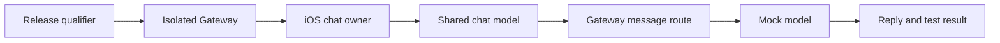

Codex review: blocked before merge. _Reviewed September 26, 2026, 7:12 PM ET / 23:12 UTC (Revision 7)._

# ClawSweeper review

## What this changes

The branch preserves iOS chat drafts and submitted messages, corrects mock reply-marker selection, and changes native release qualification pairing and failure diagnostics.

## Merge readiness

⛔ **Blocked before merge - 2 items remain**

Keep open. Current main does not contain the chat repairs, and the simulator evidence shows useful behavior changes. The release qualification outcome remains unresolved: earlier hosted attempts failed at different stages, and the exact-head run had not completed at review time.

**Priority:** P2
**Reviewed head:** `9dd12312083bca2af6714a2c04e2cf927a020ddb`

## Review scores

| Measure | Result | What it means |
|---|---|---|
| **Overall readiness** | 🦐 gold shrimp **(3/6)** | The owner-level repairs have meaningful local proof, but the branch's release-qualification result is still uncertain on the hosted runner. |
| **Proof confidence** | 🦐 gold shrimp **(3/6)** | Not applicable: The collaborator proof gate does not apply. Inspected simulator before/after images support the draft and submitted-message repairs, and the PR reports local native and HTTP-boundary runs; the exact-head hosted qualifier was still running. No stored-data contract changes. |
| **Patch quality** | 🐚 platinum hermit **(4/6)** | No actionable review findings were identified. |

## Verification

| Check | Result | Evidence |
|---|---|---|
| **Real behavior** | Not applicable | Not applicable: The collaborator proof gate does not apply. Inspected simulator before/after images support the draft and submitted-message repairs, and the PR reports local native and HTTP-boundary runs; the exact-head hosted qualifier was still running. No stored-data contract changes. |
| **Evidence reviewed** | 9 items | Introduced chat repairs: The pinned introduced diff transfers a draft only across the same owner, account inputs, and session, and invalidates older history snapshots before appending a submitted message. Current-main comparison: Current main detaches the old iOS chat model without transferring its input; its shared send path also appends the optimistic row without first invalidating earlier history. History reconciliation contract: A changed history generation retains messages added after a request's visible-message snapshot, supporting the placement of the new send-side invalidation. |
| **Findings** | None | None. |
| **Security** | None | None. |

## How this fits together

The iOS app turns a Gateway connection and session into a chat view, then sends messages through the shared chat model. Native release qualification pairs a simulator app with an isolated Gateway and checks its conversation against a mock model.

## Before merge

- [ ] **Resolve merge risk (P1)** - Earlier hosted native qualification attempts stopped at first-seed submission and setup-code issuance. The exact-head qualifier has not completed, so the release path may still stop before its chat assertions.
- [ ] **Complete next step (P2)** - Inspect the exact-head hosted qualification and its sanitized diagnostics; resolve a reproduced pairing or chat failure before merge.

<strong>Agent review details</strong>

### Security

None.

### PR surface

Tests +312, Other +392. Total +704 across 10 files.

View PR surface stats

| Area | Files | Added | Removed | Net |
|---|---:|---:|---:|---:|
| Source | 0 | 0 | 0 | 0 |
| Tests | 2 | 324 | 12 | +312 |
| Docs | 0 | 0 | 0 | 0 |
| Config | 0 | 0 | 0 | 0 |
| Generated | 0 | 0 | 0 | 0 |
| Other | 8 | 430 | 38 | +392 |
| **Total** | **10** | **754** | **50** | **+704** |

### Review metrics

| Metric | Value | Why it matters |
|---|---|---|
| **Production and test LOC** | production +293 net, tests +411 net | Most production growth adds native failure diagnostics, which the PR explains as needed to isolate hosted failures. |

### Merge-risk options

**Maintainer options:**
1. **Resolve the hosted qualifier (recommended)**  
   Inspect the current-head result and sanitized diagnostics, then repair any reproduced pairing or chat failure before relying on this branch for release qualification.

### Technical review

Best possible solution:

Keep the chat repairs with their existing owners and use the exact-head hosted result to establish a complete native qualification or identify and repair its remaining failing boundary without weakening assertions or timeouts.

Do we have a high-confidence way to reproduce the issue?

Yes for the two chat symptoms: current source and inspected before/after simulator captures establish a focused owner and history-race path. The cause of the hosted qualification failures remains unclear.

Is this the best way to solve the issue?

Unclear overall. The chat-owner repairs are narrow and supported by local proof, but the native release qualifier still needs an exact-head hosted outcome or a diagnosed remaining failure.

AGENTS.md: found and applied where relevant.

Codex review notes: model internal, reasoning high; reviewed against [fb720291b0a3](https://github.com/openclaw/openclaw/commit/fb720291b0a30ddf67336fe2c87dbebfac01db45).

### Labels

Label changes:

No label changes.

Label justifications:

- `P2`: The fixes affect a bounded iOS chat and release-qualification workflow without evidence of a wider outage.
- `merge-risk: 🚨 automation`: The PR changes native release qualification, and earlier hosted attempts failed at multiple stages while the exact-head run remains incomplete.
- `rating: 🦐 gold shrimp`: Overall readiness is 🦐 gold shrimp; proof is 🦐 gold shrimp and patch quality is 🐚 platinum hermit.
- `status: 👀 ready for maintainer look`: ClawSweeper has no concrete contributor-facing blocker left for this PR. Not applicable: The collaborator proof gate does not apply. Inspected simulator before/after images support the draft and submitted-message repairs, and the PR reports local native and HTTP-boundary runs; the exact-head hosted qualifier was still running. No stored-data contract changes.
- `proof: 📸 screenshot`: Contributor real behavior proof includes screenshot evidence. The collaborator proof gate does not apply. Inspected simulator before/after images support the draft and submitted-message repairs, and the PR reports local native and HTTP-boundary runs; the exact-head hosted qualifier was still running. No stored-data contract changes.

### Evidence

What I checked:

- **Introduced chat repairs:** The pinned introduced diff transfers a draft only across the same owner, account inputs, and session, and invalidates older history snapshots before appending a submitted message. ([`apps/ios/Sources/Chat/IOSChatViewModelOwner.swift:53`](https://github.com/openclaw/openclaw/blob/9dd12312083bca2af6714a2c04e2cf927a020ddb/apps/ios/Sources/Chat/IOSChatViewModelOwner.swift#L53), [9dd12312083b](https://github.com/openclaw/openclaw/commit/9dd12312083bca2af6714a2c04e2cf927a020ddb))
- **Current-main comparison:** Current main detaches the old iOS chat model without transferring its input; its shared send path also appends the optimistic row without first invalidating earlier history. ([`apps/ios/Sources/Chat/IOSChatViewModelOwner.swift:52`](https://github.com/openclaw/openclaw/blob/fb720291b0a30ddf67336fe2c87dbebfac01db45/apps/ios/Sources/Chat/IOSChatViewModelOwner.swift#L52), [fb720291b0a3](https://github.com/openclaw/openclaw/commit/fb720291b0a30ddf67336fe2c87dbebfac01db45))
- **History reconciliation contract:** A changed history generation retains messages added after a request's visible-message snapshot, supporting the placement of the new send-side invalidation. ([`apps/shared/OpenClawKit/Sources/OpenClawChatUI/ChatViewModel+HistoryReconciliation.swift:745`](https://github.com/openclaw/openclaw/blob/9dd12312083bca2af6714a2c04e2cf927a020ddb/apps/shared/OpenClawKit/Sources/OpenClawChatUI/ChatViewModel%2BHistoryReconciliation.swift#L745), [9dd12312083b](https://github.com/openclaw/openclaw/commit/9dd12312083bca2af6714a2c04e2cf927a020ddb))
- **Qualification boundary:** The branch requests a setup code from the existing Gateway RPC using the isolated fixture token, then passes it to the native XCTest. ([`scripts/lib/ios-release-e2e-native.ts:390`](https://github.com/openclaw/openclaw/blob/9dd12312083bca2af6714a2c04e2cf927a020ddb/scripts/lib/ios-release-e2e-native.ts#L390), [9dd12312083b](https://github.com/openclaw/openclaw/commit/9dd12312083bca2af6714a2c04e2cf927a020ddb))
- **Pairing authority:** The existing setup-code method requires operator-admin scope; the handler can return a code with QR rendering disabled. ([`src/gateway/methods/core-descriptors.ts:288`](https://github.com/openclaw/openclaw/blob/9dd12312083bca2af6714a2c04e2cf927a020ddb/src/gateway/methods/core-descriptors.ts#L288), [9dd12312083b](https://github.com/openclaw/openclaw/commit/9dd12312083bca2af6714a2c04e2cf927a020ddb))
- **Inspected simulator proof:** The four prepared PR images visibly show a submitted message and a typed draft missing before the respective repairs and present afterward in the rendered iOS chat view. They do not establish the hosted qualifier's cause.

Likely related people:

- **Peter Steinberger:** Raw commit 541406eeb737e00907438f79cbc0d0a74f0def99 adds apps/ios/Sources/Chat/IOSChatViewModelOwner.swift:20 relative to its recorded parents. This identifies author metadata, not feature responsibility or a PR merger. (role: source-line author; confidence: high; commits: [541406eeb737](https://github.com/openclaw/openclaw/commit/541406eeb737e00907438f79cbc0d0a74f0def99); files: `apps/ios/Sources/Chat/IOSChatViewModelOwner.swift`)
- **joshavant:** Suggested for follow-up; no historical authorship or introduction is verified. (role: unverified routing candidate; confidence: low)
- **Vincent Koc:** Suggested for follow-up; no historical authorship or introduction is verified. (role: unverified routing candidate; confidence: low)

### Rank-up moves

Optional improvements that raise the rating; they are not merge blockers.

- Inspect the exact-head hosted qualifier's sanitized result and establish a complete run or the cause of its first failing stage.

### Rating scale

| Score | Internal tier | Crab rank | Meaning |
|---:|:---:|---|---|
| **6/6** | S | 🦀 challenger crab | Exceptional readiness |
| **5/6** | A | 🦞 diamond lobster | Very strong readiness |
| **4/6** | B | 🐚 platinum hermit | Good normal PR; ordinary maintainer review |
| **3/6** | C | 🦐 gold shrimp | Useful, but confidence is limited |
| **2/6** | D | 🦪 silver shellfish | Proof or implementation needs work |
| **1/6** | F | 🧂 unranked krab | Not merge-ready |
| N/A | NA | 🌊 off-meta tidepool | Rating does not apply |

Overall follows the weaker of proof and patch quality.
Shiny media proof means a screenshot, video, or linked artifact directly shows the changed behavior. Runtime, network, CSP, and security claims still need visible diagnostics.

### Workflow

- ClawSweeper keeps one durable marker-backed review comment per issue or PR.
- Re-runs edit this comment so the latest verdict, findings, and automation markers stay together instead of adding duplicate bot comments.
- A fresh review can be triggered by eligible `@clawsweeper re-review` comments, exact-item GitHub events, scheduled/background review runs, or manual workflow dispatch.
- PR/issue authors and users with repository write access can comment `@clawsweeper re-review` or `@clawsweeper re-run` on an open PR or issue to request a fresh review only.
- Maintainers can also comment `@clawsweeper review` to request a fresh review only.
- Fresh-review commands do not start repair, autofix, rebase, CI repair, or automerge.
- Maintainer-only repair and merge flows require explicit commands such as `@clawsweeper autofix`, `@clawsweeper automerge`, `@clawsweeper fix ci`, or `@clawsweeper address review`.
- Maintainers can comment `@clawsweeper explain` to ask for more context, or `@clawsweeper stop` to stop active automation.

### History

Review history (6 earlier review cycles)

<!-- clawsweeper-review-history v=1 total=6 -->
- reviewed 2026-09-26T18:52:39.260Z sha a9b2a9228c48c3d1a0ae8a8f7cc6a8db9691bf2a :: needs maintainer review before merge. :: none
- reviewed 2026-09-26T19:59:19.332Z sha 58597222518e75a9d45511579a7202043890e744 :: needs maintainer review before merge. :: none
- reviewed 2026-09-26T20:27:17.593Z sha 76d73d120512ab8149f55a3acf68b845aec85781 :: needs maintainer review before merge. :: none
- reviewed 2026-09-26T21:30:31.763Z sha e7f1e1e4bf4e720e6109c3a1dc7b6b5150fa5f00 :: needs maintainer review before merge. :: none
- reviewed September 26, 2026, 6:00 PM ET / 22:00 UTC (Revision 5) sha unknown :: needs maintainer review before merge. :: none
- reviewed 2026-09-26T22:18:05.947Z sha 9a7111501867f331d9fff64425906e06dab8dab1 :: blocked before merge. :: none

<!-- clawsweeper-verdict:needs-human item=159065 sha=9dd12312083bca2af6714a2c04e2cf927a020ddb confidence=high updated_at=2026-09-26T23:07:24Z reviewed_at=2026-09-26T23:12:07.882Z lease_owner=github-run-36278366498-1 lease_comment_id=5850748440 source_revision=4fe4518f8c64b4e8c5acec968a8c1f56a31dfda2c35fd842fa043283119537cd live_verification=absent -->
<!-- clawsweeper-review-state:blocked item=159065 sha=9dd12312083bca2af6714a2c04e2cf927a020ddb v=1 -->

<!-- clawsweeper-review-version item=159065 reviewed_at=2026-09-26T23:12:07.882Z sha=9dd12312083bca2af6714a2c04e2cf927a020ddb source_revision=4fe4518f8c64b4e8c5acec968a8c1f56a31dfda2c35fd842fa043283119537cd lease_owner=github-run-36278366498-1 lease_comment_id=5850748440 v=1 -->

<!-- clawsweeper-review item=159065 -->