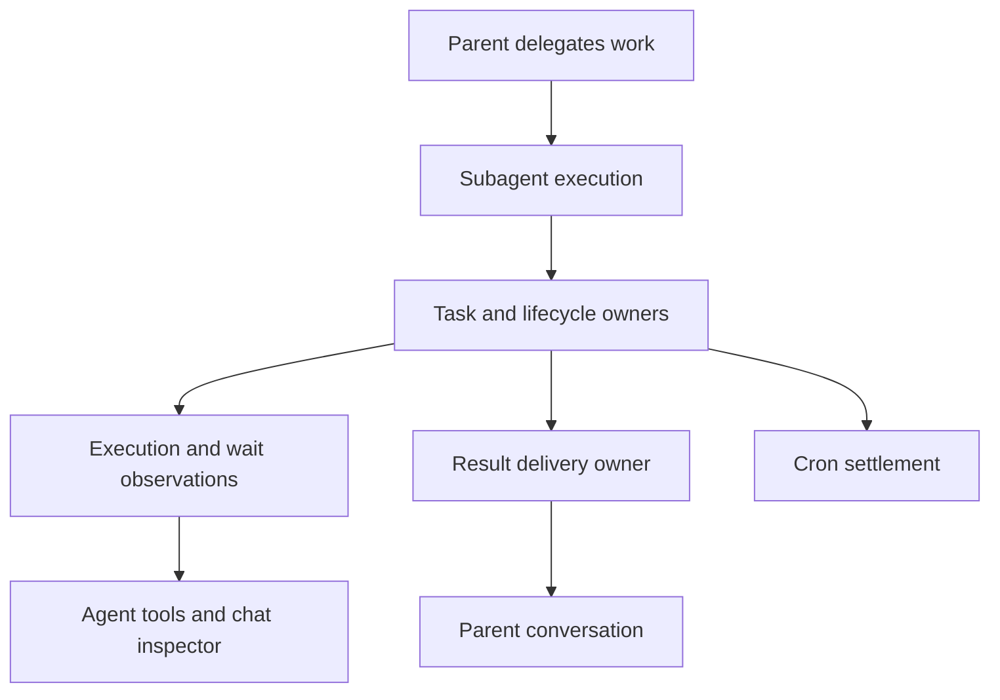

Codex review: blocked before merge. _Reviewed September 14, 2026, 1:46 AM ET / 05:46 UTC (Revision 11)._

# ClawSweeper review

## What this changes

The PR explains subagent waits and result delivery in tools and the chat inspector, adds coordination controls, and updates cron settlement and Lobster checkpoint recovery.

## Merge readiness

⛔ **Blocked before merge - 2 items remain**

This maintainer-owned PR retains useful behavior absent from current main. No blocking correctness defect was found; source inspection and the author's clarification resolve the earlier generic configuration and migration concern.

**Priority:** P2
**Reviewed head:** `3f2e4f99bf7bc96785442d29a082744cab2e5b4d`

## Review scores

| Measure | Result | What it means |
|---|---|---|
| **Overall readiness** | 🐚 platinum hermit **(4/6)** | Useful implementation with direct visual evidence, reported live lifecycle validation, and no supported blocking finding. |
| **Proof confidence** | 🦞 diamond lobster **(5/6)** ✨ media proof bonus | Sufficient (screenshot): Inspected before/after screenshots directly show the task inspector's corrected wait state and dependencies; the captured body reports real-provider Gateway scenarios covering yield, resume, failure, and cancellation. Unit and browser tests supplement those observations. |
| **Patch quality** | 🐚 platinum hermit **(4/6)** | No actionable review findings were identified. |

## Verification

| Check | Result | Evidence |
|---|---|---|
| **Real behavior** | Verified | Sufficient (screenshot): Inspected before/after screenshots directly show the task inspector's corrected wait state and dependencies; the captured body reports real-provider Gateway scenarios covering yield, resume, failure, and cancellation. Unit and browser tests supplement those observations. |
| **Evidence reviewed** | 11 items | Still necessary on main and latest release: Both fetched main and v2026.9.4 expose only list/cancel in the subagents tool; the proposed selected-task wait remains distinct work. The live PR read confirmed the supplied head remains open and unmerged. Release comparison: The supplied latest release also lacks selected-task waiting. Compatibility concern resolved: TaskSummary.execution is optional and version-tagged; activity and progress batches are process-local. The Workboard manifest changes asset paths, not configSchema. Omitted sessions_send.mode preserves automatic routing. The author explicitly discusses the intentional childless-yield correction and existing checkpoint representation at https://github.com/openclaw/openclaw/pull/147571#issuecomment-5657444604. |
| **Findings** | None | None. |
| **Security** | None | None. |

## How this fits together

Subagents perform delegated work while the task registry tracks execution and delivery to the parent conversation. These observations feed agent tools, the Control UI, progress notifications, and scheduled-job completion.

## Before merge

- [ ] **Review config compatibility** - Confirm compatibility and upgrade impact for the changed config or default surface before merge.
- [ ] **Add data-model compatibility proof** - Confirm migration or upgrade compatibility proof before merge.

<strong>Agent review details</strong>

### Security

None.

### PR surface

PR surface statistics unavailable: the file list is incomplete.

### Review metrics

| Metric | Value | Why it matters |
|---|---|---|
| **Compatibility surface** | 1 optional protocol field; 0 configuration keys or durable schema changes | The execution projection does not require a stored-data migration. |
| **Production versus test growth** | Production/tooling net +1,479 lines; tests/fixtures net +2,721 lines | Production growth implements shared observations, bounded progress delivery, coordination controls, and their UI presentation. |

### Stored data model

Persistent data-model change detected: `unknown-truncated-pull-files`. Confirm migration or upgrade compatibility proof before merge.

### Technical review

Best possible solution:

Keep execution observations derived from existing lifecycle owners, with result delivery tracked separately and existing configuration and durable records preserved.

Do we have a high-confidence way to reproduce the issue?

Not applicable as one discrete bug reproduction: this combines coordination features and lifecycle corrections; source inspection and the inspected screenshots substantiate the central observability problem.

Is this the best way to solve the issue?

Yes. The implementation extends existing task, delivery, and session owners, and the locale extraction follows the established registrar pattern without introducing a competing state store.

AGENTS.md: found and applied where relevant.

Codex review notes: model internal, reasoning medium; reviewed against [2545695c28b5](https://github.com/openclaw/openclaw/commit/2545695c28b5a036ab678c4fed377c47c8adfb0a).

### Labels

Label justifications:

- `P2`: This improves delegated-task observability and coordination without evidence of an urgent widespread outage.
- `rating: 🐚 platinum hermit`: Overall readiness is 🐚 platinum hermit; proof is 🦞 diamond lobster and patch quality is 🐚 platinum hermit.
- `status: 👀 ready for maintainer look`: ClawSweeper has no concrete contributor-facing blocker left for this PR. Sufficient (screenshot): Inspected before/after screenshots directly show the task inspector's corrected wait state and dependencies; the captured body reports real-provider Gateway scenarios covering yield, resume, failure, and cancellation. Unit and browser tests supplement those observations.
- `proof: sufficient`: Contributor real behavior proof is sufficient. Inspected before/after screenshots directly show the task inspector's corrected wait state and dependencies; the captured body reports real-provider Gateway scenarios covering yield, resume, failure, and cancellation. Unit and browser tests supplement those observations.
- `proof: 📸 screenshot`: Contributor real behavior proof includes screenshot evidence. Inspected before/after screenshots directly show the task inspector's corrected wait state and dependencies; the captured body reports real-provider Gateway scenarios covering yield, resume, failure, and cancellation. Unit and browser tests supplement those observations.
- `proof: telegram-e2e`: This PR needs Telegram Test Server proof with the repository E2E skill. Opt-in progress notifications after yield change visible Telegram messages and belong in Test Server coverage.

### Evidence

What I checked:

- **Still necessary on main and latest release:** Both fetched main and v2026.9.4 expose only list/cancel in the subagents tool; the proposed selected-task wait remains distinct work. The live PR read confirmed the supplied head remains open and unmerged. ([`src/agents/tools/subagents-tool.ts:34`](https://github.com/openclaw/openclaw/blob/2545695c28b5a036ab678c4fed377c47c8adfb0a/src/agents/tools/subagents-tool.ts#L34), [2545695c28b5](https://github.com/openclaw/openclaw/commit/2545695c28b5a036ab678c4fed377c47c8adfb0a))
- **Release comparison:** The supplied latest release also lacks selected-task waiting. ([`src/agents/tools/subagents-tool.ts:34`](https://github.com/openclaw/openclaw/blob/3a9d69db306cd7f081e06254cb89c4bcc14a7107/src/agents/tools/subagents-tool.ts#L34), [3a9d69db306c](https://github.com/openclaw/openclaw/commit/3a9d69db306cd7f081e06254cb89c4bcc14a7107))
- **Compatibility concern resolved:** TaskSummary.execution is optional and version-tagged; activity and progress batches are process-local. The Workboard manifest changes asset paths, not configSchema. Omitted sessions_send.mode preserves automatic routing. The author explicitly discusses the intentional childless-yield correction and existing checkpoint representation at https://github.com/openclaw/openclaw/pull/147571#issuecomment-5657444604. ([`packages/gateway-protocol/src/schema/tasks.ts:105`](https://github.com/openclaw/openclaw/blob/3f2e4f99bf7bc96785442d29a082744cab2e5b4d/packages/gateway-protocol/src/schema/tasks.ts#L105), [3f2e4f99bf7b](https://github.com/openclaw/openclaw/commit/3f2e4f99bf7bc96785442d29a082744cab2e5b4d))
- **Progress delivery authority:** Progress requires matching task/run generation, requester ownership, pending yield-batch membership, and notification policy. It rechecks those facts after runtime loading and supplies guards at adapter handoff and platform dispatch; cancellation, replacement, resume, mute, drain, and reset have focused rejection coverage. ([`src/tasks/task-registry-progress.ts:31`](https://github.com/openclaw/openclaw/blob/3f2e4f99bf7bc96785442d29a082744cab2e5b4d/src/tasks/task-registry-progress.ts#L31), [3f2e4f99bf7b](https://github.com/openclaw/openclaw/commit/3f2e4f99bf7bc96785442d29a082744cab2e5b4d))
- **Checkpoint and notification boundaries:** Lobster reads the session-bound flow, checks its checkpoint and revision, and requires successful resume admission before invoking the runner. The installed-engine regression rejects another session, mismatched credentials, and replay. Passive session notifications reject exact-incarnation grants before enqueueing. ([`extensions/lobster/src/lobster-taskflow.ts:194`](https://github.com/openclaw/openclaw/blob/3f2e4f99bf7bc96785442d29a082744cab2e5b4d/extensions/lobster/src/lobster-taskflow.ts#L194), [3f2e4f99bf7b](https://github.com/openclaw/openclaw/commit/3f2e4f99bf7bc96785442d29a082744cab2e5b4d))
- **Affirmative Codex dependency signal:** The native subagent monitor directly interprets Codex thread/status/changed and collabAgentToolCall notifications, so its status and mailbox-wait claims require the Codex protocol contract. ([`extensions/codex/src/app-server/native-subagent-monitor.ts:651`](https://github.com/openclaw/openclaw/blob/3f2e4f99bf7bc96785442d29a082744cab2e5b4d/extensions/codex/src/app-server/native-subagent-monitor.ts#L651), [3f2e4f99bf7b](https://github.com/openclaw/openclaw/commit/3f2e4f99bf7bc96785442d29a082744cab2e5b4d))

Likely related people:

- **steipete:** Suggested for follow-up; no historical authorship or introduction is verified. (role: unverified routing candidate; confidence: low)
- **vincentkoc:** Suggested for follow-up; no historical authorship or introduction is verified. (role: unverified routing candidate; confidence: low)

### Rating scale

| Score | Internal tier | Crab rank | Meaning |
|---:|:---:|---|---|
| **6/6** | S | 🦀 challenger crab | Exceptional readiness |
| **5/6** | A | 🦞 diamond lobster | Very strong readiness |
| **4/6** | B | 🐚 platinum hermit | Good normal PR; ordinary maintainer review |
| **3/6** | C | 🦐 gold shrimp | Useful, but confidence is limited |
| **2/6** | D | 🦪 silver shellfish | Proof or implementation needs work |
| **1/6** | F | 🧂 unranked krab | Not merge-ready |
| N/A | NA | 🌊 off-meta tidepool | Rating does not apply |

Overall follows the weaker of proof and patch quality.
Shiny media proof means a screenshot, video, or linked artifact directly shows the changed behavior. Runtime, network, CSP, and security claims still need visible diagnostics.

### Workflow

- ClawSweeper keeps one durable marker-backed review comment per issue or PR.
- Re-runs edit this comment so the latest verdict, findings, and automation markers stay together instead of adding duplicate bot comments.
- A fresh review can be triggered by eligible `@clawsweeper re-review` comments, exact-item GitHub events, scheduled/background review runs, or manual workflow dispatch.
- PR/issue authors and users with repository write access can comment `@clawsweeper re-review` or `@clawsweeper re-run` on an open PR or issue to request a fresh review only.
- Maintainers can also comment `@clawsweeper review` to request a fresh review only.
- Fresh-review commands do not start repair, autofix, rebase, CI repair, or automerge.
- Maintainer-only repair and merge flows require explicit commands such as `@clawsweeper autofix`, `@clawsweeper automerge`, `@clawsweeper fix ci`, or `@clawsweeper address review`.
- Maintainers can comment `@clawsweeper explain` to ask for more context, or `@clawsweeper stop` to stop active automation.

### History

Review history (10 earlier review cycles; latest 8 shown)

<!-- clawsweeper-review-history v=1 total=10 -->
- reviewed 2026-09-14T01:04:56.144Z sha 0439d3df94355b89051213e16b00dd8cfda9270d :: blocked before merge. :: none
- reviewed 2026-09-14T01:49:14.090Z sha 8fcbc72d56eb7c600fae5876454a158303cf36bd :: blocked before merge. :: none
- reviewed 2026-09-14T03:03:09.755Z sha c27898dacb1c35e4464e2c99859c8c859f194095 :: blocked before merge. :: none
- reviewed 2026-09-14T03:34:01.875Z sha d49d694425207304c89fa2b6989a9165eea18581 :: blocked before merge. :: none
- reviewed 2026-09-14T04:03:55.333Z sha 0826716b6a874f5a8ab818ee68ea93dd0698d321 :: blocked before merge. :: none
- reviewed 2026-09-14T04:24:47.522Z sha b755bf3d4a395750fb960fc29fce7f32398d58d3 :: blocked before merge. :: none
- reviewed 2026-09-14T05:06:26.013Z sha 0848c85940cb70e0189aac5d816f909bd57870fe :: blocked before merge. :: none
- reviewed 2026-09-14T05:24:15.616Z sha 23cbac42f15cf886b22f2a634a01ebaba48d3670 :: blocked before merge. :: none

<!-- clawsweeper-verdict:needs-human item=147571 sha=3f2e4f99bf7bc96785442d29a082744cab2e5b4d confidence=high updated_at=2026-09-14T05:42:26Z reviewed_at=2026-09-14T05:46:47.601Z lease_owner=github-run-34810459098-1 lease_comment_id=5659554255 source_revision=79527abd1dc87b768b250d55bef07e83bb421f432554595040e61e9c6594b726 live_verification=absent -->
<!-- clawsweeper-review-state:blocked item=147571 sha=3f2e4f99bf7bc96785442d29a082744cab2e5b4d v=1 -->

<!-- clawsweeper-review-version item=147571 reviewed_at=2026-09-14T05:46:47.601Z sha=3f2e4f99bf7bc96785442d29a082744cab2e5b4d source_revision=79527abd1dc87b768b250d55bef07e83bb421f432554595040e61e9c6594b726 lease_owner=github-run-34810459098-1 lease_comment_id=5659554255 v=1 -->

<!-- clawsweeper-review item=147571 -->