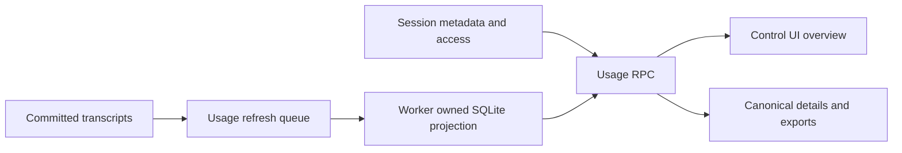

Codex review: needs changes before merge.

## What this changes

This PR adds server-side Usage filtering and 50-row pagination backed by incrementally maintained transcript projections.

**Example:** Open Usage with 1,250 matching sessions.
- **Before:** The overview analyzes the first 1,000 sessions and displays at most 50 rows without pagination.
- **After:** The overview analyzes all 1,250 sessions and pages through 50 rows while preserving totals and selected comparisons.

## Review scores

| Measure | Result | What it means |
|---|---|---|
| **Overall readiness** | 🐚 platinum hermit **(4/6)** | Useful implementation with strong visible behavior evidence and no identified production defect; helper-only tests retain obsolete policy. |
| **Proof confidence** | 🦞 diamond lobster **(5/6)** ✨ media proof bonus | Sufficient (screenshot): Inspected browser screenshots exercise the real Usage rendering path with a synthetic Gateway, showing all 1,250 sessions, pagination, and retained off-page comparisons; the body also records production-worker boundary measurements and new-writer/old-reader rollback behavior. |
| **Patch quality** | 🐚 platinum hermit **(4/6)** | No actionable review findings were identified. |

## Product

**Kind:** Performance · **Worth it:** Yes · **Fix scope:** Complete
**User problem:** Large Usage histories produce expensive detailed responses, and client-side analysis excludes sessions beyond the loaded cap.
**Reason:** The maintainer-directed change provides complete filtered analysis and substantially smaller overview responses, with its performance tradeoffs disclosed.

## Merge readiness

⛔ **Needs changes before merge - 1 item remains**

Keep open: this maintainer-directed improvement addresses capped Usage analysis still present on main. No new production defect was identified, but GitHub confirms a merge conflict on the reviewed head.

**Priority:** P2
**Reviewed head:** `753bfc9adc8781ffef2eedbc0b8cb51eb6392747`

## Before merge

- [ ] **Complete next step** - Resolve GitHub's reported merge conflict while preserving both the overview changes and main's Usage changes, then validate the paths affected by the resolution.

## Findings

None.

### Tests

- Low-value test `ui/src/pages/usage/view.test.ts`: Remove the bounded source-order inventory test and its copied test-support builder: it now tests a retired implementation rather than the production server inventory.
- Low-value test `ui/src/pages/usage/query.test.ts`: Use explicit server-option fixtures for suggestion tests and remove assertions against the retired buildUsageFilterOptions copy.

<strong>Agent review details</strong>

### How this fits together

The Usage RPC reads session metadata and transcript-derived SQLite caches, aggregates the matching population, and returns compact overview rows to Control UI while retaining canonical detailed reports and exports.

### Technical review

Best possible solution:

Land the conflict-resolved overview while preserving canonical exports, exact accounting, and current access checks.

Do we have a high-confidence way to reproduce the issue?

Current main's 1,000-row request and client-side filtering establish the capped-analysis path; the inspected synthetic browser evidence shows the corresponding before/after behavior.

Is this the best way to solve the issue?

A shared server overview owner coherently handles filtering, accounting, and paging while retaining canonical detail paths, with the storage and cold-build costs explicitly recorded.

AGENTS.md: found and applied where relevant.

Codex review notes: model internal, reasoning medium; reviewed against [d77d04aacc99](https://github.com/openclaw/openclaw/commit/d77d04aacc99f700d5a301ae99f7bdb829ef0e67).

### Provenance checked

- `Usage filtering and capped session presentation` changes intended behavior with a stated reason (8a352c8f9dfd03b5afadb6c86421949141921110: The original dashboard supplied session analytics and filters; subsequent display-count work explicitly documented the 50-row presentation cap.)
- `Worker-owned usage reporting` keeps the original intent (ad74de529f8b7313d946dda4ec478eeb62f100c2: Move expensive cache decoding, aggregation, and refresh work away from the Gateway thread while retaining existing accounting and ownership.)
- `Precise hourly accounting and calendar traversal` keeps the original intent (https://github.com/openclaw/openclaw/pull/146919: Preserve elapsed allocation and forward progress across daylight-saving transitions; the shared overview retains these contracts with named-zone coverage.)
- `Full-history cache representation` changes intended behavior with a stated reason (a64b30705fab54d39fa4b407fc46aa311b4ee731: Serve usage from a durable transcript aggregate cache; this PR explains replacing its per-event body with rebuildable date partitions and canonical replay.)

### Testing

Proof path: shipped entry point.

### Security

None.

### Evidence

What I checked:

- **Current main retains the capped request:** The shared UI request still requests 1,000 detailed rows without server-side overview parameters, and Model Providers consumes only provider aggregates. ([`ui/src/lib/sessions/usage.ts:55`](https://github.com/openclaw/openclaw/blob/d77d04aacc99f700d5a301ae99f7bdb829ef0e67/ui/src/lib/sessions/usage.ts#L55), [d77d04aacc99](https://github.com/openclaw/openclaw/commit/d77d04aacc99f700d5a301ae99f7bdb829ef0e67))
- **Selection repair is present:** The shared overview constructs selected comparison rows independently of pagination; inspected before/after images show both comparisons and Clear Selection retained on the final page. ([`src/shared/usage-overview.ts:339`](https://github.com/openclaw/openclaw/blob/753bfc9adc8781ffef2eedbc0b8cb51eb6392747/src/shared/usage-overview.ts#L339), [753bfc9adc87](https://github.com/openclaw/openclaw/commit/753bfc9adc8781ffef2eedbc0b8cb51eb6392747))
- **Final response access check:** The handler rejects publication when configuration or access revisions change during awaited work; the existing revocation regression now expects report rejection. ([`src/gateway/server-methods/usage.ts:566`](https://github.com/openclaw/openclaw/blob/753bfc9adc8781ffef2eedbc0b8cb51eb6392747/src/gateway/server-methods/usage.ts#L566), [753bfc9adc87](https://github.com/openclaw/openclaw/commit/753bfc9adc8781ffef2eedbc0b8cb51eb6392747))
- **Rebuildable storage transition:** Release v2026.10.2 uses cache version 6. The candidate accepts version 6, pins the historical migration decoder to that version, and replaces derived cache contents without changing authoritative transcripts or the database schema; rollback and re-upgrade fixtures cover partition replacement. ([`src/infra/session-cost-usage-cache-migration.ts:19`](https://github.com/openclaw/openclaw/blob/b8952d477f0c932d8ddc6da5c89cab5a169b6ff1/src/infra/session-cost-usage-cache-migration.ts#L19), [b8952d477f0c](https://github.com/openclaw/openclaw/commit/b8952d477f0c932d8ddc6da5c89cab5a169b6ff1))
- **Inspected browser evidence:** The supplied synthetic browser screenshots visibly change the cohort from 1,000 to 1,250 sessions and add Previous/Next controls: https://github.com/user-attachments/assets/9afaea24-e6ac-45ca-88d8-c18c5ed0ce97 and https://github.com/user-attachments/assets/5ccc42ac-9e95-4a0d-af54-62f5299e746f. ([753bfc9adc87](https://github.com/openclaw/openclaw/commit/753bfc9adc8781ffef2eedbc0b8cb51eb6392747))
- **Recorded performance tradeoffs:** The maintainer-authored body records slower cold backfill, sparse-cache growth, and potentially slower legacy reads alongside reduced steady-state response size and main-thread work; these are disclosed tradeoffs of the approved representation. ([753bfc9adc87](https://github.com/openclaw/openclaw/commit/753bfc9adc8781ffef2eedbc0b8cb51eb6392747))

### PR surface

PR surface statistics unavailable: the file list is incomplete.

### Review metrics

| Metric | Value | Why it matters |
|---|---|---|
| **RPC contract expansion** | 9 optional request fields | The existing sessions.usage endpoint gains overview, filtering, sorting, and paging parameters while omitted parameters preserve the legacy response path. |
| **Persisted cache transition** | Cache version 6 → 7; no database schema-version bump | The changed representation remains reconstructible from authoritative transcripts and reuses cache_entries. |

### Root-cause cluster

Relationship: `fixed_by_candidate`
Canonical: https://github.com/openclaw/openclaw/issues/127245
Summary: This PR addresses oversized usage responses and aggregation costs; a narrower open candidate trims only Model Providers detail rows.

Members:
- `canonical`: https://github.com/openclaw/openclaw/issues/127245 - Reports oversized all-agent usage responses and Gateway responsiveness problems.
- `partial_overlap`: https://github.com/openclaw/openclaw/pull/136337 - Uses a one-row request for Model Providers but does not implement all-matched Usage filtering, paging, or transcript projections.

Proposal only: this assessment does not dispatch repair, suppress jobs, mutate sibling items, close, or merge anything.

### Labels

Label changes:

No label changes.

Label justifications:

- `P2`: Improves large-history analytics completeness and responsiveness without establishing an urgent core-runtime regression.
- `rating: 🐚 platinum hermit`: Overall readiness is 🐚 platinum hermit; proof is 🦞 diamond lobster and patch quality is 🐚 platinum hermit.
- `status: ⏳ waiting on author`: ClawSweeper has contributor-facing work open and is waiting for author action.
- `proof: sufficient`: Contributor real behavior proof is sufficient.
- `proof: 📸 screenshot`: Contributor real behavior proof includes screenshot evidence.

### Rank-up moves

Optional improvements that raise the rating; they are not merge blockers.

- Remove the retired filter-inventory implementation from test support and retain suggestion coverage using explicit server-option fixtures.

### Rating scale

6/6 🦀 challenger crab · 5/6 🦞 diamond lobster · 4/6 🐚 platinum hermit · 3/6 🦐 gold shrimp · 2/6 🦪 silver shellfish · 1/6 🧂 unranked krab. Overall follows the weaker of proof and patch quality; ✨ marks media proof (a screenshot, video, or linked artifact) that directly shows the changed behavior.

### Workflow

ClawSweeper edits this one comment on every review. Comment `@clawsweeper re-review` for a fresh review only. Repair and merge execution lanes are retired.

### History

Review history (3 earlier review cycles)

<!-- clawsweeper-review-history v=1 total=3 -->
- reviewed 2026-10-12T06:17:56.232Z sha 6961144ca7570b50f05d4c99d7c8cb142898d2c0 :: needs changes before merge. :: [P2] Preserve selected comparison rows when changing pages
- reviewed 2026-10-12T06:43:45.788Z sha 9b245f72126a839cfd61f4b85fd85d99aaf30f16 :: blocked before merge. :: [P2] Preserve selected comparison rows across page changes | [P2] Keep the historical migration reader pinned to version 6 | [P2] Handle transcript replay failures at the report boundary | [P2] Update the existing revocation regression for report rejection
- reviewed 2026-10-12T08:32:45.100Z sha 562b531d30a4ece91746d1d0504f5bcfb78d65e5 :: needs changes before merge. :: none

_Reviewed October 12, 2026, 5:00 AM ET / 09:00 UTC (Revision 4)._

<!-- clawsweeper-verdict:needs-changes item=169660 sha=753bfc9adc8781ffef2eedbc0b8cb51eb6392747 confidence=high updated_at=2026-10-12T08:52:30Z reviewed_at=2026-10-12T09:00:51.754Z lease_owner=github-run-38226152901-1 lease_comment_id=6120938336 source_revision=2441ff35de48dbba519c0ac54b6fc5d0baf62e409e1158a42be8fae71d868592 -->
<!-- clawsweeper-review-state:needs-changes item=169660 sha=753bfc9adc8781ffef2eedbc0b8cb51eb6392747 v=1 -->

<!-- clawsweeper-review-version item=169660 reviewed_at=2026-10-12T09:00:51.754Z sha=753bfc9adc8781ffef2eedbc0b8cb51eb6392747 source_revision=2441ff35de48dbba519c0ac54b6fc5d0baf62e409e1158a42be8fae71d868592 lease_owner=github-run-38226152901-1 lease_comment_id=6120938336 v=1 -->

<!-- clawsweeper-review item=169660 -->