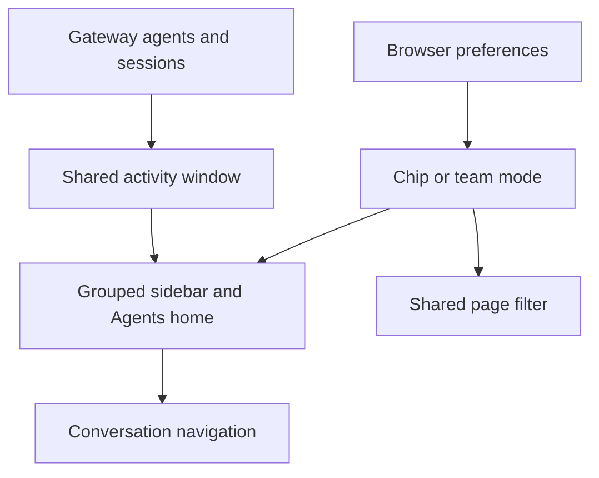

Codex review: blocked before merge. _Reviewed September 12, 2026, 3:42 AM ET / 07:42 UTC (Revision 18)._

# ClawSweeper review

## What this changes

Adds an optional team sidebar with grouped agent sessions, remembered page scope, shared activity loading, and consistent agent avatars across the Control UI.

## Merge readiness

⛔ **Blocked before merge - 2 items remain**

This PR still provides distinct value beyond the merged Agents home page. The prior concrete findings are addressed, and the reviewed preference handling supports clearing the earlier generic compatibility warning. No blocking defect was established.

**Priority:** P2
**Reviewed head:** `0d827127ca2f8e65a8157a31950d1d6624dddcd0`

## Review scores

| Measure | Result | What it means |
|---|---|---|
| **Overall readiness** | 🐚 platinum hermit **(4/6)** | Useful, well-supported UI work with inspected visual proof and resolved prior findings; no additional concrete repair was identified. |
| **Proof confidence** | 🦞 diamond lobster **(5/6)** ✨ media proof bonus | Sufficient (screenshot): Inspected synthetic Control UI captures demonstrate chip/team presentation and the new agent menu through the declared sidebar-roster entrypoint. Scoped UI policy accepts this visual boundary proof; preference and replacement behavior also have focused coverage, while a live team deployment remains unclaimed. |
| **Patch quality** | 🐚 platinum hermit **(4/6)** | No actionable review findings were identified. |

## Verification

| Check | Result | Evidence |
|---|---|---|
| **Real behavior** | Verified | Sufficient (screenshot): Inspected synthetic Control UI captures demonstrate chip/team presentation and the new agent menu through the declared sidebar-roster entrypoint. Scoped UI policy accepts this visual boundary proof; preference and replacement behavior also have focused coverage, while a live team deployment remains unclaimed. |
| **Evidence reviewed** | 9 items | Pinned introduction and latest revision: The local base-to-head file inventory confirms the introduced surface. The preceding-head diff encountered an unavailable Git blob; the exact GitHub commit endpoint independently showed that the latest commit changes only mock task fixtures and two E2E selectors. Existing preferences remain compatible: Missing or invalid team-mode values resolve to chip mode. The added preference fields use the existing browser settings owner; tests cover old settings, explicit modes, and null versus unset remembered scope. Scope restoration: Selection preserves the pre-team scope, including All agents, across chat navigation, preference reload, and gateway switching; disabling team mode restores it and clears the remembered value. The tests exercise the production selection capability and settings serialization. |
| **Findings** | None | None. |
| **Security** | None | None. |

## How this fits together

The Control UI turns Gateway agent identities and session activity into navigation and chat views. Team mode groups those existing sessions while keeping page filters separate from the agent owning the open conversation.

## Before merge

- [ ] **Review config compatibility** - Confirm compatibility and upgrade impact for the changed config or default surface before merge.
- [ ] **Add data-model compatibility proof** - Confirm migration or upgrade compatibility proof before merge.

<strong>Agent review details</strong>

### Security

None.

### PR surface

PR surface statistics unavailable: the file list is incomplete.

### Review metrics

| Metric | Value | Why it matters |
|---|---|---|
| **Browser preference surface** | 3 added fields; team mode defaults off | Mode, remembered scope, and collapsed agents stay within the existing gateway-scoped browser settings owner. |
| **Production versus test growth** | Production/tooling net +1797; tests/fixtures net +3316; docs net +58 | Production growth supports the stated grouped navigation and shared avatar behavior, with substantial lifecycle and interaction coverage. |

### Stored data model

Persistent data-model change detected: `unknown-data-model-change: ui/src/pages/config/memory-page.ts`, `unknown-truncated-pull-files`. Confirm migration or upgrade compatibility proof before merge.

### Technical review

Best possible solution:

Keep team mode opt-in, preserve existing browser preferences, and serve both roster views through the shared activity and session owners.

Do we have a high-confidence way to reproduce the issue?

Not applicable to a feature proposal. The inspected captures demonstrate the new visual states, and source review confirms the prior replacement-props repair.

Is this the best way to solve the issue?

Yes. Extending existing selection, session, and avatar owners with an opt-in presentation mode is a maintainable fit; the reviewed old-preference and restoration paths address the earlier compatibility concern.

AGENTS.md: found and applied where relevant.

Codex review notes: model internal, reasoning medium; reviewed against [347fce255982](https://github.com/openclaw/openclaw/commit/347fce25598215278fb84d5c549f58b8628c36d7).

### Labels

Label justifications:

- `P2`: This is a useful optional multi-agent navigation improvement with a bounded Control UI surface.
- `rating: 🐚 platinum hermit`: Overall readiness is 🐚 platinum hermit; proof is 🦞 diamond lobster and patch quality is 🐚 platinum hermit.
- `status: 👀 ready for maintainer look`: ClawSweeper has no concrete contributor-facing blocker left for this PR. Sufficient (screenshot): Inspected synthetic Control UI captures demonstrate chip/team presentation and the new agent menu through the declared sidebar-roster entrypoint. Scoped UI policy accepts this visual boundary proof; preference and replacement behavior also have focused coverage, while a live team deployment remains unclaimed.
- `proof: sufficient`: Contributor real behavior proof is sufficient. Inspected synthetic Control UI captures demonstrate chip/team presentation and the new agent menu through the declared sidebar-roster entrypoint. Scoped UI policy accepts this visual boundary proof; preference and replacement behavior also have focused coverage, while a live team deployment remains unclaimed.
- `proof: 📸 screenshot`: Contributor real behavior proof includes screenshot evidence. Inspected synthetic Control UI captures demonstrate chip/team presentation and the new agent menu through the declared sidebar-roster entrypoint. Scoped UI policy accepts this visual boundary proof; preference and replacement behavior also have focused coverage, while a live team deployment remains unclaimed.

### Evidence

What I checked:

- **Pinned introduction and latest revision:** The local base-to-head file inventory confirms the introduced surface. The preceding-head diff encountered an unavailable Git blob; the exact GitHub commit endpoint independently showed that the latest commit changes only mock task fixtures and two E2E selectors. ([0d827127ca2f](https://github.com/openclaw/openclaw/commit/0d827127ca2f8e65a8157a31950d1d6624dddcd0))
- **Existing preferences remain compatible:** Missing or invalid team-mode values resolve to chip mode. The added preference fields use the existing browser settings owner; tests cover old settings, explicit modes, and null versus unset remembered scope. ([`ui/src/app/settings.sidebar-prefs.node.test.ts:16`](https://github.com/openclaw/openclaw/blob/0d827127ca2f8e65a8157a31950d1d6624dddcd0/ui/src/app/settings.sidebar-prefs.node.test.ts#L16), [0d827127ca2f](https://github.com/openclaw/openclaw/commit/0d827127ca2f8e65a8157a31950d1d6624dddcd0))
- **Scope restoration:** Selection preserves the pre-team scope, including All agents, across chat navigation, preference reload, and gateway switching; disabling team mode restores it and clears the remembered value. The tests exercise the production selection capability and settings serialization. ([`ui/src/app/agent-selection.test.ts:109`](https://github.com/openclaw/openclaw/blob/0d827127ca2f8e65a8157a31950d1d6624dddcd0/ui/src/app/agent-selection.test.ts#L109), [0d827127ca2f](https://github.com/openclaw/openclaw/commit/0d827127ca2f8e65a8157a31950d1d6624dddcd0))
- **Prior plugin replacement finding resolved:** The host supplies session-list replacement props directly from the session owner before choosing its default renderer. The replacement regression covers chip-to-team-to-chip transitions and subsequent session updates without mounting the built-in list. ([`ui/src/components/app-sidebar.ts:557`](https://github.com/openclaw/openclaw/blob/0d827127ca2f8e65a8157a31950d1d6624dddcd0/ui/src/components/app-sidebar.ts#L557), [0d827127ca2f](https://github.com/openclaw/openclaw/commit/0d827127ca2f8e65a8157a31950d1d6624dddcd0))
- **Shared activity lifecycle:** Sidebar and Agents home consume one reference-counted Gateway activity store. It cancels retired requests, releases subscriptions after the last consumer leaves, and bounds refreshes to three 100-session pages. ([`ui/src/lib/agents/roster-activity-store.ts:42`](https://github.com/openclaw/openclaw/blob/0d827127ca2f8e65a8157a31950d1d6624dddcd0/ui/src/lib/agents/roster-activity-store.ts#L42), [0d827127ca2f](https://github.com/openclaw/openclaw/commit/0d827127ca2f8e65a8157a31950d1d6624dddcd0))
- **Inspected visual evidence:** Read the prepared media manifest and directly inspected proof-image-1.png through proof-image-4.png. They show chip mode, its agent menu, the team sidebar, and the global New conversation agent menu from the declared synthetic sidebar-roster setup. These substantiate appearance, not a live team deployment or network-security behavior.

Likely related people:

- **unknown:** The claimed source-line change could not be verified from bounded local history. (role: source history unknown; confidence: low)
- **steipete:** Suggested for follow-up; no historical authorship or introduction is verified. (role: unverified routing candidate; confidence: low)

### Rating scale

| Score | Internal tier | Crab rank | Meaning |
|---:|:---:|---|---|
| **6/6** | S | 🦀 challenger crab | Exceptional readiness |
| **5/6** | A | 🦞 diamond lobster | Very strong readiness |
| **4/6** | B | 🐚 platinum hermit | Good normal PR; ordinary maintainer review |
| **3/6** | C | 🦐 gold shrimp | Useful, but confidence is limited |
| **2/6** | D | 🦪 silver shellfish | Proof or implementation needs work |
| **1/6** | F | 🧂 unranked krab | Not merge-ready |
| N/A | NA | 🌊 off-meta tidepool | Rating does not apply |

Overall follows the weaker of proof and patch quality.
Shiny media proof means a screenshot, video, or linked artifact directly shows the changed behavior. Runtime, network, CSP, and security claims still need visible diagnostics.

### Workflow

- ClawSweeper keeps one durable marker-backed review comment per issue or PR.
- Re-runs edit this comment so the latest verdict, findings, and automation markers stay together instead of adding duplicate bot comments.
- A fresh review can be triggered by eligible `@clawsweeper re-review` comments, exact-item GitHub events, scheduled/background review runs, or manual workflow dispatch.
- PR/issue authors and users with repository write access can comment `@clawsweeper re-review` or `@clawsweeper re-run` on an open PR or issue to request a fresh review only.
- Maintainers can also comment `@clawsweeper review` to request a fresh review only.
- Fresh-review commands do not start repair, autofix, rebase, CI repair, or automerge.
- Maintainer-only repair and merge flows require explicit commands such as `@clawsweeper autofix`, `@clawsweeper automerge`, `@clawsweeper fix ci`, or `@clawsweeper address review`.
- Maintainers can comment `@clawsweeper explain` to ask for more context, or `@clawsweeper stop` to stop active automation.

### History

Review history (17 earlier review cycles; latest 8 shown)

<!-- clawsweeper-review-history v=1 total=17 -->
- reviewed 2026-09-12T03:11:48.530Z sha a2f0aac7574b7739134bc9309af7426b370480b5 :: blocked before merge. :: [P1] [P1] Populate replacement props independently of the default view | [P2] [P2] Update the identity lifecycle assertion to use textAvatar
- reviewed 2026-09-12T03:39:01.333Z sha b83f82a11a69fcac190d4d6260eb5799e3fbf387 :: blocked before merge. :: [P1] [P1] Populate replacement props independently of the default view
- reviewed 2026-09-12T04:02:16.989Z sha 220f1d8c38bd66a5f92a82fc65a3f1ee27fab0c0 :: blocked before merge. :: [P1] [P1] Populate replacement props independently of the default view
- reviewed 2026-09-12T04:16:48.066Z sha d371e31147ab457997c1583bdd9f88ed3a883f8f :: blocked before merge. :: [P1] Preserve replacement session props without mounting the default view | [P3] Replace the obsolete See all navigation instruction
- reviewed 2026-09-12T05:07:55.756Z sha b6cd4826c2fadc72f56af251ee22195742284715 :: blocked before merge. :: [P1] Preserve replacement session props without mounting the default view | [P3] Replace the obsolete See all navigation instruction
- reviewed 2026-09-12T06:20:47.416Z sha b6cd4826c2fadc72f56af251ee22195742284715 :: blocked before merge. :: [P1] Preserve replacement session props without mounting the default view | [P3] Replace the obsolete See all navigation instruction
- reviewed 2026-09-12T06:39:04.148Z sha 1a54315f88d5f40825ce0f74894d3650f71b4a71 :: blocked before merge. :: none
- reviewed 2026-09-12T07:00:02.724Z sha 17c2423989179d3e9fbfbd60e3a6c04fcc105682 :: blocked before merge. :: none

<!-- clawsweeper-verdict:needs-human item=141476 sha=0d827127ca2f8e65a8157a31950d1d6624dddcd0 confidence=high updated_at=2026-09-12T07:39:31Z reviewed_at=2026-09-12T07:42:36.270Z lease_owner=github-run-34681190750-1 lease_comment_id=5644514233 source_revision=023b026e702f609a34224cc67e2eff69cf31b33455f6a6b9b71232f326b65542 live_verification=absent -->
<!-- clawsweeper-review-state:blocked item=141476 sha=0d827127ca2f8e65a8157a31950d1d6624dddcd0 v=1 -->

<!-- clawsweeper-review-version item=141476 reviewed_at=2026-09-12T07:42:36.270Z sha=0d827127ca2f8e65a8157a31950d1d6624dddcd0 source_revision=023b026e702f609a34224cc67e2eff69cf31b33455f6a6b9b71232f326b65542 lease_owner=github-run-34681190750-1 lease_comment_id=5644514233 v=1 -->

<!-- clawsweeper-review item=141476 -->