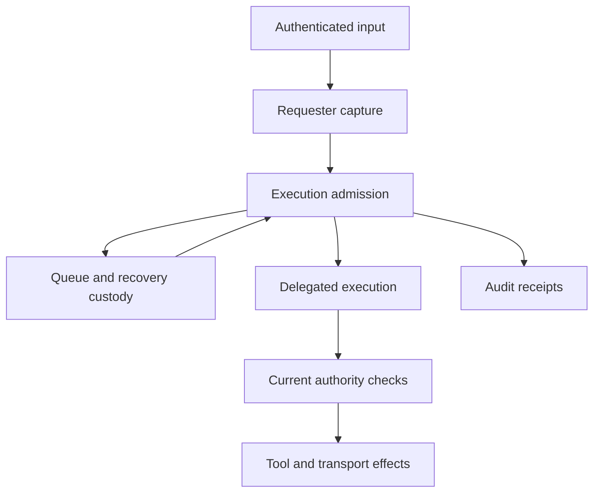

Codex review: needs changes before merge.

## What this changes

This PR preserves authenticated requester identity through delegation, queued execution, and recovery, with opt-in collaborative steering and explicit followup behavior.

**Example:** Alice selects accepted participant Bob for a queued child execution.
- **Before:** The child could pair Bob’s authority with Alice’s requester facts or lose requester identity during recovery.
- **After:** The child retains Bob’s identity, resolves applicable policy at admission, and rejects revoked or reassigned authority before effects.

## Review scores

| Measure | Result | What it means |
|---|---|---|
| **Overall readiness** | 🐚 platinum hermit **(4/6)** | Useful repair with substantive shipped-entry-point, final-effect, live-channel, and upgrade evidence; unresolved validation failures limit confidence in the integrated candidate. |
| **Proof confidence** | 🐚 platinum hermit **(4/6)** | Sufficient (live_output): The previous four Before-merge items are addressed: real selected-child HTTP/file effects and revoked/reassigned zero-effect outcomes replace the earlier mocked-execution gap; seven live two-human Telegram scenarios exercise authorization and followup behavior; and published v2026.10.4 upgraded state proceeds through selected-requester queueing and cold recovery. Current production matches the exercised parent. Queued revocation is supported compositionally by shared owners and custody tests. Inspector images were directly inspected. Portal retrieval was unavailable here, so execution results are assessed from the detailed source-bound public reports. Rollback restoration, pre-upgrade human-profile continuity, independently varied restart policy, and a performance guarantee are not claimed. |
| **Patch quality** | 🐚 platinum hermit **(4/6)** | No actionable review findings were identified. |

## Product

**Kind:** Bug fix · **Worth it:** Yes · **Fix scope:** Complete
**User problem:** Delegated or recovered work can lose the authenticated requester or combine one person’s authority with another person’s identity.
**Reason:** The maintainer-authored direction accepts the steering and participant-selection contracts, and the implementation addresses a concrete permission and execution-identity problem.

## Merge readiness

⛔ **Needs changes before merge - 1 item remains**

Keep open: this maintainer-owned repair remains useful, and the updated evidence addresses the previous authority and upgrade blockers; integration validation remains outstanding.

**Priority:** P1
**Reviewed head:** `d3ddc954302f83bf566f99a89f37d6faf7777ad7`

## Before merge

- [ ] **Complete next step** - Reconcile the recorded dirty merge state with current main and complete required integration validation, preserving the unresolved CI failures until evidence establishes their cause.

## Findings

None.

<strong>Agent review details</strong>

### How this fits together

Authenticated channel and Gateway inputs enter the admission owners, which carry requester facts into queued, delegated, and recovered executions; existing tool and transport owners enforce authority before effects.

### Technical review

Best possible solution:

Retain the existing admission and custody owners, preserve the accepted requester contract, and complete integration validation without weakening authority checks.

Do we have a high-confidence way to reproduce the issue?

Current-main policy resolution consumes persisted delegated projections without this PR’s preserved requester-origin admission path; source inspection and the supplied source-bound behavior reports establish the affected boundary, without executing target code during this review.

Is this the best way to solve the issue?

The inspected implementation uses the existing requester-policy, participant-selection, transcript-custody, and recovery owners, preserves intentional delegation, and supplies the missing final-effect and upgrade evidence.

AGENTS.md: found and applied where relevant.

Codex review notes: model internal, reasoning medium; reviewed against [806ea5812ccb](https://github.com/openclaw/openclaw/commit/806ea5812ccbe393b4dd0c3a6c1ce0010a5d755a).

### Provenance checked

- `Participant selection and native delegation` changes intended behavior with a stated reason (https://github.com/openclaw/openclaw/pull/160525: Require explicit participant selection after multi-person steering and refuse ambiguous native delegation.)
- `Requester completion policy` keeps the original intent (https://github.com/openclaw/openclaw/pull/160786: Restore a yielded requester’s captured policy through exact completion custody while preserving revocation and final-effect checks.)
- `Operator restart recovery` keeps the original intent (https://github.com/openclaw/openclaw/pull/166553: Re-admit the exact persisted authenticated source under current authority rather than infer privilege from session ownership.)

### Testing

Proof path: shipped entry point.

### Security

None.

### Evidence

What I checked:

- **Pinned introduction and unchanged production proof inputs:** Reviewed introduced hunks against b2e85fadecb2d19aa4a501e9729b508c3975eb22. The final commit changes only the membership and updater test fixtures; production inputs match the 42a6bffeeb596554129eb5918b3abfcb2ed83cdf candidate used for the latest live and recovery proof. ([`src/gateway/server.chat-membership-authority.product.test.ts:261`](https://github.com/openclaw/openclaw/blob/d3ddc954302f83bf566f99a89f37d6faf7777ad7/src/gateway/server.chat-membership-authority.product.test.ts#L261), [d3ddc954302f](https://github.com/openclaw/openclaw/commit/d3ddc954302f83bf566f99a89f37d6faf7777ad7))
- **Selected-child authority proof:** The updated PR body reports five source-bound Gateway scenarios with real child HTTP/file effects after source completion, zero sink writes after unlinking or reassignment during awaited preparation, and retained queued requester custody. Source inspection confirms selection carries authority and requester origin together. Queued revocation remains compositional proof rather than one continuous live trace. ([`src/agents/subagents/spawn/subagent-spawn-gateway.ts:57`](https://github.com/openclaw/openclaw/blob/d3ddc954302f83bf566f99a89f37d6faf7777ad7/src/agents/subagents/spawn/subagent-spawn-gateway.ts#L57), [d3ddc954302f](https://github.com/openclaw/openclaw/commit/d3ddc954302f83bf566f99a89f37d6faf7777ad7))
- **Live Telegram authorization:** Josh Avant’s detailed [live report](https://github.com/openclaw/openclaw/pull/157806#issuecomment-6254936495) correlates real human ingress, runtime refusals, followup notices, execution identities, writes, denied writes, and terminal ingress records across seven scenarios, including the moved direct-policy callback. ([`extensions/telegram/src/security.ts:53`](https://github.com/openclaw/openclaw/blob/42a6bffeeb596554129eb5918b3abfcb2ed83cdf/extensions/telegram/src/security.ts#L53), [42a6bffeeb59](https://github.com/openclaw/openclaw/commit/42a6bffeeb596554129eb5918b3abfcb2ed83cdf))
- **Upgrade and cold-recovery composition:** The updated body and [maintainer report](https://github.com/openclaw/openclaw/pull/157806#issuecomment-6255533594) describe a published v2026.10.4 upgrade followed by selected-Bob queued work and actual cold recovery using the installed candidate package and upgraded state. Include-owned true, old history/session identity, FIFO, exactly-once execution, and withdrawal survived. The released profile catalog was empty; policy was not independently varied across restart. ([`src/gateway/operator-run-recovery.ts`](https://github.com/openclaw/openclaw/blob/42a6bffeeb596554129eb5918b3abfcb2ed83cdf/src/gateway/operator-run-recovery.ts), [42a6bffeeb59](https://github.com/openclaw/openclaw/commit/42a6bffeeb596554129eb5918b3abfcb2ed83cdf))
- **Compatibility and accepted scope:** The maintainer-authored direction explicitly accepts incumbent authority for unqualified operations, opt-in cross-person steering, and selected-participant delegation. Legacy prepared channel policies retain their original-request snapshot contract through a documented deprecation adapter. Older receipt-reader limitations and unsuccessful rollback observations remain disclosed. Public docs: [`docs/plugins/sdk-migration/compatibility-policy.md`](https://docs.openclaw.ai/plugins/sdk-migration/compatibility-policy). ([`docs/plugins/sdk-migration/compatibility-policy.md:46`](https://docs.openclaw.ai/plugins/sdk-migration/compatibility-policy), [d3ddc954302f](https://github.com/openclaw/openclaw/commit/d3ddc954302f83bf566f99a89f37d6faf7777ad7))
- **Inspector media inspected:** Directly inspected the body’s GitHub-hosted before/after images. The after image adds Recorded authority subject while retaining unknown outcome and unverified provenance. The prepared manifest contained only expired, unrelated plugin-installation images returning HTTP 403; scratch-file downloads were blocked, so the current inspector images were inspected from fetched bytes. ([`ui/src/pages/activity/run-inspector-evidence-view.tsx:207`](https://github.com/openclaw/openclaw/blob/d3ddc954302f83bf566f99a89f37d6faf7777ad7/ui/src/pages/activity/run-inspector-evidence-view.tsx#L207), [d3ddc954302f](https://github.com/openclaw/openclaw/commit/d3ddc954302f83bf566f99a89f37d6faf7777ad7))

### PR surface

PR surface statistics unavailable: the file list is incomplete.

### Review metrics

| Metric | Value | Why it matters |
|---|---|---|
| **New configuration option** | 1 boolean; default false | messages.queue.allowCollaborativeSteering explicitly controls cross-person influence over an incumbent execution; Doctor preserves explicit stored values. |

### Labels

Label changes:

- add `proof: sufficient`: Contributor real behavior proof is sufficient.
- add `rating: 🐚 platinum hermit`: Overall readiness is 🐚 platinum hermit; proof is 🐚 platinum hermit and patch quality is 🐚 platinum hermit.
- add `status: ⏳ waiting on author`: ClawSweeper has contributor-facing work open and is waiting for author action.
- remove `rating: 🦐 gold shrimp`: Current PR rating is `rating: 🐚 platinum hermit`, so this older rating label is no longer current.
- remove `status: 📣 needs proof`: Current PR status label is `status: ⏳ waiting on author`.

Label justifications:

- `P1`: Incorrect requester identity affects established delegation, permission enforcement, and recovered agent workflows.
- `merge-risk: 🚨 compatibility`: The accepted change alters default steering behavior and adds a channel SDK callback while retaining a documented legacy-policy compatibility path.
- `merge-risk: 🚨 security-boundary`: The accepted design transfers selected human authority into detached children and permits cross-person steering only through explicit opt-in; final-effect revocation proof now covers the changed selection path.
- `rating: 🐚 platinum hermit`: Overall readiness is 🐚 platinum hermit; proof is 🐚 platinum hermit and patch quality is 🐚 platinum hermit.
- `status: ⏳ waiting on author`: ClawSweeper has contributor-facing work open and is waiting for author action.
- `proof: sufficient`: Contributor real behavior proof is sufficient.

### Rating scale

6/6 🦀 challenger crab · 5/6 🦞 diamond lobster · 4/6 🐚 platinum hermit · 3/6 🦐 gold shrimp · 2/6 🦪 silver shellfish · 1/6 🧂 unranked krab. Overall follows the weaker of proof and patch quality; ✨ marks media proof (a screenshot, video, or linked artifact) that directly shows the changed behavior.

### Workflow

ClawSweeper edits this one comment on every review. Comment `@clawsweeper re-review` for a fresh review only. Repair and merge execution lanes are retired.

### History

Review history (32 earlier review cycles; latest 8 shown)

<!-- clawsweeper-review-history v=1 total=32 -->
- reviewed 2026-10-14T21:16:40.874Z sha 9a4d358d3be5c0f0c17e5433b662f6906c24902d :: blocked before merge. :: none
- reviewed 2026-10-14T22:03:41.689Z sha 9a4d358d3be5c0f0c17e5433b662f6906c24902d :: needs changes before merge. :: none
- reviewed 2026-10-15T04:49:01.394Z sha dc956dc34b9fa9367fcaddac3575d365ef590aeb :: needs real behavior proof before merge. :: none
- reviewed 2026-10-15T06:34:13.362Z sha 9f4bf71378a5410c2ee166afe8792824d20c1430 :: needs real behavior proof before merge. :: none
- reviewed 2026-10-15T08:25:17.845Z sha f84d9c6c44c995e4c05b7c41634ec09637c8faf4 :: needs real behavior proof before merge. :: none
- reviewed 2026-10-15T22:50:39.419Z sha 80040829865fb1c321214bb70ecfc272b299d1f0 :: needs changes before merge. :: [P2] Emit the followup start notice when execution starts
- reviewed 2026-10-18T05:32:49.687Z sha cfb08ba7f3d57e1e71b4cb7d454ff4d1e1f077b3 :: needs real behavior proof before merge. :: none
- reviewed 2026-10-18T16:56:36.721Z sha 8a11bd2cec21a6fca61619e133696eba6fc5db79 :: needs real behavior proof before merge. :: none

_Reviewed October 18, 2026, 5:52 PM ET / 21:52 UTC (Revision 33)._

<!-- clawsweeper-verdict:needs-changes item=157806 sha=d3ddc954302f83bf566f99a89f37d6faf7777ad7 confidence=high updated_at=2026-10-18T21:46:35Z reviewed_at=2026-10-18T21:52:43.260Z lease_owner=github-run-39169285625-1 lease_comment_id=6255534788 source_revision=4e68d77cb1fd376ace4394384775e984b055f0d499bf6deb423bff04eb504edb -->
<!-- clawsweeper-review-state:needs-changes item=157806 sha=d3ddc954302f83bf566f99a89f37d6faf7777ad7 v=1 -->

<!-- clawsweeper-review-version item=157806 reviewed_at=2026-10-18T21:52:43.260Z sha=d3ddc954302f83bf566f99a89f37d6faf7777ad7 source_revision=4e68d77cb1fd376ace4394384775e984b055f0d499bf6deb423bff04eb504edb lease_owner=github-run-39169285625-1 lease_comment_id=6255534788 v=1 -->

<!-- clawsweeper-review item=157806 -->