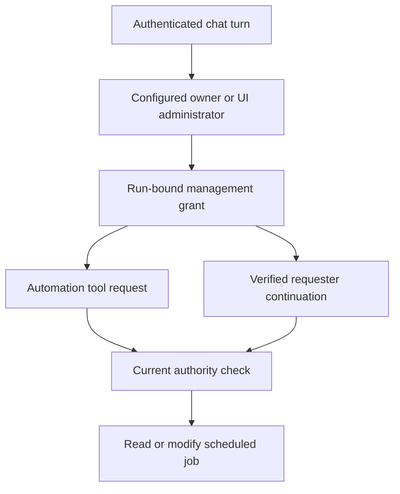

Codex review: needs maintainer review before merge. _Reviewed September 15, 2026, 1:57 AM ET / 05:57 UTC (Revision 3)._

# ClawSweeper review

## What this changes

Lets explicitly configured channel owners manage existing automations across sessions using revocable grants, while preserving SDK compatibility and management-only subagent continuations.

## Merge readiness

✅ **Ready for maintainer review**

The prior SDK compatibility blocker is resolved, and no introduced blocking defect was found. This maintainer-sponsored work remains useful because current main still restricts cross-session automation management to Control UI administrators.

**Priority:** P2
**Reviewed head:** `4f8ddcfeea348ea0e2c0dea988bb11cee66aab60`

## Review scores

| Measure | Result | What it means |
|---|---|---|
| **Overall readiness** | 🐚 platinum hermit **(4/6)** | A focused extension of the existing authority owner with meaningful boundary coverage and the previous compatibility blocker repaired. |
| **Proof confidence** | 🌊 off-meta tidepool | Not applicable: The maintainer/bot contributor-proof exemption applies. Inspected production-boundary coverage exercises persisted updates, ordinary-caller rejection, and revocation during validation; the PR reports passing results, without claiming a live Discord run. No material unresolved authority-chain case was established. |
| **Patch quality** | 🐚 platinum hermit **(4/6)** | No actionable review findings were identified. |

## Verification

| Check | Result | Evidence |
|---|---|---|
| **Real behavior** | Not applicable | Not applicable: The maintainer/bot contributor-proof exemption applies. Inspected production-boundary coverage exercises persisted updates, ordinary-caller rejection, and revocation during validation; the PR reports passing results, without claiming a live Discord run. No material unresolved authority-chain case was established. |
| **Evidence reviewed** | 8 items | Current main still lacks channel-owner management: The fetched main revision creates external creator capabilities without a management entitlement, and its conversational-management documentation explicitly limits management grants to Control UI administrator turns. The supplied latest release is v2026.9.4; its documentation object was unavailable locally, so no release implementation claim is made. Previous compatibility finding addressed: The current scope retains readonly controlUiAdmin and projects true only for Control UI administrator entitlements. The added public legacy/V2 consumer checks cover that value and reject creator grants for either management-only source, satisfying the concrete prior finding and rank-up request. Admission and revocation remain owner-bound: Fresh channel turns use the admitted command sender, channel, and account; the entitlement rechecks the current global owner list. New direct channel input revokes pending requester authority. Grant consumption and management assertions reject removed owners, expired grants, and inactive run authority. |
| **Findings** | None | None. |
| **Security** | None | None. |

## How this fits together

OpenClaw’s automation tool sends job-management requests to the Gateway scheduler. Authenticated turn admission supplies authority, which the Gateway checks before returning job data or committing changes.

## Before merge

None.

<strong>Agent review details</strong>

### Security

None.

### PR surface

Source +59, Tests +512, Docs 0. Total +571 across 31 files.

View PR surface stats

| Area | Files | Added | Removed | Net |
|---|---:|---:|---:|---:|
| Source | 10 | 122 | 63 | +59 |
| Tests | 20 | 624 | 112 | +512 |
| Docs | 1 | 3 | 3 | 0 |
| Config | 0 | 0 | 0 | 0 |
| Generated | 0 | 0 | 0 | 0 |
| Other | 0 | 0 | 0 | 0 |
| **Total** | **31** | **749** | **178** | **+571** |

### Review metrics

| Metric | Value | Why it matters |
|---|---|---|
| **Production versus validation growth** | Production +59 net lines; tests and fixtures +512 net lines | Production growth extends the existing grant owner, while most added code covers authority boundaries and compatibility. |

### Technical review

Best possible solution:

Keep one Gateway management-grant owner, preserve existing harness consumers, and retain current-owner checks through continuation admission and final job commits.

Do we have a high-confidence way to reproduce the issue?

Not applicable as a defect reproduction: current main deliberately limits this authority to Control UI administrators, and the PR adds a supported channel-owner path.

Is this the best way to solve the issue?

Yes. Reusing method-bound, one-use grants avoids a competing authorization system, and the repaired SDK projection preserves the documented compatibility window.

AGENTS.md: found and applied where relevant.

Codex review notes: model internal, reasoning medium; reviewed against [c657a10e11da](https://github.com/openclaw/openclaw/commit/c657a10e11da3a7eb6de9ba2d9ac93501227905c).

### Labels

Label justifications:

- `P2`: This is a bounded conversational-management improvement with existing Control UI and CLI alternatives.
- `rating: 🐚 platinum hermit`: Overall readiness is 🐚 platinum hermit; proof is 🌊 off-meta tidepool and patch quality is 🐚 platinum hermit.
- `status: 👀 ready for maintainer look`: ClawSweeper has no concrete contributor-facing blocker left for this PR. Not applicable: The maintainer/bot contributor-proof exemption applies. Inspected production-boundary coverage exercises persisted updates, ordinary-caller rejection, and revocation during validation; the PR reports passing results, without claiming a live Discord run. No material unresolved authority-chain case was established.

### Evidence

What I checked:

- **Current main still lacks channel-owner management:** The fetched main revision creates external creator capabilities without a management entitlement, and its conversational-management documentation explicitly limits management grants to Control UI administrator turns. The supplied latest release is v2026.9.4; its documentation object was unavailable locally, so no release implementation claim is made. Public docs: [`docs/automation/cron-jobs/managing-jobs.md`](https://docs.openclaw.ai/automation/cron-jobs/managing-jobs). ([`docs/automation/cron-jobs/managing-jobs.md:77`](https://docs.openclaw.ai/automation/cron-jobs/managing-jobs), [c657a10e11da](https://github.com/openclaw/openclaw/commit/c657a10e11da3a7eb6de9ba2d9ac93501227905c))
- **Previous compatibility finding addressed:** The current scope retains readonly controlUiAdmin and projects true only for Control UI administrator entitlements. The added public legacy/V2 consumer checks cover that value and reject creator grants for either management-only source, satisfying the concrete prior finding and rank-up request. ([`src/gateway/cron-creator-authority-grant.ts:38`](https://github.com/openclaw/openclaw/blob/4f8ddcfeea348ea0e2c0dea988bb11cee66aab60/src/gateway/cron-creator-authority-grant.ts#L38), [4f8ddcfeea34](https://github.com/openclaw/openclaw/commit/4f8ddcfeea348ea0e2c0dea988bb11cee66aab60))
- **Admission and revocation remain owner-bound:** Fresh channel turns use the admitted command sender, channel, and account; the entitlement rechecks the current global owner list. New direct channel input revokes pending requester authority. Grant consumption and management assertions reject removed owners, expired grants, and inactive run authority. ([`src/auto-reply/reply/get-reply-run-execute.ts:584`](https://github.com/openclaw/openclaw/blob/4f8ddcfeea348ea0e2c0dea988bb11cee66aab60/src/auto-reply/reply/get-reply-run-execute.ts#L584), [4f8ddcfeea34](https://github.com/openclaw/openclaw/commit/4f8ddcfeea348ea0e2c0dea988bb11cee66aab60))
- **Final-effect coverage:** The inspected integration coverage uses real requester lifecycle, Gateway handlers, CronService, and stored-job readback. It checks permitted updates, denied ordinary continuations, preserved creator/runtime authority, and owner removal while update validation awaits. The PR reports this coverage passing; this read-only review did not execute tests. ([`src/gateway/server-methods/requester-cron-authority.integration.test.ts:333`](https://github.com/openclaw/openclaw/blob/4f8ddcfeea348ea0e2c0dea988bb11cee66aab60/src/gateway/server-methods/requester-cron-authority.integration.test.ts#L333), [4f8ddcfeea34](https://github.com/openclaw/openclaw/commit/4f8ddcfeea348ea0e2c0dea988bb11cee66aab60))
- **Codex dependency signal and boundary:** The changed Codex runtime predicate controls whether an attempt can capture configured-MCP creator authority. It now excludes both management-only entitlement sources; the bundled construction regression covers the new channel-owner case. This establishes the dependency-related inspection signal, while the entitlement itself remains an OpenClaw host capability. ([`extensions/codex/src/app-server/run-attempt-runtime.ts:194`](https://github.com/openclaw/openclaw/blob/4f8ddcfeea348ea0e2c0dea988bb11cee66aab60/extensions/codex/src/app-server/run-attempt-runtime.ts#L194), [4f8ddcfeea34](https://github.com/openclaw/openclaw/commit/4f8ddcfeea348ea0e2c0dea988bb11cee66aab60))
- **Dependency source inspected:** The sibling checkout’s cache origin identifies openai/codex. Its dynamic-tool response adapter receives client results and forwards them to the conversation; OpenClaw’s management entitlement is not part of this response contract. The MCP status processor was also inspected for the runtime catalog boundary. ([`codex-rs/app-server/src/dynamic_tools.rs:18`](https://github.com/openai/codex/blob/6b9826e3aa83b1a5947db50f4332cb9c65f1b340/codex-rs/app-server/src/dynamic_tools.rs#L18), [6b9826e3aa83](https://github.com/openai/codex/commit/6b9826e3aa83b1a5947db50f4332cb9c65f1b340))

Likely related people:

- **steipete:** Suggested for follow-up; no historical authorship or introduction is verified. (role: unverified routing candidate; confidence: low)
- **openclaw/openclaw-secops:** Suggested for follow-up; no historical authorship or introduction is verified. (role: unverified routing candidate; confidence: low)

### Rating scale

| Score | Internal tier | Crab rank | Meaning |
|---:|:---:|---|---|
| **6/6** | S | 🦀 challenger crab | Exceptional readiness |
| **5/6** | A | 🦞 diamond lobster | Very strong readiness |
| **4/6** | B | 🐚 platinum hermit | Good normal PR; ordinary maintainer review |
| **3/6** | C | 🦐 gold shrimp | Useful, but confidence is limited |
| **2/6** | D | 🦪 silver shellfish | Proof or implementation needs work |
| **1/6** | F | 🧂 unranked krab | Not merge-ready |
| N/A | NA | 🌊 off-meta tidepool | Rating does not apply |

Overall follows the weaker of proof and patch quality.
Shiny media proof means a screenshot, video, or linked artifact directly shows the changed behavior. Runtime, network, CSP, and security claims still need visible diagnostics.

### Workflow

- ClawSweeper keeps one durable marker-backed review comment per issue or PR.
- Re-runs edit this comment so the latest verdict, findings, and automation markers stay together instead of adding duplicate bot comments.
- A fresh review can be triggered by eligible `@clawsweeper re-review` comments, exact-item GitHub events, scheduled/background review runs, or manual workflow dispatch.
- PR/issue authors and users with repository write access can comment `@clawsweeper re-review` or `@clawsweeper re-run` on an open PR or issue to request a fresh review only.
- Maintainers can also comment `@clawsweeper review` to request a fresh review only.
- Fresh-review commands do not start repair, autofix, rebase, CI repair, or automerge.
- Maintainer-only repair and merge flows require explicit commands such as `@clawsweeper autofix`, `@clawsweeper automerge`, `@clawsweeper fix ci`, or `@clawsweeper address review`.
- Maintainers can comment `@clawsweeper explain` to ask for more context, or `@clawsweeper stop` to stop active automation.

### History

Review history (2 earlier review cycles)

<!-- clawsweeper-review-history v=1 total=2 -->
- reviewed 2026-09-15T05:25:06.993Z sha d8c236a4629af693b677381bf838cd23b501fdf2 :: blocked before merge. :: [P1] Preserve compatibility for the exported harness capability
- reviewed 2026-09-15T05:36:16.099Z sha 5e76236c609f6a4eed1116cf1fa0e9005de87fae :: blocked before merge. :: [P1] Preserve compatibility for the exported harness capability

<!-- clawsweeper-verdict:needs-human item=148790 sha=4f8ddcfeea348ea0e2c0dea988bb11cee66aab60 confidence=high updated_at=2026-09-15T05:54:25Z reviewed_at=2026-09-15T05:57:46.528Z lease_owner=github-run-34934543330-1 lease_comment_id=5675448636 source_revision=1b102f041e041729dd010f385c91b4bd0c89181a918b7d910d0e1cdec701e98d live_verification=absent -->
<!-- clawsweeper-review-state:ready item=148790 sha=4f8ddcfeea348ea0e2c0dea988bb11cee66aab60 v=1 -->

<!-- clawsweeper-review-version item=148790 reviewed_at=2026-09-15T05:57:46.528Z sha=4f8ddcfeea348ea0e2c0dea988bb11cee66aab60 source_revision=1b102f041e041729dd010f385c91b4bd0c89181a918b7d910d0e1cdec701e98d lease_owner=github-run-34934543330-1 lease_comment_id=5675448636 v=1 -->

<!-- clawsweeper-review item=148790 -->