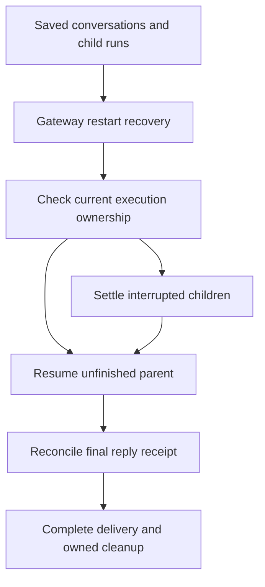

Codex review: needs maintainer review before merge. _Reviewed September 19, 2026, 8:00 PM ET / September 20, 2026, 00:00 UTC (Revision 2)._

# ClawSweeper review

## What this changes

Resumes unfinished parent conversations after Gateway restarts, settles interrupted children through normal completion, and reconciles recovered replies without automatically relaunching children.

## Merge readiness

✅ **Ready for maintainer review**

The PR remains necessary: fetched main and v2026.9.5 retain the parent-recovery defect. No concrete introduced correctness or security blocker was found.

**Priority:** P2
**Reviewed head:** `ba64ac34ac94e1f7046c3ce7736807d73b888c75`

## Review scores

| Measure | Result | What it means |
|---|---|---|
| **Overall readiness** | 🐚 platinum hermit **(4/6)** | A coherent ownership simplification with relevant regression coverage and no actionable blocker found. |
| **Proof confidence** | 🌊 off-meta tidepool | Not applicable: The supplied repository state identifies a maintainer-authored PR, so the ordinary external-contributor gate does not apply. Inspected restart coverage exercises real Gateway lifecycle and SQLite settlement with controlled agent execution; reported test totals were not independently rerun. |
| **Patch quality** | 🐚 platinum hermit **(4/6)** | No actionable review findings were identified. |

## Verification

| Check | Result | Evidence |
|---|---|---|
| **Real behavior** | Not applicable | Not applicable: The supplied repository state identifies a maintainer-authored PR, so the ordinary external-contributor gate does not apply. Inspected restart coverage exercises real Gateway lifecycle and SQLite settlement with controlled agent execution; reported test totals were not independently rerun. |
| **Evidence reviewed** | 9 items | Current main still contains the defect: Fetched main still classifies announcement-origin turns as disposable completion reports, allowing unfinished parent work to be reconciled without continuation. Latest supplied release retains the same shortcut: The v2026.9.5 source also contains completionSource-based reconciliation; the central repair is not already supplied by that release. Recovery ownership and final effects: Child recovery captures session identity, checks live executions and admission, and passes current-owner predicates into terminal completion. Completion rechecks after acquiring its lock; cleanup persists suppression when ownership changes while saved-result delivery remains independent. |
| **Findings** | None | None. |
| **Security** | None | None. |

## How this fits together

Gateway restart recovery reads persisted conversations and delegated-task records to determine what work remains. It coordinates parent continuation, child settlement, final replies, and session cleanup.

## Before merge

None.

<strong>Agent review details</strong>

### Security

None.

### PR surface

Source -1335, Tests -2474, Docs -21, Other -10. Total -3840 across 59 files.

View PR surface stats

| Area | Files | Added | Removed | Net |
|---|---:|---:|---:|---:|
| Source | 30 | 402 | 1737 | -1335 |
| Tests | 25 | 665 | 3139 | -2474 |
| Docs | 2 | 35 | 56 | -21 |
| Config | 0 | 0 | 0 | 0 |
| Generated | 0 | 0 | 0 | 0 |
| Other | 2 | 1 | 11 | -10 |
| **Total** | **59** | **1103** | **4943** | **-3840** |

### Review metrics

| Metric | Value | Why it matters |
|---|---|---|
| **Runtime versus verification footprint** | Runtime production −1,335 lines; tests/support/tooling −2,474 lines | The cutover removes a separate child-relaunch owner and its obsolete tests while retaining parent, settlement, and cancellation coverage. |

### Technical review

Best possible solution:

Keep task continuation with the parent, using existing admission, durable completion receipts, and current-owner cleanup safeguards.

Do we have a high-confidence way to reproduce the issue?

Yes, from source: interrupt a parent turn started by a child result before its work finishes; current main can discard it based on announcement provenance. No runtime reproduction was executed during this read-only review.

Is this the best way to solve the issue?

Yes. The patch removes the incorrect provenance shortcut and consolidates child interruption into existing settlement, while preserving admission and final-delivery checks.

AGENTS.md: found and applied where relevant.

Codex review notes: model internal, reasoning medium; reviewed against [2adc87245a5a](https://github.com/openclaw/openclaw/commit/2adc87245a5ac9041dafabf0b26fc59d7c1b2655).

### Labels

Label justifications:

- `P2`: Repairs task continuation after a Gateway restart with a bounded impact on interrupted parent and child workflows.
- `rating: 🐚 platinum hermit`: Overall readiness is 🐚 platinum hermit; proof is 🌊 off-meta tidepool and patch quality is 🐚 platinum hermit.
- `status: 👀 ready for maintainer look`: ClawSweeper has no concrete contributor-facing blocker left for this PR. Not applicable: The supplied repository state identifies a maintainer-authored PR, so the ordinary external-contributor gate does not apply. Inspected restart coverage exercises real Gateway lifecycle and SQLite settlement with controlled agent execution; reported test totals were not independently rerun.

### Evidence

What I checked:

- **Current main still contains the defect:** Fetched main still classifies announcement-origin turns as disposable completion reports, allowing unfinished parent work to be reconciled without continuation. ([`src/agents/main-session-recovery/main-session-restart-recovery-store.ts:548`](https://github.com/openclaw/openclaw/blob/2adc87245a5ac9041dafabf0b26fc59d7c1b2655/src/agents/main-session-recovery/main-session-restart-recovery-store.ts#L548), [2adc87245a5a](https://github.com/openclaw/openclaw/commit/2adc87245a5ac9041dafabf0b26fc59d7c1b2655))
- **Latest supplied release retains the same shortcut:** The v2026.9.5 source also contains completionSource-based reconciliation; the central repair is not already supplied by that release. ([`src/agents/main-session-recovery/main-session-restart-recovery-store.ts:556`](https://github.com/openclaw/openclaw/blob/ec9c1a13db8938e5a3eaa51fca2e981cde2395a9/src/agents/main-session-recovery/main-session-restart-recovery-store.ts#L556), [ec9c1a13db89](https://github.com/openclaw/openclaw/commit/ec9c1a13db8938e5a3eaa51fca2e981cde2395a9))
- **Recovery ownership and final effects:** Child recovery captures session identity, checks live executions and admission, and passes current-owner predicates into terminal completion. Completion rechecks after acquiring its lock; cleanup persists suppression when ownership changes while saved-result delivery remains independent. ([`src/agents/subagents/registry/subagent-registry-restart-recovery.ts:71`](https://github.com/openclaw/openclaw/blob/ba64ac34ac94e1f7046c3ce7736807d73b888c75/src/agents/subagents/registry/subagent-registry-restart-recovery.ts#L71), [ba64ac34ac94](https://github.com/openclaw/openclaw/commit/ba64ac34ac94e1f7046c3ce7736807d73b888c75))
- **Saved requester result reconciliation:** Requester-settle delivery recognizes the original run's recovery claim or terminal receipt before dispatching another requester turn. Recovered results still pass ordinary final-delivery checks. ([`src/agents/subagents/announce/subagent-announce-direct-delivery.ts:252`](https://github.com/openclaw/openclaw/blob/ba64ac34ac94e1f7046c3ce7736807d73b888c75/src/agents/subagents/announce/subagent-announce-direct-delivery.ts#L252), [ba64ac34ac94](https://github.com/openclaw/openclaw/commit/ba64ac34ac94e1f7046c3ce7736807d73b888c75))
- **Restart regression coverage and proof limits:** The Gateway harness stops and restarts the server, retains the transcript, verifies one recovery successor, and distinguishes a visible final from progress-only output. Agent execution and final receipt production are controlled. The captured PR body reports passing restart suites; this review inspected their source and did not execute tests. ([`src/gateway/server.subagent-settle-replay.harness.test.ts:283`](https://github.com/openclaw/openclaw/blob/ba64ac34ac94e1f7046c3ce7736807d73b888c75/src/gateway/server.subagent-settle-replay.harness.test.ts#L283), [ba64ac34ac94](https://github.com/openclaw/openclaw/commit/ba64ac34ac94e1f7046c3ce7736807d73b888c75))
- **Existing-state and ownership coverage:** Coverage includes a fresh execution or admission arriving during the terminal-lock wait, saved-result delivery with replaced or missing child sessions, and cold restoration of a retired accepted receipt. Separate classification cases retain attempted, consumed, accepted, and abandoned legacy receipts without redispatch. ([`src/agents/subagents/registry/subagent-orphan-recovery.restart-integration.test.ts:238`](https://github.com/openclaw/openclaw/blob/ba64ac34ac94e1f7046c3ce7736807d73b888c75/src/agents/subagents/registry/subagent-orphan-recovery.restart-integration.test.ts#L238), [ba64ac34ac94](https://github.com/openclaw/openclaw/commit/ba64ac34ac94e1f7046c3ce7736807d73b888c75))

Likely related people:

- **steipete:** Suggested for follow-up; no historical authorship or introduction is verified. (role: unverified routing candidate; confidence: low)

### Rating scale

| Score | Internal tier | Crab rank | Meaning |
|---:|:---:|---|---|
| **6/6** | S | 🦀 challenger crab | Exceptional readiness |
| **5/6** | A | 🦞 diamond lobster | Very strong readiness |
| **4/6** | B | 🐚 platinum hermit | Good normal PR; ordinary maintainer review |
| **3/6** | C | 🦐 gold shrimp | Useful, but confidence is limited |
| **2/6** | D | 🦪 silver shellfish | Proof or implementation needs work |
| **1/6** | F | 🧂 unranked krab | Not merge-ready |
| N/A | NA | 🌊 off-meta tidepool | Rating does not apply |

Overall follows the weaker of proof and patch quality.
Shiny media proof means a screenshot, video, or linked artifact directly shows the changed behavior. Runtime, network, CSP, and security claims still need visible diagnostics.

### Workflow

- ClawSweeper keeps one durable marker-backed review comment per issue or PR.
- Re-runs edit this comment so the latest verdict, findings, and automation markers stay together instead of adding duplicate bot comments.
- A fresh review can be triggered by eligible `@clawsweeper re-review` comments, exact-item GitHub events, scheduled/background review runs, or manual workflow dispatch.
- PR/issue authors and users with repository write access can comment `@clawsweeper re-review` or `@clawsweeper re-run` on an open PR or issue to request a fresh review only.
- Maintainers can also comment `@clawsweeper review` to request a fresh review only.
- Fresh-review commands do not start repair, autofix, rebase, CI repair, or automerge.
- Maintainer-only repair and merge flows require explicit commands such as `@clawsweeper autofix`, `@clawsweeper automerge`, `@clawsweeper fix ci`, or `@clawsweeper address review`.
- Maintainers can comment `@clawsweeper explain` to ask for more context, or `@clawsweeper stop` to stop active automation.

### History

Review history (1 earlier review cycle)

<!-- clawsweeper-review-history v=1 total=1 -->
- reviewed 2026-09-19T23:30:14.214Z sha ba64ac34ac94e1f7046c3ce7736807d73b888c75 :: needs maintainer review before merge. :: none

<!-- clawsweeper-verdict:needs-human item=153243 sha=ba64ac34ac94e1f7046c3ce7736807d73b888c75 confidence=high updated_at=2026-09-19T23:56:17Z reviewed_at=2026-09-20T00:00:05.415Z lease_owner=github-run-35477377155-1 lease_comment_id=5746243446 source_revision=814a6b0eb2aff4fcbab78fc8483e2189351c884e671c04c28dc3ef7de42b2be1 live_verification=absent -->
<!-- clawsweeper-review-state:ready item=153243 sha=ba64ac34ac94e1f7046c3ce7736807d73b888c75 v=1 -->

<!-- clawsweeper-review-version item=153243 reviewed_at=2026-09-20T00:00:05.415Z sha=ba64ac34ac94e1f7046c3ce7736807d73b888c75 source_revision=814a6b0eb2aff4fcbab78fc8483e2189351c884e671c04c28dc3ef7de42b2be1 lease_owner=github-run-35477377155-1 lease_comment_id=5746243446 v=1 -->

<!-- clawsweeper-review item=153243 -->