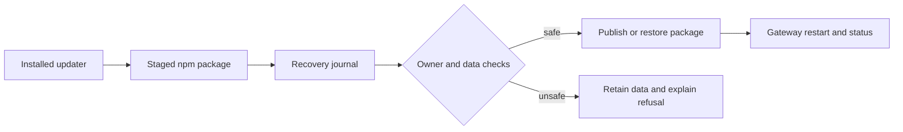

Codex review: needs real behavior proof before merge. _Reviewed September 28, 2026, 2:39 AM ET / 06:39 UTC (Revision 7)._

# ClawSweeper review

## What this changes

The branch adds a durable journal and standalone helper for recovering supported POSIX npm package updates, with updater handoff, status output, tests, and documentation.

## Merge readiness

⛔ **Blocked before merge - 9 items remain**

Keep open. Current main does not provide the branch’s standalone interrupted-package recovery, and the related full-state PRs address broader work.

**Priority:** P0
**Reviewed head:** `83c03dc3edd0e5b4d9b9340eb2d315508dc6258d`
**Owner decision:** Required. See [Decision needed](#decision-needed).

## Review scores

| Measure | Result | What it means |
|---|---|---|
| **Overall readiness** | 🦐 gold shrimp **(3/6)** | The branch has meaningful installed evidence and extensive fault coverage, while current-head authority and released-journal compatibility remain unresolved. |
| **Proof confidence** | 🦐 gold shrimp **(3/6)** | Needs stronger real behavior proof before merge: Authority-chain proof required: The linked older-revision installed run shows a published updater, rollback, and repair after updater loss, but it does not exercise this head’s initial publication cut or a revoked owner through the final package and service effects. The new stored layout has synthetic legacy-journal coverage; an existing released-journal upgrade run is still needed for data-model compatibility. A redacted terminal trace or logs of these paths would help; redact private addresses, keys, phone numbers, and endpoints. Updating the PR body should trigger re-review, or a maintainer can request `@clawsweeper re-review`. After adding proof, update the PR body; ClawSweeper should re-review automatically. If it does not, the PR author or someone with repository write access can comment `@clawsweeper re-review`. |
| **Patch quality** | 🦐 gold shrimp **(3/6)** | Security review found an item that needs attention. |

## Verification

| Check | Result | Evidence |
|---|---|---|
| **Real behavior** | Needs proof | Needs stronger real behavior proof before merge: Authority-chain proof required: The linked older-revision installed run shows a published updater, rollback, and repair after updater loss, but it does not exercise this head’s initial publication cut or a revoked owner through the final package and service effects. The new stored layout has synthetic legacy-journal coverage; an existing released-journal upgrade run is still needed for data-model compatibility. A redacted terminal trace or logs of these paths would help; redact private addresses, keys, phone numbers, and endpoints. Updating the PR body should trigger re-review, or a maintainer can request `@clawsweeper re-review`. After adding proof, update the PR body; ClawSweeper should re-review automatically. If it does not, the PR author or someone with repository write access can comment `@clawsweeper re-review`. |
| **Evidence reviewed** | 8 items | Current-main boundary: At the fetched main revision, the activation module reads or rejects an existing in-directory journal but has no standalone package repair entrypoint. Introduced recovery path: The pinned base-to-head diff adds recovery admission, a fresh executor fence, and package publication or retirement through the recorded journal. Prior finding addressed in source: The current reader inspects released in-directory journals without granting write authority and reports their original helper command; the added test checks that repair and retirement through the new owner are refused. |
| **Findings** | None | None. |
| **Security** | Needs attention | Verify retained authority at the final effect: The introduced helper can resume package effects after updater loss. Current-head evidence does not establish that a replaced or revoked original owner is denied before those effects. |

## How this fits together

The CLI updater stages an npm package, then replaces the installed package and launchers before checking the Gateway. The new recovery journal records that publication so a separate helper can inspect or finish it if the updater stops.

## Decision needed

| Question | Recommendation |
|---|---|
| Should the new external control-directory journal and read-only treatment of released in-directory journals become the supported upgrade and retention contract? | **Accept after upgrade proof:** Retain the single-journal design once an installed released-journal upgrade demonstrates safe status, recovery, retirement, and next-update admission. |

Why: The branch materially changes durable recovery layout and the behavior of installations carrying older journals; repository storage policy calls for an accepted contract, which the supplied discussion does not establish.

## Before merge

- [ ] **Add real behavior proof** - Needs stronger real behavior proof before merge: Authority-chain proof required: The linked older-revision installed run shows a published updater, rollback, and repair after updater loss, but it does not exercise this head’s initial publication cut or a revoked owner through the final package and service effects. The new stored layout has synthetic legacy-journal coverage; an existing released-journal upgrade run is still needed for data-model compatibility. A redacted terminal trace or logs of these paths would help; redact private addresses, keys, phone numbers, and endpoints. Updating the PR body should trigger re-review, or a maintainer can request `@clawsweeper re-review`. After adding proof, update the PR body; ClawSweeper should re-review automatically. If it does not, the PR author or someone with repository write access can comment `@clawsweeper re-review`.
- [ ] **Resolve security concern: Verify retained authority at the final effect** - The introduced helper can resume package effects after updater loss. Current-head evidence does not establish that a replaced or revoked original owner is denied before those effects.
- [ ] **Resolve merge risk (P1)** - The relocated journal and retained receipt change the stored recovery contract. Synthetic legacy-journal tests cover inspection, but no captured released-journal upgrade and retirement run establishes how an existing interrupted installation proceeds.
- [ ] **Resolve merge risk (P1)** - The helper and delegated worker can retain recovery authority after the original updater exits. Available current-head evidence does not show a replaced or revoked owner rejected before final package, configuration, or service I/O.
- [ ] **Resolve merge risk (P1)** - The linked installed owner-loss run cuts after publication on an older revision; it does not observe a current-head interruption during the initial control-directory or package rename.
- [ ] **Complete next step (P2)** - Provide current-head installed upgrade and revoked-owner final-effect evidence, then obtain a maintainer decision on the durable journal contract.
- [ ] **Resolve maintainer decision** - Resolve the maintainer decision shown above before merge.
- [ ] **Review config compatibility** - Confirm compatibility and upgrade impact for the changed config or default surface before merge.
- [ ] **Add data-model compatibility proof** - Confirm migration or upgrade compatibility proof before merge.

## Findings

- [medium] Verify retained authority at the final effect — `src/infra/package-update-activation.ts:193`

<strong>Agent review details</strong>

### Security

Needs attention: No new dependency or workflow-permission change was found; retained recovery authority still needs final-effect verification.

### PR surface

PR surface statistics unavailable: the file list is incomplete.

### Review metrics

| Metric | Value | Why it matters |
|---|---|---|
| **Production and test growth** | production +4,168 net; tests/support +4,754 net | The PR body attributes the production growth to durable publication and custody, with substantial fault coverage alongside it. |
| **Stored recovery contract** | 1 journal layout relocated; 1 completion receipt retained | Existing interrupted installations and later updates depend on the new retention and legacy-inspection rules. |

### Stored data model

Persistent data-model change detected: `unknown-truncated-pull-files`. Confirm migration or upgrade compatibility proof before merge.

### Merge-risk options

**Maintainer options:**
1. **Prove the installed recovery boundary (recommended)**  
   Exercise a published updater against this head with an existing released journal, an initial publication interruption, and a revoked original owner; record the final package, data, and service effects before merge.

### Technical review

Best possible solution:

Keep one journal and original-owner recovery path, with a guided Doctor or Fix launcher for users stranded after an interrupted update and an explicit refusal when existing data cannot safely roll back.

Do we have a high-confidence way to reproduce the issue?

Yes. Interrupting a supported POSIX npm update during package publication exposes the recovery boundary in current source; the linked installed run demonstrates updater loss on an older branch revision, but this review did not execute current main.

Is this the best way to solve the issue?

Unclear. A single journal and sealed helper fit the existing updater owner, but the stored-contract upgrade and retained-authority effects need current-head proof before this can be judged the safest complete fix.

AGENTS.md: found and applied where relevant.

Codex review notes: model internal, reasoning high; reviewed against [8ab43884177d](https://github.com/openclaw/openclaw/commit/8ab43884177ddbdcbe4b21907e4bbb0ec134c751).

### Labels

Label changes:

- add `rating: 🦐 gold shrimp`: Overall readiness is 🦐 gold shrimp; proof is 🦐 gold shrimp and patch quality is 🦐 gold shrimp.
- remove `rating: 🦪 silver shellfish`: Current PR rating is `rating: 🦐 gold shrimp`, so this older rating label is no longer current.

Label justifications:

- `P0`: An interrupted update can leave the installed package partly replaced and the Gateway unavailable.
- `merge-risk: 🚨 compatibility`: The journal moves to a new layout while released in-directory journals remain inspection-only and can block a later update.
- `merge-risk: 🚨 session-state`: Rollback decisions must preserve newer database and transcript writes when the previous runtime is compatible.
- `merge-risk: 🚨 security-boundary`: A retained helper and delegated executor carry authority across updater loss into final filesystem and service effects.
- `rating: 🦐 gold shrimp`: Overall readiness is 🦐 gold shrimp; proof is 🦐 gold shrimp and patch quality is 🦐 gold shrimp.
- `status: 📣 needs proof`: The PR needs real behavior proof before ClawSweeper can clear the contributor ask. Needs stronger real behavior proof before merge: Authority-chain proof required: The linked older-revision installed run shows a published updater, rollback, and repair after updater loss, but it does not exercise this head’s initial publication cut or a revoked owner through the final package and service effects. The new stored layout has synthetic legacy-journal coverage; an existing released-journal upgrade run is still needed for data-model compatibility. A redacted terminal trace or logs of these paths would help; redact private addresses, keys, phone numbers, and endpoints. Updating the PR body should trigger re-review, or a maintainer can request `@clawsweeper re-review`. After adding proof, update the PR body; ClawSweeper should re-review automatically. If it does not, the PR author or someone with repository write access can comment `@clawsweeper re-review`.

### Evidence

Security concerns:

- [medium] Verify retained authority at the final effect — `src/infra/package-update-activation.ts:193`
  The introduced helper can resume package effects after updater loss. Current-head evidence does not establish that a replaced or revoked original owner is denied before those effects.
  Confidence: 0.78

What I checked:

- **Current-main boundary:** At the fetched main revision, the activation module reads or rejects an existing in-directory journal but has no standalone package repair entrypoint. ([`src/infra/package-update-activation.ts:15`](https://github.com/openclaw/openclaw/blob/8ab43884177ddbdcbe4b21907e4bbb0ec134c751/src/infra/package-update-activation.ts#L15), [8ab43884177d](https://github.com/openclaw/openclaw/commit/8ab43884177ddbdcbe4b21907e4bbb0ec134c751))
- **Introduced recovery path:** The pinned base-to-head diff adds recovery admission, a fresh executor fence, and package publication or retirement through the recorded journal. ([`src/infra/package-update-activation.ts:168`](https://github.com/openclaw/openclaw/blob/83c03dc3edd0e5b4d9b9340eb2d315508dc6258d/src/infra/package-update-activation.ts#L168), [83c03dc3edd0](https://github.com/openclaw/openclaw/commit/83c03dc3edd0e5b4d9b9340eb2d315508dc6258d))
- **Prior finding addressed in source:** The current reader inspects released in-directory journals without granting write authority and reports their original helper command; the added test checks that repair and retirement through the new owner are refused. ([`src/infra/package-update-activation-status.ts:19`](https://github.com/openclaw/openclaw/blob/83c03dc3edd0e5b4d9b9340eb2d315508dc6258d/src/infra/package-update-activation-status.ts#L19), [83c03dc3edd0](https://github.com/openclaw/openclaw/commit/83c03dc3edd0e5b4d9b9340eb2d315508dc6258d))
- **Legacy-format test scope:** The released-journal cases construct a synthetic in-directory journal and check status, refusal, and unchanged files; they do not show an installed released journal carried through an upgrade. ([`src/infra/package-update-activation-released.test.ts:91`](https://github.com/openclaw/openclaw/blob/83c03dc3edd0e5b4d9b9340eb2d315508dc6258d/src/infra/package-update-activation-released.test.ts#L91), [83c03dc3edd0](https://github.com/openclaw/openclaw/commit/83c03dc3edd0e5b4d9b9340eb2d315508dc6258d))
- **Authority chain:** The delegated worker checks live parent and receiver leases, registers admitted authority for the operation, and settles children before returning; package recovery separately reacquires an executor before publication. ([`src/cli/update-cli/update-command-executor-delegated.ts:175`](https://github.com/openclaw/openclaw/blob/83c03dc3edd0e5b4d9b9340eb2d315508dc6258d/src/cli/update-cli/update-command-executor-delegated.ts#L175), [83c03dc3edd0](https://github.com/openclaw/openclaw/commit/83c03dc3edd0e5b4d9b9340eb2d315508dc6258d))
- **Installed behavior evidence:** The PR body links https://github.com/openclaw/openclaw/actions/runs/36280374595 and reports published-2026.9.6-updater installation, failed-service rollback preserving newer writes, and recovery after updater SIGKILL. It expressly binds those observations to older revision d1621807 and says the owner-loss cut occurred after publication. ([d1621807a918](https://github.com/openclaw/openclaw/commit/d1621807a918617ed0f96d6a9f84130072b92d34))

Likely related people:

- **steipete:** Suggested for follow-up; no historical authorship or introduction is verified. (role: unverified routing candidate; confidence: low)
- **fuller-stack-dev:** Suggested for follow-up; no historical authorship or introduction is verified. (role: unverified routing candidate; confidence: low)
- **unknown:** The claimed source-line change could not be verified from bounded local history. (role: source history unknown; confidence: low)

### Rank-up moves

Optional improvements that raise the rating; they are not merge blockers.

- Show current-head final-effect proof for a replaced original owner before package, configuration, or service I/O.
- Capture a published-updater upgrade carrying an interrupted released journal through status, recovery, retirement, and next-update admission.

### Rating scale

| Score | Internal tier | Crab rank | Meaning |
|---:|:---:|---|---|
| **6/6** | S | 🦀 challenger crab | Exceptional readiness |
| **5/6** | A | 🦞 diamond lobster | Very strong readiness |
| **4/6** | B | 🐚 platinum hermit | Good normal PR; ordinary maintainer review |
| **3/6** | C | 🦐 gold shrimp | Useful, but confidence is limited |
| **2/6** | D | 🦪 silver shellfish | Proof or implementation needs work |
| **1/6** | F | 🧂 unranked krab | Not merge-ready |
| N/A | NA | 🌊 off-meta tidepool | Rating does not apply |

Overall follows the weaker of proof and patch quality.
Shiny media proof means a screenshot, video, or linked artifact directly shows the changed behavior. Runtime, network, CSP, and security claims still need visible diagnostics.

### Workflow

- ClawSweeper keeps one durable marker-backed review comment per issue or PR.
- Re-runs edit this comment so the latest verdict, findings, and automation markers stay together instead of adding duplicate bot comments.
- A fresh review can be triggered by eligible `@clawsweeper re-review` comments, exact-item GitHub events, scheduled/background review runs, or manual workflow dispatch.
- PR/issue authors and users with repository write access can comment `@clawsweeper re-review` or `@clawsweeper re-run` on an open PR or issue to request a fresh review only.
- Maintainers can also comment `@clawsweeper review` to request a fresh review only.
- Fresh-review commands do not start repair, autofix, rebase, CI repair, or automerge.
- Maintainer-only repair and merge flows require explicit commands such as `@clawsweeper autofix`, `@clawsweeper automerge`, `@clawsweeper fix ci`, or `@clawsweeper address review`.
- Maintainers can comment `@clawsweeper explain` to ask for more context, or `@clawsweeper stop` to stop active automation.

### History

Review history (6 earlier review cycles)

<!-- clawsweeper-review-history v=1 total=6 -->
- reviewed 2026-09-26T00:58:09.208Z sha 191f04eeb8ee0ad62e84de85bbcdc2bf6f3dacdb :: blocked before merge. :: [P1] Preserve read-only status for shipped recovery journals
- reviewed 2026-09-26T01:15:51.446Z sha 155ccb702c0837b848a1c6de9469d477fcc6e87c :: blocked before merge. :: [P1] Preserve read-only status for shipped recovery journals
- reviewed 2026-09-26T01:54:32.743Z sha 2fc268a1f8802f75efd6266f3c78d0ab0fa51874 :: blocked before merge. :: [P1] Keep shipped activation journals readable in update status
- reviewed 2026-09-26T02:47:10.890Z sha 11d6baa0f0e221d3b3e77e9758402525bdda9c01 :: blocked before merge. :: [P1] Keep shipped activation journals readable in update status
- reviewed 2026-09-26T03:33:50.782Z sha 11d6baa0f0e221d3b3e77e9758402525bdda9c01 :: blocked before merge. :: [P1] Keep shipped activation journals readable for recovery guidance
- reviewed 2026-09-26T04:33:54.264Z sha 11d6baa0f0e221d3b3e77e9758402525bdda9c01 :: needs real behavior proof before merge. :: [P1] Keep released activation journals readable for recovery guidance

<!-- clawsweeper-security:security-sensitive item=158491 sha=83c03dc3edd0e5b4d9b9340eb2d315508dc6258d confidence=high updated_at=2026-09-28T06:34:14Z reviewed_at=2026-09-28T06:39:02.940Z lease_owner=github-run-36386976262-1 lease_comment_id=5864724649 source_revision=b37dd8e7dc6e6f28cd5fa2359d58598330e6e64b8b343f8bafd753ee903571dd live_verification=absent -->
<!-- clawsweeper-verdict:needs-human item=158491 sha=83c03dc3edd0e5b4d9b9340eb2d315508dc6258d confidence=high updated_at=2026-09-28T06:34:14Z reviewed_at=2026-09-28T06:39:02.940Z lease_owner=github-run-36386976262-1 lease_comment_id=5864724649 source_revision=b37dd8e7dc6e6f28cd5fa2359d58598330e6e64b8b343f8bafd753ee903571dd live_verification=absent -->
<!-- clawsweeper-review-state:blocked item=158491 sha=83c03dc3edd0e5b4d9b9340eb2d315508dc6258d v=1 -->

<!-- clawsweeper-review-version item=158491 reviewed_at=2026-09-28T06:39:02.940Z sha=83c03dc3edd0e5b4d9b9340eb2d315508dc6258d source_revision=b37dd8e7dc6e6f28cd5fa2359d58598330e6e64b8b343f8bafd753ee903571dd lease_owner=github-run-36386976262-1 lease_comment_id=5864724649 v=1 -->

<!-- clawsweeper-review item=158491 -->