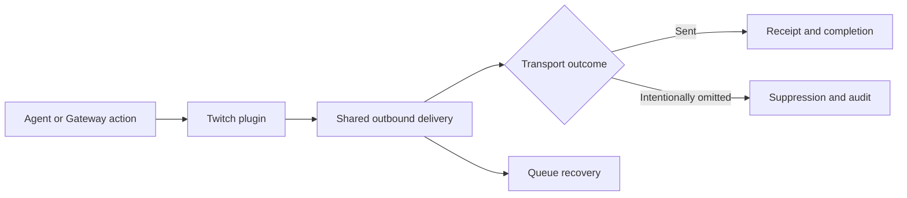

Codex review: found issues before merge. _Reviewed August 29, 2026, 1:25 AM ET / 05:25 UTC._

# ClawSweeper review

## What this changes

The branch represents Twitch messages emptied by Markdown stripping as an intentional no-send outcome and carries that fact through shared delivery, queue recovery, receipts, and operator output.

## Regression provenance

Possible regression — suspected (reviewed change). No predecessor PR is attributed.

## Merge readiness

⚠️ **Ready for maintainer review - 3 items remain**

Keep open. The central bug remains on current main, but the branch retains a prior P2 test-boundary violation and introduces a shared channel SDK outcome that needs maintainer confirmation.

**Priority:** P2
**Reviewed head:** `c5bfc8ae7ea10d47affd73cf832fc3af92cd25c5`
**Owner decision:** Required. See [Decision needed](#decision-needed).

## Review scores

| Measure | Result | What it means |
|---|---|---|
| **Overall readiness** | 🦐 gold shrimp **(3/6)** | The repair has a coherent owner-boundary design and authority coverage, but the unresolved private-plugin test coupling remains a merge blocker. |
| **Proof confidence** | 🌊 off-meta tidepool | Not applicable: The PR is authored by a repository member, so the external-contributor proof gate does not apply; the supplied test claims remain supplemental rather than independently rerun in this read-only review. |
| **Patch quality** | 🦐 gold shrimp **(3/6)** | 1 actionable review finding remain. |

## Verification

| Check | Result | Evidence |
|---|---|---|
| **Real behavior** | Not applicable | Not applicable: The PR is authored by a repository member, so the external-contributor proof gate does not apply; the supplied test claims remain supplemental rather than independently rerun in this read-only review. |
| **Evidence reviewed** | 8 items | Current-main bug remains: Current main returns a successful Twitch result with the nonempty sentinel `skipped` when Markdown stripping produces no text, so the requested behavior is not already implemented. Owner-boundary repair: The branch returns `outcome: "not_sent"` with no message ID before client-manager lookup, preserving the fact at the Twitch transport owner. Shared accounting recognizes no-send: The shared delivery owner suppresses a payload with the explicit no-send reason and bypasses successful lifecycle accounting. |
| **Findings** | 1 actionable finding | [P2] Keep the Twitch transport mock in the plugin test lane |
| **Security** | None | None. |

## How this fits together

Twitch’s plugin turns agent and Gateway message actions into transport sends. Shared outbound delivery records receipts, queue settlement, audit terminals, and source-reply completion from those results.

## Decision needed

| Question | Recommendation |
|---|---|
| Should the shared channel SDK permanently distinguish an adapter-confirmed pre-dispatch no-send from an acknowledged send without a platform ID? | **Accept the explicit no-send contract:** Keep the optional outcome after relocating the private Twitch mock to the plugin-owned test lane. |

Why: This is an additive public plugin contract with semantics for all channel adapters, so source compatibility alone cannot determine the intended long-term API.

## Before merge

- [ ] **Keep the Twitch transport mock in the plugin test lane (P2)** - This root test directly mocks `extensions/twitch/src/client-manager-registry.js`, a private plugin module. That couples core coverage to an internal extension layout and violates the established core/plugin test boundary; keep the no-client-manager assertion in `extensions/twitch/src/send.test.ts` and leave generic delivery behavior in core tests.
- [ ] **Resolve merge risk (P1)** - The optional `not_sent` field changes the shared channel result contract; maintainers should explicitly confirm that intentional pre-dispatch omission is the permanent distinction from an acknowledged send without an ID.

## Findings

- [P2] Keep the Twitch transport mock in the plugin test lane — `test/twitch-message-tool-delivery.test.ts:23-26`

<strong>Agent review details</strong>

### Security

None.

### PR surface

Source -8, Tests +951, Docs +10, Other -1. Total +952 across 36 files.

View PR surface stats

| Area | Files | Added | Removed | Net |
|---|---:|---:|---:|---:|
| Source | 21 | 271 | 279 | -8 |
| Tests | 12 | 1226 | 275 | +951 |
| Docs | 2 | 11 | 1 | +10 |
| Config | 0 | 0 | 0 | 0 |
| Generated | 0 | 0 | 0 | 0 |
| Other | 1 | 0 | 1 | -1 |
| **Total** | **36** | **1508** | **556** | **+952** |

### Review metrics

| Metric | Value | Why it matters |
|---|---|---|
| **Production versus test LOC** | production +271/-279 (net -8); tests +1226/-275 (net +951); docs +11/-1 | The repair is net-negative in production but adds substantial cross-boundary regression coverage. |
| **Shared channel result contract** | 1 optional outcome added | The new `not_sent` outcome is source-compatible when omitted but affects every adapter using the shared receipt and delivery path. |

### Stored data model

Persistent data-model change detected: `serialized state: extensions/twitch/src/actions.ts`. Confirm migration or upgrade compatibility proof before merge.

### Merge-risk options

**Maintainer options:**
1. **Relocate the private transport assertion (recommended)**  
   Remove the root test’s direct mock of Twitch private source and retain that assertion in the plugin-owned send suite before merge.
2. **Confirm the shared result contract**  
   Have the channel SDK owner explicitly accept `not_sent` as the distinction between intentional omission and identityless acknowledgement.

### Technical review

Best possible solution:

Retain the typed no-send model, move the Twitch-private transport assertion into the plugin test lane, and land only after the channel SDK contract is explicitly accepted.

Do we have a high-confidence way to reproduce the issue?

Yes, from source: current main returns successful `messageId: "skipped"` after Twitch sanitizes a payload to empty, while the branch supplies a typed no-send outcome. Runtime execution was not performed because this is a read-only review.

Is this the best way to solve the issue?

Yes, conditionally: recording an owner-confirmed no-send in the shared delivery owner is preferable to retaining a magic successful ID, but the new shared SDK meaning needs maintainer acceptance and its private-plugin mock must move.

Full review comments:

- [P2] Keep the Twitch transport mock in the plugin test lane — `test/twitch-message-tool-delivery.test.ts:23-26`
  This root test directly mocks `extensions/twitch/src/client-manager-registry.js`, a private plugin module. That couples core coverage to an internal extension layout and violates the established core/plugin test boundary; keep the no-client-manager assertion in `extensions/twitch/src/send.test.ts` and leave generic delivery behavior in core tests.
  Confidence: 0.98

Overall correctness: patch is incorrect
Overall confidence: 0.92

AGENTS.md: found and applied where relevant.

Codex review notes: model internal, reasoning high; reviewed against [4ee2216cd76b](https://github.com/openclaw/openclaw/commit/4ee2216cd76ba9cedcb8e62d81dd02e0b531ffb5).

### Labels

Label justifications:

- `P2`: This is a meaningful delivery-accounting repair with a bounded unresolved test-boundary defect.
- `merge-risk: 🚨 compatibility`: The PR adds an optional shared channel SDK outcome whose semantics affect existing adapters and delivery accounting.
- `rating: 🦐 gold shrimp`: Overall readiness is 🦐 gold shrimp; proof is 🌊 off-meta tidepool and patch quality is 🦐 gold shrimp.
- `status: ⏳ waiting on author`: ClawSweeper has contributor-facing work open and is waiting for author action. Not applicable: The PR is authored by a repository member, so the external-contributor proof gate does not apply; the supplied test claims remain supplemental rather than independently rerun in this read-only review.

### Evidence

What I checked:

- **Current-main bug remains:** Current main returns a successful Twitch result with the nonempty sentinel `skipped` when Markdown stripping produces no text, so the requested behavior is not already implemented. ([`extensions/twitch/src/send.ts`](https://github.com/openclaw/openclaw/blob/4ee2216cd76b/extensions/twitch/src/send.ts), [4ee2216cd76b](https://github.com/openclaw/openclaw/commit/4ee2216cd76b))
- **Owner-boundary repair:** The branch returns `outcome: "not_sent"` with no message ID before client-manager lookup, preserving the fact at the Twitch transport owner. ([`extensions/twitch/src/send.ts:112`](https://github.com/openclaw/openclaw/blob/c5bfc8ae7ea1/extensions/twitch/src/send.ts#L112), [c5bfc8ae7ea1](https://github.com/openclaw/openclaw/commit/c5bfc8ae7ea1))
- **Shared accounting recognizes no-send:** The shared delivery owner suppresses a payload with the explicit no-send reason and bypasses successful lifecycle accounting. ([`src/infra/outbound/deliver-core.ts:461`](https://github.com/openclaw/openclaw/blob/c5bfc8ae7ea1/src/infra/outbound/deliver-core.ts#L461), [c5bfc8ae7ea1](https://github.com/openclaw/openclaw/commit/c5bfc8ae7ea1))
- **Authority final-effect check:** The canonical Gateway send path passes the live authority guard into the platform-dispatch callback; its introduced test closes authority immediately before dispatch and observes no platform send. ([`src/gateway/server-methods/send.ts:1172`](https://github.com/openclaw/openclaw/blob/c5bfc8ae7ea1/src/gateway/server-methods/send.ts#L1172), [c5bfc8ae7ea1](https://github.com/openclaw/openclaw/commit/c5bfc8ae7ea1))
- **Prior finding remains at the exact head:** The root-level Twitch integration test directly mocks the private plugin source module; the only change after the preceding reviewed head is the separate contract-helper addition, so the prior finding remains unresolved. ([`test/twitch-message-tool-delivery.test.ts:23`](https://github.com/openclaw/openclaw/blob/c5bfc8ae7ea1/test/twitch-message-tool-delivery.test.ts#L23), [c5bfc8ae7ea1](https://github.com/openclaw/openclaw/commit/c5bfc8ae7ea1))
- **Applicable test boundary:** Repository policy keeps core tests out of private extension source; the plugin-owned send test already covers that the client manager is not called for a no-send result. ([`extensions/twitch/src/send.test.ts:205`](https://github.com/openclaw/openclaw/blob/c5bfc8ae7ea1/extensions/twitch/src/send.test.ts#L205), [c5bfc8ae7ea1](https://github.com/openclaw/openclaw/commit/c5bfc8ae7ea1))

Likely related people:

- **steipete:** Current-main and branch history both associate Peter Steinberger with the affected Twitch send path and shared delivery repair. (role: recent Twitch and outbound contributor; confidence: high; commits: [5d88e1818a41](https://github.com/openclaw/openclaw/commit/5d88e1818a41f2acea38f306843391231e240149), [c191ab20272a](https://github.com/openclaw/openclaw/commit/c191ab20272a72328b78a78c7e50709ff29237e7); files: `extensions/twitch/src/send.ts`, `src/infra/outbound/deliver-core.ts`)
- **wangmiao0668000666:** The merged Synology receipt correction is a related but distinct precedent for avoiding fabricated delivery identity. (role: adjacent receipt-contract contributor; confidence: medium; commits: [77e9ee092fc6](https://github.com/openclaw/openclaw/commit/77e9ee092fc6e926be079e25f1450681ab0f41e5); files: `src/channels/message/receipt.ts`)

### Rank-up moves

Optional improvements that raise the rating; they are not merge blockers.

- Move the private client-manager mock and no-send transport assertion into `extensions/twitch/src/send.test.ts`.
- Obtain explicit maintainer acceptance of the shared `not_sent` channel-result contract.

### Rating scale

| Score | Internal tier | Crab rank | Meaning |
|---:|:---:|---|---|
| **6/6** | S | 🦀 challenger crab | Exceptional readiness |
| **5/6** | A | 🦞 diamond lobster | Very strong readiness |
| **4/6** | B | 🐚 platinum hermit | Good normal PR; ordinary maintainer review |
| **3/6** | C | 🦐 gold shrimp | Useful, but confidence is limited |
| **2/6** | D | 🦪 silver shellfish | Proof or implementation needs work |
| **1/6** | F | 🧂 unranked krab | Not merge-ready |
| N/A | NA | 🌊 off-meta tidepool | Rating does not apply |

Overall follows the weaker of proof and patch quality.
Shiny media proof means a screenshot, video, or linked artifact directly shows the changed behavior. Runtime, network, CSP, and security claims still need visible diagnostics.

### Workflow

- ClawSweeper keeps one durable marker-backed review comment per issue or PR.
- Re-runs edit this comment so the latest verdict, findings, and automation markers stay together instead of adding duplicate bot comments.
- A fresh review can be triggered by eligible `@clawsweeper re-review` comments, exact-item GitHub events, scheduled/background review runs, or manual workflow dispatch.
- PR/issue authors and users with repository write access can comment `@clawsweeper re-review` or `@clawsweeper re-run` on an open PR or issue to request a fresh review only.
- Maintainers can also comment `@clawsweeper review` to request a fresh review only.
- Fresh-review commands do not start repair, autofix, rebase, CI repair, or automerge.
- Maintainer-only repair and merge flows require explicit commands such as `@clawsweeper autofix`, `@clawsweeper automerge`, `@clawsweeper fix ci`, or `@clawsweeper address review`.
- Maintainers can comment `@clawsweeper explain` to ask for more context, or `@clawsweeper stop` to stop active automation.

### History

Review history (7 earlier review cycles)

<!-- clawsweeper-review-history v=1 total=7 -->
- reviewed 2026-08-28T09:17:36.465Z sha 89362bd7ff5f46ff870533875059ad9c5b732609 :: needs maintainer review before merge. :: none
- reviewed 2026-08-28T20:30:51.316Z sha 929dec1f9d35407c9d1f112aee218c4517be4f4d :: needs maintainer review before merge. :: none
- reviewed 2026-08-28T21:33:19.208Z sha 579cf1a8e79717289108e25f29e0e1645c5ffa44 :: needs maintainer review before merge. :: none
- reviewed 2026-08-28T21:44:30.768Z sha 7c2aa07c6a9e8225afde4b3c63e3ed2f2e59c0d6 :: needs maintainer review before merge. :: none
- reviewed 2026-08-28T22:59:27.085Z sha 4806a06e17ea1aa4a18ef105e22098a2372bdb3a :: needs maintainer review before merge. :: none
- reviewed 2026-08-29T04:29:36.004Z sha 64230a73738a27f1a9440ef0a609d7d00dc8d3f5 :: needs maintainer review before merge. :: none
- reviewed 2026-08-29T05:12:16.761Z sha f913e542fe4ab0507ce2f6b67b4bfee176d7d883 :: found issues before merge. :: [P2] Keep the Twitch transport mock in the plugin test lane

<!-- clawsweeper-verdict:needs-human item=131689 sha=c5bfc8ae7ea10d47affd73cf832fc3af92cd25c5 confidence=high updated_at=2026-08-29T05:21:42Z reviewed_at=2026-08-29T05:25:13.012Z lease_owner=github-run-33235875348-1 lease_comment_id=5460546575 source_revision=9c0b1a1e6696e607a2e2145bdd56e7d6be832c79ee9b4e74d22641258c5db772 live_verification=absent -->

<!-- clawsweeper-review-version item=131689 reviewed_at=2026-08-29T05:25:13.012Z sha=c5bfc8ae7ea10d47affd73cf832fc3af92cd25c5 source_revision=9c0b1a1e6696e607a2e2145bdd56e7d6be832c79ee9b4e74d22641258c5db772 lease_owner=github-run-33235875348-1 lease_comment_id=5460546575 v=1 -->

<!-- clawsweeper-review item=131689 -->