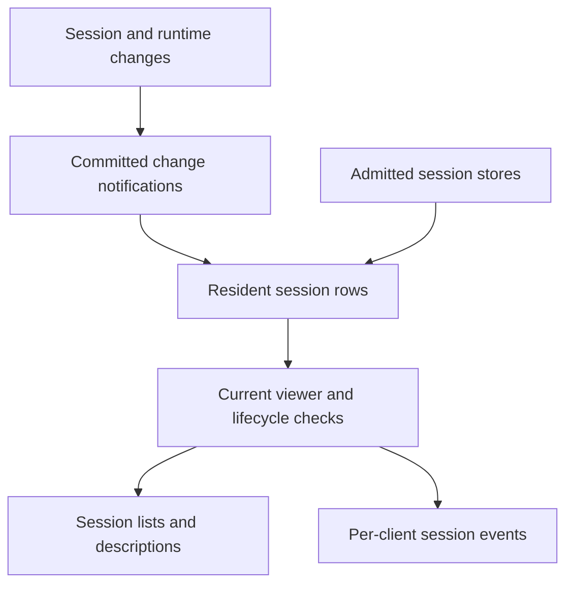

Codex review: blocked before merge. _Reviewed September 17, 2026, 7:44 AM ET / 11:44 UTC (Revision 20)._

# ClawSweeper review

## What this changes

Keeps session metadata in memory, refreshes affected rows after committed changes, and supplies viewer-specific lists and events while preserving cleared cloud-placement indicators.

## Merge readiness

⛔ **Blocked before merge - 2 items remain**

This PR remains useful: current main retains the older session-list cache, and the related merged work does not complete this cutover. No blocking defect was established in the reviewed paths; the previous synthetic-reader finding is addressed.

**Priority:** P2
**Reviewed head:** `47ee13cde0e8946932ed069f4d459bb3895cf577`

## Review scores

| Measure | Result | What it means |
|---|---|---|
| **Overall readiness** | 🐚 platinum hermit **(4/6)** | A coherent owner-level cutover with meaningful regression coverage and no established blocking finding; runtime execution was outside this read-only review. |
| **Proof confidence** | 🌊 off-meta tidepool | Not applicable: The supplied MEMBER classification exempts this PR from ordinary external-contributor proof. The matching body records focused production-owner tests and a synthetic benchmark; linked screenshots cover visible placement clearing but could not be inspected here. |
| **Patch quality** | 🐚 platinum hermit **(4/6)** | No actionable review findings were identified. |

## Verification

| Check | Result | Evidence |
|---|---|---|
| **Real behavior** | Not applicable | Not applicable: The supplied MEMBER classification exempts this PR from ordinary external-contributor proof. The matching body records focused production-owner tests and a synthetic benchmark; linked screenshots cover visible placement clearing but could not be inspected here. |
| **Evidence reviewed** | 11 items | Pinned source and complete body: The checkout is the pinned head. The full GitHub body was read and its SHA-256 matched the supplied snapshot, 37bfdb4f69d9fc0e8f0a403982e4ef9651dd8801901e15508adfe0c6c9388e99, resolving the supplied body omissions. Still necessary on current main: Fetched main still implements completed-page caching with a one-second live reuse window. The merged materialization, UI refresh, and asynchronous inventory PRs provide related groundwork rather than this resident-row implementation. Latest release boundary: The latest supplied release contains the older session-list cache and no session-row-projection module; no released implementation of this cutover was established. |
| **Findings** | None | None. |
| **Security** | None | None. |

## How this fits together

The Gateway combines stored conversations, running-agent state, and sharing permissions into session lists and updates for connected clients. The resident projection prepares reusable metadata, while each response applies current visibility and time-dependent presentation.

## Before merge

- [ ] **Review config compatibility** - Confirm compatibility and upgrade impact for the changed config or default surface before merge.
- [ ] **Add data-model compatibility proof** - Confirm migration or upgrade compatibility proof before merge.

<strong>Agent review details</strong>

### Security

None.

### PR surface

PR surface statistics unavailable: the file list is incomplete.

### Review metrics

| Metric | Value | Why it matters |
|---|---|---|
| **Reported fixture CPU** | 33.676 → 8.467 ms p50 per call | The disclosed 4,000-row, six-viewer synthetic comparison supports the performance motivation without claiming deployed Gateway latency. |

### Stored data model

Persistent data-model change detected: `migration/backfill/repair: src/acp/runtime/session-meta-doctor.ts`, `unknown-truncated-pull-files`. Confirm migration or upgrade compatibility proof before merge.

### Technical review

Best possible solution:

Keep one commit-driven row projection with bounded refresh work, transient incognito reads, and current authorization at response and event publication.

Do we have a high-confidence way to reproduce the issue?

Yes for the source-level mechanism: current main retains completed-page reuse and repeated metadata construction, and the PR provides a bounded comparison fixture. This review did not execute a current-main runtime reproduction.

Is this the best way to solve the issue?

Yes: the shared resident owner removes repeated construction while retaining existing storage, authorization, and lifecycle owners; the reviewed regression coverage targets the important cutover boundaries.

AGENTS.md: found and applied where relevant.

Codex review notes: model internal, reasoning medium; reviewed against [b2acccb2527a](https://github.com/openclaw/openclaw/commit/b2acccb2527af181c0bcb6d6a83e7db24dc8dec4).

### Labels

Label justifications:

- `P2`: Improves session-list responsiveness and freshness without evidence of an emergency or release-blocking outage.
- `rating: 🐚 platinum hermit`: Overall readiness is 🐚 platinum hermit; proof is 🌊 off-meta tidepool and patch quality is 🐚 platinum hermit.
- `status: 👀 ready for maintainer look`: ClawSweeper has no concrete contributor-facing blocker left for this PR. Not applicable: The supplied MEMBER classification exempts this PR from ordinary external-contributor proof. The matching body records focused production-owner tests and a synthetic benchmark; linked screenshots cover visible placement clearing but could not be inspected here.

### Evidence

What I checked:

- **Pinned source and complete body:** The checkout is the pinned head. The full GitHub body was read and its SHA-256 matched the supplied snapshot, 37bfdb4f69d9fc0e8f0a403982e4ef9651dd8801901e15508adfe0c6c9388e99, resolving the supplied body omissions. ([47ee13cde0e8](https://github.com/openclaw/openclaw/commit/47ee13cde0e8946932ed069f4d459bb3895cf577))
- **Still necessary on current main:** Fetched main still implements completed-page caching with a one-second live reuse window. The merged materialization, UI refresh, and asynchronous inventory PRs provide related groundwork rather than this resident-row implementation. ([`src/gateway/server-methods/sessions-list-cache.ts:71`](https://github.com/openclaw/openclaw/blob/b2acccb2527af181c0bcb6d6a83e7db24dc8dec4/src/gateway/server-methods/sessions-list-cache.ts#L71), [b2acccb2527a](https://github.com/openclaw/openclaw/commit/b2acccb2527af181c0bcb6d6a83e7db24dc8dec4))
- **Latest release boundary:** The latest supplied release contains the older session-list cache and no session-row-projection module; no released implementation of this cutover was established. ([`src/gateway/server-methods/sessions-list-cache.ts`](https://github.com/openclaw/openclaw/blob/3a9d69db306cd7f081e06254cb89c4bcc14a7107/src/gateway/server-methods/sessions-list-cache.ts), [3a9d69db306c](https://github.com/openclaw/openclaw/commit/3a9d69db306cd7f081e06254cb89c4bcc14a7107))
- **Startup admission isolation:** The latest commit captures the projection owner's async context for drains and topology capture. Successful pending-database preparation publishes store availability after ending its temporary admission borrow; the added regression checks both background refresh and capture. ([`src/gateway/session-row-projection.ts:62`](https://github.com/openclaw/openclaw/blob/47ee13cde0e8946932ed069f4d459bb3895cf577/src/gateway/session-row-projection.ts#L62), [47ee13cde0e8](https://github.com/openclaw/openclaw/commit/47ee13cde0e8946932ed069f4d459bb3895cf577))
- **Fresh authorization at response:** List and describe recheck dirty state after readiness, then select and present synchronously. List replies occur inside the final presentation frame rather than after awaiting the returned result. ([`src/gateway/session-utils-list.ts:254`](https://github.com/openclaw/openclaw/blob/47ee13cde0e8946932ed069f4d459bb3895cf577/src/gateway/session-utils-list.ts#L254), [47ee13cde0e8](https://github.com/openclaw/openclaw/commit/47ee13cde0e8946932ed069f4d459bb3895cf577))
- **Prior synthetic-reader finding addressed:** Synthetic readers now acquire exact resident profile facts. The retained real-dispatch tests cover allowed foreign-session reads, merged-profile ownership, and role revocation during readiness for both list and describe, alongside zero-SQLite assertions. ([`src/gateway/server-plugin-in-process-dispatch.session-reads.test.ts:146`](https://github.com/openclaw/openclaw/blob/47ee13cde0e8946932ed069f4d459bb3895cf577/src/gateway/server-plugin-in-process-dispatch.session-reads.test.ts#L146), [47ee13cde0e8](https://github.com/openclaw/openclaw/commit/47ee13cde0e8946932ed069f4d459bb3895cf577))

Likely related people:

- **steipete:** Suggested for follow-up; no historical authorship or introduction is verified. (role: unverified routing candidate; confidence: low)
- **Josh Lehman:** Suggested for follow-up; no historical authorship or introduction is verified. (role: unverified routing candidate; confidence: low)

### Rating scale

| Score | Internal tier | Crab rank | Meaning |
|---:|:---:|---|---|
| **6/6** | S | 🦀 challenger crab | Exceptional readiness |
| **5/6** | A | 🦞 diamond lobster | Very strong readiness |
| **4/6** | B | 🐚 platinum hermit | Good normal PR; ordinary maintainer review |
| **3/6** | C | 🦐 gold shrimp | Useful, but confidence is limited |
| **2/6** | D | 🦪 silver shellfish | Proof or implementation needs work |
| **1/6** | F | 🧂 unranked krab | Not merge-ready |
| N/A | NA | 🌊 off-meta tidepool | Rating does not apply |

Overall follows the weaker of proof and patch quality.
Shiny media proof means a screenshot, video, or linked artifact directly shows the changed behavior. Runtime, network, CSP, and security claims still need visible diagnostics.

### Workflow

- ClawSweeper keeps one durable marker-backed review comment per issue or PR.
- Re-runs edit this comment so the latest verdict, findings, and automation markers stay together instead of adding duplicate bot comments.
- A fresh review can be triggered by eligible `@clawsweeper re-review` comments, exact-item GitHub events, scheduled/background review runs, or manual workflow dispatch.
- PR/issue authors and users with repository write access can comment `@clawsweeper re-review` or `@clawsweeper re-run` on an open PR or issue to request a fresh review only.
- Maintainers can also comment `@clawsweeper review` to request a fresh review only.
- Fresh-review commands do not start repair, autofix, rebase, CI repair, or automerge.
- Maintainer-only repair and merge flows require explicit commands such as `@clawsweeper autofix`, `@clawsweeper automerge`, `@clawsweeper fix ci`, or `@clawsweeper address review`.
- Maintainers can comment `@clawsweeper explain` to ask for more context, or `@clawsweeper stop` to stop active automation.

### History

Review history (19 earlier review cycles; latest 8 shown)

<!-- clawsweeper-review-history v=1 total=19 -->
- reviewed 2026-09-16T23:55:00.243Z sha 3f1585b843c0e368c371d5bcb1b324b696eb1cd0 :: blocked before merge. :: [P1] Prepare profile facts for synthetic operator callers
- reviewed 2026-09-17T00:57:45.973Z sha d094650e1acce4b897e36ba8b4ba846d7979920a :: blocked before merge. :: none
- reviewed 2026-09-17T01:23:16.079Z sha 0c08509571ecc5edfc74d8b463db805f58eda30f :: blocked before merge. :: none
- reviewed 2026-09-17T08:35:13.594Z sha d113e5734dc765e2be18db287b8a1def1c05d5db :: blocked before merge. :: none
- reviewed 2026-09-17T09:46:12.830Z sha d113e5734dc765e2be18db287b8a1def1c05d5db :: blocked before merge. :: none
- reviewed 2026-09-17T10:42:13.207Z sha d113e5734dc765e2be18db287b8a1def1c05d5db :: blocked before merge. :: none
- reviewed 2026-09-17T10:56:14.419Z sha 74b5ec899c7e94a1eb7f6efd41814e1edcbfa752 :: blocked before merge. :: none
- reviewed 2026-09-17T11:07:16.007Z sha 74b5ec899c7e94a1eb7f6efd41814e1edcbfa752 :: blocked before merge. :: none

<!-- clawsweeper-verdict:needs-human item=150196 sha=47ee13cde0e8946932ed069f4d459bb3895cf577 confidence=high updated_at=2026-09-17T11:40:47Z reviewed_at=2026-09-17T11:44:42.670Z lease_owner=github-run-35216776266-1 lease_comment_id=5713735937 source_revision=55a74e202338b835ad1db4cd55c1238d3c9d3e45cb7b66d1e3be164e37082650 live_verification=absent -->
<!-- clawsweeper-review-state:blocked item=150196 sha=47ee13cde0e8946932ed069f4d459bb3895cf577 v=1 -->

<!-- clawsweeper-review-version item=150196 reviewed_at=2026-09-17T11:44:42.670Z sha=47ee13cde0e8946932ed069f4d459bb3895cf577 source_revision=55a74e202338b835ad1db4cd55c1238d3c9d3e45cb7b66d1e3be164e37082650 lease_owner=github-run-35216776266-1 lease_comment_id=5713735937 v=1 -->

<!-- clawsweeper-review item=150196 -->