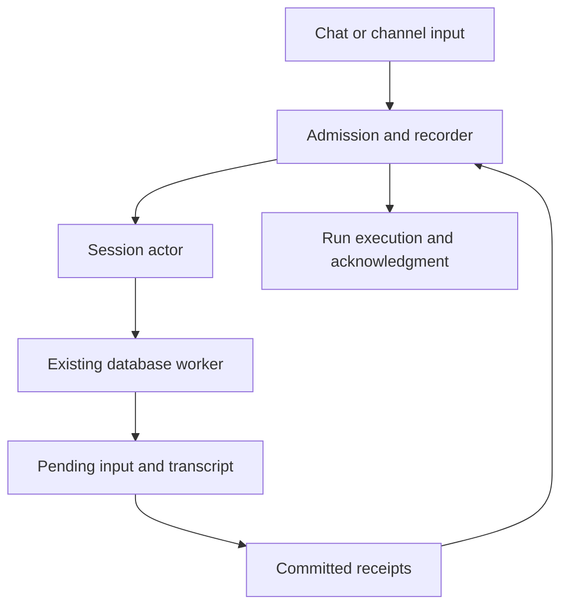

Codex review: needs changes before merge.

## What this changes

This PR batches durable chat input acceptance, transcript promotion, and run adoption through the existing session actor.

**Example:** Send ten warmed chat turns in the pinned comparison workload.
- **Before:** Median all-thread SQLite work averages 657.1 statements per turn.
- **After:** The candidate averages 594.8 statements per turn while retaining durable input before acknowledgment.

## Review scores

| Measure | Result | What it means |
|---|---|---|
| **Overall readiness** | 🐚 platinum hermit **(4/6)** | A useful measured cutover with meaningful boundary coverage and no new actionable finding; accepted tradeoffs remain explicit. |
| **Proof confidence** | 🐚 platinum hermit **(4/6)** ✨ media proof bonus | Sufficient (linked_artifact): The previously assessed Gateway workloads exercise acceptance and adoption through startup, connected chat turns, and shutdown; later recorded regressions cover committed custody, cancellation, lifecycle replacement, and transaction/commit refusal. Linked proof portals were inaccessible here, which does not invalidate the retained evidence. |
| **Patch quality** | 🐚 platinum hermit **(4/6)** | No actionable review findings were identified. |

## Product

**Kind:** Performance · **Worth it:** Yes · **Fix scope:** Complete
**User problem:** Chat acceptance and run startup repeatedly read session facts and perform separate durable writes.
**Reason:** The maintainer-authored direction has measured incremental savings and explicitly records retained costs and accepted ordering tradeoffs.

## Merge readiness

⛔ **Needs changes before merge - 1 item remains**

Keep this PR open: it delivers a measured performance improvement beyond the landed actor core. No new actionable code finding remains after the maintainer explicitly accepted the earlier completion interleaving; GitHub still reports conflicts and failed required CI.

**Priority:** P2
**Reviewed head:** `536d9d4fa54c98b54a95148e61c387062624fd80`

## Before merge

- [ ] **Complete next step** - Resolve GitHub's reported conflicts with main and validate the affected session and Gateway contracts after the resolution.

## Findings

None.

<strong>Agent review details</strong>

### How this fits together

Gateway chat admission and reply execution pass approved input and lifecycle authority to the session actor, which commits through the existing database worker and publishes canonical custody and transcript receipts.

### Technical review

Best possible solution:

Complete the actor cutover while preserving canonical durable receipts, final authority checks, and the existing native-incognito owner.

Do we have a high-confidence way to reproduce the issue?

This performance refactor has pinned comparative measurements and custody regressions; the separate hosted optional-identity failure has no established root cause.

Is this the best way to solve the issue?

Reusing the admitted actor and existing transaction kernels addresses repeated database work without adding a competing writer or replay protocol.

AGENTS.md: found and applied where relevant.

Codex review notes: model internal, reasoning medium; reviewed against [facdd3c34bac](https://github.com/openclaw/openclaw/commit/facdd3c34bace8bb148406dbe57166d7a2de1d62).

### Provenance checked

- `Worker transcript commit and completion ordering` changes intended behavior with a stated reason (ca77256127e6ba13c00d68bca42194d1b9e2a780: https://github.com/openclaw/openclaw/pull/163889 keeps predicates, transcript writes, custody publication, and accepted completion within the existing worker owner; its original contract drained completion before releasing FIFO.)
- `Durable pending-input acceptance and source identity` keeps the original intent (d6c1b1f9e14aa06443c685d81414911628e18914: https://github.com/openclaw/openclaw/pull/164284 moves staging and settlement into workers while preserving live custody and durability before acknowledgment.)
- `Restart recovery and source redelivery` keeps the original intent (d8b723fb00c2b37e0b451b435caaa5af4de0cb94: https://github.com/openclaw/openclaw/pull/108283 records input with its recovery claim and retains exact source authority while refusing ambiguous side-effect replay.)
- `Native-incognito actor acquisition` keeps the original intent (d5173ccc77b9ff5395cdbc38a8c37b45349d46e0: The landed actor core deliberately declines native-incognito acquisition until its later memory-backend cutover.)

### Testing

Proof path: shipped entry point.

### Security

None.

### Evidence

What I checked:

- **Pinned production cutover:** The introduced diff activates acceptInput and adoptRun for recorder and recovery callers, removes the superseded restart-admission reducer, and preserves the existing native-incognito owner. ([`src/config/sessions/session-actor-phase.worker.ts:133`](https://github.com/openclaw/openclaw/blob/536d9d4fa54c98b54a95148e61c387062624fd80/src/config/sessions/session-actor-phase.worker.ts#L133), [536d9d4fa54c](https://github.com/openclaw/openclaw/commit/536d9d4fa54c98b54a95148e61c387062624fd80))
- **Distinct from current main:** Fetched main retains lifecycle-only adoptRun and does not bind the Gateway recorder to the input actor; the merged inactive actor core at https://github.com/openclaw/openclaw/pull/168602 supplies the foundation rather than this caller cutover. ([`src/config/sessions/session-actor-phase.worker.ts:132`](https://github.com/openclaw/openclaw/blob/facdd3c34bace8bb148406dbe57166d7a2de1d62/src/config/sessions/session-actor-phase.worker.ts#L132), [facdd3c34bac](https://github.com/openclaw/openclaw/commit/facdd3c34bace8bb148406dbe57166d7a2de1d62))
- **Earlier concern explicitly accepted:** The code still drains accepted completions after the unbound writer reservation ends. In https://github.com/openclaw/openclaw/pull/168607#issuecomment-6107664327, steipete expressly accepts that exact successor interleaving for this landing without claiming it fixed. ([`src/config/sessions/session-turn.ts:672`](https://github.com/openclaw/openclaw/blob/536d9d4fa54c98b54a95148e61c387062624fd80/src/config/sessions/session-turn.ts#L672), [536d9d4fa54c](https://github.com/openclaw/openclaw/commit/536d9d4fa54c98b54a95148e61c387062624fd80))
- **Committed custody and final authority:** Committed pending custody publishes before callbacks, and the final actor commit admission carries the exact turn candidate. Recovery regressions rotate lifecycle authority at transaction and commit boundaries and assert unchanged durable state. ([`src/config/sessions/session-actor.worker.ts:311`](https://github.com/openclaw/openclaw/blob/536d9d4fa54c98b54a95148e61c387062624fd80/src/config/sessions/session-actor.worker.ts#L311), [536d9d4fa54c](https://github.com/openclaw/openclaw/commit/536d9d4fa54c98b54a95148e61c387062624fd80))
- **Recorded performance and behavior proof:** The complete body records alternating Gateway workloads pinned to cc65e9aacc50bfd2e86a8edc0eb89d561e571b3a and 4f076e633cb8c74f87918e5a57d926c06384bc2f, plus later custody and integration proof. Measurements remain explicitly historical. The linked Crabbox portals were inaccessible through this review's web tool, so their underlying artifacts were not independently re-inspected. ([536d9d4fa54c](https://github.com/openclaw/openclaw/commit/536d9d4fa54c98b54a95148e61c387062624fd80))
- **CI attribution:** Prompt-cache conflict failures and stopped-file inspection have matching annotations on pinned main at https://github.com/openclaw/openclaw/actions/runs/38122045725/job/114418744592 and https://github.com/openclaw/openclaw/actions/runs/38122045725/job/114418744591. The optional-connection-identity failure remains unexplained and is not classified as inherited; passing diagnostic replays are not a fix. ([`src/gateway/server-chat.agent-events.test-helpers.ts:290`](https://github.com/openclaw/openclaw/blob/536d9d4fa54c98b54a95148e61c387062624fd80/src/gateway/server-chat.agent-events.test-helpers.ts#L290), [536d9d4fa54c](https://github.com/openclaw/openclaw/commit/536d9d4fa54c98b54a95148e61c387062624fd80))

Likely related people:

- **Peter Steinberger:** Raw commit d6c1b1f9e14aa06443c685d81414911628e18914 adds src/sessions/user-turn-transcript.ts:233 relative to its recorded parents. This identifies author metadata, not feature responsibility or a PR merger. (role: source-line author; confidence: high; commits: [d6c1b1f9e14a](https://github.com/openclaw/openclaw/commit/d6c1b1f9e14aa06443c685d81414911628e18914); files: `src/sessions/user-turn-transcript.ts`)
- **Dallin Romney:** Raw commit a33accd27f3d3331d0d42d8915038d3aa47b2421 adds src/auto-reply/reply/restart-recovery-claim.ts:343 relative to its recorded parents. This identifies author metadata, not feature responsibility or a PR merger. (role: source-line author; confidence: medium; commits: [a33accd27f3d](https://github.com/openclaw/openclaw/commit/a33accd27f3d3331d0d42d8915038d3aa47b2421); files: `src/auto-reply/reply/restart-recovery-claim.ts`)
- **Shakker:** Raw commit 8a1b7710d776231fd10dfe580c92c8139da0fd78 adds src/sessions/user-turn-transcript.ts:535 relative to its recorded parents. This identifies author metadata, not feature responsibility or a PR merger. (role: source-line author; confidence: low; commits: [8a1b7710d776](https://github.com/openclaw/openclaw/commit/8a1b7710d776231fd10dfe580c92c8139da0fd78); files: `src/sessions/user-turn-transcript.ts`)

### PR surface

Source +1209, Tests +872, Docs +16, Other 0. Total +2097 across 62 files. Added test files: 2.

View PR surface stats

| Area | Files | Added | Removed | Net |
|---|---:|---:|---:|---:|
| Source | 31 | 1664 | 455 | +1209 |
| Tests | 29 | 1322 | 450 | +872 |
| Docs | 1 | 17 | 1 | +16 |
| Config | 0 | 0 | 0 | 0 |
| Generated | 0 | 0 | 0 | 0 |
| Other | 1 | 1 | 1 | 0 |
| **Total** | **62** | **3004** | **907** | **+2097** |

### Review metrics

| Metric | Value | Why it matters |
|---|---|---|
| **Production versus test growth** | Production/tooling +1,665 −456; tests/support +1,322 −450. | The pinned diff confirms substantial growth for actor binding, committed-custody publication, retained compatibility, and owner-boundary regressions. |

### Labels

Label changes:

- add `rating: 🐚 platinum hermit`: Overall readiness is 🐚 platinum hermit; proof is 🐚 platinum hermit and patch quality is 🐚 platinum hermit.
- remove `rating: 🦪 silver shellfish`: Current PR rating is `rating: 🐚 platinum hermit`, so this older rating label is no longer current.

Label justifications:

- `P2`: This is a measured internal performance improvement with no intended user-visible behavior change.
- `merge-risk: 🚨 compatibility`: The cutover touches SDK callback completion and native-incognito compatibility; the optional argument and retained owner have maintainer-approved direction.
- `merge-risk: 🚨 session-state`: Acceptance, transcript promotion, recovery checkpoints, and custody publication change; the exact unbound completion interleaving is explicitly accepted for this landing.
- `rating: 🐚 platinum hermit`: Overall readiness is 🐚 platinum hermit; proof is 🐚 platinum hermit and patch quality is 🐚 platinum hermit.
- `status: ⏳ waiting on author`: ClawSweeper has contributor-facing work open and is waiting for author action.
- `proof: sufficient`: Contributor real behavior proof is sufficient.

### Rating scale

6/6 🦀 challenger crab · 5/6 🦞 diamond lobster · 4/6 🐚 platinum hermit · 3/6 🦐 gold shrimp · 2/6 🦪 silver shellfish · 1/6 🧂 unranked krab. Overall follows the weaker of proof and patch quality; ✨ marks media proof (a screenshot, video, or linked artifact) that directly shows the changed behavior.

### Workflow

ClawSweeper edits this one comment on every review. Comment `@clawsweeper re-review` for a fresh review only; repair and merge need explicit maintainer commands such as `@clawsweeper autofix` or `@clawsweeper automerge`.

### History

Review history (4 earlier review cycles)

<!-- clawsweeper-review-history v=1 total=4 -->
- reviewed 2026-10-10T19:16:14.784Z sha def5d6d30baf4374b60036eb2f2644b6dd3b3999 :: needs changes before merge. :: none
- reviewed 2026-10-11T04:15:47.236Z sha def5d6d30baf4374b60036eb2f2644b6dd3b3999 :: needs changes before merge. :: [P2] Publish consumed custody before invoking committed-message callbacks | [P2] Complete the actor-admission cutover for caller-owned runner fixtures | [P2] Preserve the no-write outcome for late persistence after release
- reviewed 2026-10-11T06:36:54.127Z sha 496404f9d39f8774ab860b13f4b5c148aa853819 :: needs changes before merge. :: [P1] Bind the recorder actor to the canonical transcript target | [P2] Complete actor admission for caller-owned runner fixtures | [P2] Preserve the no-write outcome after admission release | [P2] Preserve live execution getters in the cohort fixture | [P2] Await asynchronous staging refusal in shutdown coverage
- reviewed 2026-10-11T08:35:41.894Z sha 536d9d4fa54c98b54a95148e61c387062624fd80 :: needs changes before merge. :: [P2] Preserve FIFO settlement for unbound transcript callers

_Reviewed October 11, 2026, 5:46 AM ET / 09:46 UTC (Revision 5)._

<!-- clawsweeper-verdict:needs-human item=168607 sha=536d9d4fa54c98b54a95148e61c387062624fd80 confidence=high updated_at=2026-10-11T09:41:12Z reviewed_at=2026-10-11T09:46:01.798Z lease_owner=github-run-38129197587-1 lease_comment_id=6107683223 source_revision=34f0f0f2b5c99fb77d8c94ffe507cfb6065bde08f6522dd63867cca4beefb55c live_verification=absent hold=blocked findings=0 -->
<!-- clawsweeper-review-state:needs-changes item=168607 sha=536d9d4fa54c98b54a95148e61c387062624fd80 v=1 -->

<!-- clawsweeper-review-version item=168607 reviewed_at=2026-10-11T09:46:01.798Z sha=536d9d4fa54c98b54a95148e61c387062624fd80 source_revision=34f0f0f2b5c99fb77d8c94ffe507cfb6065bde08f6522dd63867cca4beefb55c lease_owner=github-run-38129197587-1 lease_comment_id=6107683223 v=1 -->

<!-- clawsweeper-review item=168607 -->