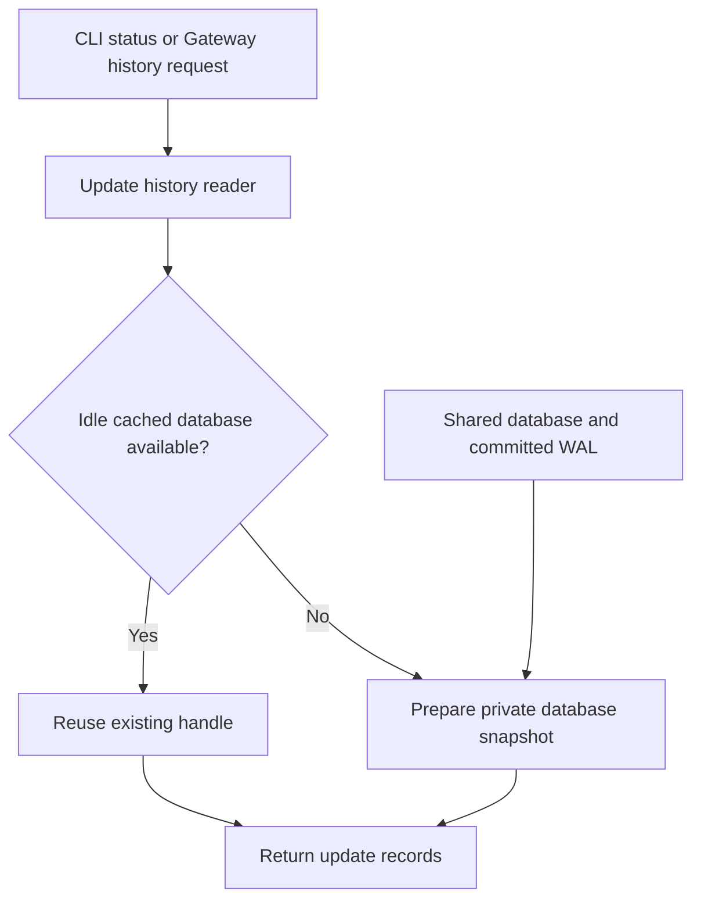

Codex review: needs maintainer review before merge. _Reviewed September 5, 2026, 11:20 PM ET / September 6, 2026, 03:20 UTC._

# ClawSweeper review

## What this changes

Update status and history queries use the existing SQLite reader that preserves inspected database files, with regression coverage for committed history and transaction isolation.

## Merge readiness

✅ **Ready for maintainer review**

The fix remains necessary: current main and the latest release still use the ordinary SQLite reader. No introduced correctness defect was found, and the supplied Linux CLI evidence resolves the previous review’s specific proof follow-up.

**Priority:** P2
**Reviewed head:** `5f79151e76617147abbd2636955d6a66cc459526`

## Review scores

| Measure | Result | What it means |
|---|---|---|
| **Overall readiness** | 🐚 platinum hermit **(4/6)** | A focused repair with useful regression coverage and sufficient retained runtime evidence; no actionable patch defect remains. |
| **Proof confidence** | 🦞 diamond lobster **(5/6)** | Sufficient (terminal): Retained macOS CLI evidence and the supplied completed Linux CLI/WAL report exercise status through the changed history owner, preserving protected files while returning committed history. The previous Linux follow-up is addressed. Evidence retains its private-candidate source identities and setup qualifications; raw linked artifacts could not be independently reopened here. |
| **Patch quality** | 🐚 platinum hermit **(4/6)** | No actionable review findings were identified. |

## Verification

| Check | Result | Evidence |
|---|---|---|
| **Real behavior** | Verified | Sufficient (terminal): Retained macOS CLI evidence and the supplied completed Linux CLI/WAL report exercise status through the changed history owner, preserving protected files while returning committed history. The previous Linux follow-up is addressed. Evidence retains its private-candidate source identities and setup qualifications; raw linked artifacts could not be independently reopened here. |
| **Evidence reviewed** | 9 items | Verified introduced change: The pinned base-to-head diff changes only the reader import and its get/list call sites in production. Active-run discovery delegates to list; queries, record decoding, writes, and schema remain unchanged. The complete introduced test diff was also inspected. Existing shared reader preserves lifecycle boundaries: The helper reuses idle cached handles, skips handles with active transactions, preserves missing databases, and prepares isolated snapshots when a writable handle exists. Fresh reads retain schema and quarantine checks, and snapshot cleanup runs in finally. Meaningful owner-boundary regression coverage: Six cold-read cases cover get/list/active with and without retained WAL. Additional cases cover an absent history table, cached writer usability, and exclusion of uncommitted writes. Filesystem metadata and content hashes detect side effects; a main-only control distinguishes committed WAL history from stale main-file data. Tests were inspected, not executed. |
| **Findings** | None | None. |
| **Security** | None | None. |

## How this fits together

The update ledger stores durable update progress and results in OpenClaw’s shared SQLite database. CLI status and Gateway history requests read those records to report active and completed updates.

## Before merge

None.

<strong>Agent review details</strong>

### Security

None.

### PR surface

Source 0, Tests +137. Total +137 across 2 files.

View PR surface stats

| Area | Files | Added | Removed | Net |
|---|---:|---:|---:|---:|
| Source | 1 | 3 | 3 | 0 |
| Tests | 1 | 138 | 1 | +137 |
| Docs | 0 | 0 | 0 | 0 |
| Config | 0 | 0 | 0 | 0 |
| Generated | 0 | 0 | 0 | 0 |
| Other | 0 | 0 | 0 | 0 |
| **Total** | **2** | **141** | **4** | **+137** |

### Review metrics

None.

### Technical review

Best possible solution:

Keep history reads on the existing artifact-preserving owner while retaining committed-WAL visibility, cached writer reuse, and unchanged durable records.

Do we have a high-confidence way to reproduce the issue?

Yes: cold update-status reads reach the ordinary SQLite reader on current main, and the supplied unmodified-CLI evidence records WAL/SHM creation. This review inspected the path without executing it.

Is this the best way to solve the issue?

Yes: selecting the existing artifact-preserving reader at the history owner is a focused repair that avoids duplicating snapshot logic or changing storage contracts.

AGENTS.md: found and applied where relevant.

Codex review notes: model internal, reasoning medium; reviewed against [6c33a2f3b9b2](https://github.com/openclaw/openclaw/commit/6c33a2f3b9b2b1c2ca78293f178a04aaa5e637b1).

### Labels

Label justifications:

- `P2`: This is a bounded correctness repair for status reads that unexpectedly create SQLite coordination files.
- `rating: 🐚 platinum hermit`: Overall readiness is 🐚 platinum hermit; proof is 🦞 diamond lobster and patch quality is 🐚 platinum hermit.
- `status: 👀 ready for maintainer look`: ClawSweeper has no concrete contributor-facing blocker left for this PR. Sufficient (terminal): Retained macOS CLI evidence and the supplied completed Linux CLI/WAL report exercise status through the changed history owner, preserving protected files while returning committed history. The previous Linux follow-up is addressed. Evidence retains its private-candidate source identities and setup qualifications; raw linked artifacts could not be independently reopened here.
- `proof: sufficient`: Contributor real behavior proof is sufficient. Retained macOS CLI evidence and the supplied completed Linux CLI/WAL report exercise status through the changed history owner, preserving protected files while returning committed history. The previous Linux follow-up is addressed. Evidence retains its private-candidate source identities and setup qualifications; raw linked artifacts could not be independently reopened here.

### Evidence

What I checked:

- **Verified introduced change:** The pinned base-to-head diff changes only the reader import and its get/list call sites in production. Active-run discovery delegates to list; queries, record decoding, writes, and schema remain unchanged. The complete introduced test diff was also inspected. ([`src/infra/update-run-ledger.ts:456`](https://github.com/openclaw/openclaw/blob/5f79151e76617147abbd2636955d6a66cc459526/src/infra/update-run-ledger.ts#L456), [5f79151e7661](https://github.com/openclaw/openclaw/commit/5f79151e76617147abbd2636955d6a66cc459526))
- **Existing shared reader preserves lifecycle boundaries:** The helper reuses idle cached handles, skips handles with active transactions, preserves missing databases, and prepares isolated snapshots when a writable handle exists. Fresh reads retain schema and quarantine checks, and snapshot cleanup runs in finally. ([`src/state/openclaw-state-db-readonly.ts:133`](https://github.com/openclaw/openclaw/blob/5f79151e76617147abbd2636955d6a66cc459526/src/state/openclaw-state-db-readonly.ts#L133), [5f79151e7661](https://github.com/openclaw/openclaw/commit/5f79151e76617147abbd2636955d6a66cc459526))
- **Meaningful owner-boundary regression coverage:** Six cold-read cases cover get/list/active with and without retained WAL. Additional cases cover an absent history table, cached writer usability, and exclusion of uncommitted writes. Filesystem metadata and content hashes detect side effects; a main-only control distinguishes committed WAL history from stale main-file data. Tests were inspected, not executed. ([`src/infra/update-run-ledger.test.ts:118`](https://github.com/openclaw/openclaw/blob/5f79151e76617147abbd2636955d6a66cc459526/src/infra/update-run-ledger.test.ts#L118), [5f79151e7661](https://github.com/openclaw/openclaw/commit/5f79151e76617147abbd2636955d6a66cc459526))
- **Current main still needs the repair:** Inspection of fetched main shows getUpdateRun and listUpdateRuns still calling withExistingOpenClawStateDatabaseReadOnly. Neither supplied merged related PR establishes that this sidecar repair has landed. ([`src/infra/update-run-ledger.ts:456`](https://github.com/openclaw/openclaw/blob/6c33a2f3b9b2b1c2ca78293f178a04aaa5e637b1/src/infra/update-run-ledger.ts#L456), [6c33a2f3b9b2](https://github.com/openclaw/openclaw/commit/6c33a2f3b9b2b1c2ca78293f178a04aaa5e637b1))
- **Latest release retains the ordinary reader:** The supplied latest release, v2026.9.2, also uses the ordinary reader for both history entry points. ([`src/infra/update-run-ledger.ts`](https://github.com/openclaw/openclaw/blob/3928bad9badfcb6c7d140530435e806fb8092190/src/infra/update-run-ledger.ts), [3928bad9badf](https://github.com/openclaw/openclaw/commit/3928bad9badfcb6c7d140530435e806fb8092190))
- **Previous Linux proof follow-up addressed:** The captured report at https://github.com/openclaw/openclaw/pull/138917#issuecomment-5556450554 records Linux x64, Node 24.19.0 CLI execution on base 69587bbb6bf8b115e77ceeaf63e6eaf69893b1fa with authored tree bbf78916457e3686df2df07e461d931509fd2604. Retained-WAL status returned all 17 expected history fields in 892 ms; the main-only control lacked history, and protected files and schema remained unchanged. No-action and rejected-timeout controls passed. These are private-candidate results, not an exact-public-head binary run; the report retains its independent setup-admission qualifications.

Likely related people:

- **steipete:** Suggested for follow-up; no historical authorship or introduction is verified. (role: unverified routing candidate; confidence: low)

### Rating scale

| Score | Internal tier | Crab rank | Meaning |
|---:|:---:|---|---|
| **6/6** | S | 🦀 challenger crab | Exceptional readiness |
| **5/6** | A | 🦞 diamond lobster | Very strong readiness |
| **4/6** | B | 🐚 platinum hermit | Good normal PR; ordinary maintainer review |
| **3/6** | C | 🦐 gold shrimp | Useful, but confidence is limited |
| **2/6** | D | 🦪 silver shellfish | Proof or implementation needs work |
| **1/6** | F | 🧂 unranked krab | Not merge-ready |
| N/A | NA | 🌊 off-meta tidepool | Rating does not apply |

Overall follows the weaker of proof and patch quality.
Shiny media proof means a screenshot, video, or linked artifact directly shows the changed behavior. Runtime, network, CSP, and security claims still need visible diagnostics.

### Workflow

- ClawSweeper keeps one durable marker-backed review comment per issue or PR.
- Re-runs edit this comment so the latest verdict, findings, and automation markers stay together instead of adding duplicate bot comments.
- A fresh review can be triggered by eligible `@clawsweeper re-review` comments, exact-item GitHub events, scheduled/background review runs, or manual workflow dispatch.
- PR/issue authors and users with repository write access can comment `@clawsweeper re-review` or `@clawsweeper re-run` on an open PR or issue to request a fresh review only.
- Maintainers can also comment `@clawsweeper review` to request a fresh review only.
- Fresh-review commands do not start repair, autofix, rebase, CI repair, or automerge.
- Maintainer-only repair and merge flows require explicit commands such as `@clawsweeper autofix`, `@clawsweeper automerge`, `@clawsweeper fix ci`, or `@clawsweeper address review`.
- Maintainers can comment `@clawsweeper explain` to ask for more context, or `@clawsweeper stop` to stop active automation.

### History

Review history (1 earlier review cycle)

<!-- clawsweeper-review-history v=1 total=1 -->
- reviewed 2026-09-05T06:44:07.263Z sha 3253f18df01790c3b3461867d6929451890aef21 :: blocked before merge. :: none

<!-- clawsweeper-verdict:needs-human item=138917 sha=5f79151e76617147abbd2636955d6a66cc459526 confidence=high updated_at=2026-09-06T03:17:27Z reviewed_at=2026-09-06T03:20:08.666Z lease_owner=github-run-34008466264-1 lease_comment_id=5556580177 source_revision=306f903b9c1654081f6db5eb6ae5fdba82dc08adb649e1c79d90243f71452890 live_verification=absent -->
<!-- clawsweeper-review-state:ready item=138917 sha=5f79151e76617147abbd2636955d6a66cc459526 v=1 -->

<!-- clawsweeper-review-version item=138917 reviewed_at=2026-09-06T03:20:08.666Z sha=5f79151e76617147abbd2636955d6a66cc459526 source_revision=306f903b9c1654081f6db5eb6ae5fdba82dc08adb649e1c79d90243f71452890 lease_owner=github-run-34008466264-1 lease_comment_id=5556580177 v=1 -->

<!-- clawsweeper-review item=138917 -->