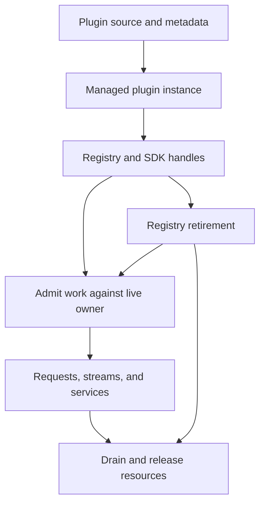

Codex review: blocked before merge. _Reviewed September 11, 2026, 4:25 PM ET / 20:25 UTC (Revision 13)._

# ClawSweeper review

## What this changes

The branch keeps plugin code, callbacks, active work, and cleanup attached to their owning instance during retirement, with corresponding SDK, consumer, and build changes.

## Merge readiness

⛔ **Blocked before merge - 3 items remain**

This remains a useful, maintainer-owned foundation that current main does not implement. All 566 introduced paths match the previous reviewed head byte-for-byte; the earlier donor-release repair remains present, and this review found no additional actionable defect.

**Priority:** P2
**Reviewed head:** `ddfd8e413e177f1c8552de9c4e9a097ba1f760d6`

## Review scores

| Measure | Result | What it means |
|---|---|---|
| **Overall readiness** | 🐚 platinum hermit **(4/6)** | Strong recorded runtime evidence supports a coherent ownership refactor with no actionable findings and a documented external-loader compatibility limitation. |
| **Proof confidence** | 🦞 diamond lobster **(5/6)** | Sufficient (live_output): Recorded built-Gateway RPC/shutdown and fresh/stable-upgrade runs exercise the changed loader and lifetime owners, with successful requests, preserved state, and natural cleanup; historical final-dispatch evidence also covers retained, unpublished, replaced, and revoked callbacks. Source continuity preserves the prior assessment, while blocked log retrieval remains a reviewer limitation rather than missing contributor proof. |
| **Patch quality** | 🐚 platinum hermit **(4/6)** | No actionable review findings were identified. |

## Verification

| Check | Result | Evidence |
|---|---|---|
| **Real behavior** | Verified | Sufficient (live_output): Recorded built-Gateway RPC/shutdown and fresh/stable-upgrade runs exercise the changed loader and lifetime owners, with successful requests, preserved state, and natural cleanup; historical final-dispatch evidence also covers retained, unpublished, replaced, and revoked callbacks. Source continuity preserves the prior assessment, while blocked log retrieval remains a reviewer limitation rather than missing contributor proof. |
| **Evidence reviewed** | 11 items | Review continuity verified independently: The complete GitHub tree for previous reviewed head 518125d1e6d31132d46be7db61bb996f8a4c671a was compared with local HEAD using blob identities. All 566 merge-base..HEAD paths matched, including absence for deleted paths. The API tree was not truncated. This establishes content continuity, not a claim that hashes substitute for source review. Foundation remains absent from main and latest release: Both fetched main and v2026.9.4 lack plugin-instance.ts and retain the older registry-epoch implementation. The supplied merged prerequisites address narrower shutdown problems; none establishes completion of this foundation. Instance admission and cleanup ownership: The instance owner distinguishes ordinary calls, retained consumers, and host cleanup. Retirement closes admission, invalidates ordinary tokens, waits for consumers, and reports bounded disposer failures. Registry authority reads current record ownership rather than trusting an identifier alone. |
| **Findings** | None | None. |
| **Security** | None | None. |

## How this fits together

OpenClaw loads plugins into registries used by Gateway requests, agents, model helpers, and services. This change coordinates their execution and resource lifetimes so retiring a registry does not prematurely dispose dependencies still in use.

## Before merge

- [ ] **Resolve merge risk (P1)** - External plugins relying on incidental module filenames, CommonJS cache identities, or repeated evaluation after failure may need adaptation; representative upgrade proof cannot establish compatibility with every such assumption.
- [ ] **Resolve merge risk (P1)** - The reviewer could inspect recorded observations and source continuity but could not independently retrieve the linked Testbox logs through the permitted network path.
- [ ] **Review config compatibility** - Confirm compatibility and upgrade impact for the changed config or default surface before merge.

<strong>Agent review details</strong>

### Security

None.

### PR surface

PR surface statistics unavailable: the file list is incomplete.

### Review metrics

| Metric | Value | Why it matters |
|---|---|---|
| **Production versus test growth** | Reported net production +5,106; tests/support +15,106 | The PR explicitly attributes production growth to instance admission, captured-source ownership, and retained cleanup. |
| **Re-review continuity** | 566 introduced paths unchanged since the previous reviewed head | Complete tree comparison supports retaining prior resolved findings and proof assessments across this refresh. |

### Stored data model

Persistent data-model change detected: `serialized state: scripts/lib/bundled-plugin-build-entries.mjs`, `unknown-data-model-change: extensions/memory-core/src/memory/embeddings.ts`, `unknown-data-model-change: extensions/memory-core/src/memory/lifecycle.ts`, `unknown-data-model-change: extensions/memory-core/src/memory/manager-provider-lifecycle.ts`, `unknown-data-model-change: extensions/memory-core/src/memory/manager-registry.ts`, `unknown-data-model-change: extensions/memory-core/src/memory/manager.ts`, and 9 more. Migration or upgrade compatibility proof is recorded; maintainers should verify it before merge.

### Merge-risk options

**Maintainer options:**
1. **Retain the documented loader boundary (recommended)**  
   Use the existing maintainer-led compatibility discussion and representative upgrade proof to accept captured-source semantics without promising incidental loader behavior.

### Technical review

Best possible solution:

Keep one instance lifetime owner while preserving the documented SDK and startup contracts exercised by the recorded fresh-install and stable-upgrade proof.

Do we have a high-confidence way to reproduce the issue?

Yes for the targeted retirement scenarios: the source and existing two-Gateway and prepared-publication regressions define concrete paths. This read-only review did not execute a failing current-main reproduction.

Is this the best way to solve the issue?

Yes. Central instance ownership addresses the lifetime mismatch, preserves existing SDK result shapes, and has explicit startup and upgrade evidence; no competing implementation is needed.

AGENTS.md: found and applied where relevant.

Codex review notes: model internal, reasoning medium; reviewed against [a56463d58cbe](https://github.com/openclaw/openclaw/commit/a56463d58cbe70cef0be5c748f3e2f205a446b0c).

### Labels

Label justifications:

- `P2`: This is an actively owned lifecycle reliability improvement without evidence of an urgent current user outage.
- `merge-risk: 🚨 compatibility`: Captured module identities and retained evaluation failures alter loader behavior that external plugins may incidentally depend on.
- `rating: 🐚 platinum hermit`: Overall readiness is 🐚 platinum hermit; proof is 🦞 diamond lobster and patch quality is 🐚 platinum hermit.
- `status: 👀 ready for maintainer look`: ClawSweeper has no concrete contributor-facing blocker left for this PR. Sufficient (live_output): Recorded built-Gateway RPC/shutdown and fresh/stable-upgrade runs exercise the changed loader and lifetime owners, with successful requests, preserved state, and natural cleanup; historical final-dispatch evidence also covers retained, unpublished, replaced, and revoked callbacks. Source continuity preserves the prior assessment, while blocked log retrieval remains a reviewer limitation rather than missing contributor proof.
- `proof: sufficient`: Contributor real behavior proof is sufficient. Recorded built-Gateway RPC/shutdown and fresh/stable-upgrade runs exercise the changed loader and lifetime owners, with successful requests, preserved state, and natural cleanup; historical final-dispatch evidence also covers retained, unpublished, replaced, and revoked callbacks. Source continuity preserves the prior assessment, while blocked log retrieval remains a reviewer limitation rather than missing contributor proof.

### Evidence

What I checked:

- **Review continuity verified independently:** The complete GitHub tree for previous reviewed head 518125d1e6d31132d46be7db61bb996f8a4c671a was compared with local HEAD using blob identities. All 566 merge-base..HEAD paths matched, including absence for deleted paths. The API tree was not truncated. This establishes content continuity, not a claim that hashes substitute for source review. ([ddfd8e413e17](https://github.com/openclaw/openclaw/commit/ddfd8e413e177f1c8552de9c4e9a097ba1f760d6))
- **Foundation remains absent from main and latest release:** Both fetched main and v2026.9.4 lack plugin-instance.ts and retain the older registry-epoch implementation. The supplied merged prerequisites address narrower shutdown problems; none establishes completion of this foundation. ([`src/plugins/registry-lifecycle.ts:1`](https://github.com/openclaw/openclaw/blob/a56463d58cbe70cef0be5c748f3e2f205a446b0c/src/plugins/registry-lifecycle.ts#L1), [a56463d58cbe](https://github.com/openclaw/openclaw/commit/a56463d58cbe70cef0be5c748f3e2f205a446b0c))
- **Instance admission and cleanup ownership:** The instance owner distinguishes ordinary calls, retained consumers, and host cleanup. Retirement closes admission, invalidates ordinary tokens, waits for consumers, and reports bounded disposer failures. Registry authority reads current record ownership rather than trusting an identifier alone. ([`src/plugins/plugin-instance.ts:31`](https://github.com/openclaw/openclaw/blob/ddfd8e413e177f1c8552de9c4e9a097ba1f760d6/src/plugins/plugin-instance.ts#L31), [ddfd8e413e17](https://github.com/openclaw/openclaw/commit/ddfd8e413e177f1c8552de9c4e9a097ba1f760d6))
- **Earlier donor-release finding remains addressed:** Prepared publications observe registry/cache retirement and release idle holds independently of admitted borrowers. Gateway close releases SDK claims before model and registry disposal; the two-Gateway regression checks that the surviving Gateway remains bound while the closed Gateway rejects calls. ([`src/agents/prepared-model-runtime.plugin-lifetime.ts:207`](https://github.com/openclaw/openclaw/blob/ddfd8e413e177f1c8552de9c4e9a097ba1f760d6/src/agents/prepared-model-runtime.plugin-lifetime.ts#L207), [ddfd8e413e17](https://github.com/openclaw/openclaw/commit/ddfd8e413e177f1c8552de9c4e9a097ba1f760d6))
- **Documented loader compatibility boundary:** The architecture documentation explicitly covers captured filenames, instance-local evaluation failures, synchronous TypeScript loading, and Bun's retained native/Jiti path. The SDK preserves bare prepared-completion results through host-owned claims rather than requiring existing callers to adopt a disposer. Public docs: [`docs/plugins/architecture.md`](https://docs.openclaw.ai/plugins/architecture). ([`docs/plugins/architecture.md:181`](https://docs.openclaw.ai/plugins/architecture), [ddfd8e413e17](https://github.com/openclaw/openclaw/commit/ddfd8e413e177f1c8552de9c4e9a097ba1f760d6))
- **Recorded real behavior and proof limitations:** The captured PR body records fresh TypeScript startup and two official-2026.9.2 compatibility flows on tree 840b890d, each with ordered RPCs, healthy status, exactly-once service cleanup, natural exit, and unchanged operator state. It separately identifies the 2026.9.3 upgrade replay and later combined integration evidence. These retain their historical source identities. The four prepared screenshots were inspected and show the donor management UI, not standalone proof of this foundation's runtime invariants. Linked Testbox workflows have cancelled hosting-job conclusions; attempting to read their underlying logs was blocked by the proxy at productionresultssa7.blob.core.windows.net, so workflow status was not treated as scenario success or failure.

Likely related people:

- **steipete:** Suggested for follow-up; no historical authorship or introduction is verified. (role: unverified routing candidate; confidence: low)
- **sunlit-deng:** Suggested for follow-up; no historical authorship or introduction is verified. (role: unverified routing candidate; confidence: low)

### Rating scale

| Score | Internal tier | Crab rank | Meaning |
|---:|:---:|---|---|
| **6/6** | S | 🦀 challenger crab | Exceptional readiness |
| **5/6** | A | 🦞 diamond lobster | Very strong readiness |
| **4/6** | B | 🐚 platinum hermit | Good normal PR; ordinary maintainer review |
| **3/6** | C | 🦐 gold shrimp | Useful, but confidence is limited |
| **2/6** | D | 🦪 silver shellfish | Proof or implementation needs work |
| **1/6** | F | 🧂 unranked krab | Not merge-ready |
| N/A | NA | 🌊 off-meta tidepool | Rating does not apply |

Overall follows the weaker of proof and patch quality.
Shiny media proof means a screenshot, video, or linked artifact directly shows the changed behavior. Runtime, network, CSP, and security claims still need visible diagnostics.

### Workflow

- ClawSweeper keeps one durable marker-backed review comment per issue or PR.
- Re-runs edit this comment so the latest verdict, findings, and automation markers stay together instead of adding duplicate bot comments.
- A fresh review can be triggered by eligible `@clawsweeper re-review` comments, exact-item GitHub events, scheduled/background review runs, or manual workflow dispatch.
- PR/issue authors and users with repository write access can comment `@clawsweeper re-review` or `@clawsweeper re-run` on an open PR or issue to request a fresh review only.
- Maintainers can also comment `@clawsweeper review` to request a fresh review only.
- Fresh-review commands do not start repair, autofix, rebase, CI repair, or automerge.
- Maintainer-only repair and merge flows require explicit commands such as `@clawsweeper autofix`, `@clawsweeper automerge`, `@clawsweeper fix ci`, or `@clawsweeper address review`.
- Maintainers can comment `@clawsweeper explain` to ask for more context, or `@clawsweeper stop` to stop active automation.

### History

Review history (12 earlier review cycles; latest 8 shown)

<!-- clawsweeper-review-history v=1 total=12 -->
- reviewed 2026-09-11T07:16:28.986Z sha 7598f421d3859eb3764ad3d1a44fe25a5de8bfd9 :: blocked before merge. :: none
- reviewed 2026-09-11T15:27:41.033Z sha 7598f421d3859eb3764ad3d1a44fe25a5de8bfd9 :: blocked before merge. :: none
- reviewed 2026-09-11T16:27:05.602Z sha 099f37e2bc06e058e2abd830ad9653ea2e4b1b18 :: blocked before merge. :: none
- reviewed 2026-09-11T16:44:15.218Z sha c63ba44f5ae51c6e015b3c429f5480c0ee71ccf1 :: blocked before merge. :: none
- reviewed 2026-09-11T18:45:19.965Z sha 02f8f09380b61e2c55220bb55f80f3202e15c524 :: blocked before merge. :: none
- reviewed 2026-09-11T19:14:16.348Z sha eebf9fd3abe9a03ae44bd804092365b3a61dfc8d :: blocked before merge. :: none
- reviewed 2026-09-11T19:29:19.233Z sha 256d57f34d9fd3fd2e6f2cad99c1114c2fa65743 :: blocked before merge. :: none
- reviewed 2026-09-11T19:48:22.328Z sha 518125d1e6d31132d46be7db61bb996f8a4c671a :: blocked before merge. :: none

<!-- clawsweeper-verdict:needs-human item=144252 sha=ddfd8e413e177f1c8552de9c4e9a097ba1f760d6 confidence=high updated_at=2026-09-11T20:22:03Z reviewed_at=2026-09-11T20:25:47.895Z lease_owner=github-run-34643661127-1 lease_comment_id=5640185963 source_revision=e377acf7ad4568bb8458b0a552576f2e84f54df7902b5a97afaff785d02e5e19 live_verification=absent -->
<!-- clawsweeper-review-state:blocked item=144252 sha=ddfd8e413e177f1c8552de9c4e9a097ba1f760d6 v=1 -->

<!-- clawsweeper-review-version item=144252 reviewed_at=2026-09-11T20:25:47.895Z sha=ddfd8e413e177f1c8552de9c4e9a097ba1f760d6 source_revision=e377acf7ad4568bb8458b0a552576f2e84f54df7902b5a97afaff785d02e5e19 lease_owner=github-run-34643661127-1 lease_comment_id=5640185963 v=1 -->

<!-- clawsweeper-review item=144252 -->