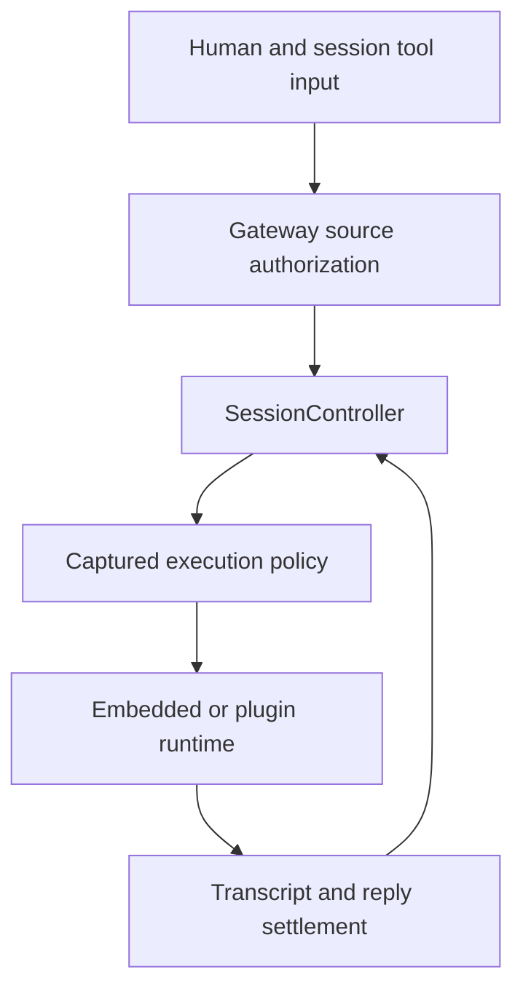

Codex review: needs maintainer review before merge.

## What this changes

This PR consolidates steering authorization, recovery readiness, accepted-input custody, and completion handoffs around the existing SessionController.

**Example:** A user sends “Correction sent during compaction.” while recovery compaction is running.
- **Before:** The original run never receives the correction, which becomes a later turn.
- **After:** The original execution receives the correction once, history records one input, and the pending queue empties.

## Review scores

| Measure | Result | What it means |
|---|---|---|
| **Overall readiness** | 🐚 platinum hermit **(4/6)** | Strong product-path and authority evidence supports the retained fix; the broad lifecycle change and revision-qualified coverage warrant a measured correctness rating. |
| **Proof confidence** | 🦞 diamond lobster **(5/6)** | Sufficient (logs): Published isolated Gateway and real native traces exercise same-requester steering, completion-handoff input, queued automation effects, and revoked-source rejection before I/O; public-RPC recovery-compaction proof is also recorded at the integrated 223d revision, with historical source, scripted-inference, native-version, and fault-injection qualifications preserved. |
| **Patch quality** | 🐚 platinum hermit **(4/6)** | No actionable review findings were identified. |

## Product

**Kind:** Bug fix · **Worth it:** Yes · **Fix scope:** Complete
**User problem:** Valid corrections can miss the active execution, and accepted continuation work can lose its source or delivery custody before dispatch.
**Reason:** Current-source defects and public-Gateway evidence establish user value, and the maintainer's recorded decision resolves the retained completion-context behavior.

## Merge readiness

✅ **Ready for maintainer review**

Keep this PR open: it repairs meaningful session-input failures that remain on main, and the bounded completion-context policy now has maintainer approval; no actionable introduced defect was identified.

**Priority:** P2
**Reviewed head:** `7ee4c15b521b6e78396b7aad75bdf27a90af9d1d`

## Before merge

None.

## Findings

None.

<strong>Agent review details</strong>

### How this fits together

Gateway RPCs, channel input, and session tools feed the SessionController, which checks requester authority and execution compatibility before delivering input through embedded or plugin runtimes and settling its transcript and reply custody.

### Technical review

Best possible solution:

Retain the existing controller as the single lifecycle owner, with independent incoming authorization, exact-target delivery, and receiver-held custody through settlement.

Do we have a high-confidence way to reproduce the issue?

Main's backend-detachment path retains resolved readiness, and the linked public-Gateway comparison records the correction missing its original run on main; this read-only review executed no target code.

Is this the best way to solve the issue?

The retained consolidation addresses the shared ownership boundary, preserves ordinary peer and explicit-followup scheduling, and keeps optional-reply promotion and reconnect-policy proposals separate.

AGENTS.md: found and applied where relevant.

Codex review notes: model internal, reasoning medium; reviewed against [9819d4db1c86](https://github.com/openclaw/openclaw/commit/9819d4db1c86ebab2afc1ebd404bbe09cd776b4a).

### Provenance checked

- `Session input, cancellation, and settlement ownership` keeps the original intent (https://github.com/openclaw/openclaw/pull/175837: Replace competing lifecycle owners with one controller per physical session and retain exact source custody through cleanup and recovery.)
- `Requester identity and current authority` keeps the original intent (https://github.com/openclaw/openclaw/pull/157806: Preserve authenticated requester identity across admission, forwarding, and recovery while independently enforcing revocation and collaboration policy.)
- `Busy-child versus separate-turn peer scheduling` keeps the original intent (https://github.com/openclaw/openclaw/pull/160842: Permit narrow zero-wait guidance to the caller's active child while preserving waited sends, ordinary peers, and explicit followup as separate turns.)
- `Accepted completion authority lifetime` keeps the original intent (https://github.com/openclaw/openclaw/pull/147499: Transfer the verified requester entitlement through child settlement into a fresh run scope that remains valid independently of later batch retirement.)
- `Completion-context steering projection` changes intended behavior with a stated reason (https://github.com/openclaw/openclaw/pull/157806: Incoming overlays previously reconstructed policy provenance; the PR explains retaining the incumbent completion's verified context, and jalehman explicitly accepts that bounded change.)
- `Embedded steering checkpoints` keeps the original intent (https://github.com/openclaw/openclaw/pull/120470: Apply steering before unstarted tools while allowing already-running tools to finish and preserving paired transcript results.)

### Testing

Proof path: shipped entry point.

### Security

None.

### Evidence

What I checked:

- **Pinned PR ownership:** Reviewed the introduced comparison from the pinned base to the actual head; the stale synthetic merge was not used to attribute changes. ([7ee4c15b521b](https://github.com/openclaw/openclaw/commit/7ee4c15b521b6e78396b7aad75bdf27a90af9d1d))
- **Recovery defect remains on main:** Main detaches the backend without replacing its readiness promise; this PR creates readiness for the same operation's replacement backend and releases waiters at finalization or yield. ([`src/sessions/session-controller.operation.ts:579`](https://github.com/openclaw/openclaw/blob/9819d4db1c86ebab2afc1ebd404bbe09cd776b4a/src/sessions/session-controller.operation.ts#L579), [9819d4db1c86](https://github.com/openclaw/openclaw/commit/9819d4db1c86ebab2afc1ebd404bbe09cd776b4a))
- **Recorded product decision:** Repository administrator jalehman explicitly accepted compatible same-requester human input joining a completion execution while retaining its verified policy and independently checking incoming authority: https://github.com/openclaw/openclaw/pull/177698#issuecomment-6322460413.
- **Administrator identity verified:** The repository permission endpoint identifies jalehman as an administrator, supporting the recorded direction decision.
- **Public Gateway regression evidence:** Jalehman's stacked https://github.com/openclaw/openclaw/pull/178985 records twelve public-RPC scenarios passing on this consolidation and the recovery-compaction scenario failing on its main baseline; the separately observed restart-before-recovery deadlock is expressly excluded.
- **Completion authority proof:** The published native receipt correlates an authorized human correction with its captured completion turn and shows incoming-device revocation during preparation preventing native, provider, and transcript input while the original completion finishes normally: https://github.com/openclaw/openclaw/pull/177698#issuecomment-6296128923. ([`src/auto-reply/reply/reply-tool-authority-inbound.ts:39`](https://github.com/openclaw/openclaw/blob/c3efd0744574c6920dda4af1066b6d6058053a54/src/auto-reply/reply/reply-tool-authority-inbound.ts#L39), [c3efd0744574](https://github.com/openclaw/openclaw/commit/c3efd0744574c6920dda4af1066b6d6058053a54))

Likely related people:

- **Peter Steinberger:** Raw commit 67433ff438133a9c0797dab4dc35a82de5ae256f adds extensions/codex/src/app-server/run-attempt-active-turn.ts:393 relative to its recorded parents. This identifies author metadata, not feature responsibility or a PR merger. (role: source-line author; confidence: high; commits: [67433ff43813](https://github.com/openclaw/openclaw/commit/67433ff438133a9c0797dab4dc35a82de5ae256f); files: `extensions/codex/src/app-server/run-attempt-active-turn.ts`)

### PR surface

PR surface statistics unavailable: the file list is incomplete.

### Labels

Label changes:

- add `merge-risk: 🚨 security-boundary`: The patch changes caller-policy projection and transfers requester authority into accepted run custody; the bounded policy tradeoff is explicitly accepted, and current-authority checks remain essential.
- add `proof: sufficient`: Contributor real behavior proof is sufficient.
- add `rating: 🐚 platinum hermit`: Overall readiness is 🐚 platinum hermit; proof is 🦞 diamond lobster and patch quality is 🐚 platinum hermit.
- add `status: 👀 ready for maintainer look`: ClawSweeper has no concrete contributor-facing blocker left for this PR.

Label justifications:

- `P2`: The consolidation repairs bounded steering, recovery, and continuation failures without evidence of an emergency runtime outage.
- `merge-risk: 🚨 security-boundary`: The patch changes caller-policy projection and transfers requester authority into accepted run custody; the bounded policy tradeoff is explicitly accepted, and current-authority checks remain essential.
- `rating: 🐚 platinum hermit`: Overall readiness is 🐚 platinum hermit; proof is 🦞 diamond lobster and patch quality is 🐚 platinum hermit.
- `status: 👀 ready for maintainer look`: ClawSweeper has no concrete contributor-facing blocker left for this PR.
- `proof: sufficient`: Contributor real behavior proof is sufficient.

### Rating scale

6/6 🦀 challenger crab · 5/6 🦞 diamond lobster · 4/6 🐚 platinum hermit · 3/6 🦐 gold shrimp · 2/6 🦪 silver shellfish · 1/6 🧂 unranked krab. Overall follows the weaker of proof and patch quality; ✨ marks media proof (a screenshot, video, or linked artifact) that directly shows the changed behavior.

### Workflow

ClawSweeper edits this one comment on every review. Comment `@clawsweeper re-review` for a fresh review only. Repair and merge execution lanes are retired.

### History

Review history (13 earlier review cycles; latest 8 shown)

<!-- clawsweeper-review-history v=1 total=13 -->
- reviewed 2026-10-20T15:49:46.295Z sha c3efd0744574c6920dda4af1066b6d6058053a54 :: needs real behavior proof before merge. :: none
- reviewed 2026-10-20T17:22:02.778Z sha 0f78424994631408fbeed838bb7df25991d7ba40 :: needs real behavior proof before merge. :: none
- reviewed 2026-10-20T19:18:21.190Z sha 24bb99cfcf9a29a19e484ec85169fd423c009315 :: blocked before merge. :: none
- reviewed 2026-10-20T19:43:52.595Z sha 5d74c50003122fe40da34b36eac16e838e5857d3 :: blocked before merge. :: none
- reviewed 2026-10-20T20:43:39.891Z sha d7cfd0a504836854e7563e94f975f3069629865d :: needs maintainer review before merge. :: none
- reviewed 2026-10-20T21:12:25.503Z sha 7605b4fc8c28a628cd4d6b9a3e63bc9f1304ce10 :: needs maintainer review before merge. :: none
- reviewed 2026-10-20T22:40:39.664Z sha 26d5d608da70226c95e584ce7c8bf875e3068761 :: needs maintainer review before merge. :: none
- reviewed 2026-10-21T05:38:50.148Z sha 223d8959a0d02c4daab9076c037cfedf282d3a3f :: blocked before merge. :: none

_Reviewed October 21, 2026, 6:18 PM ET / 22:18 UTC (Revision 14)._

<!-- clawsweeper-verdict:needs-human item=177698 sha=7ee4c15b521b6e78396b7aad75bdf27a90af9d1d confidence=high updated_at=2026-10-21T22:09:11Z reviewed_at=2026-10-21T22:18:56.563Z lease_owner=github-run-39684299249-1 lease_comment_id=6322465043 source_revision=1d1974e14da57d95c38715f795189bb0ef298b5d821d453cc1bcd4c5c85c9169 hold=not_opted_in findings=0 -->
<!-- clawsweeper-review-state:ready item=177698 sha=7ee4c15b521b6e78396b7aad75bdf27a90af9d1d v=1 -->

<!-- clawsweeper-review-version item=177698 reviewed_at=2026-10-21T22:18:56.563Z sha=7ee4c15b521b6e78396b7aad75bdf27a90af9d1d source_revision=1d1974e14da57d95c38715f795189bb0ef298b5d821d453cc1bcd4c5c85c9169 lease_owner=github-run-39684299249-1 lease_comment_id=6322465043 v=1 -->

<!-- clawsweeper-review item=177698 -->