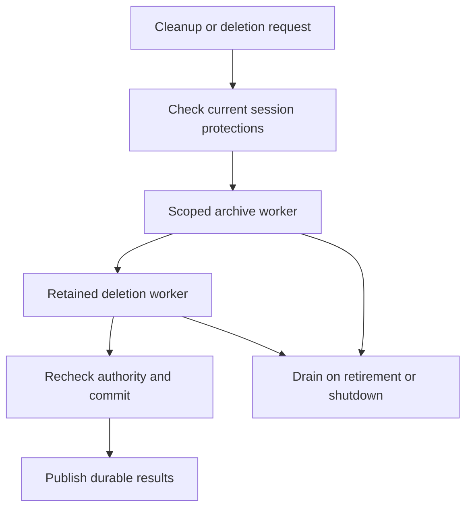

Codex review: blocked before merge. _Reviewed September 13, 2026, 7:45 AM ET / 11:45 UTC (Revision 29)._

# ClawSweeper review

## What this changes

Session cleanup reuses bounded background workers, avoids redundant metadata processing, and moves startup integrity scans off the Gateway thread while preserving archive and deletion ordering.

## Merge readiness

⛔ **Blocked before merge - 5 items remain**

Keep open: this remains useful, maintainer-backed work that current main does not replace. The updated MASSIVE evidence resolves the previous performance blocker, and source review found no blocking correctness defect.

**Priority:** P2
**Reviewed head:** `d49a43e01bf8db330560b7a2f1258bcf733b68c5`

## Review scores

| Measure | Result | What it means |
|---|---|---|
| **Overall readiness** | 🐚 platinum hermit **(4/6)** | Strong runtime evidence and coherent lifecycle ownership support a good patch rating; published-updater acceptance remains the merge blocker. |
| **Proof confidence** | 🦞 diamond lobster **(5/6)** | Sufficient (live_output): The captured body’s current-build Linux Gateway SMOKE, SCALE, and MASSIVE runs exercise the changed cleanup workers with concurrent reads, archive conservation, and observed native shutdown; MASSIVE now passes. This preserves the runtime proof classification while the separately required published-updater handoff remains pending. |
| **Patch quality** | 🐚 platinum hermit **(4/6)** | No actionable review findings were identified. |

## Verification

| Check | Result | Evidence |
|---|---|---|
| **Real behavior** | Verified | Sufficient (live_output): The captured body’s current-build Linux Gateway SMOKE, SCALE, and MASSIVE runs exercise the changed cleanup workers with concurrent reads, archive conservation, and observed native shutdown; MASSIVE now passes. This preserves the runtime proof classification while the separately required published-updater handoff remains pending. |
| **Evidence reviewed** | 9 items | Accepted lifecycle design: The September 12 design decision explicitly accepts one retained reclamation worker, per-operation authority and settlement, 60-second idle retirement, and joined native shutdown; it also requires published-driver update compatibility. https://github.com/openclaw/openclaw/pull/140897#issuecomment-5647899202. Current main still uses per-operation workers: Fetched main still calls the one-shot archive-worker operation for reclamation and publishes after native exit. The retained worker architecture remains a distinct contribution beyond the merged admission and offline-cleanup repairs. Latest-release comparison: The v2026.9.4 source also uses per-operation worker reclamation. The local release blob could not be retrieved through Git’s promisor remote, so the source was inspected through GitHub’s contents API. |
| **Findings** | None | None. |
| **Security** | None | None. |

## How this fits together

OpenClaw’s session storage handles cleanup and deletion requests against per-agent SQLite databases. It protects retained conversations, archives eligible transcripts, commits removals, and publishes results back to Gateway and CLI callers.

## Before merge

- [ ] **Resolve merge risk (P1)** - The actual published 2026.9.4 updater restart handoff remains unverified for this build; retained workers must drain without preventing restart or leaving database leases behind.
- [ ] **Resolve merge risk (P1)** - The source-runtime measurements show higher immediate RSS, including after drainage; sustained memory cost on smaller hosts remains uncharacterized.
- [ ] **Complete next step (P2)** - Complete the actual published 2026.9.4 updater restart handoff on the validated build, confirming retained-worker exit, released leases, preserved state, and healthy restart.
- [ ] **Review config compatibility** - Confirm compatibility and upgrade impact for the changed config or default surface before merge.
- [ ] **Add data-model compatibility proof** - Confirm migration or upgrade compatibility proof before merge.

<strong>Agent review details</strong>

### Security

None.

### PR surface

PR surface statistics unavailable: the file list is incomplete.

### Review metrics

| Metric | Value | Why it matters |
|---|---|---|
| **Production versus test growth** | Production net +1,475 lines; tests/support net +1,864 lines | Production growth implements the accepted worker reuse, admission, and retirement lifecycle rather than new configuration or storage formats. |
| **Current-build MASSIVE acceptance** | 56m21.895s; maximum lifetime gap 477.838 ms | Both the unchanged 60-minute budget and 500 ms responsiveness limit now pass. |

### Stored data model

Persistent data-model change detected: `unknown-truncated-pull-files`. Confirm migration or upgrade compatibility proof before merge.

### Merge-risk options

**Maintainer options:**
1. **Finish the accepted updater check (recommended)**  
   Complete the published 2026.9.4 restart handoff against the validated build, showing retained-worker drainage, state preservation, and healthy restart.

### Technical review

Best possible solution:

Keep bounded reuse within the existing storage owner, with published-updater compatibility established before landing and the measured memory tradeoff retained in the evidence.

Do we have a high-confidence way to reproduce the issue?

Yes for repeated worker startup: current main visibly creates a worker for each reclamation, and the supplied paired workloads exercise that path. Exact latency on fetched main was not reproduced in this read-only review.

Is this the best way to solve the issue?

Yes: the patch extends the existing archive and reclamation owners, preserves per-victim transactions and live guards, and supplies current-build performance evidence; updater acceptance remains outstanding.

AGENTS.md: found and applied where relevant.

Codex review notes: model internal, reasoning medium; reviewed against [abd7a44d0724](https://github.com/openclaw/openclaw/commit/abd7a44d072417690f6a41955ffd99046db4f9bc).

### Labels

Label justifications:

- `P2`: This is a bounded session-cleanup performance improvement with meaningful runtime evidence and no demonstrated emergency regression.
- `merge-risk: 🚨 compatibility`: The changed worker lifetime still needs the explicitly required published-updater restart compatibility check.
- `merge-risk: 🚨 availability`: Retaining worker heaps changes memory headroom, and the measured increase in immediate RSS has not established sustained small-host behavior.
- `rating: 🐚 platinum hermit`: Overall readiness is 🐚 platinum hermit; proof is 🦞 diamond lobster and patch quality is 🐚 platinum hermit.
- `status: 👀 ready for maintainer look`: ClawSweeper has no concrete contributor-facing blocker left for this PR. Sufficient (live_output): The captured body’s current-build Linux Gateway SMOKE, SCALE, and MASSIVE runs exercise the changed cleanup workers with concurrent reads, archive conservation, and observed native shutdown; MASSIVE now passes. This preserves the runtime proof classification while the separately required published-updater handoff remains pending.
- `proof: sufficient`: Contributor real behavior proof is sufficient. The captured body’s current-build Linux Gateway SMOKE, SCALE, and MASSIVE runs exercise the changed cleanup workers with concurrent reads, archive conservation, and observed native shutdown; MASSIVE now passes. This preserves the runtime proof classification while the separately required published-updater handoff remains pending.

### Evidence

What I checked:

- **Accepted lifecycle design:** The September 12 design decision explicitly accepts one retained reclamation worker, per-operation authority and settlement, 60-second idle retirement, and joined native shutdown; it also requires published-driver update compatibility. https://github.com/openclaw/openclaw/pull/140897#issuecomment-5647899202.
- **Current main still uses per-operation workers:** Fetched main still calls the one-shot archive-worker operation for reclamation and publishes after native exit. The retained worker architecture remains a distinct contribution beyond the merged admission and offline-cleanup repairs. ([`src/config/sessions/session-accessor.sqlite-reclamation.ts:481`](https://github.com/openclaw/openclaw/blob/abd7a44d072417690f6a41955ffd99046db4f9bc/src/config/sessions/session-accessor.sqlite-reclamation.ts#L481), [abd7a44d0724](https://github.com/openclaw/openclaw/commit/abd7a44d072417690f6a41955ffd99046db4f9bc))
- **Latest-release comparison:** The v2026.9.4 source also uses per-operation worker reclamation. The local release blob could not be retrieved through Git’s promisor remote, so the source was inspected through GitHub’s contents API. ([`src/config/sessions/session-accessor.sqlite-reclamation.ts`](https://github.com/openclaw/openclaw/blob/3a9d69db306cd7f081e06254cb89c4bcc14a7107/src/config/sessions/session-accessor.sqlite-reclamation.ts), [3a9d69db306c](https://github.com/openclaw/openclaw/commit/3a9d69db306cd7f081e06254cb89c4bcc14a7107))
- **Fresh authority and ordered publication:** Every retained-worker request composes the database claim and request authority, checks them again inside writer admission and commit authorization, and publishes committed removals before releasing the writer. Worker retirement revokes pending commit gates and joins native exit before exact lease-receipt cleanup. ([`src/config/sessions/session-accessor.sqlite-reclamation.ts:413`](https://github.com/openclaw/openclaw/blob/d49a43e01bf8db330560b7a2f1258bcf733b68c5/src/config/sessions/session-accessor.sqlite-reclamation.ts#L413), [d49a43e01bf8](https://github.com/openclaw/openclaw/commit/d49a43e01bf8db330560b7a2f1258bcf733b68c5))
- **Lifecycle regression coverage:** The retained-worker tests exercise per-request async context, revoked admission and commit, queued retirement, database switching, idle reopening, crash cleanup, and mismatched lease receipts while checking preserved victims and native exits. These tests were read, not executed during this review. ([`src/config/sessions/session-accessor.sqlite-reclamation-reuse.test.ts:258`](https://github.com/openclaw/openclaw/blob/d49a43e01bf8db330560b7a2f1258bcf733b68c5/src/config/sessions/session-accessor.sqlite-reclamation-reuse.test.ts#L258), [d49a43e01bf8](https://github.com/openclaw/openclaw/commit/d49a43e01bf8db330560b7a2f1258bcf733b68c5))
- **Complete captured proof body inspected:** The full GitHub body was read and its SHA-256 matched the supplied snapshot, 0ad4c3c2c5e4fa80703127eb5dcc574af52fce296ac5c9014c4b0d8dbeac521c. Current-build SMOKE, SCALE, and MASSIVE report successful cleanup, conservation, concurrent reads, native shutdown, and zero remaining agent leases. MASSIVE completed in 3,381.895 seconds with a 477.838 ms whole-lifetime maximum gap; archive identity is 5ce9c0bf938f23372b59b733fb94c37ce2c6b77be9463f69b28073d3c8deb110. https://github.com/openclaw/openclaw/actions/runs/34751079145. ([d49a43e01bf8](https://github.com/openclaw/openclaw/commit/d49a43e01bf8db330560b7a2f1258bcf733b68c5))

Likely related people:

- **steipete:** Suggested for follow-up; no historical authorship or introduction is verified. (role: unverified routing candidate; confidence: low)

### Rank-up moves

Optional improvements that raise the rating; they are not merge blockers.

- Verify the actual published 2026.9.4 updater restart handoff with a live retained worker using the same validated build.

### Rating scale

| Score | Internal tier | Crab rank | Meaning |
|---:|:---:|---|---|
| **6/6** | S | 🦀 challenger crab | Exceptional readiness |
| **5/6** | A | 🦞 diamond lobster | Very strong readiness |
| **4/6** | B | 🐚 platinum hermit | Good normal PR; ordinary maintainer review |
| **3/6** | C | 🦐 gold shrimp | Useful, but confidence is limited |
| **2/6** | D | 🦪 silver shellfish | Proof or implementation needs work |
| **1/6** | F | 🧂 unranked krab | Not merge-ready |
| N/A | NA | 🌊 off-meta tidepool | Rating does not apply |

Overall follows the weaker of proof and patch quality.
Shiny media proof means a screenshot, video, or linked artifact directly shows the changed behavior. Runtime, network, CSP, and security claims still need visible diagnostics.

### Workflow

- ClawSweeper keeps one durable marker-backed review comment per issue or PR.
- Re-runs edit this comment so the latest verdict, findings, and automation markers stay together instead of adding duplicate bot comments.
- A fresh review can be triggered by eligible `@clawsweeper re-review` comments, exact-item GitHub events, scheduled/background review runs, or manual workflow dispatch.
- PR/issue authors and users with repository write access can comment `@clawsweeper re-review` or `@clawsweeper re-run` on an open PR or issue to request a fresh review only.
- Maintainers can also comment `@clawsweeper review` to request a fresh review only.
- Fresh-review commands do not start repair, autofix, rebase, CI repair, or automerge.
- Maintainer-only repair and merge flows require explicit commands such as `@clawsweeper autofix`, `@clawsweeper automerge`, `@clawsweeper fix ci`, or `@clawsweeper address review`.
- Maintainers can comment `@clawsweeper explain` to ask for more context, or `@clawsweeper stop` to stop active automation.

### History

Review history (28 earlier review cycles; latest 8 shown)

<!-- clawsweeper-review-history v=1 total=28 -->
- reviewed 2026-09-13T08:16:36.339Z sha 81c77fe8ea8c511ac17d05198a552f971a8af138 :: blocked before merge. :: none
- reviewed 2026-09-13T08:34:17.004Z sha 81c77fe8ea8c511ac17d05198a552f971a8af138 :: blocked before merge. :: none
- reviewed 2026-09-13T08:46:18.875Z sha 81c77fe8ea8c511ac17d05198a552f971a8af138 :: blocked before merge. :: none
- reviewed 2026-09-13T09:55:50.701Z sha d49a43e01bf8db330560b7a2f1258bcf733b68c5 :: blocked before merge. :: none
- reviewed 2026-09-13T10:09:40.172Z sha d49a43e01bf8db330560b7a2f1258bcf733b68c5 :: blocked before merge. :: none
- reviewed 2026-09-13T10:21:02.398Z sha d49a43e01bf8db330560b7a2f1258bcf733b68c5 :: blocked before merge. :: none
- reviewed 2026-09-13T10:36:23.215Z sha d49a43e01bf8db330560b7a2f1258bcf733b68c5 :: blocked before merge. :: none
- reviewed 2026-09-13T10:49:04.966Z sha d49a43e01bf8db330560b7a2f1258bcf733b68c5 :: blocked before merge. :: none

<!-- clawsweeper-verdict:needs-human item=140897 sha=d49a43e01bf8db330560b7a2f1258bcf733b68c5 confidence=high updated_at=2026-09-13T11:42:05Z reviewed_at=2026-09-13T11:45:51.455Z lease_owner=github-run-34755020094-1 lease_comment_id=5653039552 source_revision=763fef2d9778dcb6a8669e5aaa227ff68acb35cd7c80556f7429ba5a875f8f88 live_verification=absent -->
<!-- clawsweeper-review-state:blocked item=140897 sha=d49a43e01bf8db330560b7a2f1258bcf733b68c5 v=1 -->

<!-- clawsweeper-review-version item=140897 reviewed_at=2026-09-13T11:45:51.455Z sha=d49a43e01bf8db330560b7a2f1258bcf733b68c5 source_revision=763fef2d9778dcb6a8669e5aaa227ff68acb35cd7c80556f7429ba5a875f8f88 lease_owner=github-run-34755020094-1 lease_comment_id=5653039552 v=1 -->

<!-- clawsweeper-review item=140897 -->