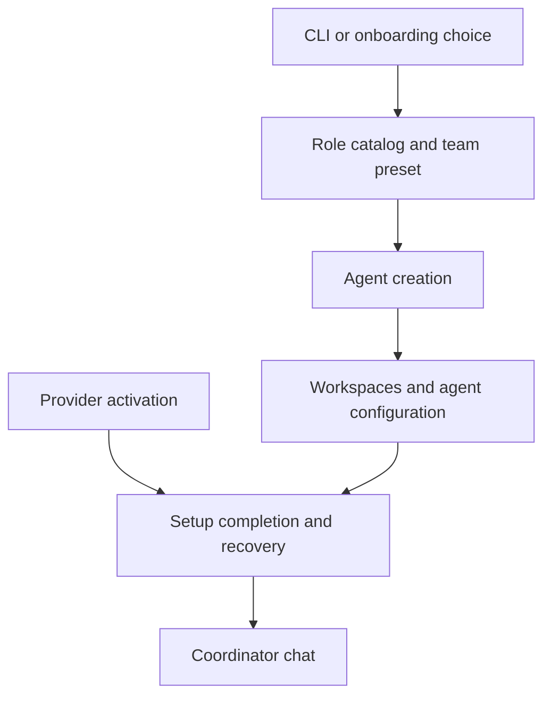

Codex review: blocked before merge. _Reviewed September 12, 2026, 3:04 AM ET / 07:04 UTC._

# ClawSweeper review

## What this changes

Adds four agent role templates, a coordinated-team creation command, and team onboarding with explicit coordinator handoffs.

## Merge readiness

⛔ **Blocked before merge - 5 items remain**

Keep open: this maintainer-sponsored feature remains absent from main, but two previously identified onboarding defects still block merge.

**Priority:** P2
**Reviewed head:** `25ec3121bdf8e88c6e99f78c06f6a368477c2774`

## Review scores

| Measure | Result | What it means |
|---|---|---|
| **Overall readiness** | 🦐 gold shrimp **(3/6)** | Useful provisioning work and concrete CLI proof are offset by two unresolved onboarding lifecycle defects. |
| **Proof confidence** | 🐚 platinum hermit **(4/6)** ✨ media proof bonus | Sufficient (screenshot): Inspected terminal screenshots show the team creation entrypoint producing four agents and persisting identity and delegation settings in isolated state. This supports provisioning; guided activation, receipt completion, and recovery remain separate correctness blockers. |
| **Patch quality** | 🦐 gold shrimp **(3/6)** | 2 actionable review findings remain. |

## Verification

| Check | Result | Evidence |
|---|---|---|
| **Real behavior** | Verified | Sufficient (screenshot): Inspected terminal screenshots show the team creation entrypoint producing four agents and persisting identity and delegation settings in isolated state. This supports provisioning; guided activation, receipt completion, and recovery remain separate correctness blockers. |
| **Evidence reviewed** | 10 items | Verified introduced changes: Inspected the merge-base-to-head changes. The verified test merge has the pinned base followed by the exact PR head as parents; its team creation and setup changes retain both reported failure paths. Still necessary on main: The fetched main revision's agent command registration lacks both --role and team creation. Its tree also lacks the role loader and team service. Release context: The supplied latest release, v2026.9.4, contains none of the new role loader, team service, or bundled role directory. |
| **Findings** | 2 actionable findings | [P1] Preserve the requested team through provider activation [P1] Align the team workspace with setup receipt completion |
| **Security** | None | None. |

## How this fits together

Agent provisioning turns CLI and onboarding choices into workspaces and agent configuration. Guided onboarding connects provider activation, setup recovery, and the agent selected for subsequent chat.

## Before merge

- [ ] **Preserve the requested team through provider activation (P1)** - On fresh guided team onboarding, successful provider activation persists a `main` entry carrying model-runtime metadata before setup runs. `startedWithoutAuthoredRoster` consequently becomes false, skipping both team creation and this coordinator assignment. The subsequent team-workspace assertion fails, and fallback still targets the coordinator that was never created. Preserve approved team intent across activation while distinguishing activation-generated membership from an existing user fleet. This predecessor-review finding remains unresolved.
- [ ] **Align the team workspace with setup receipt completion (P1)** - Fresh guided team onboarding records the parent workspace in `beginLocalOnboarding`, but this layout assigns the ambient coordinator `&lt;parent>/coordinator`. `completeLocalSetupRecovery` compares that child workspace with the recorded parent and throws. Even skipping provider setup therefore leaves a persisted team with a pending receipt instead of completing onboarding. Align receipt creation, completion, and resumed targeting without weakening ownership checks. This predecessor-review finding remains unresolved.
- [ ] **Resolve merge risk (P1)** - Recovery after partial team provisioning remains unproven: created members are retained, and another creation attempt can encounter their existing IDs.
- [ ] **Complete next step (P2)** - Repair both onboarding findings and validate provider activation, receipt completion, and interrupted recovery together.
- [ ] **Add data-model compatibility proof** - Confirm migration or upgrade compatibility proof before merge.

## Findings

- [P1] Preserve the requested team through provider activation — `src/system-agent/setup-apply.ts:289`
- [P1] Align the team workspace with setup receipt completion — `src/agents/agent-team.ts:125-127`

<strong>Agent review details</strong>

### Security

None.

### PR surface

Source +598, Tests +536, Docs +496. Total +1630 across 48 files.

View PR surface stats

| Area | Files | Added | Removed | Net |
|---|---:|---:|---:|---:|
| Source | 20 | 717 | 119 | +598 |
| Tests | 13 | 629 | 93 | +536 |
| Docs | 15 | 502 | 6 | +496 |
| Config | 0 | 0 | 0 | 0 |
| Generated | 0 | 0 | 0 | 0 |
| Other | 0 | 0 | 0 | 0 |
| **Total** | **48** | **1848** | **218** | **+1630** |

### Review metrics

| Metric | Value | Why it matters |
|---|---|---|
| **New CLI option names** | 6: --role, --preset, --coordinator, --prefix, --workspace-root, --team | These expose the new provisioning workflow without introducing configuration schema keys. |

### Stored data model

Persistent data-model change detected: `database schema: docs/reference/templates/roles/coordinator/CLAW.md`, `database schema: docs/reference/templates/roles/presets/team.json`, `database schema: docs/reference/templates/roles/researcher/CLAW.md`, `database schema: docs/reference/templates/roles/reviewer/CLAW.md`, `database schema: docs/reference/templates/roles/writer/CLAW.md`, `database schema: src/agents/agent-roles.ts`. Confirm migration or upgrade compatibility proof before merge.

### Root-cause cluster

Relationship: `canonical`
Canonical: https://github.com/openclaw/openclaw/pull/145712
Summary: This PR is the explicit replacement for the closed, unmerged predecessor; portable export/import was separate work.

Members:
- `superseded`: https://github.com/openclaw/openclaw/pull/141174 - The author closed it for merge-workflow recovery and opened this replacement with the same head.
- `adjacent_distinct`: https://github.com/openclaw/openclaw/pull/141339 - The closed, unmerged proposal concerned portable export/import, not onboarding lifecycle repair.

Proposal only: this assessment does not dispatch repair, suppress jobs, mutate sibling items, close, or merge anything.

### Merge-risk options

**Maintainer options:**
1. **Complete the team onboarding lifecycle (recommended)**  
   Repair team intent and receipt targeting together, then verify successful activation, skipped-provider setup, and interrupted reruns through the real persistence owners.

### Technical review

Best possible solution:

Carry one approved coordinator and workspace target through provider activation, provisioning, receipt completion, and resumable setup while preserving existing fleets.

Do we have a high-confidence way to reproduce the issue?

Yes, from source at the PR head: fresh guided team onboarding fails after provider activation materializes main, or after skipped-provider setup reaches receipt completion. These paths were traced, not executed.

Is this the best way to solve the issue?

Not yet: sharing the Claw reader and agent creation owner is appropriate, but the surrounding onboarding lifecycle still assumes single-agent workspace ownership.

Full review comments:

- [P1] Preserve the requested team through provider activation — `src/system-agent/setup-apply.ts:289`
  On fresh guided team onboarding, successful provider activation persists a `main` entry carrying model-runtime metadata before setup runs. `startedWithoutAuthoredRoster` consequently becomes false, skipping both team creation and this coordinator assignment. The subsequent team-workspace assertion fails, and fallback still targets the coordinator that was never created. Preserve approved team intent across activation while distinguishing activation-generated membership from an existing user fleet. This predecessor-review finding remains unresolved.
  Confidence: 0.98
- [P1] Align the team workspace with setup receipt completion — `src/agents/agent-team.ts:125-127`
  Fresh guided team onboarding records the parent workspace in `beginLocalOnboarding`, but this layout assigns the ambient coordinator `&lt;parent>/coordinator`. `completeLocalSetupRecovery` compares that child workspace with the recorded parent and throws. Even skipping provider setup therefore leaves a persisted team with a pending receipt instead of completing onboarding. Align receipt creation, completion, and resumed targeting without weakening ownership checks. This predecessor-review finding remains unresolved.
  Confidence: 0.99

Overall correctness: patch is incorrect
Overall confidence: 0.98

AGENTS.md: found and applied where relevant.

Codex review notes: model internal, reasoning medium; reviewed against [398e107c5bc0](https://github.com/openclaw/openclaw/commit/398e107c5bc04f43f3db94478b82e2df8f8817bb).

### Labels

Label changes:

- add `P2`: This is a bounded new provisioning feature with onboarding defects to repair before release.
- add `merge-risk: 🚨 session-state`: Guided team setup can retain an unintended main roster or leave a created team attached to a pending setup receipt.
- add `proof: sufficient`: Contributor real behavior proof is sufficient. Inspected terminal screenshots show the team creation entrypoint producing four agents and persisting identity and delegation settings in isolated state. This supports provisioning; guided activation, receipt completion, and recovery remain separate correctness blockers.
- add `proof: 📸 screenshot`: Contributor real behavior proof includes screenshot evidence. Inspected terminal screenshots show the team creation entrypoint producing four agents and persisting identity and delegation settings in isolated state. This supports provisioning; guided activation, receipt completion, and recovery remain separate correctness blockers.
- add `rating: 🦐 gold shrimp`: Overall readiness is 🦐 gold shrimp; proof is 🐚 platinum hermit and patch quality is 🦐 gold shrimp.
- add `status: ⏳ waiting on author`: ClawSweeper has contributor-facing work open and is waiting for author action. Sufficient (screenshot): Inspected terminal screenshots show the team creation entrypoint producing four agents and persisting identity and delegation settings in isolated state. This supports provisioning; guided activation, receipt completion, and recovery remain separate correctness blockers.

Label justifications:

- `P2`: This is a bounded new provisioning feature with onboarding defects to repair before release.
- `merge-risk: 🚨 session-state`: Guided team setup can retain an unintended main roster or leave a created team attached to a pending setup receipt.
- `rating: 🦐 gold shrimp`: Overall readiness is 🦐 gold shrimp; proof is 🐚 platinum hermit and patch quality is 🦐 gold shrimp.
- `status: ⏳ waiting on author`: ClawSweeper has contributor-facing work open and is waiting for author action. Sufficient (screenshot): Inspected terminal screenshots show the team creation entrypoint producing four agents and persisting identity and delegation settings in isolated state. This supports provisioning; guided activation, receipt completion, and recovery remain separate correctness blockers.
- `proof: sufficient`: Contributor real behavior proof is sufficient. Inspected terminal screenshots show the team creation entrypoint producing four agents and persisting identity and delegation settings in isolated state. This supports provisioning; guided activation, receipt completion, and recovery remain separate correctness blockers.
- `proof: 📸 screenshot`: Contributor real behavior proof includes screenshot evidence. Inspected terminal screenshots show the team creation entrypoint producing four agents and persisting identity and delegation settings in isolated state. This supports provisioning; guided activation, receipt completion, and recovery remain separate correctness blockers.

### Evidence

What I checked:

- **Verified introduced changes:** Inspected the merge-base-to-head changes. The verified test merge has the pinned base followed by the exact PR head as parents; its team creation and setup changes retain both reported failure paths. ([`src/system-agent/setup-apply.ts:289`](https://github.com/openclaw/openclaw/blob/25ec3121bdf8e88c6e99f78c06f6a368477c2774/src/system-agent/setup-apply.ts#L289), [25ec3121bdf8](https://github.com/openclaw/openclaw/commit/25ec3121bdf8e88c6e99f78c06f6a368477c2774))
- **Still necessary on main:** The fetched main revision's agent command registration lacks both --role and team creation. Its tree also lacks the role loader and team service. ([`src/cli/program/register.agent.ts:169`](https://github.com/openclaw/openclaw/blob/398e107c5bc04f43f3db94478b82e2df8f8817bb/src/cli/program/register.agent.ts#L169), [398e107c5bc0](https://github.com/openclaw/openclaw/commit/398e107c5bc04f43f3db94478b82e2df8f8817bb))
- **Release context:** The supplied latest release, v2026.9.4, contains none of the new role loader, team service, or bundled role directory. ([3a9d69db306c](https://github.com/openclaw/openclaw/commit/3a9d69db306cd7f081e06254cb89c4bcc14a7107))
- **Provider activation creates roster membership:** Provider credential staging supplies an agent runtime, and model selection materializes an agent entry for that runtime. Activation persists this before guided setup reads its initial roster, causing setup to skip requested team creation. ([`src/system-agent/setup-model-selection.ts:80`](https://github.com/openclaw/openclaw/blob/25ec3121bdf8e88c6e99f78c06f6a368477c2774/src/system-agent/setup-model-selection.ts#L80), [25ec3121bdf8](https://github.com/openclaw/openclaw/commit/25ec3121bdf8e88c6e99f78c06f6a368477c2774))
- **Setup receipt and workspace disagree:** Guided onboarding records the parent workspace at receipt creation. Team provisioning assigns the coordinator a child workspace, while completion requires the resolved ambient workspace to equal the recorded parent. ([`src/system-agent/setup-recovery.ts:44`](https://github.com/openclaw/openclaw/blob/25ec3121bdf8e88c6e99f78c06f6a368477c2774/src/system-agent/setup-recovery.ts#L44), [25ec3121bdf8](https://github.com/openclaw/openclaw/commit/25ec3121bdf8e88c6e99f78c06f6a368477c2774))
- **Predecessor discussion and review continuity:** https://github.com/openclaw/openclaw/pull/141174#issuecomment-5644223735 confirms replacement for a rejected merge-method workflow, with the same branch and head. Its review at https://github.com/openclaw/openclaw/pull/141174#issuecomment-5569725731 already raised both onboarding findings; neither is resolved in the inspected source. ([25ec3121bdf8](https://github.com/openclaw/openclaw/commit/25ec3121bdf8e88c6e99f78c06f6a368477c2774))

Likely related people:

- **steipete:** Suggested for follow-up; no historical authorship or introduction is verified. (role: unverified routing candidate; confidence: low)
- **unknown:** The claimed source-line change could not be verified from bounded local history. (role: source history unknown; confidence: low)

### Rank-up moves

Optional improvements that raise the rating; they are not merge blockers.

- Verify provider activation followed by creation of the selected team through real persistence owners.
- Verify skipped-provider setup completes its receipt and interrupted reruns preserve the team.

### Rating scale

| Score | Internal tier | Crab rank | Meaning |
|---:|:---:|---|---|
| **6/6** | S | 🦀 challenger crab | Exceptional readiness |
| **5/6** | A | 🦞 diamond lobster | Very strong readiness |
| **4/6** | B | 🐚 platinum hermit | Good normal PR; ordinary maintainer review |
| **3/6** | C | 🦐 gold shrimp | Useful, but confidence is limited |
| **2/6** | D | 🦪 silver shellfish | Proof or implementation needs work |
| **1/6** | F | 🧂 unranked krab | Not merge-ready |
| N/A | NA | 🌊 off-meta tidepool | Rating does not apply |

Overall follows the weaker of proof and patch quality.
Shiny media proof means a screenshot, video, or linked artifact directly shows the changed behavior. Runtime, network, CSP, and security claims still need visible diagnostics.

### Workflow

- ClawSweeper keeps one durable marker-backed review comment per issue or PR.
- Re-runs edit this comment so the latest verdict, findings, and automation markers stay together instead of adding duplicate bot comments.
- A fresh review can be triggered by eligible `@clawsweeper re-review` comments, exact-item GitHub events, scheduled/background review runs, or manual workflow dispatch.
- PR/issue authors and users with repository write access can comment `@clawsweeper re-review` or `@clawsweeper re-run` on an open PR or issue to request a fresh review only.
- Maintainers can also comment `@clawsweeper review` to request a fresh review only.
- Fresh-review commands do not start repair, autofix, rebase, CI repair, or automerge.
- Maintainer-only repair and merge flows require explicit commands such as `@clawsweeper autofix`, `@clawsweeper automerge`, `@clawsweeper fix ci`, or `@clawsweeper address review`.
- Maintainers can comment `@clawsweeper explain` to ask for more context, or `@clawsweeper stop` to stop active automation.

<!-- clawsweeper-verdict:needs-human item=145712 sha=25ec3121bdf8e88c6e99f78c06f6a368477c2774 confidence=high updated_at=2026-09-12T07:00:49Z reviewed_at=2026-09-12T07:04:11.880Z lease_owner=github-run-34679516585-1 lease_comment_id=5644340598 source_revision=deab6385c346e25bf13d6a5a8192f1d3473c79c07bdf339a80ee352db831d43f live_verification=absent -->
<!-- clawsweeper-review-state:blocked item=145712 sha=25ec3121bdf8e88c6e99f78c06f6a368477c2774 v=1 -->

<!-- clawsweeper-review-version item=145712 reviewed_at=2026-09-12T07:04:11.880Z sha=25ec3121bdf8e88c6e99f78c06f6a368477c2774 source_revision=deab6385c346e25bf13d6a5a8192f1d3473c79c07bdf339a80ee352db831d43f lease_owner=github-run-34679516585-1 lease_comment_id=5644340598 v=1 -->

<!-- clawsweeper-review item=145712 -->