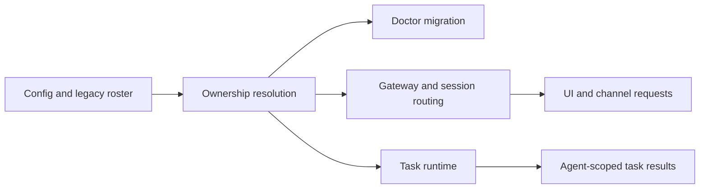

Codex review: needs maintainer review before merge. _Reviewed August 12, 2026, 6:09 PM ET / 22:09 UTC._

# ClawSweeper review

## What this changes

Replaces implicit multi-agent default selection with explicit ownership, migration, and agent-scoped routing across config, sessions, Gateway, task runtime, UI, and plugin discovery.

## Merge readiness

⚠️ **Ready for maintainer review - 4 items remain**

Keep open: this is maintainer-owned, protected ownership work, and current main still selects an omitted agent through the persisted default marker. The local checkout cannot load the exact PR head, so no exact-head merge verdict is safe.

**Priority:** P1
**Reviewed head:** `93fe3c28c2e018f1724c4ed22fda29cefaff6929`
**Owner decision:** Required. See [Decision needed](#decision-needed).

## Review scores

| Measure | Result | What it means |
|---|---|---|
| **Overall readiness** | 🦐 gold shrimp **(3/6)** | The PR has substantial stated validation, but current-head and dependency inspection are unavailable in this environment. |
| **Proof confidence** | 🦐 gold shrimp **(3/6)** | Not applicable: This maintainer-authored PR supplies CI and suite evidence; the external-contributor proof gate does not apply, but exact-head evidence remains unavailable to this reviewer. |
| **Patch quality** | 🦐 gold shrimp **(3/6)** | Security review found an item that needs attention. |

## Verification

| Check | Result | Evidence |
|---|---|---|
| **Real behavior** | Not applicable | Not applicable: This maintainer-authored PR supplies CI and suite evidence; the external-contributor proof gate does not apply, but exact-head evidence remains unavailable to this reviewer. |
| **Evidence reviewed** | 5 items | Current-main default selection remains: When callers omit an agent ID, the resolver chooses the entry marked default or the first agent; this is the ambient-selection behavior the PR proposes to replace. Current-main migration preserves default markers: The roster migration materializes main with default:true and repairs absent or duplicate markers by selecting an effective default, so current main does not already implement the PR's central change. Prior ownership groundwork: Merged commits establish the preceding roster-injection and per-surface ownership work referenced by this PR. |
| **Findings** | None | None. |
| **Security** | Needs attention | Inspect exact-head authorization changes: The supplied PR changes ownership and authorization paths, but the current head is unavailable in this checkout, preventing a conclusive security-boundary review. |

## How this fits together

Agent selection begins with configuration and legacy roster migration, then feeds Gateway/session/task routing and user interfaces. The change makes ownership explicit before those consumers read or mutate agent-scoped state.

## Decision needed

| Question | Recommendation |
|---|---|
| Should this protected maintainer PR remain paused until an exact-head review can inspect the branch and its Codex CLI integration, rather than relying on earlier-head evidence in the body? | **Pause for exact-head evidence:** Wait for accessible exact-head source, current checks, and Codex contract inspection before deciding merge readiness. |

Why: The PR changes compatibility-sensitive ownership and invokes Codex-related behavior, but this reviewer cannot load the current head or sibling Codex source.

## Before merge

- [ ] **Resolve security concern: Inspect exact-head authorization changes** - The supplied PR changes ownership and authorization paths, but the current head is unavailable in this checkout, preventing a conclusive security-boundary review.
- [ ] **Resolve merge risk (P1)** - The PR removes a persisted selection behavior and changes session/task ownership, so upgrade behavior needs exact-head source and migration proof before merge.
- [ ] **Resolve merge risk (P1)** - The exact PR head and Codex dependency source could not be inspected because the checkout lacks the objects and GitHub DNS was unavailable.

## Findings

- [low] Inspect exact-head authorization changes

<strong>Agent review details</strong>

### Security

Needs attention: No concrete vulnerability was established, but the exact-head security-sensitive ownership and Codex CLI changes could not be inspected.

### Review metrics

| Metric | Value | Why it matters |
|---|---|---|
| **Production versus test LOC** | Not computed: exact PR head object unavailable locally | The requested production/test classification cannot be derived safely from the supplied partial file list. |

### Stored data model

Persistent data-model change detected: `database schema: src/state/openclaw-state-schema.sql`, `serialized state: src/sessions/session-lifecycle-events.ts`, `serialized state: src/state/openclaw-state-db.generated.d.ts`, `serialized state: test/non-isolated-runner.test.ts`, `serialized state: ui/src/lib/session-viewer-presence.test.ts`, `serialized state: ui/src/lib/session-viewer-presence.ts`, and 7 more. Migration or upgrade compatibility proof is recorded; maintainers should verify it before merge.

### Merge-risk options

**Maintainer options:**
1. **Verify upgrade ownership (recommended)**  
   Obtain exact-head proof that released multi-agent configurations migrate durable owners and that ambiguous requests return actionable selection errors.
2. **Pause the branch**  
   Keep the maintainer-owned PR open until the unavailable head and dependency evidence can be reviewed.

### Technical review

Best possible solution:

Review the exact current head after its objects and the relevant Codex source are available; retain a single explicit ownership resolver with Doctor-owned migration for released configurations.

Do we have a high-confidence way to reproduce the issue?

No high-confidence runtime reproduction was run. Current main source does show that omitted agent selection resolves through the default marker or first roster entry.

Is this the best way to solve the issue?

Unclear: explicit ownership is consistent with the preceding merged groundwork, but the exact implementation cannot be compared with current main while the PR head is unavailable.

AGENTS.md: found and applied where relevant.

Codex review notes: model internal, reasoning high; reviewed against [5bcbbcf6fdd9](https://github.com/openclaw/openclaw/commit/5bcbbcf6fdd90ff1cc9c84f4cac325e0a12292c0).

### Labels

Label changes:

- add `rating: 🦐 gold shrimp`: Overall readiness is 🦐 gold shrimp; proof is 🦐 gold shrimp and patch quality is 🦐 gold shrimp.
- remove `rating: 🦪 silver shellfish`: Current PR rating is `rating: 🦐 gold shrimp`, so this older rating label is no longer current.

Label justifications:

- `P1`: This changes agent/session selection across active multi-agent Gateway and task workflows.
- `merge-risk: 🚨 compatibility`: Existing persisted default-agent configuration is being retired and migrated.
- `merge-risk: 🚨 session-state`: The intended behavior changes attribution of bare session keys and task ownership.
- `rating: 🦐 gold shrimp`: Overall readiness is 🦐 gold shrimp; proof is 🦐 gold shrimp and patch quality is 🦐 gold shrimp.
- `status: ⏳ waiting on author`: ClawSweeper has contributor-facing work open and is waiting for author action. Not applicable: This maintainer-authored PR supplies CI and suite evidence; the external-contributor proof gate does not apply, but exact-head evidence remains unavailable to this reviewer.

### Evidence

Security concerns:

- [low] Inspect exact-head authorization changes
  The supplied PR changes ownership and authorization paths, but the current head is unavailable in this checkout, preventing a conclusive security-boundary review.
  Confidence: 0.94

What I checked:

- **Current-main default selection remains:** When callers omit an agent ID, the resolver chooses the entry marked default or the first agent; this is the ambient-selection behavior the PR proposes to replace. ([`src/agents/agent-scope-config.ts:144`](https://github.com/openclaw/openclaw/blob/5bcbbcf6fdd9/src/agents/agent-scope-config.ts#L144), [5bcbbcf6fdd9](https://github.com/openclaw/openclaw/commit/5bcbbcf6fdd9))
- **Current-main migration preserves default markers:** The roster migration materializes main with default:true and repairs absent or duplicate markers by selecting an effective default, so current main does not already implement the PR's central change. ([`src/config/legacy.roster.ts:63`](https://github.com/openclaw/openclaw/blob/5bcbbcf6fdd9/src/config/legacy.roster.ts#L63), [5bcbbcf6fdd9](https://github.com/openclaw/openclaw/commit/5bcbbcf6fdd9))
- **Prior ownership groundwork:** Merged commits establish the preceding roster-injection and per-surface ownership work referenced by this PR. ([`src/agents/agent-scope-config.ts:144`](https://github.com/openclaw/openclaw/blob/82d1a03f2559/src/agents/agent-scope-config.ts#L144), [82d1a03f2559](https://github.com/openclaw/openclaw/commit/82d1a03f2559))
- **Exact-head inspection blocked:** The local repository is a promisor checkout without the PR head object; resolving it attempted a fetch, but GitHub DNS was unavailable. The exact diff, LOC split, and current-head source cannot be independently inspected here.
- **Codex dependency gate blocked:** The supplied diff adds TUI coverage for resolving and invoking the Codex CLI, an affirmative dependency signal, but sibling ../codex is absent and cannot be cloned while GitHub DNS is unavailable. (`src/tui/tui.local-auth.test.ts:1`)

Likely related people:

- **steipete:** Peter Steinberger authored the two merged preparatory ownership commits and this PR's supplied commit history. (role: introduced related ownership groundwork; confidence: high; commits: [82d1a03f2559](https://github.com/openclaw/openclaw/commit/82d1a03f2559d15ceb829b855dd16ee193009573), [4bfb26415aed](https://github.com/openclaw/openclaw/commit/4bfb26415aed3fae4a8a85c3b539addfc11cccf0); files: `src/agents/agent-scope-config.ts`, `src/config/legacy.roster.ts`)
- **Vincent Koc:** Current-main blame assigns the default-resolution and roster-migration lines to the recent current-tree commit. (role: recent current-main contributor; confidence: medium; commits: [d82edfc4d225](https://github.com/openclaw/openclaw/commit/d82edfc4d2258b41190821b182fae62a9480896b); files: `src/agents/agent-scope-config.ts`, `src/config/legacy.roster.ts`, `src/gateway/server-methods/agent-id-shared.ts`)

### Rank-up moves

Optional improvements that raise the rating; they are not merge blockers.

- Make the exact PR head available to review and complete the remaining exact-head checks.
- Provide access to the relevant Codex source or a maintained contract reference for the CLI invocation path.

### Rating scale

| Score | Internal tier | Crab rank | Meaning |
|---:|:---:|---|---|
| **6/6** | S | 🦀 challenger crab | Exceptional readiness |
| **5/6** | A | 🦞 diamond lobster | Very strong readiness |
| **4/6** | B | 🐚 platinum hermit | Good normal PR; ordinary maintainer review |
| **3/6** | C | 🦐 gold shrimp | Useful, but confidence is limited |
| **2/6** | D | 🦪 silver shellfish | Proof or implementation needs work |
| **1/6** | F | 🧂 unranked krab | Not merge-ready |
| N/A | NA | 🌊 off-meta tidepool | Rating does not apply |

Overall follows the weaker of proof and patch quality.
Shiny media proof means a screenshot, video, or linked artifact directly shows the changed behavior. Runtime, network, CSP, and security claims still need visible diagnostics.

### Workflow

- ClawSweeper keeps one durable marker-backed review comment per issue or PR.
- Re-runs edit this comment so the latest verdict, findings, and automation markers stay together instead of adding duplicate bot comments.
- A fresh review can be triggered by eligible `@clawsweeper re-review` comments, exact-item GitHub events, scheduled/background review runs, or manual workflow dispatch.
- PR/issue authors and users with repository write access can comment `@clawsweeper re-review` or `@clawsweeper re-run` on an open PR or issue to request a fresh review only.
- Maintainers can also comment `@clawsweeper review` to request a fresh review only.
- Fresh-review commands do not start repair, autofix, rebase, CI repair, or automerge.
- Maintainer-only repair and merge flows require explicit commands such as `@clawsweeper autofix`, `@clawsweeper automerge`, `@clawsweeper fix ci`, or `@clawsweeper address review`.
- Maintainers can comment `@clawsweeper explain` to ask for more context, or `@clawsweeper stop` to stop active automation.

### History

Review history (102 earlier review cycles; latest 8 shown)

<!-- clawsweeper-review-history v=1 total=102 -->
- reviewed 2026-08-12T17:00:52.033Z sha 4d53650f77a778c31d2c74b2325de2a68c99ffcb :: found issues before merge. :: [P1] Reject bare-key task access without an agent
- reviewed 2026-08-12T17:09:23.861Z sha d024485b59ebf48b95c2c062ba3da6652f204b82 :: needs changes before merge. :: [P1] Reject bare-key task access without an agent
- reviewed 2026-08-12T18:00:27.208Z sha 3a20d6595f41d6b77cfdc9d4a9220c1ade662b0a :: found issues before merge. :: [P1] Reject bare-key task access without an agent
- reviewed 2026-08-12T19:17:08.006Z sha 772dc97f3d2b3fc35d434533c282d86760ec5740 :: found issues before merge. :: [P1] Reject task access when caller agent is missing
- reviewed 2026-08-12T20:14:39.479Z sha 8ee396e8e9664cace7277d9c4b65c783cfa0bbf0 :: found issues before merge. :: [P1] Reject bare-key task access without an agent | [P1] Scope managed task flows by agent
- reviewed 2026-08-12T20:30:15.330Z sha 8972aa04e635faed1e2dce806261f30b6f52f56c :: found issues before merge. :: [P1] Reject agentless bare-key task access
- reviewed 2026-08-12T21:07:56.339Z sha 61e8f70f246fecbf29628574b0a78fb3eb4047bc :: found issues before merge. :: [P1] Propagate agent identity into bound task runtimes
- reviewed 2026-08-12T21:33:51.500Z sha 8bfe9d6a5dbb760cfd6bb6daa2dc398c195dceae :: found issues before merge. :: [P1] Propagate agent identity into bound task runtimes

<!-- clawsweeper-security:security-sensitive item=114388 sha=93fe3c28c2e018f1724c4ed22fda29cefaff6929 confidence=high updated_at=2026-08-12T22:06:06Z reviewed_at=2026-08-12T22:09:09.244Z lease_owner=github-run-31645425583-1 lease_comment_id=5273329475 source_revision=7a71fa5949ceb02a27115e61f930f2a5b2bf6f273404028cd6295c51b116c160 -->
<!-- clawsweeper-verdict:needs-human item=114388 sha=93fe3c28c2e018f1724c4ed22fda29cefaff6929 confidence=high updated_at=2026-08-12T22:06:06Z reviewed_at=2026-08-12T22:09:09.244Z lease_owner=github-run-31645425583-1 lease_comment_id=5273329475 source_revision=7a71fa5949ceb02a27115e61f930f2a5b2bf6f273404028cd6295c51b116c160 -->

<!-- clawsweeper-review-version item=114388 reviewed_at=2026-08-12T22:09:09.244Z sha=93fe3c28c2e018f1724c4ed22fda29cefaff6929 source_revision=7a71fa5949ceb02a27115e61f930f2a5b2bf6f273404028cd6295c51b116c160 lease_owner=github-run-31645425583-1 lease_comment_id=5273329475 v=1 -->

<!-- clawsweeper-review item=114388 -->