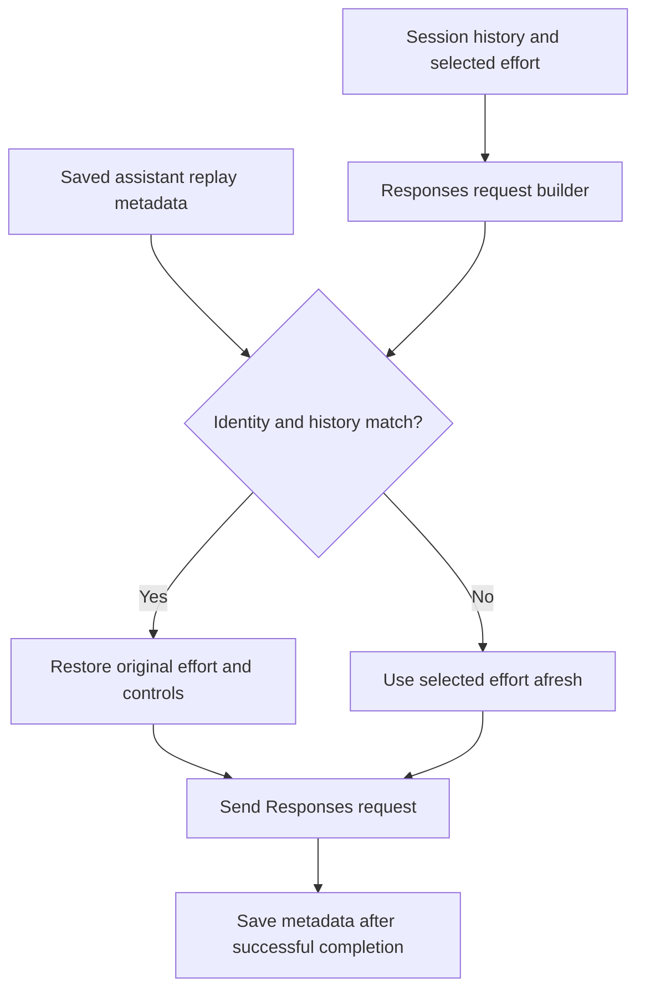

Codex review: needs maintainer review before merge. _Reviewed September 7, 2026, 7:14 AM ET / 11:14 UTC._

# ClawSweeper review

## What this changes

Preserves OpenAI Responses reasoning-effort history across idle expiry and restarts using saved assistant replay metadata, with transcript compatibility tests and updated documentation.

## Merge readiness

✅ **Ready for maintainer review**

This remains useful: fetched main still loses reasoning-update continuity after transport cleanup. The persistence design is explicitly accepted, compatibility coverage addresses the earlier concern, and no blocking introduced defect was found.

**Priority:** P2
**Reviewed head:** `2adced80066e4da87c323f180214a090dd37c253`

## Review scores

| Measure | Result | What it means |
|---|---|---|
| **Overall readiness** | 🐚 platinum hermit **(4/6)** | A focused lifecycle repair with accepted persistence semantics, meaningful compatibility coverage, and no blocking findings. |
| **Proof confidence** | 🌊 off-meta tidepool | Not applicable: The supplied repository state identifies a member-authored PR, so the external-contributor proof gate does not apply. Evidence exercises the actual transcript storage path and synthetic SSE/WebSocket requests, showing restored request equality; live provider cache hits remain unmeasured. |
| **Patch quality** | 🐚 platinum hermit **(4/6)** | No actionable review findings were identified. |

## Verification

| Check | Result | Evidence |
|---|---|---|
| **Real behavior** | Not applicable | Not applicable: The supplied repository state identifies a member-authored PR, so the external-contributor proof gate does not apply. Evidence exercises the actual transcript storage path and synthetic SSE/WebSocket requests, showing restored request equality; live provider cache hits remain unmeasured. |
| **Evidence reviewed** | 9 items | Pinned patch ownership: Inspected the merge-base-to-head changes. Host-verified test-merge evidence identifies the same eight introduced paths; the unrelated skill and security-test changes belong to the base branch. Current main still needs the repair: Fetched main's HTTP continuation owner uses only its in-memory entry and removes entries on idle expiry or cleanup. Its provider documentation explicitly describes fresh requests after expiry or restart; the new durable reasoning-state helper is absent. Replay validation and safe fallback: Restoration checks provider, API, model, endpoint, session, auth profile, compatible settings, control positions, request fingerprint, and normalized history fingerprint. Missing or incompatible metadata returns the original request and never resurrects a previous response handle. |
| **Findings** | None | None. |
| **Security** | None | None. |

## How this fits together

The Responses transport converts session history and model settings into OpenAI requests. Saved replay metadata lets a new connection reconstruct previously accepted reasoning settings while retaining current request and history checks.

## Before merge

None.

<strong>Agent review details</strong>

### Security

None.

### PR surface

Source +170, Tests +221, Docs +7. Total +398 across 8 files.

View PR surface stats

| Area | Files | Added | Removed | Net |
|---|---:|---:|---:|---:|
| Source | 5 | 179 | 9 | +170 |
| Tests | 1 | 256 | 35 | +221 |
| Docs | 2 | 14 | 7 | +7 |
| Config | 0 | 0 | 0 | 0 |
| Generated | 0 | 0 | 0 | 0 |
| Other | 0 | 0 | 0 | 0 |
| **Total** | **8** | **449** | **51** | **+398** |

### Review metrics

| Metric | Value | Why it matters |
|---|---|---|
| **Production versus regression coverage** | Production +170 net lines; tests +221 net lines | Production growth implements durable replay validation while reusing existing control placement; tests exercise expiry, storage reload, and compatibility boundaries. |

### Technical review

Best possible solution:

Keep reasoning lineage in the accepted assistant replay metadata, preserving existing cold-request behavior whenever identity, settings, or retained history no longer match.

Do we have a high-confidence way to reproduce the issue?

Yes, from source: change reasoning effort between supported Responses turns, clear or expire transport state, then rebuild from saved history; current main has no durable restoration path. This review did not execute that scenario.

Is this the best way to solve the issue?

Yes. The patch repairs the replay lifecycle using existing control-placement and normalization logic, with accepted persistence semantics and explicit legacy fallback coverage.

AGENTS.md: found and applied where relevant.

Codex review notes: model internal, reasoning medium; reviewed against [8ed4d8e50039](https://github.com/openclaw/openclaw/commit/8ed4d8e5003952e1d2883f0a5addb15c130328d1).

### Labels

Label justifications:

- `P2`: This repairs bounded reasoning-prefix continuity and potential cache reuse without evidence of an urgent runtime outage.
- `rating: 🐚 platinum hermit`: Overall readiness is 🐚 platinum hermit; proof is 🌊 off-meta tidepool and patch quality is 🐚 platinum hermit.
- `status: 👀 ready for maintainer look`: ClawSweeper has no concrete contributor-facing blocker left for this PR. Not applicable: The supplied repository state identifies a member-authored PR, so the external-contributor proof gate does not apply. Evidence exercises the actual transcript storage path and synthetic SSE/WebSocket requests, showing restored request equality; live provider cache hits remain unmeasured.

### Evidence

What I checked:

- **Pinned patch ownership:** Inspected the merge-base-to-head changes. Host-verified test-merge evidence identifies the same eight introduced paths; the unrelated skill and security-test changes belong to the base branch. ([2adced80066e](https://github.com/openclaw/openclaw/commit/2adced80066e4da87c323f180214a090dd37c253))
- **Current main still needs the repair:** Fetched main's HTTP continuation owner uses only its in-memory entry and removes entries on idle expiry or cleanup. Its provider documentation explicitly describes fresh requests after expiry or restart; the new durable reasoning-state helper is absent. ([`packages/ai/src/transports/openai-responses-continuation.ts:210`](https://github.com/openclaw/openclaw/blob/8ed4d8e5003952e1d2883f0a5addb15c130328d1/packages/ai/src/transports/openai-responses-continuation.ts#L210), [8ed4d8e50039](https://github.com/openclaw/openclaw/commit/8ed4d8e5003952e1d2883f0a5addb15c130328d1))
- **Replay validation and safe fallback:** Restoration checks provider, API, model, endpoint, session, auth profile, compatible settings, control positions, request fingerprint, and normalized history fingerprint. Missing or incompatible metadata returns the original request and never resurrects a previous response handle. ([`packages/ai/src/transports/openai-responses-reasoning-state.ts:60`](https://github.com/openclaw/openclaw/blob/2adced80066e4da87c323f180214a090dd37c253/packages/ai/src/transports/openai-responses-reasoning-state.ts#L60), [2adced80066e](https://github.com/openclaw/openclaw/commit/2adced80066e4da87c323f180214a090dd37c253))
- **Successful-completion ownership:** The transport records the effective admitted request only after terminal processing and abort/error checks. Compaction replay and compaction output are excluded from durable reasoning capture. ([`packages/ai/src/transports/openai-responses-client.ts:579`](https://github.com/openclaw/openclaw/blob/2adced80066e4da87c323f180214a090dd37c253/packages/ai/src/transports/openai-responses-client.ts#L579), [2adced80066e](https://github.com/openclaw/openclaw/commit/2adced80066e4da87c323f180214a090dd37c253))
- **Accepted persistence design:** The supplied maintainer comment explicitly accepts storing original effort, control positions, and validation hashes in existing assistant replay metadata, with identity fences and unchanged legacy behavior: https://github.com/openclaw/openclaw/pull/141065#issuecomment-5568362036. This addresses the material-persistence checkpoint rather than leaving a new product decision unresolved. Public docs: [`docs/reference/database-schemas.md`](https://docs.openclaw.ai/reference/database-schemas). ([`docs/reference/database-schemas.md:470`](https://docs.openclaw.ai/reference/database-schemas), [2adced80066e](https://github.com/openclaw/openclaw/commit/2adced80066e4da87c323f180214a090dd37c253))
- **Storage and legacy compatibility evidence:** The inspected test appends generated messages through SessionManager, reopens SQLite-backed history, and compares the complete resulting request. Five cases cover current metadata, two legacy shapes, and model/session changes; additional cases cover transport expiry and incompatible settings. The captured body reports 136 passing tests and a pre-fix control with one intended failure and four passing compatibility cases. These are contributor-reported executions, not tests run during this review. ([`packages/ai/src/transports/openai-responses-client.continuation.test.ts:343`](https://github.com/openclaw/openclaw/blob/2adced80066e4da87c323f180214a090dd37c253/packages/ai/src/transports/openai-responses-client.continuation.test.ts#L343), [2adced80066e](https://github.com/openclaw/openclaw/commit/2adced80066e4da87c323f180214a090dd37c253))

Likely related people:

- **steipete:** Suggested for follow-up; no historical authorship or introduction is verified. (role: unverified routing candidate; confidence: low)
- **Markus Hartung:** Suggested for follow-up; no historical authorship or introduction is verified. (role: unverified routing candidate; confidence: low)

### Rating scale

| Score | Internal tier | Crab rank | Meaning |
|---:|:---:|---|---|
| **6/6** | S | 🦀 challenger crab | Exceptional readiness |
| **5/6** | A | 🦞 diamond lobster | Very strong readiness |
| **4/6** | B | 🐚 platinum hermit | Good normal PR; ordinary maintainer review |
| **3/6** | C | 🦐 gold shrimp | Useful, but confidence is limited |
| **2/6** | D | 🦪 silver shellfish | Proof or implementation needs work |
| **1/6** | F | 🧂 unranked krab | Not merge-ready |
| N/A | NA | 🌊 off-meta tidepool | Rating does not apply |

Overall follows the weaker of proof and patch quality.
Shiny media proof means a screenshot, video, or linked artifact directly shows the changed behavior. Runtime, network, CSP, and security claims still need visible diagnostics.

### Workflow

- ClawSweeper keeps one durable marker-backed review comment per issue or PR.
- Re-runs edit this comment so the latest verdict, findings, and automation markers stay together instead of adding duplicate bot comments.
- A fresh review can be triggered by eligible `@clawsweeper re-review` comments, exact-item GitHub events, scheduled/background review runs, or manual workflow dispatch.
- PR/issue authors and users with repository write access can comment `@clawsweeper re-review` or `@clawsweeper re-run` on an open PR or issue to request a fresh review only.
- Maintainers can also comment `@clawsweeper review` to request a fresh review only.
- Fresh-review commands do not start repair, autofix, rebase, CI repair, or automerge.
- Maintainer-only repair and merge flows require explicit commands such as `@clawsweeper autofix`, `@clawsweeper automerge`, `@clawsweeper fix ci`, or `@clawsweeper address review`.
- Maintainers can comment `@clawsweeper explain` to ask for more context, or `@clawsweeper stop` to stop active automation.

### History

Review history (7 earlier review cycles)

<!-- clawsweeper-review-history v=1 total=7 -->
- reviewed 2026-09-07T09:01:56.251Z sha fac838423e70943411d41a5dbb786099f17dc9f2 :: blocked before merge. :: none
- reviewed 2026-09-07T09:17:17.969Z sha fac838423e70943411d41a5dbb786099f17dc9f2 :: blocked before merge. :: none
- reviewed 2026-09-07T09:24:21.751Z sha fac838423e70943411d41a5dbb786099f17dc9f2 :: blocked before merge. :: none
- reviewed 2026-09-07T09:43:08.165Z sha ba46c1932b50eea2988f076ee499bf54a110f4aa :: needs maintainer review before merge. :: none
- reviewed 2026-09-07T10:16:19.281Z sha aa33fae7e46cfd7fc9f40cb0b6623781ff62775b :: needs maintainer review before merge. :: none
- reviewed 2026-09-07T10:28:55.949Z sha aa33fae7e46cfd7fc9f40cb0b6623781ff62775b :: needs maintainer review before merge. :: none
- reviewed 2026-09-07T11:08:31.410Z sha 2adced80066e4da87c323f180214a090dd37c253 :: needs maintainer review before merge. :: none

<!-- clawsweeper-verdict:needs-human item=141065 sha=2adced80066e4da87c323f180214a090dd37c253 confidence=high updated_at=2026-09-07T11:11:51Z reviewed_at=2026-09-07T11:14:30.101Z lease_owner=github-run-34115160296-1 lease_comment_id=5569751967 source_revision=18fbaa7aa4c985249b33e3e37fbcbde4d258d7e3bef030b9375e593c7054cebc live_verification=absent -->
<!-- clawsweeper-review-state:ready item=141065 sha=2adced80066e4da87c323f180214a090dd37c253 v=1 -->

<!-- clawsweeper-review-version item=141065 reviewed_at=2026-09-07T11:14:30.101Z sha=2adced80066e4da87c323f180214a090dd37c253 source_revision=18fbaa7aa4c985249b33e3e37fbcbde4d258d7e3bef030b9375e593c7054cebc lease_owner=github-run-34115160296-1 lease_comment_id=5569751967 v=1 -->

<!-- clawsweeper-review item=141065 -->