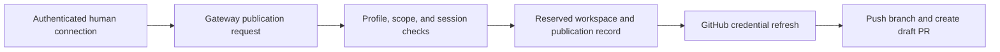

Codex review: needs maintainer review before merge. _Reviewed September 1, 2026, 6:11 AM ET / 10:11 UTC._

# ClawSweeper review

## What this changes

Adds profile-owned GitHub device OAuth and Gateway-brokered personal branch push and draft-PR publication, with matching protocol, storage, Control UI, and mobile model updates.

## Merge readiness

⛔ **Blocked by patch quality or review findings - 6 items remain**

Authority-chain proof required: source-level revalidation is present, but this personal OAuth path can push branches and create draft PRs, so it needs a redacted real Gateway demonstration that both permits the selected owner and rejects disconnected or reassigned ownership before final GitHub I/O.

**Priority:** P1
**Reviewed head:** `95685a9624ea5ebb17b83ea9426e0b7311cdab60`
**Owner decision:** Required. See [Decision needed](#decision-needed).

## Review scores

| Measure | Result | What it means |
|---|---|---|
| **Overall readiness** | 🧂 unranked krab **(1/6)** | PR readiness rating was derived from proof quality, review findings, security review, and reviewer confidence. |
| **Proof confidence** | 🌊 off-meta tidepool | Not applicable: Real behavior proof is not required for maintainer- or bot-authored pull requests. |
| **Patch quality** | 🧂 unranked krab **(1/6)** | Security review found an item that needs attention. |

## Verification

| Check | Result | Evidence |
|---|---|---|
| **Real behavior** | Not applicable | Not applicable: Real behavior proof is not required for maintainer- or bot-authored pull requests. |
| **Evidence reviewed** | 7 items | Closure-bound authorization: The introduced personal-action owner is derived from a current authenticated human Gateway connection and revalidated for profile, role, scope, abort state, and live connection membership.<br>Final-effect checks: The executor invokes authority validation immediately before and after both the Git push and draft pull-request creation.<br>Mocked stale-authority coverage: The test injects socket, scope, disconnect, reconnect, profile-merge, and session changes immediately before push and asserts no mocked push or POST occurs. |
| **Findings** | None | None. |
| **Security** | Needs attention | Real stale-authority denial is unproven: Mocked tests show intended checks, but no redacted real Gateway run demonstrates that disconnect or reassignment is rejected before GitHub push and draft-PR creation. |

## How this fits together

A human Control UI connection asks the Gateway to publish work from a session using that person’s GitHub account. The Gateway verifies the live profile, session, workspace, and OAuth selection before invoking Git and GitHub to push a branch and create a draft pull request.



## Decision needed

| Question | Recommendation |
|---|---|
| May this personal GitHub publication boundary merge without real final-effect authorization proof? | **Require redacted real boundary proof:** Demonstrate an allowed owner completing OAuth and publication, then prove disconnect and reassignment reject before push or PR creation. |

Why: Mocks cover intended fencing, but only a real Gateway and GitHub transport can establish that stale or reassigned authority is rejected before an external effect.

## Before merge

- [ ] **Resolve security concern: Real stale-authority denial is unproven** - Mocked tests show intended checks, but no redacted real Gateway run demonstrates that disconnect or reassignment is rejected before GitHub push and draft-PR creation.
- [ ] **Resolve merge risk (P1)** - Mocked command and Gateway tests do not establish that a real OAuth-selected identity is denied before GitHub push or draft-PR I/O after disconnect or profile reassignment.
- [ ] **Resolve merge risk (P1)** - This adds a persistent personal-publication and OAuth path alongside existing shared publication behavior, so upgrade and operator behavior remain compatibility-sensitive until the real flow is exercised.
- [ ] **Complete next step (P2)** - Protected maintainer review should require real, redacted final-effect authorization evidence; this is not a safe automated repair dispatch.
- [ ] **Improve patch quality** - Resolve the security review concern or explain why the changed path is safe.

## Findings

- [medium] Real stale-authority denial is unproven — `src/gateway/github-publication-executor.ts:485`


<details>
<summary><strong>Agent review details</strong></summary>

### Security

Needs attention: No concrete code bypass was found, but this authority-changing OAuth and publication path lacks real final-effect proof.

### PR surface

PR surface statistics unavailable: the file list is incomplete.

### Review metrics

| Metric | Value | Why it matters |
|---|---|---|
| **PR-reported implementation size** | production +3,830; tests/support +4,230 | This is a large cross-layer feature, so the protected maintainer review and real authorization proof must cover the end-to-end boundary rather than only unit paths. |

### Stored data model

Persistent data-model change detected: `serialized state: scripts/protocol-gen-kotlin.ts`, `serialized state: src/agents/worktrees/registry.ts`, `serialized state: src/agents/worktrees/run-lease-owner.ts`, `unknown-data-model-change: packages/gateway-protocol/src/schema/session-github-publication.ts`, `unknown-data-model-change: packages/gateway-protocol/src/schema/users.ts`, `unknown-data-model-change: scripts/protocol-gen-kotlin.ts`, and 3 more. Confirm migration or upgrade compatibility proof before merge.

### Root-cause cluster

Relationship: `fixed_by_candidate`
Canonical: https://github.com/openclaw/openclaw/issues/133590
Summary: This PR is the candidate implementation of the accepted personal GitHub connection and publication feature in #133590.

Members:
- `canonical`: https://github.com/openclaw/openclaw/issues/133590 - The branch’s feature-introduction commit explicitly references this accepted design issue.
- `adjacent_distinct`: https://github.com/openclaw/openclaw/pull/134351 - The related merged work addresses a separate GitHub credential-handling concern and does not replace personal publication.

Proposal only: this assessment does not dispatch repair, suppress jobs, mutate sibling items, close, or merge anything.

### Merge-risk options

**Maintainer options:**
1. **Prove final authorization at real GitHub I/O (recommended)**  
   Add a redacted real Gateway run covering allowed publication and stale-owner rejection before both push and draft-PR creation.
2. **Pause until a safe proof environment exists**  
   Do not merge the personal-publication path until real OAuth and final-effect authority proof can be captured without exposing credentials.

<details>
<summary>Copy recommended automerge instruction</summary>

```text
@clawsweeper automerge

Special instructions:
Require redacted real Gateway proof of allowed personal publication and disconnect/reassignment denial before push and draft-PR creation.
```

</details>

### Technical review

Best possible solution:

Add redacted real Gateway proof for successful device authorization, account selection, push, and draft PR creation, plus disconnect and ownership-reassignment denial before final I/O.

Do we have a high-confidence way to reproduce the issue?

Not applicable: this is a feature PR, not a report of broken existing behavior; its mocked authority scenarios are source-readable but not real-effect reproduction evidence.

Is this the best way to solve the issue?

Unclear: closure-bound checks at the publication owner and final-effect executor are the appropriate design direction, but the required real authorization proof is absent.

AGENTS.md: found and applied where relevant.

Codex review notes: model internal, reasoning high; reviewed against [02a509a3277f](https://github.com/openclaw/openclaw/commit/02a509a3277f21798cae4d0fda725397834d83e4).

### Labels

Label justifications:

- `P1`: The PR introduces a security-sensitive publication workflow that can create external GitHub effects and is not yet proven at its final boundary.
- `merge-risk: 🚨 compatibility`: It adds new persisted personal-publication state and alters how existing session publication flows select credentials and owners.
- `merge-risk: 🚨 auth-provider`: The new device OAuth and account-selection path determines which GitHub credential may publish.
- `merge-risk: 🚨 security-boundary`: A live human connection’s authority is carried to Git push and draft-PR creation, but real stale-authority denial remains unproven.
- `rating: 🧂 unranked krab`: Overall readiness is 🧂 unranked krab; proof is 🌊 off-meta tidepool and patch quality is 🧂 unranked krab.
- `status: ⏳ waiting on author`: ClawSweeper has contributor-facing work open and is waiting for author action. Not applicable: Real behavior proof is not required for maintainer- or bot-authored pull requests.

### Evidence

Security concerns:

- [medium] Real stale-authority denial is unproven — `src/gateway/github-publication-executor.ts:485`
  Mocked tests show intended checks, but no redacted real Gateway run demonstrates that disconnect or reassignment is rejected before GitHub push and draft-PR creation.
  Confidence: 0.94

Acceptance criteria:

- [P1] Run a redacted real Gateway device-OAuth flow with the intended owner, selected account, push, and draft-PR creation.
- [P1] Repeat with disconnect immediately before push and profile reassignment immediately before draft-PR creation; verify each rejects before external I/O.

What I checked:

- **Closure-bound authorization:** The introduced personal-action owner is derived from a current authenticated human Gateway connection and revalidated for profile, role, scope, abort state, and live connection membership. ([`src/gateway/server-methods/github-personal-authorization.ts:120`](https://github.com/openclaw/openclaw/blob/95685a9624ea/src/gateway/server-methods/github-personal-authorization.ts#L120), [95685a9624ea](https://github.com/openclaw/openclaw/commit/95685a9624ea))
- **Final-effect checks:** The executor invokes authority validation immediately before and after both the Git push and draft pull-request creation. ([`src/gateway/github-publication-executor.ts:483`](https://github.com/openclaw/openclaw/blob/95685a9624ea/src/gateway/github-publication-executor.ts#L483), [95685a9624ea](https://github.com/openclaw/openclaw/commit/95685a9624ea))
- **Mocked stale-authority coverage:** The test injects socket, scope, disconnect, reconnect, profile-merge, and session changes immediately before push and asserts no mocked push or POST occurs. ([`src/gateway/github-personal-publication.test.ts:470`](https://github.com/openclaw/openclaw/blob/95685a9624ea/src/gateway/github-personal-publication.test.ts#L470), [95685a9624ea](https://github.com/openclaw/openclaw/commit/95685a9624ea))
- **External GitHub API boundary:** Credential verification directly calls GitHub’s fixed /user endpoint with bearer authentication and redirect refusal, making real OAuth/API behavior part of this feature’s proof requirement. ([`src/agents/github-oauth-client.ts:286`](https://github.com/openclaw/openclaw/blob/95685a9624ea/src/agents/github-oauth-client.ts#L286), [95685a9624ea](https://github.com/openclaw/openclaw/commit/95685a9624ea))
- **Separate durable request ownership:** Personal publication requests are persisted in a new table explicitly separated from older shared publication requests, carrying owner, connection generation, session, identity, and effect facts. ([`src/state/openclaw-state-schema.sql:2178`](https://github.com/openclaw/openclaw/blob/95685a9624ea/src/state/openclaw-state-schema.sql#L2178), [95685a9624ea](https://github.com/openclaw/openclaw/commit/95685a9624ea))
- **Current-main necessity:** Fetched main still exposes only the shared session publication coordinator; it has no personal GitHub implementation under the affected Gateway, agent, state, or protocol paths. ([`src/gateway/server-methods/sessions-github.ts:12`](https://github.com/openclaw/openclaw/blob/02a509a3277f/src/gateway/server-methods/sessions-github.ts#L12), [02a509a3277f](https://github.com/openclaw/openclaw/commit/02a509a3277f))

Likely related people:

- **steipete:** Suggested for follow-up; no historical authorship or introduction is verified. (role: unverified routing candidate; confidence: low)

### Rating scale

| Score | Internal tier | Crab rank | Meaning |
|---:|:---:|---|---|
| **6/6** | S | 🦀 challenger crab | Exceptional readiness |
| **5/6** | A | 🦞 diamond lobster | Very strong readiness |
| **4/6** | B | 🐚 platinum hermit | Good normal PR; ordinary maintainer review |
| **3/6** | C | 🦐 gold shrimp | Useful, but confidence is limited |
| **2/6** | D | 🦪 silver shellfish | Proof or implementation needs work |
| **1/6** | F | 🧂 unranked krab | Not merge-ready |
| N/A | NA | 🌊 off-meta tidepool | Rating does not apply |

Overall follows the weaker of proof and patch quality.
Shiny media proof means a screenshot, video, or linked artifact directly shows the changed behavior. Runtime, network, CSP, and security claims still need visible diagnostics.

### Workflow

- ClawSweeper keeps one durable marker-backed review comment per issue or PR.
- Re-runs edit this comment so the latest verdict, findings, and automation markers stay together instead of adding duplicate bot comments.
- A fresh review can be triggered by eligible `@clawsweeper re-review` comments, exact-item GitHub events, scheduled/background review runs, or manual workflow dispatch.
- PR/issue authors and users with repository write access can comment `@clawsweeper re-review` or `@clawsweeper re-run` on an open PR or issue to request a fresh review only.
- Maintainers can also comment `@clawsweeper review` to request a fresh review only.
- Fresh-review commands do not start repair, autofix, rebase, CI repair, or automerge.
- Maintainer-only repair and merge flows require explicit commands such as `@clawsweeper autofix`, `@clawsweeper automerge`, `@clawsweeper fix ci`, or `@clawsweeper address review`.
- Maintainers can comment `@clawsweeper explain` to ask for more context, or `@clawsweeper stop` to stop active automation.

### History

<details>
<summary>Review history (2 earlier review cycles)</summary>

<!-- clawsweeper-review-history v=1 total=2 -->
- reviewed 2026-09-01T09:12:55.961Z sha 5f96495de2658d3e28394c0992e9ef74f96c87c3 :: needs real behavior proof before merge. :: [P1] Generate the confirmation result for mobile clients
- reviewed 2026-09-01T09:51:12.385Z sha 95685a9624ea5ebb17b83ea9426e0b7311cdab60 :: needs maintainer review before merge. :: none

</details>

</details>

<!-- clawsweeper-security:security-sensitive item=133799 sha=95685a9624ea5ebb17b83ea9426e0b7311cdab60 confidence=medium updated_at=2026-09-01T10:06:11Z reviewed_at=2026-09-01T10:11:13.998Z lease_owner=github-run-33495505970-1 lease_comment_id=5492322099 source_revision=0fd974fb5971b586307e9278f84b39956775279c8294a43f2f891b8b998cdfe0 live_verification=absent -->
<!-- clawsweeper-verdict:needs-human item=133799 sha=95685a9624ea5ebb17b83ea9426e0b7311cdab60 confidence=medium updated_at=2026-09-01T10:06:11Z reviewed_at=2026-09-01T10:11:13.998Z lease_owner=github-run-33495505970-1 lease_comment_id=5492322099 source_revision=0fd974fb5971b586307e9278f84b39956775279c8294a43f2f891b8b998cdfe0 live_verification=absent -->

<!-- clawsweeper-review-version item=133799 reviewed_at=2026-09-01T10:11:13.998Z sha=95685a9624ea5ebb17b83ea9426e0b7311cdab60 source_revision=0fd974fb5971b586307e9278f84b39956775279c8294a43f2f891b8b998cdfe0 lease_owner=github-run-33495505970-1 lease_comment_id=5492322099 v=1 -->

<!-- clawsweeper-review item=133799 -->